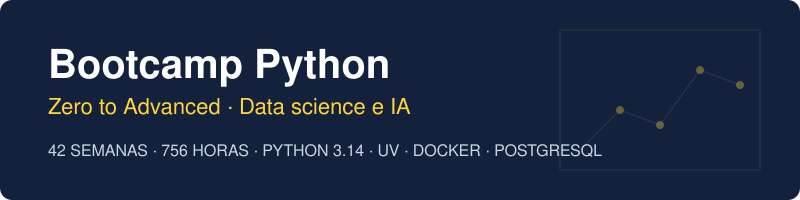

<p align="center">
  
</p>

<p align="center">
  <a href="LICENSE"></a>
  <a href="#"></a>
  <a href="#"></a>
  <a href="docs/stack-versions.md"></a>
  <a href="docs/stack-versions.md"></a>
  <a href="docs/stack-versions.md"></a>
</p>

<p align="center">
  <a href="README_EN.md"></a>
</p>

---

## 📋 Descripción

Bootcamp **Zero to Advanced** de **42 semanas (~10 meses)** de Python moderno, con **énfasis en data science e inteligencia artificial**. Autoestudio asincrónico, **18 h/semana**, 100% práctico. Empiezas sin saber programar y terminas con un sistema propio que recoge, guarda, analiza y predice datos de tu dominio, y responde preguntas sobre ellos con un LLM.

### 🎯 Objetivos

Al finalizar el bootcamp serás capaz de:

- ✅ Escribir Python 3.14 idiomático, tipado y probado, desde el primer script
- ✅ Gestionar proyectos con `uv` (`pyproject.toml`, `uv.lock`) y correrlos en Docker
- ✅ Diseñar con clases, `dataclasses`, `Protocol` y Pydantic, y verificarlo con mypy
- ✅ Probar con pytest: fixtures, mocks, tests por propiedades y cobertura
- ✅ Programar concurrencia con threads, procesos y asyncio
- ✅ Consumir APIs con httpx y persistir en PostgreSQL con SQLAlchemy 2 y Alembic
- ✅ Servir tu proyecto con FastAPI y entregarlo con CI e imagen Docker segura
- ✅ Analizar datos con NumPy, pandas, Polars y DuckDB, y comunicarlos con gráficos y estadística
- ✅ Entrenar y evaluar modelos con scikit-learn y PyTorch
- ✅ Construir aplicaciones con LLMs: salida estructurada, tool use, RAG con pgvector y agentes con MCP
- ✅ Llevar un modelo a producción con MLflow y monitorizar su drift
- ✅ Reconocer y mitigar riesgos de seguridad, privacidad y sesgo en sistemas de IA

### 🐍 ¿Por qué Python con énfasis en datos e IA?

> Python es el lenguaje con el que hoy se analiza, se entrena y se pone en producción la IA.

NumPy, pandas, scikit-learn, PyTorch y los SDK de los principales proveedores de LLM son Python primero. Por eso casi la mitad del bootcamp (fases 4 y 5, 20 semanas) es data science, ML e IA. Las 22 semanas anteriores no son relleno: sin buen Python, tipos, tests, concurrencia y bases de datos, un notebook nunca llega a producción.

---

## 🗓️ Estructura del Bootcamp

| Fase | Semanas | Horas | Temas principales |
|:--:|:--:|:--:|---|
| **1 Fundamentos** | 1-8 | 144 h | Entorno Docker + uv, tipos, control de flujo, funciones, colecciones, algoritmos, archivos, proyectos uv |
| **2 Python idiomático** | 9-15 | 126 h | Clases, `Protocol`, data model, decoradores, typing estricto, Pydantic, testing profesional, CLI |
| **3 Python profesional** | 16-22 | 126 h | Concurrencia, asyncio, HTTP, PostgreSQL, FastAPI, CI y Docker, performance |
| **4 Data science** | 23-30 | 144 h | NumPy, pandas, Polars, DuckDB, visualización, estadística, EDA y notebooks |
| **5 IA y ML** | 31-42 | 216 h | scikit-learn, PyTorch, Transformers, LLMs, RAG, agentes y MCP, MLOps, IA segura, capstone |

**Total: 42 semanas** | **756 horas** | Índice con el estado de cada semana: [bootcamp/README.md](bootcamp/README.md) · Decisión de ritmo: [docs/decision-semanas.md](docs/decision-semanas.md)

### 🧭 Proyecto hilo conductor

Un solo repositorio, el **Observatorio de datos** de tu dominio (calidad del aire, agricultura, turismo, mesa de ayuda…), que crece cada semana: de un script que lee un CSV a un sistema con API, PostgreSQL, análisis, modelos y un asistente con RAG. Detalle en [docs/proyecto-hilo-conductor.md](docs/proyecto-hilo-conductor.md); elige tu dominio en [docs/dominios.md](docs/dominios.md).

---

## 📚 Contenido por Semana

```
bootcamp/week-NN-tema_principal/
├── README.md                 # Objetivos, tiempos (18 h), entregables
├── rubrica-evaluacion.md     # Conocimiento 30% · Desempeño 40% · Producto 30%
├── 0-assets/                 # Diagramas SVG que apoyan la teoría
├── 1-teoria/                 # Teoría con ejemplos paso a paso
├── 2-practicas/              # Ejercicios guiados: starter con tests en rojo
├── 3-proyecto/               # La capa de la semana del Observatorio
├── 4-recursos/               # ebooks-free, videografia, webgrafia
└── 5-glosario/               # Términos clave de la semana
```

Cada ejercicio trae un `starter/` con `pyproject.toml`, `uv.lock` y tests que arrancan en rojo. No hay carpetas de solución: terminas cuando `uv run pytest` queda en verde.

---

## 🛠️ Stack Tecnológico

| Área | Herramientas |
|---|---|
| Base | Python 3.14, uv, Docker + Compose, Git, VS Code |
| Calidad | ruff, mypy, pytest, Hypothesis, pre-commit, GitHub Actions |
| Backend | httpx, PostgreSQL 18, psycopg 3, SQLAlchemy 2, Alembic, FastAPI |
| Datos | NumPy, pandas, Polars, DuckDB, matplotlib, seaborn, plotly, SciPy, statsmodels, JupyterLab |
| IA y ML | scikit-learn, gradient boosting, PyTorch, Hugging Face Transformers, SDK de LLM, pgvector, MCP, MLflow |

Versiones exactas, fechas y revisión de avisos de seguridad: [docs/stack-versions.md](docs/stack-versions.md).

### 📋 Requisitos

| Requisito | Detalle |
|---|---|
| Conocimientos previos | Ninguno de programación. Recomendado: [bc-linux-commandline](https://github.com/ergrato-dev/bc-linux-commandline) y [bc-github](https://github.com/ergrato-dev/bc-github) |
| Equipo | 16 GB de RAM recomendados (8 GB mínimo hasta la fase 4). **No necesitas GPU**: todo el bootcamp, PyTorch incluido, está pensado para CPU, con datasets y modelos dimensionados para entrenar en minutos. Para usar GPU, [Google Colab](https://colab.research.google.com) es la alternativa oficial en los notebooks de las fases 4 y 5 |
| Entorno | Linux, macOS o Windows con WSL2; Docker Engine + plugin `docker compose`, uv |

### 🔗 Para profundizar

Este bootcamp enseña lo justo de cada tema desde la óptica de Python y enlaza a los bootcamps especializados: [bc-fastapi](https://github.com/ergrato-dev/bc-fastapi), [bc-sql](https://github.com/ergrato-dev/bc-sql), [bc-testing](https://github.com/ergrato-dev/bc-testing), [bc-observability](https://github.com/ergrato-dev/bc-observability) y [bc-github-actions](https://github.com/ergrato-dev/bc-github-actions).

---

## 🚀 Inicio Rápido

```bash
git clone https://github.com/ergrato-dev/bc-python.git
cd bc-python
```

1. Prepara tu máquina: [docs/setup.md](docs/setup.md).
2. Recibe tu dominio asignado: [docs/dominios.md](docs/dominios.md).
3. Empieza por la Semana 01 desde el [índice del bootcamp](bootcamp/README.md).

Antes de publicar un cambio en el contenido, desde la raíz:

```bash
./scripts/verificar-enlaces.sh
```

---

## ⚠️ Exención de Responsabilidad

Este repositorio es un recurso **educativo** creado con fines de aprendizaje. Al utilizarlo, aceptas los siguientes términos:

- **Solo fines educativos**: el contenido, los ejemplos de código y los proyectos están diseñados exclusivamente para la enseñanza y el aprendizaje. No constituyen asesoramiento profesional, legal ni de seguridad.
- **Sin garantías**: el material se proporciona **"tal cual"**, sin garantías de ningún tipo, expresas o implícitas, incluyendo idoneidad para un propósito particular o ausencia de errores.
- **Código en producción**: los ejemplos son ilustrativos. Antes de usarlos en producción, haz revisiones de seguridad, rendimiento, coste y adaptación a tu contexto.
- **Modelos y LLMs**: las predicciones y respuestas de los modelos pueden ser erróneas o sesgadas. No las uses para decisiones que afecten a personas sin revisión humana. El uso de APIs de LLM tiene coste: vigila tus claves y tu consumo.
- **Datos personales**: trabaja con datos anonimizados o sintéticos. Si aplicas lo aprendido a datos reales, eres responsable de cumplir la normativa de protección de datos que corresponda.
- **Versiones de software**: las versiones mencionadas pueden quedar desactualizadas. Consulta siempre la documentación oficial más reciente.
- **Limitación de responsabilidad**: los autores no se responsabilizan por pérdidas de datos, daños directos o indirectos, interrupciones de servicio ni cualquier otro perjuicio derivado del uso de este material.
- **Responsabilidad del estudiante**: cada estudiante es responsable de sus propias implementaciones, entornos de desarrollo y decisiones técnicas.

---

## 📄 Licencia

[CC BY-NC-SA 4.0](LICENSE). Este repositorio no acepta pull requests externos; si encuentras un error, abre un issue. Seguridad: [SECURITY.md](SECURITY.md).

---

## 🔗 Navegación

| Anterior | Actual | Siguiente |
| -------- | ------ | --------- |
| — | **Inicio del bootcamp** | [Índice de semanas](bootcamp/README.md) |

→ [Empezar: índice de las 42 semanas](bootcamp/README.md)
