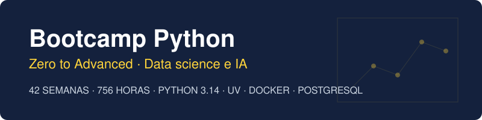

  

  
  
  
  

  

---

## 📋 Description

A **Zero to Advanced** bootcamp of **42 weeks (~10 months)** in modern Python, with a **strong focus on data science and artificial intelligence**. Self-paced and asynchronous, **18 h/week**, 100% hands-on. You start without knowing how to program and finish with your own system that collects, stores, analyzes and predicts data from your domain, and answers questions about it with an LLM.

> The course content is written in Spanish. Code, identifiers and technical names are in English.

## 🗓️ Structure

| Phase | Weeks | Hours | Main topics |
|:--:|:--:|:--:|---|
| **1 Fundamentals** | 1-8 | 144 h | Docker + uv environment, types, control flow, functions, collections, algorithms, files, uv projects |
| **2 Idiomatic Python** | 9-15 | 126 h | Classes, `Protocol`, data model, decorators, strict typing, Pydantic, professional testing, CLI |
| **3 Professional Python** | 16-22 | 126 h | Concurrency, asyncio, HTTP, PostgreSQL, FastAPI, CI and Docker, performance |
| **4 Data science** | 23-30 | 144 h | NumPy, pandas, Polars, DuckDB, visualization, statistics, EDA and notebooks |
| **5 AI and ML** | 31-42 | 216 h | scikit-learn, PyTorch, Transformers, LLMs, RAG, agents and MCP, MLOps, secure AI, capstone |

Week index with status: [bootcamp/README.md](bootcamp/README.md) · Pinned versions: [docs/stack-versions.md](docs/stack-versions.md) · Setup: [docs/setup.md](docs/setup.md).

## 🧭 Thread project

One repository per learner, the **Data Observatory** of their own domain, that grows every week: from a script that reads a CSV to a system with an API, PostgreSQL, analysis, models and a RAG assistant. See [docs/proyecto-hilo-conductor.md](docs/proyecto-hilo-conductor.md) and [docs/dominios.md](docs/dominios.md).

## 📄 License

[CC BY-NC-SA 4.0](LICENSE). This repository does not accept external pull requests; if you find a bug, please open an issue. Security: [SECURITY.md](SECURITY.md).

---

## 🔗 Navigation

→ [Start: index of the 42 weeks](bootcamp/README.md) (content in Spanish)
