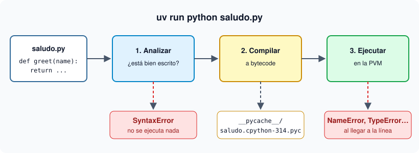

# 02 · Del código a la ejecución

⏱️ 45 min

## 🎯 Objetivos

- Describir qué hace el intérprete con tu archivo `.py`.
- Usar el REPL para probar código línea a línea.
- Distinguir un error de sintaxis de un error en ejecución, y leer un *traceback*.

---

## 1. Qué pasa cuando ejecutas un script



Cuando escribes `python saludo.py`, CPython hace tres cosas:

1. **Lee y analiza** el texto. Si hay un error de escritura (falta un paréntesis), se detiene aquí con un `SyntaxError` y no ejecuta **nada**.
2. **Compila a bytecode**: instrucciones sencillas, independientes de tu procesador. Si el archivo se importa desde otro, guarda ese bytecode en `__pycache__/` (archivos `.pyc`) para no repetir el trabajo la próxima vez.
3. **Ejecuta el bytecode** en la máquina virtual de Python (PVM), instrucción por instrucción. Los errores de esta fase (`NameError`, `TypeError`…) aparecen solo cuando el programa llega a la línea que falla.

### Paso a paso: mira el bytecode

Crea un archivo `saludo.py` con este contenido:

```python
def greet(name):
    return "Hola, " + name
```

Y ejecuta el desensamblador que trae Python (en la semana 1 lo harás con `uv run`, como verás en [03](03-uv-proyectos-y-entornos.md)):

```bash
uv run python -m dis saludo.py
```

En la parte de `greet` verás algo así:

```
  2           LOAD_CONST               0 ('Hola, ')
              LOAD_FAST_BORROW         0 (name)
              BINARY_OP                0 (+)
              RETURN_VALUE
```

Cada línea es una instrucción: carga el texto `'Hola, '`, carga la variable `name`, súmalas (`+`) y devuelve el resultado. No hace falta que memorices los nombres; lo importante es saber que tu código se convierte en esto antes de ejecutarse.

## 2. El REPL: probar sin crear archivos

**REPL** significa *Read-Eval-Print Loop*: lee una línea, la evalúa, imprime el resultado y vuelve a empezar. Es la forma más rápida de probar una idea.

```bash
uv run python
```

Verás el indicador `>>>`. Escribe y pulsa Enter:

```python
>>> 2 + 3
5
>>> "Hola, " + "Ana"
'Hola, Ana'
>>> type(3.5)
<class 'float'>
```

En el REPL no hace falta `print()`: muestra el valor de cada expresión. Desde Python 3.13 el REPL colorea el código, permite editar bloques de varias líneas con las flechas y entiende `exit` sin paréntesis.

| Tecla o comando | Qué hace |
|---|---|
| `↑` / `↓` | Recorre lo que ya escribiste |
| `F1` | Ayuda interactiva (`q` para salir) |
| `F3` | Modo pegado: pega varias líneas sin que se ejecuten una a una |
| `help(print)` | Documentación de `print` |
| `exit` o `Ctrl+D` | Salir del REPL |

## 3. Dos tipos de errores

### Error de sintaxis: el programa no llega a arrancar

```python
print("hola"
```

```
    print("hola"
         ^
SyntaxError: '(' was never closed
```

Python señala con `^` dónde se dio cuenta del problema. Ninguna línea del archivo se ejecuta, ni siquiera las que están antes del error.

### Error en ejecución: el programa arranca y se detiene al llegar

```python
print("Empieza")
print(nombre)
```

```
Empieza
Traceback (most recent call last):
  File "/app/errores.py", line 2, in <module>
    print(nombre)
          ^^^^^^
NameError: name 'nombre' is not defined
```

La primera línea sí se ejecutó (`Empieza`). El **traceback** se lee **de abajo arriba**:

1. Última línea: el tipo de error (`NameError`) y el motivo (`name 'nombre' is not defined`).
2. Encima: el archivo, la línea (`line 2`) y el código que falló, con `^^^^` debajo de la parte culpable.

| Error | Cuándo salta | Ejemplo |
|---|---|---|
| `SyntaxError` | Antes de ejecutar nada | `print("hola"` |
| `NameError` | Al usar un nombre que no existe | `print(nombre)` sin definir `nombre` |
| `TypeError` | Al combinar tipos que no encajan | `"Hola" + 3` → `can only concatenate str (not "int") to str` |
| `ValueError` | El tipo es correcto pero el valor no sirve | `int("4.5")` |

Los errores en ejecución solo aparecen si el programa pasa por esa línea. Por eso escribimos **tests**: hacen pasar al programa por cada caso importante antes de que lo haga un usuario.

## 4. Errores frecuentes

| Síntoma | Causa | Arreglo |
|---|---|---|
| `python: command not found` | Python no está en el `PATH` | Usa siempre `uv run python`, nunca `python` suelto |
| Cambias el archivo y "no pasa nada" | Ejecutas otro archivo u otra carpeta | `pwd` y `ls` antes de ejecutar |
| `IndentationError` | Mezclas espacios y tabuladores, o sangrías distintas | 4 espacios siempre; VS Code lo hace solo con la extensión de Python |
| Te asusta el traceback largo | Muestra toda la cadena de llamadas | Lee solo la última línea y la línea de tu archivo |

---

## ✅ Qué debes saber al terminar

- CPython analiza, compila a bytecode y ejecuta en la PVM; `__pycache__/` guarda bytecode para no repetir trabajo.
- El REPL (`uv run python`) sirve para probar expresiones; muestra los valores sin `print`.
- Un `SyntaxError` impide ejecutar nada; un error en ejecución salta al llegar a la línea.
- El traceback se lee de abajo arriba: tipo de error, motivo, y la línea que falló.

---

## 🔗 Navegación

| Anterior | Actual | Siguiente |
| -------- | ------ | --------- |
| [01 · Qué es Python hoy](01-que-es-python-hoy.md) | **02 · Del código a la ejecución** | [03 · uv: proyectos y entornos](03-uv-proyectos-y-entornos.md) |
