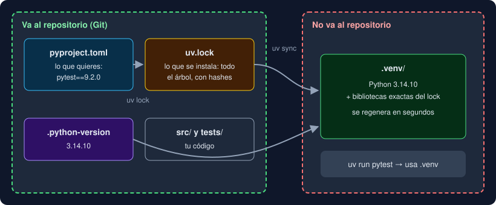

# 03 · uv: proyectos y entornos

⏱️ 55 min

## 🎯 Objetivos

- Explicar qué problema resuelven un entorno virtual y un archivo de bloqueo.
- Crear un proyecto con `uv init`, añadir dependencias con `uv add` y ejecutar con `uv run`.
- Leer un `pyproject.toml` y reconocer cada archivo de un proyecto uv.

---

## 1. El problema: cada proyecto necesita sus versiones

Imagina dos proyectos en tu máquina. Uno necesita `pandas` 2.3 y el otro `pandas` 3.0. Si instalas las bibliotecas "en el sistema", solo puede haber una versión: uno de los dos proyectos se rompe. Y si mañana un compañero instala el proyecto, ¿cómo sabe qué versiones exactas usaste?

| Problema | Solución | Archivo |
|---|---|---|
| Cada proyecto necesita sus propias bibliotecas | Un **entorno virtual** por proyecto: una carpeta con su Python y sus bibliotecas | `.venv/` |
| Saber qué bibliotecas usa el proyecto | Una lista de dependencias directas | `pyproject.toml` |
| Que todos instalen exactamente las mismas versiones, incluidas las indirectas | Un **archivo de bloqueo** (*lock*) con cada versión y su hash | `uv.lock` |
| Que todos usen el mismo Python | La versión fijada del intérprete | `.python-version` |

**uv** es la herramienta que gestiona todo eso: instala Python, crea el entorno, resuelve versiones, escribe el lock y ejecuta tu código. Es un solo programa, muy rápido, y sustituye a `pip`, `venv`, `pyenv` y `pip-tools`. En este bootcamp **nunca usas pip**: con uv cada instalación queda registrada en `pyproject.toml` y `uv.lock`, y nada se instala "a mano" sin dejar rastro.

## 2. Anatomía de un proyecto uv



| Archivo | Lo escribes tú | Va al repositorio | Para qué |
|---|---|---|---|
| `pyproject.toml` | Sí (o `uv add`) | Sí | Nombre, versión de Python aceptada y dependencias directas |
| `uv.lock` | No, lo escribe uv | **Sí** | Versiones exactas de todo el árbol de dependencias |
| `.python-version` | `uv python pin` | Sí | Versión exacta del intérprete |
| `.venv/` | No, lo crea uv | **No** | El entorno: se regenera desde el lock en segundos |

## 3. Paso a paso: tu primer proyecto

Trabaja en una carpeta de pruebas, fuera del repositorio del bootcamp (por ejemplo `~/pruebas`).

**Paso 1. Crea el proyecto.**

```bash
mkdir -p ~/pruebas && cd ~/pruebas
uv init demo
cd demo
```

Salida: `Initialized project `demo` at `/home/<tu-usuario>/pruebas/demo``. uv 0.13 crea un **paquete** con esta estructura:

```
demo/
├── .python-version     # "3.14"
├── README.md
├── pyproject.toml
└── src/
    └── demo/
        └── __init__.py # tiene una función main() que imprime "Hello from demo!"
```

Si tienes Git instalado, también crea `.gitignore` y un repositorio Git vacío.

**Paso 2. Fija la versión exacta de Python.**

```bash
uv python pin 3.14.10
```

Salida: `Updated `.python-version` from `3.14` -> `3.14.10``. Si no tienes esa versión, uv la descarga la primera vez que la necesite.

**Paso 3. Lee el `pyproject.toml`.**

```toml
[project]
name = "demo"
version = "0.1.0"
description = "Add your description here"
readme = "README.md"
requires-python = ">=3.14"
dependencies = []

[project.scripts]
demo = "demo:main"

[build-system]
requires = ["uv_build>=0.13.7,<0.14.0"]
build-backend = "uv_build"
```

| Sección | Qué dice |
|---|---|
| `[project]` | Datos del proyecto. `requires-python` es el rango de Python aceptado; `dependencies`, las bibliotecas que necesita para funcionar |
| `[project.scripts]` | Comandos que instala el proyecto: `demo` ejecuta la función `main` del paquete `demo` |
| `[build-system]` | Con qué se construye el paquete. En el bootcamp fijamos la versión exacta: `uv_build==0.13.7` |

**Paso 4. Ejecuta.**

```bash
uv run demo
```

La primera vez, uv crea `.venv/`, escribe `uv.lock`, instala tu paquete en el entorno y ejecuta el comando: `Hello from demo!`.

**Paso 5. Añade una dependencia de desarrollo.**

`pytest` (la herramienta de tests) solo hace falta mientras desarrollas, no para usar el programa. Por eso va al grupo `dev`:

```bash
uv add --dev pytest==9.2.0
```

uv resuelve versiones, actualiza `uv.lock`, instala y muestra lo que añadió:

```
 + iniconfig==2.3.1
 + packaging==26.3
 + pluggy==1.7.0
 + pygments==2.21.0
 + pytest==9.2.0
```

Pediste una biblioteca y llegaron cinco: las otras cuatro son **dependencias transitivas** (las que necesita pytest). Están todas en `uv.lock`. En `pyproject.toml` aparece solo la que pediste:

```toml
[dependency-groups]
dev = [
    "pytest==9.2.0",
]
```

Mira el árbol completo con `uv tree`.

**Paso 6. Comprueba que `uv run` usa el entorno del proyecto.**

```bash
uv run python -c "import sys; print(sys.prefix)"
```

Imprime la ruta de `.venv` dentro de `demo/`. `uv run` siempre ejecuta dentro del entorno del proyecto, y antes comprueba que el entorno coincide con el lock (si no, lo sincroniza). Por eso no necesitas "activar" nada.

## 4. Los comandos que usarás cada semana

| Comando | Qué hace |
|---|---|
| `uv init <nombre>` | Crea un proyecto nuevo (paquete con `src/`) |
| `uv python pin 3.14.10` | Fija la versión de Python en `.python-version` |
| `uv add <paquete>==<versión>` | Añade una dependencia y actualiza el lock |
| `uv add --dev <paquete>==<versión>` | Añade una dependencia solo de desarrollo |
| `uv remove <paquete>` | La quita |
| `uv sync` | Deja `.venv/` exactamente como dice el lock |
| `uv sync --locked` | Igual, pero **falla** si el lock no coincide con `pyproject.toml` (lo que usan Docker y el CI) |
| `uv run <comando>` | Ejecuta dentro del entorno: `uv run pytest`, `uv run python main.py` |
| `uv lock --check` | Comprueba que el lock está al día, sin cambiar nada |
| `uv tree` | Muestra el árbol de dependencias |

### Proyecto o ejercicio

Los proyectos son **paquetes** (`src/`, `[build-system]`): se instalan y tienen comandos. Los ejercicios de las prácticas son más simples: un archivo `.py` en la raíz y `package = false` en `[tool.uv]`, porque no se instalan; uv solo crea el entorno para ejecutar los tests.

## 5. Errores frecuentes

| Síntoma | Causa | Arreglo |
|---|---|---|
| `error: No 'project' table found` | Ejecutas `uv run` fuera de la carpeta del proyecto | `cd` a la carpeta que tiene `pyproject.toml` |
| `The lockfile ... needs to be updated, but --locked was provided` | Cambiaste `pyproject.toml` sin regenerar el lock | `uv lock` y sube el `uv.lock` nuevo |
| `ModuleNotFoundError: No module named 'pytest'` | Ejecutas `python` o `pytest` sin `uv run` | Antepón siempre `uv run` |
| Subiste `.venv/` a Git | Falta en `.gitignore` | Añade `.venv/` a `.gitignore` y `git rm -r --cached .venv` |
| Un tutorial instala paquetes con otra herramienta | Material pensado sin uv | Aquí es `uv add pandas==<versión>` |

---

## ✅ Qué debes saber al terminar

- Un entorno virtual aísla las bibliotecas de cada proyecto; uv lo crea en `.venv/`.
- `pyproject.toml` declara lo que quieres; `uv.lock` fija lo que se instala, transitivas incluidas. Ambos van al repositorio; `.venv/` no.
- `uv add`, `uv sync` y `uv run` son los tres comandos del día a día.
- `--locked` hace que uv falle en vez de cambiar el lock: así Docker y el CI instalan exactamente lo que probaste.

---

## 🔗 Navegación

| Anterior | Actual | Siguiente |
| -------- | ------ | --------- |
| [02 · Del código a la ejecución](02-del-codigo-a-la-ejecucion.md) | **03 · uv: proyectos y entornos** | [04 · Docker para Python](04-docker-para-python.md) |
