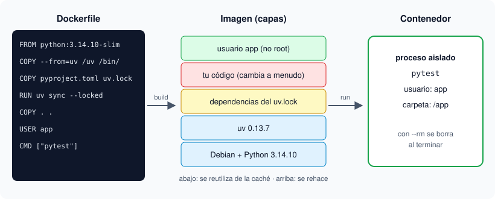

# 04 · Docker para Python

⏱️ 55 min

## 🎯 Objetivos

- Distinguir imagen, contenedor, capa y volumen.
- Leer línea a línea el `Dockerfile` que usan los starters del bootcamp.
- Ejecutar tests dentro de un contenedor con `docker compose run`.

---

## 1. Para qué Docker si ya tienes uv

uv fija las bibliotecas de Python y la versión del intérprete. Pero tu programa también depende de cosas fuera de Python: el sistema operativo, bibliotecas del sistema, y desde la fase 3, servicios como PostgreSQL. **Docker** empaqueta todo eso en una imagen que corre igual en tu portátil, en el de tu compañero y en el servidor.

| Trabajo | Dónde |
|---|---|
| Escribir código, depurar, tests rápidos | Tu máquina, con `uv run` |
| Comprobar que funciona en un entorno limpio | Contenedor, con `docker compose run` |
| Servicios (PostgreSQL, JupyterLab, MLflow) | Contenedores, desde la fase 3 |
| Entregar el programa | Imagen Docker, desde la semana 21 |

## 2. Cuatro palabras



| Palabra | Qué es | Analogía |
|---|---|---|
| **Imagen** | Plantilla de solo lectura: sistema, Python, bibliotecas y tu código | Un instalador |
| **Capa** | Cada instrucción del `Dockerfile` añade una capa. Docker guarda en caché las que no cambian | Un paso de la receta ya hecho |
| **Contenedor** | Un proceso en marcha creado a partir de una imagen, aislado del resto | El programa instalado y abierto |
| **Volumen** | Carpeta que sobrevive al contenedor (la usarás con PostgreSQL) | Un disco externo |

Un contenedor que se borra (`--rm`) no deja nada en tu máquina. La imagen sigue ahí para crear otro.

## 3. El Dockerfile de los starters, línea a línea

Todos los starters que corren en Docker usan este patrón (el del proyecto de esta semana; el ejercicio 02 usa una versión sin pytest):

```dockerfile
FROM ghcr.io/astral-sh/uv:0.13.7 AS uv
FROM python:3.14.10-slim-trixie
COPY --from=uv /uv /uvx /bin/
```

Es un **build multi-stage**: la primera imagen solo sirve para copiar los binarios de uv a la segunda. La imagen final es `python:3.14.10-slim-trixie`: Python 3.14.10 exacto sobre Debian 13 (*trixie*), en su variante reducida (*slim*). Ambas versiones están fijadas: nunca `latest`, porque `latest` cambia sin avisar y el build de mañana deja de ser el de hoy.

```dockerfile
ENV UV_PYTHON_DOWNLOADS=never \
    UV_PROJECT_ENVIRONMENT=/opt/venv \
    UV_COMPILE_BYTECODE=1 \
    UV_LINK_MODE=copy \
    PATH="/opt/venv/bin:$PATH" \
    PYTEST_ADDOPTS="-p no:cacheprovider"
```

| Variable | Para qué | Si no estuviera |
|---|---|---|
| `UV_PYTHON_DOWNLOADS=never` | Usar el Python de la imagen | uv podría descargar otro Python dentro de la imagen |
| `UV_PROJECT_ENVIRONMENT=/opt/venv` | El entorno vive fuera de `/app` | Un volumen montado en `/app` lo taparía |
| `UV_COMPILE_BYTECODE=1` | Genera los `.pyc` al construir | Cada arranque compilaría de nuevo |
| `UV_LINK_MODE=copy` | Copia los archivos en vez de enlazarlos | Avisos de uv porque la caché y el entorno están en sistemas de archivos distintos |
| `PATH=...` | `python` y `pytest` son los del entorno | Habría que escribir `uv run` en cada comando |
| `PYTEST_ADDOPTS` | Sin caché de pytest | Aviso de pytest: el usuario sin privilegios no puede escribir en `/app` |

```dockerfile
WORKDIR /app
COPY pyproject.toml uv.lock .python-version ./
RUN uv sync --locked
COPY . .
```

El orden importa por la **caché de capas**. Las dependencias cambian poco y tu código cambia mucho. Si copiaras todo primero, cada cambio en tu código obligaría a reinstalar todas las bibliotecas. Así, Docker reutiliza la capa de `uv sync` mientras `pyproject.toml` y `uv.lock` no cambien. `--locked` hace que el build falle si el lock no está al día, en vez de instalar otra cosa.

```dockerfile
RUN useradd --create-home --uid 10001 app
USER app
CMD ["pytest"]
```

Por defecto, un contenedor corre como **root**. Si alguien explota un fallo de tu programa, tendría todos los permisos dentro del contenedor. Con `USER app` el proceso corre con un usuario sin privilegios. `CMD` es lo que se ejecuta si no pides otra cosa: los tests.

El archivo `.dockerignore` evita copiar a la imagen `.venv/`, `__pycache__/` y `.git/`: el `.venv/` de tu máquina no sirve dentro del contenedor y haría la imagen más grande.

## 4. compose.yaml y los comandos

```yaml
services:
  app:
    build: .
    image: local/python-en-docker:week-01
```

`compose.yaml` describe los servicios del proyecto. Esta semana hay uno (`app`) que se construye con el `Dockerfile` de la carpeta (`build: .`). Desde la semana 19 añadirás PostgreSQL aquí.

| Comando | Qué hace |
|---|---|
| `docker compose build` | Construye la imagen |
| `docker compose run --build --rm app` | Reconstruye si hace falta, crea un contenedor, ejecuta el `CMD` (los tests) y lo borra |
| `docker compose run --rm app python report.py` | Igual, pero ejecuta otro comando en lugar del `CMD` |
| `docker compose run --rm app python` | Abre el REPL dentro del contenedor |
| `docker image ls` | Lista tus imágenes |
| `docker image rm local/python-en-docker:week-01` | Borra la imagen |

`--build` es importante: el código se **copia** a la imagen al construirla. Sin `--build`, el contenedor ejecuta el código de la última vez que construiste, no el que acabas de guardar.

## 5. Errores frecuentes

| Síntoma | Causa | Arreglo |
|---|---|---|
| `permission denied while trying to connect to the Docker daemon socket` | Tu usuario no está en el grupo `docker` (Linux) | `sudo usermod -aG docker $USER`, cierra sesión y entra de nuevo |
| `Cannot connect to the Docker daemon` | Docker no está arrancado | Abre Docker Desktop, o `sudo systemctl start docker` |
| Cambias el código y el contenedor no ve el cambio | Ejecutaste sin `--build` | `docker compose run --build --rm app` |
| `error: The lockfile at uv.lock needs to be updated` durante el build | `pyproject.toml` cambió y el lock no | `uv lock` en tu máquina y vuelve a construir |
| La imagen tarda mucho la primera vez | Descarga Python y uv (unos 50 MB) | Normal: las siguientes usan la caché |

---

## ✅ Qué debes saber al terminar

- Una imagen es la plantilla; un contenedor, un proceso en marcha creado a partir de ella; cada instrucción del `Dockerfile` es una capa en caché.
- Primero dependencias, después código: así un cambio en el código no reinstala bibliotecas.
- Versiones fijadas en `FROM` (nunca `latest`) y `USER` sin privilegios en cada imagen.
- `docker compose run --build --rm app` construye, ejecuta los tests y limpia.

---

## 🔗 Navegación

| Anterior | Actual | Siguiente |
| -------- | ------ | --------- |
| [03 · uv: proyectos y entornos](03-uv-proyectos-y-entornos.md) | **04 · Docker para Python** | [05 · Variables y tipos](05-variables-y-tipos.md) |
