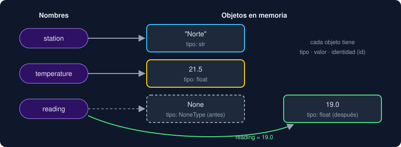

# 05 · Variables y tipos

⏱️ 45 min

## 🎯 Objetivos

- Entender que una variable es un **nombre** que apunta a un **objeto**.
- Reconocer los tipos básicos: `int`, `float`, `bool`, `str` y `None`.
- Convertir entre tipos de forma explícita y saber cuándo falla la conversión.
- Escribir tus primeras anotaciones de tipo y tus primeras funciones con `return`.

---

## 1. Una variable es un nombre, no una caja

```python
temperature = 21.5
```

Esta línea crea un objeto `21.5` de tipo `float` en memoria y le pega la etiqueta `temperature`. El `=` no es "igual": significa "a partir de ahora, este nombre apunta a este objeto".



Cada objeto tiene tres cosas:

| Propiedad | Cómo la ves | Ejemplo con `temperature = 21.5` |
|---|---|---|
| Tipo | `type(temperature)` | `<class 'float'>` |
| Valor | `temperature` | `21.5` |
| Identidad | `id(temperature)` | un número que identifica el objeto mientras existe |

Si reasignas, el nombre pasa a apuntar a otro objeto; el tipo puede cambiar:

```python
>>> reading = 21.5
>>> type(reading)
<class 'float'>
>>> reading = "sin dato"
>>> type(reading)
<class 'str'>
```

Python lo permite (es **tipado dinámico**), pero cambiar el tipo de una variable casi siempre es un error de diseño. Por eso desde hoy anotas el tipo esperado (sección 5).

### Cómo nombrar variables

| Regla | Bien | Mal |
|---|---|---|
| `snake_case`: minúsculas y guion bajo | `max_temperature` | `MaxTemperature`, `maxtemperature` |
| Nombres en inglés y que digan qué contienen | `station_name` | `x`, `dato2`, `nombreEstacion` |
| No empezar por número ni usar espacios | `reading_1` | `1reading`, `my reading` |
| No tapar nombres de Python | `values` | `list`, `type`, `str` |

## 2. Los tipos básicos

| Tipo | Qué representa | Ejemplos | Detalle importante |
|---|---|---|---|
| `int` | Enteros | `0`, `-7`, `1_000_000` | **Sin límite de tamaño**: `2**100` es exacto |
| `float` | Decimales (coma flotante, IEEE 754) | `21.5`, `-0.1`, `1e-3` | **No son exactos**: `0.1 + 0.2` da `0.30000000000000004` |
| `bool` | Verdadero o falso | `True`, `False` | Es un subtipo de `int`: `True + True` da `2` |
| `str` | Texto | `"Hola"`, `'µg/m³'` | Inmutable; comillas simples o dobles, igual |
| `NoneType` | La ausencia de valor | `None` | Hay un solo `None`; se compara con `is` |

### Paso a paso: los dos detalles que más errores causan

**Los `int` no se desbordan.** Abre el REPL (`uv run python`):

```python
>>> 2**100
1267650600228229401496703205376
```

En otros lenguajes, un entero "da la vuelta" al superar un tamaño fijo. En Python, un `int` crece lo que haga falta.

**Los `float` no se comparan con `==`.**

```python
>>> 0.1 + 0.2
0.30000000000000004
>>> 0.1 + 0.2 == 0.3
False
>>> import math
>>> math.isclose(0.1 + 0.2, 0.3)
True
```

Un `float` guarda el número en binario, y `0.1` no tiene representación binaria exacta (como `1/3` no la tiene en decimal: `0.3333…`). `math.isclose` compara con una tolerancia. En la fase 4 esto importa mucho: una media calculada de dos formas distintas casi nunca da el mismo `float` exacto.

### `None` no es `0` ni `""`

`None` significa "no hay dato". `0` es un dato (una temperatura de 0 °C existe). Confundirlos falsea los cálculos: si una medida que falta se guarda como `0`, el promedio baja sin avisar.

```python
>>> reading = None
>>> reading is None
True
>>> 0 is None
False
```

Usa siempre `is None` (no `== None`) para preguntar si falta el dato.

## 3. Conversiones explícitas

Python **no convierte solo** entre texto y números. Lo que llega de un archivo, de un formulario o del teclado es siempre `str`, y tienes que convertirlo tú:

| Conversión | Resultado | Notas |
|---|---|---|
| `int("42")` | `42` | |
| `int(" 42 ")` | `42` | Ignora espacios a los lados |
| `int("4.5")` | `ValueError: invalid literal for int() with base 10: '4.5'` | No adivina si redondear o truncar |
| `int(4.99)` | `4` | De `float` a `int` **trunca** (corta los decimales) |
| `float("3.5")` | `3.5` | |
| `float("3,5")` | `ValueError` | Python usa punto decimal; la coma hay que cambiarla antes |
| `str(21.5)` | `"21.5"` | |
| `bool("False")` | `True` | ¡Cualquier texto no vacío es `True`! |

La última fila sorprende: `bool()` no lee el texto, solo mira si está vacío. Los valores que dan `False` son pocos: `0`, `0.0`, `""`, `None` y `False`. Todo lo demás es `True`.

Para aceptar la coma decimal, cambia la coma por un punto **antes** de convertir. `replace` es un método de `str` (en la semana 2 verás muchos más):

```python
>>> "3,5".replace(",", ".")
'3.5'
>>> float("3,5".replace(",", "."))
3.5
```

Y para quitar espacios a los lados, `strip()`:

```python
>>> "  NA  ".strip()
'NA'
```

## 4. Mostrar valores: `print` y f-strings

`print` muestra valores en la salida, separados por un espacio:

```python
>>> print("Temperatura:", 21.5, "°C")
Temperatura: 21.5 °C
```

Una **f-string** (texto con una `f` delante) inserta valores dentro del texto entre llaves:

```python
>>> station = "Norte"
>>> value = 21.537
>>> f"{station}: {value} °C"
'Norte: 21.537 °C'
>>> f"{station}: {value:.1f} °C"
'Norte: 21.5 °C'
```

`:.1f` significa "como decimal, con 1 cifra después del punto" (y redondea). En la semana 2 verás el formato completo.

## 5. Tus primeras funciones y anotaciones de tipo

El proyecto te pide completar **funciones**: bloques de código con nombre que reciben datos y **devuelven** un resultado con `return`. En la semana 4 las verás a fondo; esto es todo lo que necesitas hoy:

```python
def to_celsius(fahrenheit: float) -> float:
    """Convierte grados Fahrenheit a Celsius."""
    return (fahrenheit - 32) / 1.8
```

| Parte | Qué es |
|---|---|
| `def to_celsius(...)` | Define una función llamada `to_celsius` |
| `fahrenheit: float` | Recibe un dato, llamado `fahrenheit`, que debería ser `float` |
| `-> float` | Devuelve un `float` |
| `"""..."""` | La documentación de la función (*docstring*) |
| `return ...` | El valor que devuelve. La función termina aquí |
| Sangría de 4 espacios | Lo que pertenece a la función |

Para usarla:

```python
>>> to_celsius(212.0)
100.0
```

Las **anotaciones de tipo** (`: float`, `-> float`, también en variables: `count: int = 0`) son documentación que pueden comprobar herramientas como mypy (semana 13). Python **no las comprueba al ejecutar**: `x: int = "hola"` funciona sin error. Por eso las anotas siempre y además escribes tests.

Cuando un valor puede faltar, la anotación lo dice con `| None`:

```python
def parse_value(text: str) -> float | None: ...
```

"Devuelve un `float`, o `None` si no hay dato".

### Una decisión con `if`

Algunas funciones necesitan elegir entre dos resultados. Lo justo para hoy (la semana 2 lo cubre entero):

```python
def describe(value: float | None) -> str:
    if value is None:
        return "sin dato"
    return f"{value:.1f}"
```

Si la condición del `if` es verdadera, se ejecuta el bloque sangrado debajo (y `return` termina la función). Si no, Python sigue con la línea siguiente.

## 6. Errores frecuentes

| Síntoma | Causa | Arreglo |
|---|---|---|
| `TypeError: can only concatenate str (not "int") to str` | `"Total: " + 3` | Usa una f-string: `f"Total: {3}"` |
| `ValueError: could not convert string to float: '3,5'` | Coma decimal | `float(text.replace(",", "."))` |
| Un promedio sale más bajo de lo esperado | Datos faltantes guardados como `0` | Guarda `None` y exclúyelos al calcular |
| `0.1 + 0.2 == 0.3` da `False` | Los `float` no son exactos | `math.isclose(a, b)` |
| Una función "no devuelve nada" (`None`) | Usaste `print` en vez de `return` | `print` muestra; `return` entrega el valor a quien llama |

---

## ✅ Qué debes saber al terminar

- Una variable es un nombre que apunta a un objeto con tipo, valor e identidad.
- `int` no tiene límite; `float` no es exacto y se compara con `math.isclose`.
- `None` es "no hay dato", distinto de `0` y `""`; se pregunta con `is None`.
- Las conversiones son explícitas y pueden fallar con `ValueError`.
- Las anotaciones de tipo documentan; Python no las comprueba al ejecutar.

---

## 🔗 Navegación

| Anterior | Actual | Siguiente |
| -------- | ------ | --------- |
| [04 · Docker para Python](04-docker-para-python.md) | **05 · Variables y tipos** | [Ejercicio 01 · Hola, entorno](../2-practicas/ejercicio-01-hola-entorno/README.md) |
