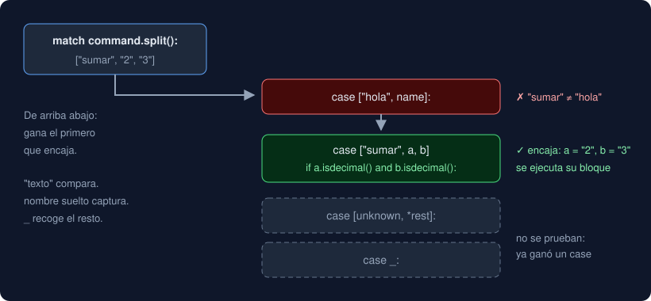

# 02 · Condicionales y `match`

⏱️ 50 min

## 🎯 Objetivos

- Escribir decisiones con `if`, `elif` y `else`, ordenando las condiciones para que cada caso caiga donde debe.
- Usar la expresión condicional (`a if condición else b`) cuando la decisión es un valor.
- Leer y escribir un `match` con literales, alternativas `|`, capturas, guardas y secuencias.
- Elegir entre `if` y `match`.

---

## 1. `if`, `elif`, `else`

En la semana 1 viste un `if` con un `return` dentro. La forma completa:

```python
def classify(value: float) -> str:
    if value < 0:
        return "negativo"
    elif value == 0:
        return "cero"
    else:
        return "positivo"
```

| Parte | Cuándo se ejecuta |
|---|---|
| `if condición:` | Si la condición es verdadera |
| `elif condición:` | Si todas las anteriores fueron falsas y esta es verdadera. Puede haber varios |
| `else:` | Si todas las anteriores fueron falsas. Opcional, siempre la última |

Python evalúa las condiciones **de arriba abajo** y ejecuta **solo el primer bloque** cuya condición es verdadera. El resto no se mira.

El bloque es todo lo que está **sangrado** (4 espacios) bajo la línea que termina en `:`. Si mezclas sangrías, Python se queja con `IndentationError`.

### Paso a paso: el orden de los rangos

Quieres clasificar una nota de 0 a 5: menos de 3.0 es "insuficiente", menos de 4.0 "aceptable", el resto "sobresaliente".

```python
def grade(score: float) -> str:
    if score < 3.0:
        return "insuficiente"
    elif score < 4.0:
        return "aceptable"
    else:
        return "sobresaliente"
```

Prueba con `score = 3.5`:

1. `3.5 < 3.0` es `False`: salta al `elif`.
2. `3.5 < 4.0` es `True`: devuelve `"aceptable"`. El `else` no se mira.

El `elif` no necesita decir `score >= 3.0 and score < 4.0`: si llegaste ahí, ya sabes que `score >= 3.0`. Ese es el truco de los rangos: **de menor a mayor, cada condición asume que las anteriores fallaron**. Si inviertes el orden y pones `score < 4.0` primero, un `2.0` saldría "aceptable".

Prueba siempre los **límites**: con `3.0` exacto, ¿qué debe salir? Aquí `3.0 < 3.0` es `False`, así que `3.0` es "aceptable". Los tests de los ejercicios comprueban justo esos valores.

### `if` sin `return`

Cuando no hay `return` en cada rama, la ejecución sigue después del bloque:

```python
level = "normal"
if value > 50:
    level = "alto"
print(level)
```

## 2. Expresión condicional

Si la decisión solo elige **un valor**, cabe en una línea:

```python
>>> b = 0
>>> result = None if b == 0 else 10 / b
>>> result is None
True
```

Se lee "`None` si `b == 0`, si no `10 / b`". Úsala para elegir valores sencillos; si necesitas `elif`, vuelve al `if` normal.

## 3. `match`: elegir según la forma del dato

`match` compara un valor con una serie de **patrones** (`case`) de arriba abajo y ejecuta el primero que encaja.



### Literales y alternativas

```python
def day_type(day: int) -> str:
    match day:
        case 1 | 2 | 3 | 4 | 5:
            return "laborable"
        case 6 | 7:
            return "fin de semana"
        case _:
            return "inválido"
```

| Patrón | Encaja cuando |
|---|---|
| `case 6:` | El valor es igual a `6` |
| `case 6 \| 7:` | Es `6` **o** `7` (alternativas con `\|`) |
| `case _:` | Siempre. Es el "cualquier otra cosa"; va al final |

Si ningún `case` encaja y no hay `case _`, el `match` no hace nada y la función sigue (y si no hay más código, devuelve `None`).

### Secuencias: desarmar un texto partido

El uso más útil de `match` en esta semana: decidir qué hacer según las palabras de una orden. `"sumar 2 3".split()` parte el texto por los espacios y da una **lista** de palabras (`['sumar', '2', '3']`; las listas son de la semana 5, aquí solo hace falta saber que tienen un orden). `match` compara la lista entera con cada patrón:

```python
def run(command: str) -> str:
    match command.split():
        case ["hola", name]:
            return f"Hola, {name}"
        case ["sumar", a, b]:
            return str(int(a) + int(b))
        case ["salir" | "exit"]:
            return "adiós"
        case [unknown, *rest]:
            return f"comando desconocido: {unknown}"
        case []:
            return ""
```

```python
>>> run("hola Ana")
'Hola, Ana'
>>> run("sumar 2 3")
'5'
>>> run("exit")
'adiós'
>>> run("borrar todo ya")
'comando desconocido: borrar'
>>> run("   ")
''
```

| Patrón | Encaja con | Y además |
|---|---|---|
| `["hola", name]` | Exactamente 2 palabras, la primera `"hola"` | **Captura** la segunda en `name` |
| `["sumar", a, b]` | Exactamente 3 palabras, la primera `"sumar"` | Captura `a` y `b` |
| `["salir" \| "exit"]` | Una palabra, `"salir"` o `"exit"` | — |
| `[unknown, *rest]` | 1 o más palabras | `unknown` es la primera; `rest`, una lista con las demás (puede estar vacía) |
| `[]` | Ninguna palabra (texto vacío o solo espacios) | — |

Un nombre suelto dentro de un patrón (`name`, `a`, `unknown`) **no compara: captura**. Recibe el valor que haya en esa posición. Las comillas marcan lo que se compara: `"hola"` es un literal.

### Guardas: una condición extra con `if`

¿Qué pasa con `run("sumar dos 3")`? El patrón `["sumar", a, b]` encaja (tres palabras) e `int("dos")` lanza `ValueError`. Una **guarda** añade una condición al patrón:

```python
        case ["sumar", a, b] if a.isdecimal() and b.isdecimal():
            return str(int(a) + int(b))
        case ["sumar", *_]:
            return "uso: sumar <entero> <entero>"
```

Si la guarda es falsa, ese `case` no cuenta y `match` sigue probando los siguientes. `str.isdecimal()` es `True` si el texto tiene uno o más dígitos y nada más (`"12"` sí; `"-1"`, `"2.5"`, `""` y `"²"` no). `*_` acepta el resto sin guardarlo.

### La trampa: una constante en un `case` captura

```python
LIMIT = 3
match value:
    case LIMIT:      # NO compara con 3: captura value en LIMIT
        ...
    case _:
        ...
```

Python lo rechaza al compilar: `SyntaxError: name capture 'LIMIT' makes remaining patterns unreachable`. Un nombre suelto siempre captura. Para comparar con una variable, usa una guarda (`case n if n == LIMIT:`) o un `if`.

## 4. ¿`if` o `match`?

| Usa | Cuando |
|---|---|
| `if` / `elif` | Decides por **rangos o condiciones** (`value < 3.0`, `x is None`) |
| `match` | Decides por **valores concretos** (`case 6 \| 7`) o por la **forma** del dato (cuántas palabras, cuál es la primera) |

`match` no es un `switch` de otros lenguajes con otra sintaxis: su fuerza es desarmar datos. Para clasificar una medida por umbrales, `if` es más claro.

## 5. Errores frecuentes

| Síntoma | Causa | Arreglo |
|---|---|---|
| `IndentationError: expected an indented block after 'if' statement` | El bloque bajo `if ...:` no tiene sangría | 4 espacios en cada línea del bloque |
| Un valor cae en el rango equivocado | Condiciones en mal orden | De menor a mayor, cada `elif` asume que las anteriores fallaron |
| La función devuelve `None` sin querer | Ninguna rama hizo `return` (falta `else` o `case _`) | Cubre todos los casos; añade `else` o `case _` |
| `SyntaxError: name capture ... makes remaining patterns unreachable` | Un nombre suelto en un `case` captura todo | Literal entre comillas, o guarda `if n == LIMIT` |
| `ValueError: invalid literal for int()` dentro de un `case` | El patrón encajó por forma, no por contenido | Añade una guarda que compruebe el contenido |
| `SyntaxError: expected ':'` | Falta `:` al final de la línea | Cada `if`, `elif`, `else`, `match` y `case` termina en `:` |

---

## ✅ Qué debes saber al terminar

- `if`/`elif`/`else` ejecuta solo la primera rama verdadera, de arriba abajo.
- Para rangos, ordena de menor a mayor y prueba los límites exactos.
- `a if condición else b` elige un valor en una línea.
- `match` prueba patrones de arriba abajo; un nombre suelto captura, un literal compara, `_` recoge el resto.
- Una guarda (`case ... if ...`) comprueba el contenido cuando la forma no basta.

---

## 🔗 Navegación

| Anterior | Actual | Siguiente |
| -------- | ------ | --------- |
| [01 · Operadores y expresiones](01-operadores-y-expresiones.md) | **02 · Condicionales y `match`** | [03 · Strings a fondo](03-strings-a-fondo.md) |
