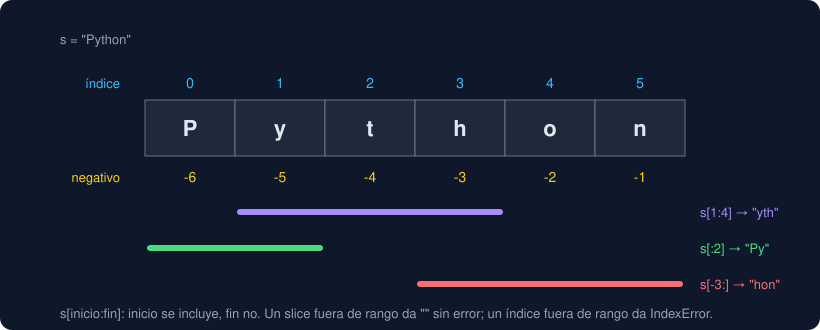

# 03 · Strings a fondo

⏱️ 55 min

## 🎯 Objetivos

- Acceder a caracteres y fragmentos de un texto con índices y *slicing*, incluidos los negativos.
- Explicar por qué un `str` no se puede modificar y qué hacen entonces sus métodos.
- Limpiar, buscar, partir y unir texto con los métodos más usados.
- Comparar textos sin que importen mayúsculas, espacios ni la forma Unicode de los acentos.

---

## 1. Un `str` es una secuencia de caracteres

Cada carácter tiene una posición, el **índice**, que empieza en `0`. También se puede contar desde el final con índices negativos: `-1` es el último.



```python
>>> s = "Python"
>>> len(s)
6
>>> s[0]
'P'
>>> s[-1]
'n'
>>> s[10]
IndexError: string index out of range
```

El último índice positivo es `len(s) - 1`. Pedir uno que no existe es un error.

## 2. Slicing: `s[inicio:fin:paso]`

Un **slice** devuelve un fragmento nuevo. `inicio` se incluye, `fin` **no**.

| Expresión | Resultado | Lectura |
|---|---|---|
| `s[1:4]` | `'yth'` | Del índice 1 al 3 |
| `s[:2]` | `'Py'` | Desde el principio hasta el 1 |
| `s[2:]` | `'thon'` | Desde el 2 hasta el final |
| `s[-3:]` | `'hon'` | Los 3 últimos |
| `s[::2]` | `'Pto'` | Uno sí, uno no |
| `s[::-1]` | `'nohtyP'` | Al revés |
| `s[10:]` | `''` | Fuera de rango: vacío, **sin error** |

Que `fin` no se incluya tiene una ventaja: `s[:n]` y `s[n:]` se reparten el texto sin solaparse, y `s[:n]` siempre tiene `n` caracteres (si el texto es lo bastante largo).

## 3. Los `str` son inmutables

No puedes cambiar un carácter de un texto:

```python
>>> s[0] = "J"
TypeError: 'str' object does not support item assignment
```

Por eso **todos los métodos de `str` devuelven un texto nuevo** y dejan el original igual. Si no guardas el resultado, se pierde:

```python
>>> code = "  ab-12 "
>>> code.strip()
'ab-12'
>>> code
'  ab-12 '
>>> code = code.strip()
>>> code
'ab-12'
```

Es el error más común con strings: llamar a `name.strip()` en una línea y seguir usando `name` sin limpiar.

## 4. Los métodos que usarás siempre

Los métodos se llaman con un punto: `texto.metodo(argumentos)`. Puedes encadenarlos porque cada uno devuelve un `str`: `text.strip().lower()`.

### Limpiar y cambiar

| Método | Ejemplo | Resultado |
|---|---|---|
| `strip()` | `"  hola  ".strip()` | `'hola'` |
| `lstrip()`, `rstrip()` | `"  hola  ".rstrip()` | `'  hola'` |
| `strip("chars")` | `"--12--".strip("-")` | `'12'` |
| `lower()`, `upper()` | `"Norte".upper()` | `'NORTE'` |
| `title()` | `"ada lovelace".title()` | `'Ada Lovelace'` |
| `replace(viejo, nuevo)` | `"3,5".replace(",", ".")` | `'3.5'` |

### Preguntar

| Método | Ejemplo | Resultado |
|---|---|---|
| `x in s` | `"@" in "ana@correo.co"` | `True` |
| `startswith`, `endswith` | `"datos.csv".endswith(".csv")` | `True` |
| `find(x)` | `"ana@correo.co".find("@")` | `3` (o `-1` si no está) |
| `count(x)` | `"banana".count("a")` | `3` |
| `isdecimal()` | `"2026".isdecimal()` | `True` (solo dígitos, al menos uno) |

### Partir y unir

| Método | Ejemplo | Resultado |
|---|---|---|
| `split()` | `"  uno  dos ".split()` | `['uno', 'dos']` |
| `split(sep)` | `"a;b;;c".split(";")` | `['a', 'b', '', 'c']` |
| `sep.join(...)` | `"-".join(["a", "b"])` | `'a-b'` |
| `partition(sep)` | `"ana@correo.co".partition("@")` | `('ana', '@', 'correo.co')` |
| `rpartition(sep)` | `"a.b.CSV".rpartition(".")` | `('a.b', '.', 'CSV')` |

`split()` sin argumento parte por cualquier cantidad de espacios y descarta los vacíos. `split(";")` parte exactamente por cada `;`, y dos seguidos dejan un `''` en medio: así se ve un campo vacío en un CSV.

### Paso a paso: `partition` y desempaquetar

`partition` busca la **primera** aparición del separador y devuelve siempre **tres** partes: lo de antes, el separador y lo de después. `rpartition` hace lo mismo con la **última**. Si el separador no está:

```python
>>> "sinpunto".partition(".")
('sinpunto', '', '')
>>> "sinpunto".rpartition(".")
('', '', 'sinpunto')
```

Puedes recibir las tres partes en tres nombres a la vez (**desempaquetar**). `_` es el nombre convencional para lo que no vas a usar:

```python
>>> user, _, domain = "ana@correo.co".partition("@")
>>> user
'ana'
>>> domain
'correo.co'
```

Tiene que haber tantos nombres como partes, o falla con `ValueError: too many values to unpack` (o `not enough`).

## 5. Unicode: mayúsculas y acentos

Un `str` de Python es texto Unicode: `len("µg/m³")` es `5`, un carácter por símbolo, aunque en el archivo ocupen más bytes.

### Comparar sin mayúsculas: `casefold`

`lower()` sirve casi siempre, pero `casefold()` está pensado para comparar y cubre más idiomas:

```python
>>> "Straße".lower()
'straße'
>>> "Straße".casefold()
'strasse'
```

Para preguntar "¿es el mismo texto sin importar mayúsculas?", compara `a.casefold() == b.casefold()`.

### El mismo acento, dos formas

Una `é` puede guardarse como un carácter (`é`) o como dos (`e` + tilde combinable). Se ven igual en pantalla, pero no son iguales para Python. Pasa con texto copiado de PDF, de macOS o de formularios web:

```python
>>> import unicodedata
>>> decomposed = unicodedata.normalize("NFD", "café")
>>> len("café"), len(decomposed)
(4, 5)
>>> decomposed == "café"
False
>>> unicodedata.normalize("NFC", decomposed) == "café"
True
```

`normalize("NFC", texto)` junta cada letra con su tilde en un solo carácter. **Normaliza antes de comparar** texto que viene de fuera. En la fase 5, cuando prepares texto para un modelo de lenguaje, este paso vuelve a aparecer.

## 6. Errores frecuentes

| Síntoma | Causa | Arreglo |
|---|---|---|
| El texto sigue con espacios después de `strip()` | No guardaste el resultado | `name = name.strip()` |
| `TypeError: 'str' object does not support item assignment` | Intentas cambiar un carácter | Construye un texto nuevo (slicing, `replace`) |
| `IndexError: string index out of range` | Índice mayor o igual que `len(s)` | Comprueba la longitud, o usa un slice (`s[:1]` no falla con texto vacío) |
| `"Ana" == "ana"` da `False` | Mayúsculas distintas | `a.casefold() == b.casefold()` |
| Dos textos iguales en pantalla no son `==` | Acentos en forma distinta, o espacios invisibles | `unicodedata.normalize("NFC", s).strip()` |
| `ValueError: not enough values to unpack (expected 3, got 2)` | Más nombres que partes | `partition` siempre da 3; `split` da las que haya |
| `s.find("x")` da `-1` y luego `s[-1:]` toma el último carácter | `-1` significa "no está", pero también es un índice válido | Pregunta antes con `"x" in s` |

---

## ✅ Qué debes saber al terminar

- Los índices empiezan en `0`; `-1` es el último; `s[a:b]` incluye `a` y excluye `b`; un slice fuera de rango no falla.
- Un `str` no se modifica: cada método devuelve un texto nuevo que debes guardar.
- `strip`, `replace`, `split`, `join` y `partition` resuelven casi toda la limpieza de texto.
- Para comparar texto de fuera: `normalize("NFC", ...)`, `strip()` y `casefold()`.

---

## 🔗 Navegación

| Anterior | Actual | Siguiente |
| -------- | ------ | --------- |
| [02 · Condicionales y `match`](02-condicionales-y-match.md) | **03 · Strings a fondo** | [04 · Formateo: f-strings y t-strings](04-formateo-f-strings-y-t-strings.md) |
