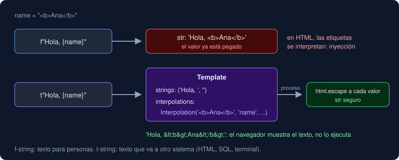

# 04 · Formateo: f-strings y t-strings

⏱️ 45 min

## 🎯 Objetivos

- Dar formato a números y textos con el mini-lenguaje de formato: decimales, ancho, alineación, separador de miles y porcentaje.
- Depurar rápido con `f"{x=}"`.
- Explicar qué es una t-string (Python 3.14), en qué se diferencia de una f-string y para qué sirve.

---

## 1. El mini-lenguaje de formato

En la semana 1 usaste `f"{value:.1f}"`. Lo que va después de `:` dentro de las llaves es la **especificación de formato**. Tiene partes opcionales, siempre en este orden:

```
{valor:[relleno][alineación][ancho][,][.precisión][tipo]}
```

### Números

| Formato | Ejemplo | Resultado | Qué hace |
|---|---|---|---|
| `.2f` | `f"{3.14159:.2f}"` | `'3.14'` | 2 decimales (redondea) |
| `,.2f` | `f"{1234567.5:,.2f}"` | `'1,234,567.50'` | Separador de miles `,` y 2 decimales |
| `_` | `f"{1000000:_}"` | `'1_000_000'` | Separador de miles `_` |
| `.1%` | `f"{0.125:.1%}"` | `'12.5%'` | Multiplica por 100 y añade `%` |
| `03d` | `f"{5:03d}"` | `'005'` | Entero con ceros a la izquierda hasta 3 cifras |
| `x` | `f"{255:x}"` | `'ff'` | Entero en hexadecimal |

### Ancho y alineación

El **ancho** es el número mínimo de caracteres; si el valor es más corto, se rellena con espacios.

| Formato | Ejemplo | Resultado |
|---|---|---|
| `<10` | `f"{'Norte':<10}\|"` | `'Norte     \|'` (a la izquierda) |
| `>10` | `f"{'Norte':>10}\|"` | `'     Norte\|'` (a la derecha) |
| `^10` | `f"{'Norte':^10}\|"` | `'  Norte   \|'` (centrado) |
| `>8.2f` | `f"{12.5:>8.2f}"` | `'   12.50'` (número de 8 de ancho y 2 decimales) |
| `*^9` | `f"{'ok':*^9}"` | `'***ok****'` (relleno con `*`) |

Con ancho fijo, varias líneas forman columnas alineadas:

```python
print(f"{'Estación':<10}|{'PM2.5':>8}")
print(f"{'Norte':<10}|{12.5:>8.2f}")
print(f"{'Centro':<10}|{131.04:>8.2f}")
```

```
Estación  |   PM2.5
Norte     |   12.50
Centro    |  131.04
```

Regla de las tablas: **textos a la izquierda, números a la derecha**. Así las cifras quedan alineadas por las unidades.

### Formato dentro del formato

La precisión puede venir de una variable, con llaves dentro de las llaves:

```python
>>> decimals = 3
>>> f"{3.14159:.{decimals}f}"
'3.142'
```

### Formato colombiano (o europeo): punto de miles, coma decimal

El mini-lenguaje usa `,` para miles y `.` para decimales. Para mostrar `1.234.567,50`, intercambia los separadores con un carácter auxiliar:

```python
>>> text = f"{1234567.5:,.2f}"
>>> text
'1,234,567.50'
>>> text.replace(",", "_").replace(".", ",").replace("_", ".")
'1.234.567,50'
```

Tres `replace` en orden: la coma pasa a `_` para no confundirse, el punto pasa a coma y el `_` pasa a punto. Es una solución para **mostrar**; nunca conviertas ese texto otra vez en número.

## 2. Depurar con `=`

Con `=` al final de la expresión, la f-string escribe la expresión y su valor:

```python
>>> x = 3
>>> f"{x=}"
'x=3'
>>> f"{x * 2 = }"
'x * 2 = 6'
```

Es la forma más rápida de mirar valores mientras pruebas. Se puede combinar con formato: `f"{value=:.2f}"`.

## 3. t-strings: plantillas que no se convierten en texto (Python 3.14)

Una f-string se evalúa **al instante** y da un `str`: los valores ya están pegados dentro del texto y no hay forma de saber dónde estaban. Eso es un problema cuando el texto va a otro sistema que interpreta caracteres especiales: una consulta SQL, una página HTML, un comando de terminal. Si un valor trae `<script>` o `'; DROP TABLE`, la f-string lo pega tal cual. Es la puerta de entrada de los ataques de **inyección**.

Python 3.14 añade las **t-strings** (*template strings*, PEP 750): se escriben igual, con `t` delante, pero **no** producen un `str`. Producen un objeto `Template` que guarda por separado las partes fijas y los valores.



```python
>>> name = "<b>Ana</b>"
>>> f"Hola, {name}"
'Hola, <b>Ana</b>'
>>> template = t"Hola, {name}"
>>> type(template)
<class 'string.templatelib.Template'>
>>> template.strings
('Hola, ', '')
>>> template.values
('<b>Ana</b>',)
```

| | f-string | t-string |
|---|---|---|
| Se escribe | `f"Hola, {name}"` | `t"Hola, {name}"` |
| Produce | `str` | `Template` |
| Los valores | Ya pegados en el texto | Aparte, en `.values` y `.interpolations` |
| ¿Quién decide cómo unirlos? | Nadie: ya están unidos | Una función que procesa la plantilla (escapar HTML, parámetros SQL) |

Cada valor está en un objeto `Interpolation` con su información completa:

```python
>>> value = 12.345
>>> template = t"PM2.5: {value:.1f}"
>>> template.interpolations
(Interpolation(12.345, 'value', None, '.1f'),)
```

Guarda el valor (`12.345`), la expresión tal como se escribió (`'value'`), la conversión (`!r`, `!s` o ninguna) y el formato (`'.1f'`). **El formato no se aplica todavía**: lo aplica la función que procese la plantilla.

Un `Template` no se puede usar donde se espera texto sin procesarlo antes:

```python
>>> template + "x"
TypeError: can only concatenate string.templatelib.Template (not "str") to string.templatelib.Template
```

Ese error es una protección: obliga a pasar por una función que decida cómo tratar los valores. En el ejercicio 03 usas una que escapa HTML con `html.escape`. En la semana 19, psycopg 3 acepta t-strings para construir consultas SQL con parámetros seguros.

**Cuándo usar cada una**: f-string para mostrar texto a una persona (consola, logs, informes). t-string cuando el texto va a otro sistema que podría interpretar lo que traen los valores.

## 4. Errores frecuentes

| Síntoma | Causa | Arreglo |
|---|---|---|
| `ValueError: Unknown format code 'f' for object of type 'str'` | Formato numérico sobre un texto (`f"{'12':.1f}"`) | Convierte antes: `float(text)` |
| `ValueError: Unknown format code 'd' for object of type 'float'` | `d` es solo para enteros | `.0f` para un `float` sin decimales |
| Las columnas no se alinean | Un valor es más largo que el ancho | Aumenta el ancho; el formato nunca recorta |
| Sale `{name}` literal en el texto | Te faltó la `f` delante | `f"..."` |
| `TypeError: can only concatenate ... Template` | Tratas una t-string como `str` | Procésala con una función que devuelva `str` |
| `round(2.5)` da `2` y `f"{2.5:.0f}"` da `'2'` | Redondeo al par (*banker's rounding*) | Es el estándar IEEE; no es un error |

---

## ✅ Qué debes saber al terminar

- `{valor:[relleno][alineación][ancho][,][.precisión][tipo]}`: `.2f`, `,`, `.1%`, `<10`, `>8.2f`.
- Textos a la izquierda y números a la derecha para que las columnas se lean.
- `f"{x=}"` muestra expresión y valor.
- Una t-string da un `Template` con partes fijas y valores separados; algo tiene que procesarlo para obtener texto. Sirve para evitar inyecciones.

---

## 🔗 Navegación

| Anterior | Actual | Siguiente |
| -------- | ------ | --------- |
| [03 · Strings a fondo](03-strings-a-fondo.md) | **04 · Formateo: f-strings y t-strings** | [05 · Entrada y salida](05-entrada-y-salida.md) |
