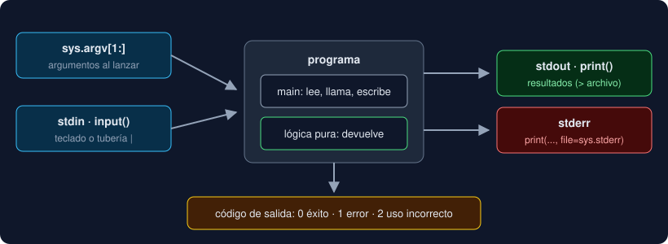

# 05 · Entrada y salida

⏱️ 45 min

## 🎯 Objetivos

- Leer datos del usuario con `input()` y de la línea de comandos con `sys.argv`.
- Escribir resultados con `print()` en la salida estándar y errores en la salida de errores.
- Terminar un programa con un código de salida que otros programas entiendan.
- Separar la lógica (funciones que devuelven) de la entrada/salida (`main`).

---

## 1. Los tres flujos estándar

Todo programa de terminal tiene tres "canales" abiertos desde que arranca:



| Flujo | En Python | Por defecto | Para qué |
|---|---|---|---|
| **stdin** (entrada estándar) | `input()`, `sys.stdin` | El teclado | Datos que entran |
| **stdout** (salida estándar) | `print()` | La pantalla | Resultados |
| **stderr** (salida de errores) | `print(..., file=sys.stderr)` | La pantalla | Errores y avisos |

stdout y stderr se ven igual en la terminal, pero son canales distintos. La terminal puede separarlos: `programa > resultado.txt` guarda solo stdout en el archivo y los errores siguen saliendo en pantalla. Si mezclas errores en stdout, ensucias el resultado.

## 2. Salida: `print`

```python
>>> print("a", "b", "c")
a b c
>>> print("a", "b", sep=";")
a;b
>>> print("sin salto", end="")
sin salto>>>
```

| Parámetro | Por defecto | Qué cambia |
|---|---|---|
| `sep` | `" "` | Lo que va entre los valores |
| `end` | `"\n"` (salto de línea) | Lo que va al final |
| `file` | `sys.stdout` | Adónde se escribe |

Para un error:

```python
import sys

print("error: falta el valor", file=sys.stderr)
```

## 3. Entrada interactiva: `input`

`input(mensaje)` muestra el mensaje, espera a que el usuario escriba y pulse Enter, y devuelve lo escrito **siempre como `str`**, sin el salto de línea:

```python
>>> age = input("Edad: ")
Edad: 30
>>> age
'30'
>>> age + 1
TypeError: can only concatenate str (not "int") to str
>>> int(age) + 1
31
```

Siempre que leas un número, conviértelo (semana 1) y piensa qué pasa si el usuario escribe otra cosa.

`input()` también lee de una **tubería**: lo que otro programa escribe en stdout entra por tu stdin.

```bash
echo "  Ana  " | uv run python saludo.py
```

Si no queda nada que leer (la tubería terminó), `input()` lanza `EOFError: EOF when reading a line`.

## 4. Argumentos de línea de comandos: `sys.argv`

Muchos programas reciben sus datos al lanzarlos: `git commit -m "mensaje"`. En Python, esos textos están en `sys.argv`, una lista de `str`:

```python
# args.py
import sys

print(sys.argv)
```

```bash
uv run python args.py uno "dos tres"
```

```
['args.py', 'uno', 'dos tres']
```

| Posición | Contiene |
|---|---|
| `sys.argv[0]` | El nombre del programa |
| `sys.argv[1:]` | Los argumentos, en orden (un slice, teoría 03) |

Las comillas de la terminal agrupan: `"dos tres"` es **un** argumento. Y como `sys.argv[1:]` es una lista, `match` puede desarmarla (teoría 02):

```python
match sys.argv[1:]:
    case []:
        ...  # sin argumentos
    case ["--ayuda"]:
        ...
    case [line]:
        ...  # exactamente un argumento
    case _:
        ...  # demasiados
```

## 5. Código de salida

Al terminar, todo programa devuelve un número al sistema: **`0` significa éxito**; cualquier otro, fallo. Lo leen la terminal (`echo $?`), los scripts, Docker y el CI de GitHub para decidir si algo salió bien.

```bash
uv run python -c 'raise SystemExit(3)'
echo $?
```

```
3
```

| Código | Convención |
|---|---|
| `0` | Todo bien |
| `1` | Error general (datos inválidos, algo falló) |
| `2` | Uso incorrecto (argumentos que faltan o sobran) |

Si un programa termina con una excepción sin capturar, Python devuelve `1`.

## 6. Paso a paso: lógica separada de la entrada/salida

La regla que usarás todo el bootcamp: **las funciones que calculan no leen ni escriben**; reciben datos y devuelven un resultado. Solo una función, `main`, habla con el exterior.

```python
"""saludo.py: saluda a quien se indique por argumento o por teclado."""

import sys


def greeting(name: str) -> str | None:
    """Lógica pura: devuelve el saludo, o None si el nombre está vacío."""
    name = name.strip()
    if name == "":
        return None
    return f"Hola, {name}"


def main(argv: list[str]) -> int:
    """Entrada/salida: lee, llama a la lógica, escribe y devuelve el código de salida."""
    match argv:
        case []:
            name = input("Nombre: ")
        case [name]:
            pass
        case _:
            print("uso: saludo.py [nombre]", file=sys.stderr)
            return 2
    result = greeting(name)
    if result is None:
        print("error: el nombre está vacío", file=sys.stderr)
        return 1
    print(result)
    return 0


if __name__ == "__main__":
    raise SystemExit(main(sys.argv[1:]))
```

| Pieza | Por qué así |
|---|---|
| `greeting` no usa `print` ni `input` | Se puede probar con un test sin teclado ni pantalla |
| `main` recibe `argv` como parámetro | Un test puede llamar a `main(["Ana"])` sin lanzar el programa |
| `pass` | "No hagas nada": el `case [name]` ya guardó el nombre |
| `raise SystemExit(main(...))` | El número que devuelve `main` se convierte en el código de salida |
| `if __name__ == "__main__":` | Solo se ejecuta al lanzar el archivo, no al importarlo |

```bash
uv run python saludo.py Ana; echo "código: $?"
uv run python saludo.py "  "; echo "código: $?"
uv run python saludo.py a b; echo "código: $?"
```

```
Hola, Ana
código: 0
error: el nombre está vacío
código: 1
uso: saludo.py [nombre]
código: 2
```

(`list[str]` en la anotación significa "lista de textos"; las listas llegan en la semana 5.)

## 7. Errores frecuentes

| Síntoma | Causa | Arreglo |
|---|---|---|
| `TypeError: can only concatenate str (not "int") to str` | `input()` devuelve `str` | Convierte con `int()` o `float()` |
| `EOFError: EOF when reading a line` | `input()` sin nada que leer (tubería vacía, Docker sin `-i`) | Pasa el dato por argumento, o usa `docker compose run` (es interactivo) |
| `IndexError: list index out of range` con `sys.argv[1]` | Lanzaste el programa sin argumentos | Usa `match sys.argv[1:]` con `case []` |
| `echo $?` da `0` aunque hubo un error | El programa imprimió el error pero no devolvió otro código | `return 1` en `main` y `raise SystemExit(main(...))` |
| El archivo de resultados trae mensajes de error mezclados | Errores impresos en stdout | `print(..., file=sys.stderr)` |
| Una función imposible de probar | Mezcla cálculo con `input`/`print` | Saca el cálculo a una función que devuelva el resultado |

---

## ✅ Qué debes saber al terminar

- stdin entra; stdout es para resultados y stderr para errores.
- `input()` siempre devuelve `str`; `sys.argv[1:]` son los argumentos, también `str`.
- `0` es éxito; `1` error; `2` uso incorrecto. `raise SystemExit(main(...))` lo comunica.
- Funciones de lógica que devuelven; un `main` que lee, llama y escribe.

---

## 🔗 Navegación

| Anterior | Actual | Siguiente |
| -------- | ------ | --------- |
| [04 · Formateo: f-strings y t-strings](04-formateo-f-strings-y-t-strings.md) | **05 · Entrada y salida** | [Ejercicio 01 · Operadores y condicionales](../2-practicas/ejercicio-01-operadores-y-condicionales/README.md) |
