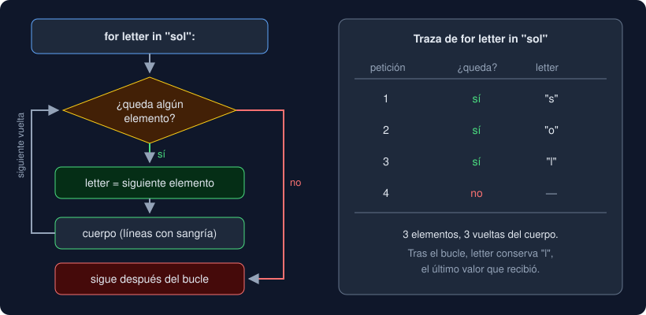

# 01 · `for` e iterables

⏱️ 50 min

## 🎯 Objetivos

- Repetir un bloque de código una vez por cada elemento de un texto, un rango o una lista.
- Generar secuencias de números con `range` sin equivocarte en el final.
- Numerar con `enumerate` y emparejar con `zip`.
- Predecir cuántas vueltas da un bucle anidado.

---

## 1. Para qué sirve un bucle

En la semana 2 tu programa procesaba **una** línea. Un archivo de medidas tiene cientos. No vas a escribir cientos de `parse_line(...)`: escribes **una vez** lo que hay que hacer con cada línea y le dices a Python que lo repita para todas. Eso es un bucle.

```python
for letter in "sol":
    print("letra:", letter)
print("fin")
```

```
letra: s
letra: o
letra: l
fin
```

| Parte | Qué es |
|---|---|
| `for letter in "sol":` | La cabecera: "para cada elemento de `"sol"`, llámalo `letter`" |
| `print("letra:", letter)` | El **cuerpo**: las líneas con sangría, que se repiten |
| `print("fin")` | Ya sin sangría: se ejecuta una vez, cuando el bucle termina |

En cada **vuelta** (iteración), `letter` toma el siguiente elemento. Cuando no quedan, el bucle termina y el programa sigue después.



## 2. Qué se puede recorrer: iterables

Un **iterable** es cualquier valor que sabe dar sus elementos uno a uno. Ya conoces varios:

| Iterable | Da | Ejemplo |
|---|---|---|
| `str` | Sus caracteres | `for c in "abc"` → `'a'`, `'b'`, `'c'` |
| `range(...)` | Números enteros | `for n in range(3)` → `0`, `1`, `2` |
| Una lista `[...]` | Sus elementos, en orden | `for v in [12.5, 8.0]` → `12.5`, `8.0` |
| `texto.split(";")` | Una lista de trozos | `for part in "a;b".split(";")` → `'a'`, `'b'` |
| `sys.stdin` | Las líneas que entran | Teoría 04 |

Las listas las verás a fondo en la semana 5. Por ahora te basta con esto: `[12.5, 8.0, 55.1]` es una lista de tres valores, `len(lista)` dice cuántos tiene y `lista.append(x)` añade uno al final.

Un número **no** es iterable:

```python
>>> for n in 5:
...     print(n)
TypeError: 'int' object is not iterable
```

## 3. `range`: números sin escribirlos

| Llamada | Da | Regla |
|---|---|---|
| `range(5)` | `0 1 2 3 4` | Desde 0 hasta 5, **sin incluir** el 5 |
| `range(1, 6)` | `1 2 3 4 5` | Desde 1 hasta 6, sin el 6 |
| `range(0, 10, 3)` | `0 3 6 9` | De 3 en 3 |
| `range(10, 0, -3)` | `10 7 4 1` | Hacia atrás, sin el 0 |
| `range(5, 5)` | nada | Vacío: el bucle no da ninguna vuelta |

El final nunca se incluye. Tiene una ventaja: `range(n)` da exactamente `n` vueltas. Para contar "del 1 al 10", `range(1, 11)`.

```python
for attempt in range(3):
    print("intento", attempt + 1, "de 3")
```

Si no vas a usar la variable, el convenio es llamarla `_`: `for _ in range(3):`.

## 4. `enumerate`: el número de vuelta

A veces necesitas el elemento **y** su posición, por ejemplo para decir "error en la línea 7". `enumerate` da parejas `(posición, elemento)`:

```python
stations = ["Norte", "Sur", "Centro"]
for number, station in enumerate(stations, start=1):
    print(number, station)
```

```
1 Norte
2 Sur
3 Centro
```

`number, station` desempaqueta cada pareja en dos nombres, igual que `user, _, domain = email.partition("@")` en la semana 2. Sin `start=1` empieza en `0`.

No lleves la cuenta a mano con un contador: `enumerate` es más corto y no se olvida de sumar.

## 5. `zip`: dos secuencias a la vez

```python
stations = ["Norte", "Sur", "Centro"]
readings = [12.5, 8.0, 55.1]
for station, reading in zip(stations, readings):
    print(f"{station:<8}{reading:>6.1f}")
```

`zip` da el primero de cada una, luego el segundo, y así. Si una lista es más corta, `zip` **para** en ella y el resto se pierde sin aviso. Si necesitas que tengan el mismo largo, `zip(a, b, strict=True)` lanza `ValueError` cuando no lo tienen.

## 6. Bucles anidados

Un bucle dentro de otro: por **cada** vuelta del de fuera, el de dentro da **todas** las suyas.

```python
for row in range(1, 3):
    for column in range(1, 4):
        print(f"({row},{column})", end=" ")
    print()
```

```
(1,1) (1,2) (1,3) 
(2,1) (2,2) (2,3) 
```

2 vueltas fuera × 3 dentro = 6 ejecuciones del `print` interior. El `print()` vacío está en el bucle de fuera: salta de línea al terminar cada fila. Ojo con el tamaño: 1 000 × 1 000 son un millón de vueltas. En la semana 6 aprenderás a medirlo.

## 7. No modifiques lo que recorres

```python
values = [1, 2, 3]
for v in values:
    values.append(v)  # la lista crece sin fin: el bucle no termina nunca
```

Si necesitas el resultado de recorrer algo, construye **otro** valor (un acumulador, teoría 03) y deja el original quieto.

---

## ⚠️ Errores frecuentes

| Error | Causa | Arreglo |
|---|---|---|
| `IndentationError: expected an indented block after 'for' statement` | El cuerpo no tiene sangría | 4 espacios más que el `for` |
| Lo que debía ir una vez sale repetido | Esa línea quedó con sangría, dentro del bucle | Quítale la sangría |
| Solo se procesa el último elemento | La línea que procesa quedó fuera del bucle | Ponla dentro, con sangría |
| `range(1, 10)` no llega a 10 | El final no se incluye | `range(1, 11)` |
| `TypeError: 'int' object is not iterable` | `for i in len(text)` | `for c in text` o `for i in range(len(text))` |
| `ValueError: too many values to unpack` | `for a, b in lista` con elementos que no son parejas | Usa `enumerate` o `zip`, que sí dan parejas |

## ✅ Qué debes saber al terminar

- [ ] Qué es el cuerpo de un bucle y cómo lo delimita la sangría.
- [ ] Qué valores son iterables y por qué un `int` no lo es.
- [ ] Qué números da `range(a, b, paso)` y por qué no incluye `b`.
- [ ] Cuándo usar `enumerate` y qué hace `zip` con listas de distinto largo.
- [ ] Cuántas veces se ejecuta el cuerpo de un bucle anidado.

---

## 🔗 Navegación

| Anterior | Actual | Siguiente |
| -------- | ------ | --------- |
| [Semana 03](../README.md) | **01 · `for` e iterables** | [02 · `while`, `break` y `continue`](02-while-break-continue.md) |
