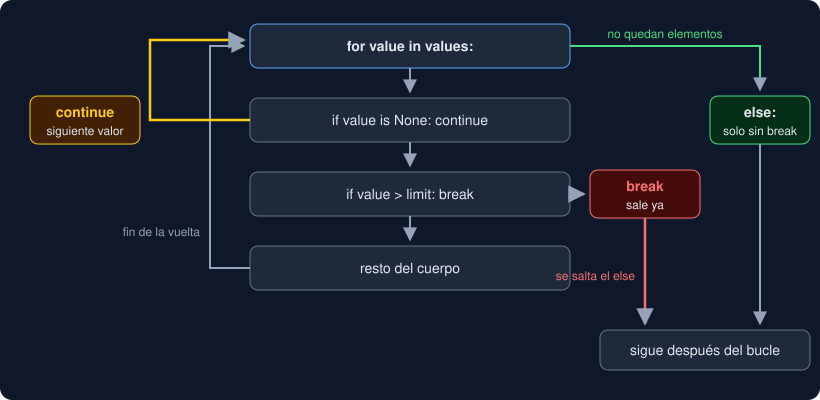

# 02 · `while`, `break`, `continue` y `else`

⏱️ 45 min

## 🎯 Objetivos

- Repetir mientras se cumpla una condición, cuando no sabes cuántas vueltas habrá.
- Reconocer y cortar un bucle infinito.
- Saltar una vuelta con `continue` y terminar el bucle con `break`.
- Usar el `else` de un bucle para saber si terminó sin `break`.

---

## 1. `while`: repetir mientras sea verdad

```python
seconds = 3
while seconds > 0:
    print("quedan", seconds)
    seconds -= 1
print("¡ya!")
```

```
quedan 3
quedan 2
quedan 1
¡ya!
```

Antes de **cada** vuelta, Python evalúa `seconds > 0`. Si es verdadera, ejecuta el cuerpo y vuelve a preguntar; si es falsa, sigue después del bucle. Si ya es falsa la primera vez, el cuerpo no se ejecuta nunca.

| Usa | Cuando |
|---|---|
| `for` | Recorres algo que ya existe: un texto, un rango, unas líneas. Sabes de antemano qué vas a recorrer |
| `while` | Repites hasta que algo cambie: un valor llega a 1, el usuario escribe `fin`, se acaban los intentos |

Si puedes escribirlo con `for`, hazlo: no tiene que preocuparse de avanzar ni de terminar.

## 2. El bucle infinito

Si el cuerpo nunca cambia la condición, el bucle no termina:

```python
seconds = 3
while seconds > 0:
    print("quedan", seconds)   # falta seconds -= 1
```

Imprime `quedan 3` sin parar. Córtalo con `Ctrl+C`: Python lanza `KeyboardInterrupt` y el programa termina. Ante un `while`, pregúntate siempre: **¿qué línea del cuerpo acerca la condición a ser falsa?**

## 3. `continue`: saltar al siguiente

`continue` abandona la vuelta actual y pasa directamente a la siguiente. El resto del cuerpo no se ejecuta en esa vuelta:

```python
for value in [10.0, None, 20.0]:
    if value is None:
        continue
    print("sumo", value)
```

```
sumo 10.0
sumo 20.0
```

Es la forma limpia de decir "esta no me interesa" al principio del cuerpo, en lugar de meter todo lo demás dentro de un `if`. Lo usarás para saltar comentarios y líneas vacías.

## 4. `break`: salir ya

`break` termina el bucle de inmediato, aunque queden elementos o la condición siga siendo verdadera:

```python
for index, value in enumerate([12.5, 55.1, 61.0]):
    if value > 50:
        print("primera alta en la posición", index)
        break
```

```
primera alta en la posición 1
```

`61.0` no se llega a mirar. Sirve para buscar: en cuanto lo encuentras, no tiene sentido seguir.

En bucles anidados, `break` sale **solo del bucle en que está**, no de todos.



## 5. `while True` con un centinela

Cuando la condición de salida solo se conoce **dentro** del cuerpo (después de leer algo), se escribe un bucle "infinito" con una salida explícita:

```python
while True:
    text = input("número (o fin): ")
    if text == "fin":
        break
    print("leído", float(text))
```

`"fin"` es el **centinela**: un valor especial que significa "ya no hay más". El bucle es infinito por construcción, y el `break` es la puerta.

## 6. El `else` de un bucle

Un `for` o un `while` pueden llevar `else`. Se ejecuta **si el bucle terminó sin `break`**:

```python
def is_prime(n: int) -> bool:
    if n < 2:
        return False
    for divisor in range(2, n):
        if n % divisor == 0:
            break
    else:
        return True   # ningún divisor: no hubo break
    return False      # hubo break: encontró un divisor
```

Léelo como "si no hubo `break`". Es poco común y confunde a muchos lectores; úsalo solo en búsquedas como esta, donde ahorra una variable `found = False`.

## 7. `return` dentro de un bucle

Dentro de una función, `return` también termina el bucle, porque termina la función entera:

```python
def first_over(values: list[float], limit: float) -> int | None:
    for index, value in enumerate(values):
        if value > limit:
            return index
    return None
```

Es lo más legible para una búsqueda dentro de una función: el `None` del final solo se alcanza si el bucle acabó sin encontrar nada.

---

## ⚠️ Errores frecuentes

| Error | Causa | Arreglo |
|---|---|---|
| El programa no termina | Bucle infinito: el cuerpo no cambia la condición | `Ctrl+C`, y actualiza la variable dentro del cuerpo |
| El cuerpo no se ejecuta ninguna vez | La condición del `while` ya era falsa al empezar | Revisa el valor inicial |
| `SyntaxError: 'break' outside loop` | `break` o `continue` fuera del bucle (sangría) | Muévelo dentro del cuerpo |
| El `else` se ejecuta siempre o nunca | Tiene la sangría del `if`, no la del `for` | `else` alineado con el `for` |
| `break` no sale del bucle de fuera | `break` solo sale del bucle en que está | Pon el bucle en una función y usa `return` |

## ✅ Qué debes saber al terminar

- [ ] Cuándo usar `while` en lugar de `for`.
- [ ] Cómo detectar un bucle infinito antes de ejecutarlo y cómo cortarlo.
- [ ] Qué diferencia hay entre `continue`, `break` y `return` dentro de un bucle.
- [ ] Qué es un centinela y cómo se escribe con `while True`.
- [ ] Cuándo se ejecuta el `else` de un bucle.

---

## 🔗 Navegación

| Anterior | Actual | Siguiente |
| -------- | ------ | --------- |
| [01 · `for` e iterables](01-for-e-iterables.md) | **02 · `while`, `break`, `continue` y `else`** | [03 · Patrones de bucle](03-patrones-de-bucle.md) |
