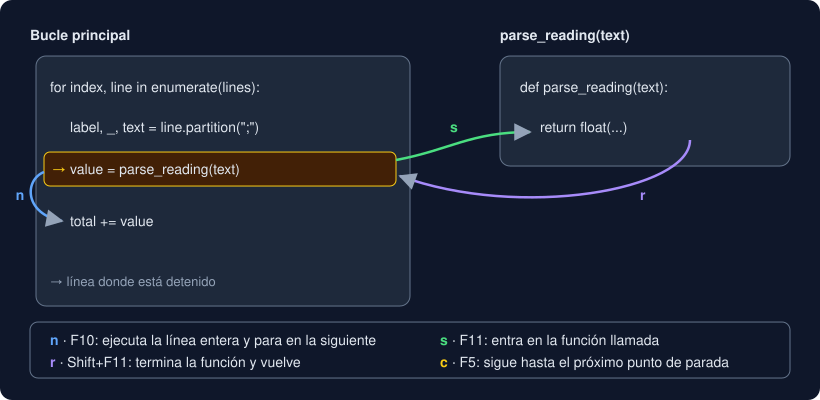

# 05 · Depuración

⏱️ 60 min

## 🎯 Objetivos

- Leer un traceback de abajo arriba y encontrar la línea que causó el error.
- Ver el estado de un bucle con `print(f"{x=}")`.
- Detener un programa con `breakpoint()` y avanzar por él con los comandos de `pdb`.
- Usar el depurador de VS Code: puntos de parada, paso a paso, variables y puntos condicionales.
- Seguir un método para depurar en lugar de cambiar cosas al azar.

---

## 1. Dos tipos de error

| Tipo | Cómo se nota | Ejemplo | Herramienta |
|---|---|---|---|
| **Excepción** | El programa se detiene con un traceback | `ZeroDivisionError` al promediar una lista vacía | Leer el traceback |
| **Error lógico** | El programa termina bien, pero el resultado es falso | Cuenta 1 cuando hay 3 | `print`, `pdb`, VS Code |

Las excepciones avisan; los errores lógicos no, y por eso son más peligrosos: un promedio mal calculado puede llegar a un informe sin que nadie lo note. Los tests (que escribes desde la semana 1) son la red que los atrapa; la depuración es cómo averiguas **por qué** falla un test.

## 2. Leer un traceback

```
Traceback (most recent call last):
  File "debug_lab.py", line 19, in <module>
    print("Promedio de []:", average([]))
                             ~~~~~~~^^^^
  File "debug_lab.py", line 15, in average
    return sum(values) / len(values)
           ~~~~~~~~~~~~^~~~~~~~~~~~~
ZeroDivisionError: division by zero
```

Se lee **de abajo arriba**:

1. **Última línea**: el tipo de error y su mensaje. Busca ese texto si no lo entiendes.
2. **Bloque de encima**: dónde ocurrió (archivo, número de línea, función) y los `^` señalando la parte exacta.
3. **Bloques de más arriba**: quién llamó a esa función, y quién a esa otra. Es la **pila de llamadas**.

A menudo la línea que falla no es la que está mal: `average` divide bien, el problema es que alguien la llamó con `[]`. Sube por la pila hasta encontrar tu decisión equivocada.

## 3. `print` con `=`

La herramienta más simple: imprime el estado en cada vuelta y mira cuándo deja de ser lo que esperas.

```python
for value in values:
    count = 0
    if value >= limit:
        count += 1
    print(f"    {value=} {count=}")
```

```
    value=60.0 count=1
    value=20.0 count=0
    value=70.0 count=1
```

`count` vuelve a 0: el acumulador está dentro del bucle (teoría 03). `f"{x=}"` (semana 2) escribe el nombre y el valor, así no confundes qué es cada número.

Reglas: imprime **antes** de sacar conclusiones, compara con tu tabla de traza y **borra** los `print` de depuración al terminar. Si los dejas, ensucian stdout, y los tests que comparan la salida fallan.

## 4. `pdb`: el depurador de la terminal

Cuando necesitas mirar muchas variables o avanzar línea a línea, detén el programa. Escribe `breakpoint()` donde quieras parar:

```python
def longest_run(levels: list[str], level: str) -> int:
    best = 0
    current = 0
    for item in levels:
        breakpoint()
        ...
```

Al ejecutar, el programa se detiene y aparece `(Pdb)`. Puedes escribir comandos y también cualquier expresión de Python:

| Comando | Nombre | Qué hace |
|---|---|---|
| `l` | *list* | Muestra el código alrededor; `->` marca la próxima línea que se ejecutará |
| `p expr` | *print* | Muestra el valor: `p item, current, best` |
| `n` | *next* | Ejecuta la línea actual y para en la siguiente, sin entrar en las funciones que llama |
| `s` | *step* | Como `n`, pero si la línea llama a una función, entra en ella |
| `r` | *return* | Sigue hasta que termine la función actual |
| `c` | *continue* | Sigue hasta el próximo `breakpoint()` o el final |
| `w` | *where* | Muestra la pila de llamadas: dónde estás y cómo llegaste |
| `q` | *quit* | Sale y termina el programa |
| `h` | *help* | Ayuda; `h n` explica `n` |



Sin cambiar el código, también puedes arrancar el programa ya detenido en la primera línea con `uv run python -m pdb archivo.py`.

Antes de entregar, borra los `breakpoint()`. Si se te olvida uno, el programa se queda esperando órdenes; `PYTHONBREAKPOINT=0` los desactiva todos sin tocar el código.

## 5. El depurador de VS Code

Hace lo mismo que `pdb`, con ventanas:

1. Instala la extensión **Python** de Microsoft (incluye **Python Debugger**).
2. Elige el intérprete del proyecto: `Ctrl+Shift+P` → **Python: Select Interpreter** → el de `.venv`.
3. Clic a la izquierda de un número de línea: un punto rojo, el **punto de parada**. No hace falta escribir `breakpoint()`.
4. `F5` → **Python Debugger: Python File**.

| Tecla | `pdb` | Qué hace |
|---|---|---|
| `F5` | `c` | Continuar |
| `F10` | `n` | Paso por encima (*step over*) |
| `F11` | `s` | Entrar (*step into*) |
| `Shift+F11` | `r` | Salir (*step out*) |
| `Shift+F5` | `q` | Parar |

| Panel | Para qué |
|---|---|
| **Variables** | Los valores actuales, sin escribir `p` |
| **Watch** | Una expresión que se recalcula en cada paso: `total / max(count, 1)` |
| **Call Stack** | La pila de llamadas, como `w` |
| **Debug Console** | Escribir expresiones de Python en el punto donde está parado |

Un **punto de parada condicional** (clic derecho sobre el punto rojo → **Edit Breakpoint**) solo se detiene cuando se cumple una expresión, por ejemplo `number == 907`. En un bucle de mil vueltas, es la diferencia entre pulsar `F5` 906 veces y llegar directo.

Para depurar un test que falla: en la vista **Testing** de VS Code (el matraz), clic derecho sobre el test → **Debug Test**.

## 6. Un método para depurar

1. **Reproduce**: consigue la entrada más pequeña que muestre el fallo. Mejor aún, escríbela como test.
2. **Predice**: ¿qué valor *debería* tener cada variable? Una tabla de traza (teoría 03).
3. **Observa**: `print`, `pdb` o VS Code, hasta encontrar la primera vuelta en que la realidad no coincide con tu predicción.
4. **Explica** el error en una frase antes de tocar nada ("`best` solo se actualiza cuando la racha se corta").
5. **Arregla** y vuelve a ejecutar los tests: el que fallaba y todos los demás.

Cambiar cosas al azar hasta que "funcione" suele dejar un segundo error escondido.

---

## ⚠️ Errores frecuentes

| Error | Causa | Arreglo |
|---|---|---|
| Lees solo la primera línea del traceback | Se lee de abajo arriba | Empieza por la última |
| El programa se queda en `(Pdb)` al ejecutarlo | Quedó un `breakpoint()` | Bórralo, o `PYTHONBREAKPOINT=0` |
| `n` no entra en tu función | `n` pasa por encima | Usa `s` para entrar |
| `*** NameError` en `pdb` | La variable aún no existe en ese punto | Avanza con `n` hasta que se cree |
| VS Code no para en el punto rojo | Ejecutaste con *Run* en vez de *Debug* (`F5`), o otro intérprete | `F5` y el intérprete de `.venv` |
| Un test que compara la salida falla de repente | Dejaste un `print` de depuración | Bórralo |

## ✅ Qué debes saber al terminar

- [ ] La diferencia entre una excepción y un error lógico.
- [ ] Cómo leer un traceback y qué es la pila de llamadas.
- [ ] Los comandos `l`, `p`, `n`, `s`, `c`, `w` y `q` de `pdb`, y sus teclas en VS Code.
- [ ] Qué es un punto de parada condicional y cuándo ahorra tiempo.
- [ ] Los cinco pasos del método para depurar.

---

## 🔗 Navegación

| Anterior | Actual | Siguiente |
| -------- | ------ | --------- |
| [04 · Leer muchas líneas](04-leer-muchas-lineas.md) | **05 · Depuración** | [Ejercicio 01 · `for` y `range`](../2-practicas/ejercicio-01-for-y-range/README.md) |
