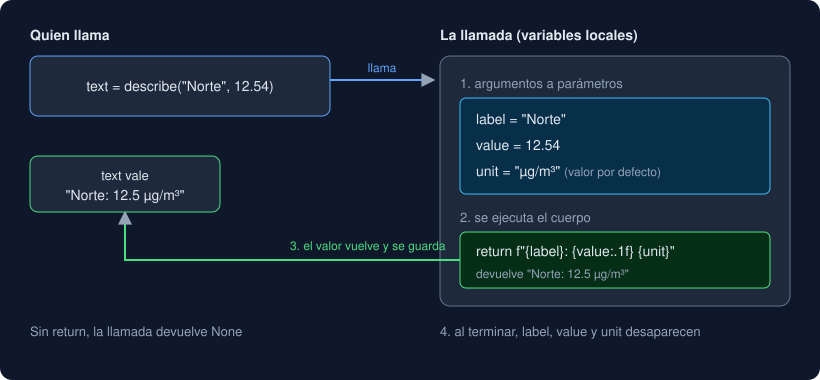

# 01 · Definir y llamar funciones

⏱️ 50 min

## 🎯 Objetivos

- Definir una función con `def`, documentarla con una docstring y llamarla.
- Distinguir parámetro de argumento, y `return` de `print`.
- Pasar argumentos por posición, por nombre, con valor por defecto y solo por nombre.
- Devolver varios valores y usar cláusulas de guarda.
- Decidir cuándo conviene sacar código a una función.

---

## 1. Para qué sirven las funciones

Llevas tres semanas usando funciones (`print`, `len`, `float`) y escribiendo algunas (`parse_value`, `classify`). Esta semana las miras a fondo, porque una función es la unidad con la que se construye todo programa mediano:

| Sin funciones | Con funciones |
|---|---|
| El mismo cálculo copiado en tres sitios; un arreglo hay que hacerlo tres veces | Se escribe una vez y se llama tres |
| Un archivo de 300 líneas que se lee de arriba abajo | Piezas con nombre: `process_lines`, `summarize` |
| Para probar algo hay que ejecutar todo el programa | Cada pieza se prueba sola con un test |

## 2. Anatomía

```python
def describe(label: str, value: float, unit: str = "µg/m³") -> str:
    """Devuelve "label: value unit" con un decimal."""
    return f"{label}: {value:.1f} {unit}"


text = describe("Norte", 12.54)
```

| Parte | Qué es |
|---|---|
| `def describe(...)` | Define la función y le da nombre. **No** ejecuta el cuerpo |
| `label`, `value`, `unit` | **Parámetros**: los nombres que recibirán los datos |
| `: str`, `-> str` | *Type hints*: qué tipo se espera (teoría 04) |
| `unit: str = "µg/m³"` | Parámetro con **valor por defecto** |
| `"""..."""` | **Docstring**: qué hace la función. La muestran `help(describe)` y VS Code al pasar el ratón |
| `return ...` | Termina la función y **entrega** el valor a quien la llamó |
| `describe("Norte", 12.54)` | La **llamada**: aquí sí se ejecuta el cuerpo. `"Norte"` y `12.54` son los **argumentos** |



## 3. `return` frente a `print`

```python
def show_double(n: int) -> None:
    print(n * 2)     # lo muestra; devuelve None


def double(n: int) -> int:
    return n * 2     # lo entrega
```

`show_double(4)` escribe `8` en la pantalla y devuelve `None`: no puedes sumarlo, guardarlo ni probarlo con un test. `double(4)` devuelve `8`, y con eso puedes hacer lo que quieras, incluido imprimirlo. Regla: **las funciones de lógica devuelven; solo `main` imprime**. Es lo que hiciste con `parse_line` y `main` en la semana 2, y lo que harás esta semana con `process_lines`.

Una función sin `return`, o con `return` solo, devuelve `None`.

## 4. Formas de pasar argumentos

| Forma | Llamada | Cuándo |
|---|---|---|
| Por posición | `describe("Norte", 12.5)` | Pocos argumentos de significado obvio |
| Por nombre | `describe(label="Norte", value=12.5)` | Para que la llamada se lea sola, sobre todo con números o booleanos |
| Mezcla | `describe("Norte", value=12.5)` | Los de posición siempre **antes** que los de nombre |
| Valor por defecto | `describe("Norte", 12.5)` usa `unit="µg/m³"` | El valor habitual; quien quiera otro lo pasa |

### Solo por nombre: el `*`

Todo lo que va después de un `*` en la firma solo se puede pasar por nombre:

```python
def share(part: int, total: int, *, decimals: int = 1) -> str: ...

share(2, 7, decimals=2)   # bien
share(2, 7, 2)            # TypeError: takes 2 positional arguments but 3 were given
```

Úsalo para opciones que cambian el comportamiento: `share(2, 7, 2)` obliga a adivinar qué es ese `2`; `decimals=2` lo dice.

## 5. Devolver varios valores

```python
def split_minutes(total: int) -> tuple[int, int]:
    return total // 60, total % 60


hours, minutes = split_minutes(135)   # 2 y 15
```

`return a, b` devuelve una **tupla** (un valor con varias partes, semana 5), y quien llama la desempaqueta. Útil para dos o tres valores relacionados, como `rows, errors = process_lines(...)`. Con más, se pierde la cuenta de qué es cada uno; en la semana 9 usarás una `dataclass`.

## 6. Cláusulas de guarda

`return` termina la función en cuanto se ejecuta. Aprovéchalo para descartar primero los casos raros y dejar el caso normal al final, sin anidar:

```python
def ratio(part: int, total: int) -> float:
    if part < 0 or total < 0 or part > total:
        raise ValueError(f"proporción imposible: {part} de {total}")
    if total == 0:
        return 0.0
    return part / total
```

`raise` también termina la función, pero con un error en lugar de un valor. Úsalo cuando no hay respuesta correcta posible: es mejor fallar con un mensaje claro que devolver un número falso. En la semana 7 verás cómo capturar esos errores; esta semana, cómo probarlos (teoría 05).

## 7. Cuándo crear una función

- **Se repite**: el mismo cálculo aparece dos veces.
- **Tiene nombre**: puedes describir en pocas palabras qué hace ("clasificar una medida"). Si el nombre necesita un "y", probablemente son dos funciones.
- **Quieres probarlo**: si una parte del programa merece un test, merece ser función.
- **Es largo**: si una función no cabe en la pantalla, busca trozos con nombre propio.

---

## ⚠️ Errores frecuentes

| Error | Causa | Arreglo |
|---|---|---|
| La función "no hace nada" | Solo la definiste; falta llamarla | `nombre(...)` |
| Sale `None` donde esperabas un valor | Falta `return`, o usaste `print` en su lugar | `return valor` |
| `TypeError: f() missing 1 required positional argument: 'x'` | Faltó un argumento sin valor por defecto | Pásalo, o dale un valor por defecto |
| `SyntaxError: positional argument follows keyword argument` | Un argumento por posición después de uno por nombre | Los de posición primero |
| `TypeError: f() got an unexpected keyword argument 'units'` | El nombre no coincide con el del parámetro | Usa el nombre exacto de la firma |
| `TypeError: f() takes 2 positional arguments but 3 were given` | Pasaste por posición un parámetro que va después del `*` | Pásalo por nombre |

## ✅ Qué debes saber al terminar

- [ ] Qué diferencia hay entre definir y llamar una función, y entre parámetro y argumento.
- [ ] Por qué las funciones de lógica devuelven en lugar de imprimir.
- [ ] Las cuatro formas de pasar argumentos y para qué sirve el `*` en una firma.
- [ ] Cómo devolver y recibir dos valores.
- [ ] Qué es una cláusula de guarda y cuándo usar `raise`.

---

## 🔗 Navegación

| Anterior | Actual | Siguiente |
| -------- | ------ | --------- |
| [Semana 04](../README.md) | **01 · Definir y llamar funciones** | [02 · Scope y efectos](02-scope-y-efectos.md) |
