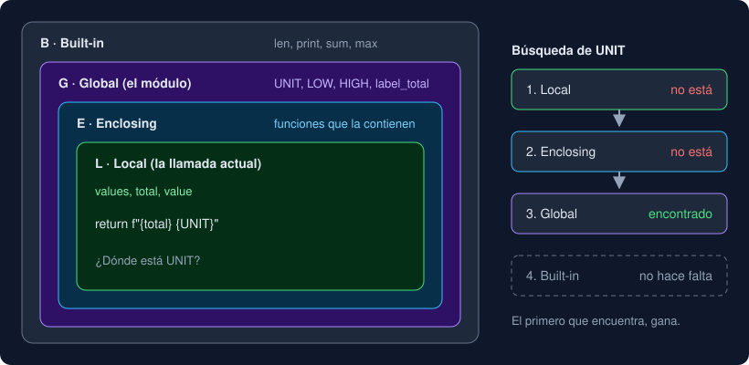

# 02 · Scope y efectos

⏱️ 40 min

## 🎯 Objetivos

- Saber dónde se busca un nombre: la regla LEGB.
- Entender por qué aparece `UnboundLocalError` y cómo evitarlo sin `global`.
- Evitar la trampa del valor por defecto mutable.
- Distinguir una función pura de una con efectos, y por qué conviene separarlas.

---

## 1. Cada llamada tiene su propio espacio de nombres

```python
def label_total(values: list[float]) -> str:
    total = 0.0
    for value in values:
        total += value
    return f"{total} {UNIT}"
```

`values`, `total` y `value` son **locales**: se crean al empezar la llamada y desaparecen al terminar. Dos llamadas a la vez (una función que se llama a sí misma, por ejemplo) tienen cada una su propio `total`. Fuera de la función, `total` no existe: `NameError`.

El **scope** (ámbito) de un nombre es la parte del programa donde ese nombre se puede usar.

## 2. La regla LEGB

Cuando Python encuentra un nombre, lo busca en este orden y se queda con el primero que encuentra:

| Letra | Ámbito | Ejemplo |
|---|---|---|
| **L** | *Local*: la función que se está ejecutando | `total` dentro de `label_total` |
| **E** | *Enclosing*: las funciones que la contienen, si está definida dentro de otra | Lo verás con los *closures* en la semana 12 |
| **G** | *Global*: el módulo (el archivo) | `UNIT`, `LOW`, `HIGH` de tu `__main__.py` |
| **B** | *Built-in*: lo que trae Python | `len`, `print`, `sum`, `max` |



Consecuencia: si llamas `sum` a una variable global, tapas la función `sum` en todo el archivo:

```python
sum = 10
sum([1, 2])   # TypeError: 'int' object is not callable
```

No uses nombres de *built-ins* para tus variables: `list`, `str`, `sum`, `max`, `input`, `id`, `type`.

## 3. Leer un global, sí; asignarlo, no

Leer una variable global desde una función funciona (regla LEGB). **Asignarla** no hace lo que parece:

```python
visits = 0

def add_visit() -> None:
    visits += 1

add_visit()
# UnboundLocalError: cannot access local variable 'visits' where it is not associated with a value
```

Al ver una asignación a `visits` dentro de la función, Python decide **al definirla** que `visits` es local en toda ella. `visits += 1` intenta leer esa local antes de que tenga valor.

Existe `global visits` para forzar que se use la global, pero evítalo: cualquier función podría cambiar `visits`, y para entender un error habría que leer todo el programa. La forma limpia es pasar el valor y devolver el nuevo:

```python
def add_visit(visits: int) -> int:
    return visits + 1

visits = add_visit(visits)
```

Las **constantes** globales (en mayúsculas, como `UNIT` o `HIGH`) son la excepción razonable: se leen desde todas partes y nadie las cambia.

## 4. El valor por defecto mutable

```python
def add_reading(value: float, readings: list[float] = []) -> list[float]:
    readings.append(value)
    return readings

add_reading(1.0)   # [1.0]
add_reading(2.0)   # [1.0, 2.0]  ← ¡la lista de la llamada anterior!
```

El valor por defecto se evalúa **una sola vez**, al ejecutarse el `def`. Si es una lista, todas las llamadas comparten esa misma lista. Con un número o un texto no pasa nada, porque son inmutables. La solución estándar:

```python
def add_reading(value: float, readings: list[float] | None = None) -> list[float]:
    if readings is None:
        readings = []
    readings.append(value)
    return readings
```

Regla: el valor por defecto de un parámetro nunca es `[]` ni `{}`; es `None`.

## 5. Funciones puras y funciones con efectos

| Pura | Con efectos |
|---|---|
| Su resultado depende **solo** de sus argumentos | Lee o cambia algo de fuera: la terminal, un archivo, una variable global, la hora |
| No cambia nada fuera de ella | Imprime, escribe, modifica un argumento |
| Misma entrada, misma salida, siempre | Puede dar otra cosa cada vez |
| Se prueba con `assert f(x) == y` | Necesita `capsys`, `monkeypatch`, archivos de prueba… |

`classify`, `format_row`, `summarize` y `ratio` son puras. `main` tiene efectos: lee stdin y escribe en stdout y stderr. Ningún programa útil es solo funciones puras, pero conviene que **los efectos estén en el borde** (en `main`) y la lógica en el centro, pura. En el proyecto de esta semana mueves el bucle de `main` a `process_lines`, que devuelve las filas y los errores en lugar de imprimirlos.

Modificar un argumento también es un efecto, y sorprende a quien llama:

```python
def drop_first(values: list[float]) -> list[float]:
    values.pop(0)        # cambia la lista de quien llamó
    return values
```

Si necesitas una versión cambiada, construye una nueva y deja la original quieta.

---

## ⚠️ Errores frecuentes

| Error | Causa | Arreglo |
|---|---|---|
| `NameError: name 'total' is not defined` fuera de la función | `total` es local | Devuélvela con `return` y guárdala al llamar |
| `UnboundLocalError: cannot access local variable` | Asignas dentro de la función una variable que querías leer de fuera | Pásala como argumento y devuelve el nuevo valor |
| `TypeError: 'int' object is not callable` | Una variable tapa un *built-in* (`sum = 10`) | Cambia el nombre de la variable |
| La lista "recuerda" llamadas anteriores | Valor por defecto `[]` | `None` y crear la lista dentro |
| Después de llamar a una función, tu lista cambió | La función modificó su argumento | Que construya y devuelva una lista nueva |

## ✅ Qué debes saber al terminar

- [ ] Qué significa cada letra de LEGB y en qué orden se busca.
- [ ] Por qué `visits += 1` dentro de una función da `UnboundLocalError`.
- [ ] Por qué el valor por defecto de una lista debe ser `None`.
- [ ] Qué es una función pura y por qué los efectos van en `main`.

---

## 🔗 Navegación

| Anterior | Actual | Siguiente |
| -------- | ------ | --------- |
| [01 · Definir y llamar funciones](01-definir-y-llamar-funciones.md) | **02 · Scope y efectos** | [03 · Funciones como valores](03-funciones-como-valores.md) |
