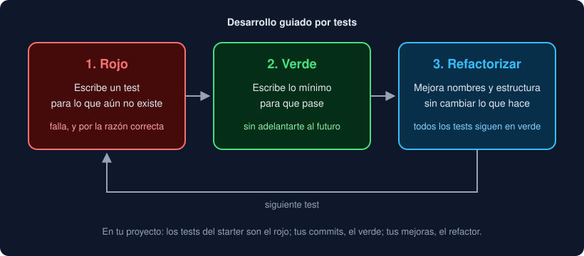

# 05 · Tests con pytest

⏱️ 1 h 10 min

## 🎯 Objetivos

- Escribir tests con `assert` y leer el informe de un fallo.
- Comparar decimales con `pytest.approx` y comprobar errores con `pytest.raises`.
- Probar muchos casos con `parametrize`, eligiendo bien los límites.
- Organizar un test en preparar, actuar y comprobar.
- Trabajar en el ciclo rojo, verde, refactorizar.

---

## 1. Qué es un test

Un test es código que llama a tu código con una entrada conocida y comprueba que el resultado es el esperado:

```python
from observatorio.rules import classify


def test_classify_limit() -> None:
    assert classify(10.0, 10.0, 50.0) == "medio"
```

Si la condición del `assert` es verdadera, no pasa nada; si es falsa, lanza `AssertionError` y el test falla. Llevas tres semanas ejecutando tests así; esta semana entiendes cada pieza para escribir los tuyos sin copiar.

pytest **descubre** los tests solo:

| Busca | Dónde |
|---|---|
| Archivos `test_*.py` | En `testpaths` del `pyproject.toml` (en el proyecto, `tests/`) |
| Funciones `test_*` | Dentro de esos archivos |

```bash
uv run pytest
```

| Código de salida | Significa |
|---|---|
| `0` | Todos pasaron |
| `1` | Alguno falló |
| `5` | No se encontró ningún test |

## 2. Leer un fallo

```
>       assert celsius_to_fahrenheit(36.6) == 97.88
E       assert 97.88000000000001 == 97.88
E        +  where 97.88000000000001 = celsius_to_fahrenheit(36.6)
```

pytest reescribe el `assert` para mostrarte **los dos valores** comparados y de dónde salieron. Con textos, marca las diferencias con `-` (esperado) y `+` (obtenido). Lee siempre esto antes de cambiar nada: el informe suele decir exactamente qué pasó.

## 3. Decimales: `pytest.approx`

`36.6 * 9 / 5 + 32` da `97.88000000000001`, porque los `float` son aproximados (semana 1). Nunca compares decimales calculados con `==`:

```python
assert celsius_to_fahrenheit(36.6) == pytest.approx(97.88)
assert ratio(2, 7) == pytest.approx(0.2857142857)
```

`approx` acepta una diferencia relativa muy pequeña (una millonésima). Los enteros, los textos y los decimales que no se calculan (`parse_value("12,5") == 12.5`) se comparan con `==` normal.

## 4. Errores esperados: `pytest.raises`

Cuando tu función debe fallar con ciertas entradas, el test comprueba que **falla como debe**:

```python
def test_ratio_rejects_part_greater_than_total() -> None:
    with pytest.raises(ValueError):
        ratio(5, 4)
```

| El bloque `with` | El test |
|---|---|
| Lanza `ValueError` | Pasa |
| No lanza nada | Falla: `Failed: DID NOT RAISE ValueError` |
| Lanza otro error | Falla con ese error |

`match="texto"` comprueba además que el mensaje contiene ese texto: `pytest.raises(ValueError, match="vacía")`.

## 5. Muchos casos: `parametrize`

```python
@pytest.mark.parametrize(
    ("value", "expected"),
    [(9.9, "bajo"), (10.0, "medio"), (49.9, "medio"), (50.0, "alto"), (None, "sin dato")],
)
def test_classify(value: float | None, expected: str) -> None:
    assert classify(value, 10.0, 50.0) == expected
```

El decorador `@pytest.mark.parametrize` ejecuta el mismo test una vez por cada tupla, con sus valores en los parámetros. Cada caso cuenta como un test y aparece con su nombre: `test_classify[10.0-medio]`.

**Qué casos elegir.** Los errores viven en los **límites**:

| Caso | Por qué |
|---|---|
| Justo en cada umbral (`10.0`, `50.0`) | Distingue `<` de `<=` |
| Justo antes (`9.9`, `49.9`) | Confirma el otro lado |
| Vacío, cero, `None` | Lo que se olvida al programar |
| Un valor normal | El caso que sí funciona, para no romperlo después |

## 6. Preparar, actuar, comprobar

Un test legible tiene tres partes, separadas por una línea en blanco:

```python
def test_process_lines_reports_invalid_line() -> None:
    lines = ["Norte;12,5", "malo"]

    rows, errors = process_lines(lines, "µg/m³", 10.0, 50.0)

    assert len(rows) == 1
    assert errors == ["línea 2: 'malo'"]
```

En inglés se llama *Arrange, Act, Assert*. El nombre del test dice qué comportamiento comprueba, no qué función llama: `test_process_lines_reports_invalid_line` mejor que `test_process_lines_2`.

Un test, un comportamiento. Si un test falla, su nombre ya debería decirte qué se rompió.

## 7. Opciones del día a día

| Comando | Qué hace |
|---|---|
| `uv run pytest -v` | Una línea por test |
| `uv run pytest -k summarize` | Solo los tests cuyo nombre contiene `summarize` |
| `uv run pytest tests/test_main.py` | Solo los de un archivo |
| `uv run pytest -x` | Para en el primer fallo |
| `uv run pytest --lf` | Solo los que fallaron la última vez |
| `uv run pytest --pdb` | Abre `pdb` en el punto del fallo (semana 3) |

## 8. El ciclo rojo, verde, refactorizar

Así trabajas en el proyecto desde la semana 1, y tiene nombre: **desarrollo guiado por tests** (*TDD*).



1. **Rojo**: escribe un test para lo que todavía no existe. Ejecútalo y comprueba que falla, y que falla **por la razón correcta** (`NotImplementedError`, no un error de importación).
2. **Verde**: escribe el código más simple que lo haga pasar.
3. **Refactorizar**: mejora el código (nombres, funciones más pequeñas, duplicados) sin cambiar lo que hace. Los tests en verde te avisan si rompes algo.

Un test que nunca has visto fallar puede no estar probando nada: por ejemplo, si olvidaste el `assert`.

---

## ⚠️ Errores frecuentes

| Error | Causa | Arreglo |
|---|---|---|
| `no tests ran` (código 5) | La función o el archivo no empiezan por `test_` | Renómbralos |
| El test pasa aunque el código esté mal | Falta el `assert`, o compara algo consigo mismo | Haz que falle a propósito una vez |
| `assert 0.30000000000000004 == 0.3` | Decimales comparados con `==` | `pytest.approx(0.3)` |
| `Failed: DID NOT RAISE ValueError` | La función no valida esa entrada | Añade la validación con `raise` |
| `ModuleNotFoundError` al ejecutar los tests | Se ejecuta desde otra carpeta o el paquete no está instalado | Ejecuta desde la raíz del proyecto con `uv run pytest` |
| `fixture 'x' not found` | Un parámetro del test no coincide con los nombres de `parametrize` | Mismos nombres en el decorador y en la firma |

## ✅ Qué debes saber al terminar

- [ ] Cómo descubre pytest los tests y qué significan los códigos 0, 1 y 5.
- [ ] Cómo leer el informe de un `assert` que falla.
- [ ] Cuándo usar `pytest.approx` y cómo funciona `pytest.raises`.
- [ ] Qué casos poner en un `parametrize` y por qué los límites.
- [ ] Las tres partes de un test y los tres pasos del ciclo rojo, verde, refactorizar.

---

## 🔗 Navegación

| Anterior | Actual | Siguiente |
| -------- | ------ | --------- |
| [04 · Type hints](04-type-hints.md) | **05 · Tests con pytest** | [Ejercicio 01 · Definir funciones](../2-practicas/ejercicio-01-definir-funciones/README.md) |
