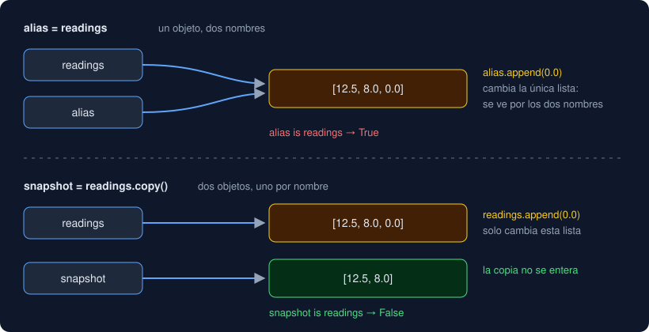

# 01 · Listas

⏱️ 1 h

## 🎯 Objetivos

- Crear una lista, leerla por posición y por trozos, y recorrerla.
- Cambiarla con sus métodos y saber cuáles devuelven algo y cuáles no.
- Ordenar con `sorted` y con `sort`, también con `key`.
- Explicar qué es un alias, por qué `=` no copia y cómo se copia.

---

## 1. Qué es una lista

Una lista guarda varios valores en orden, uno detrás de otro:

```python
readings = [12.5, 8.0, 55.1, 61.0]
labels = ["Norte", "Sur"]
empty: list[float] = []
```

| Operación | Resultado | Como en |
|---|---|---|
| `len(readings)` | `4` | Los textos (semana 2) |
| `readings[0]`, `readings[-1]` | `12.5`, `61.0` | Índices de los textos |
| `readings[1:3]` | `[8.0, 55.1]` | Slicing de los textos |
| `55.1 in readings` | `True` | `in` de los textos |
| `for value in readings:` | Una vuelta por elemento | Bucles (semana 3) |
| `readings + [9.5]` | Una lista nueva, con los 5 | Concatenar textos |

Hasta aquí, una lista se parece a un texto. La diferencia que lo cambia todo: **una lista es mutable**. Un texto no se puede cambiar (`"Norte"[0] = "n"` da `TypeError`); una lista, sí.

Los elementos pueden ser de cualquier tipo, también otras listas. Lo normal, y lo que espera `mypy`, es que sean todos del mismo tipo: `list[float]`, `list[str]`.

## 2. Cambiar una lista

| Método | Qué hace | Devuelve |
|---|---|---|
| `readings[1] = 9.5` | Sustituye la posición 1 | — |
| `readings.append(48.9)` | Añade al final | `None` |
| `readings.insert(0, 3.2)` | Añade en la posición 0 y desplaza el resto | `None` |
| `readings.extend([1.0, 2.0])` | Añade todos los de otra lista | `None` |
| `readings.pop()` | Quita el último | El elemento quitado |
| `readings.pop(0)` | Quita el de la posición 0 | El elemento quitado |
| `readings.remove(55.1)` | Quita el primero que vale `55.1` | `None` |
| `del readings[0]` | Quita la posición 0 | — |
| `readings.clear()` | La deja vacía | `None` |

Fíjate en la columna de la derecha: los métodos que cambian la lista **devuelven `None`**. Es una convención de Python: si una operación cambia el objeto, no lo devuelve, para que no confundas "cambiar" con "crear uno nuevo".

```python
readings = readings.append(48.9)   # ahora readings es None
```

`append(otra_lista)` añade la lista entera como un solo elemento; `extend(otra_lista)` añade sus elementos uno a uno.

## 3. Ordenar

| Forma | Cambia la original | Devuelve |
|---|---|---|
| `sorted(readings)` | No | Una lista nueva, ordenada |
| `readings.sort()` | Sí | `None` |

Las dos aceptan `reverse=True` y `key=`, que viste en la semana 4:

```python
records = [("Norte", 12.5), ("Sur", 8.0), ("Oriente", 55.1)]
sorted(records, key=lambda record: record[1], reverse=True)
# [('Oriente', 55.1), ('Norte', 12.5), ('Sur', 8.0)]
```

`sorted` funciona con cualquier iterable (un texto, un conjunto, las claves de un diccionario) y siempre devuelve una lista. `min`, `max` y `sum` también reciben cualquier iterable; `min` y `max` aceptan `key`.

**Ordenar por dos criterios.** Si `key` devuelve una tupla, Python compara la primera parte y, si empata, la segunda:

```python
sorted(records, key=lambda record: (-record[1], record[0]))
```

El `-` delante del número ordena los valores de mayor a menor; con empate, las etiquetas van de la A a la Z. Es la función `top` del proyecto.

## 4. Nombres y objetos: alias y copia

En la semana 1 viste que una variable es un **nombre** que apunta a un objeto. Con objetos que no cambian (números, textos) eso apenas se nota. Con listas, sí:



```python
readings = [12.5, 8.0]
alias = readings           # otro nombre para la MISMA lista
alias.append(0.0)
print(readings)            # [12.5, 8.0, 0.0]
```

`=` nunca copia: hace que el nombre de la izquierda apunte al mismo objeto que el de la derecha. Para tener otra lista:

| Forma | Resultado |
|---|---|
| `readings.copy()` | Una lista nueva con los mismos elementos |
| `list(readings)` | Lo mismo |
| `readings[:]` | Lo mismo: el trozo entero |

`a is b` pregunta si son **el mismo objeto**; `a == b`, si tienen **el mismo contenido**. Dos copias son `==` pero no `is`.

**Dónde muerde.** Una función que recibe una lista recibe la misma lista, no una copia (semana 4, efectos):

```python
def drop_high(values: list[float]) -> list[float]:
    values.sort()                 # cambia la lista de quien llamó
    return [v for v in values if v < 50]
```

Quien llama descubre que su lista ahora está ordenada. Regla del proyecto: las funciones **no cambian sus argumentos**; si necesitan otra versión, crean una lista nueva (`sorted`, una comprehension). Los tests `..._does_not_change_...` del proyecto lo comprueban.

## 5. Copias que no copian lo de dentro

`.copy()` crea una lista nueva, pero los elementos de dentro son los mismos objetos. Si esos elementos son listas, siguen compartidos:

```python
grid = [[0] * 3] * 3       # tres referencias a UNA lista interior
grid[0][0] = 9             # [[9, 0, 0], [9, 0, 0], [9, 0, 0]]
```

| Necesitas | Usa |
|---|---|
| Otra lista con los mismos elementos | `.copy()` (copia **superficial**) |
| Copiar también las listas o diccionarios de dentro | `copy.deepcopy(x)` (copia **profunda**) |
| Una cuadrícula de listas independientes | `[[0] * 3 for _ in range(3)]` |

Lo verás en el ejercicio 04.

---

## ⚠️ Errores frecuentes

| Error | Causa | Arreglo |
|---|---|---|
| `IndexError: list index out of range` | La posición no existe: en una lista de 4, la última es `3` | Usa `[-1]` para la última, o comprueba `len` |
| `AttributeError: 'NoneType' object has no attribute ...` | Guardaste el resultado de `append` o `sort` | Llama al método sin asignar: `readings.sort()` |
| Una lista "cambia sola" | Dos nombres apuntan a la misma lista | Copia con `.copy()` donde necesites independencia |
| `ValueError: list.remove(x): x not in list` | Ese valor no está | Comprueba antes con `in` |
| `TypeError: '<' not supported between instances of 'NoneType' and 'float'` | Ordenas una lista con `None` | Filtra los `None` antes de ordenar |

## ✅ Qué debes saber al terminar

- [ ] Qué tienen en común una lista y un texto, y qué los diferencia.
- [ ] Qué métodos cambian la lista y por qué devuelven `None`.
- [ ] Cuándo usar `sorted` y cuándo `sort`, y cómo ordenar por dos criterios.
- [ ] Por qué `b = a` no copia, qué diferencia hay entre `is` y `==`, y cuándo hace falta `deepcopy`.

---

## 🔗 Navegación

| Anterior | Actual | Siguiente |
| -------- | ------ | --------- |
| [Semana 05](../README.md) | **01 · Listas** | [02 · Tuplas y desempaquetado](02-tuplas-y-desempaquetado.md) |
