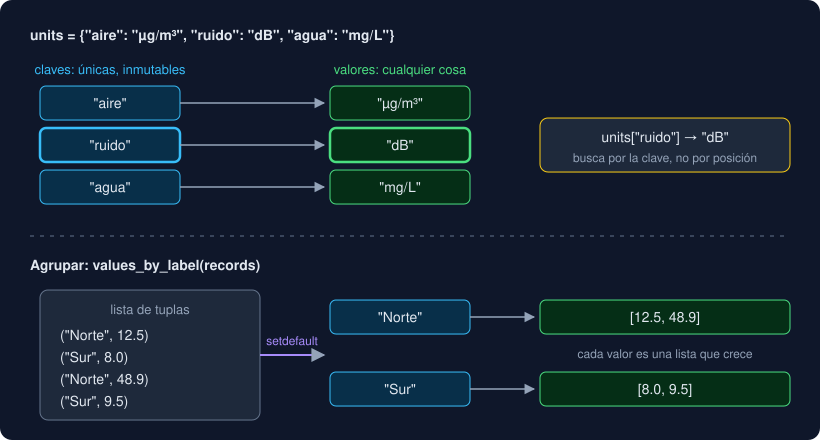

# 03 · Diccionarios

⏱️ 1 h

## 🎯 Objetivos

- Crear un diccionario, leer por clave sin romper el programa y recorrerlo.
- Contar y agrupar con un diccionario.
- Explicar qué puede ser una clave y por qué.
- Elegir entre una lista de tuplas y un diccionario.

---

## 1. Qué es un diccionario

Un diccionario guarda parejas **clave → valor** y busca por la clave:

```python
units = {"aire": "µg/m³", "ruido": "dB", "agua": "mg/L"}
units["ruido"]        # 'dB'
len(units)            # 3
"aire" in units       # True: in pregunta por las claves
"dB" in units         # False: no mira los valores
```

En una lista buscas por posición (`readings[2]`); en un diccionario, por un nombre que tú eliges. Si quieres "la unidad del aire", no tienes que saber en qué posición está.



| Regla | Consecuencia |
|---|---|
| Las claves no se repiten | Asignar a una clave que ya existe **sustituye** su valor |
| El orden es el de inserción | Al recorrer, salen en el orden en que entraron (desde Python 3.7) |
| Los valores pueden ser cualquier cosa | Números, textos, listas, otros diccionarios |
| Las claves tienen que ser inmutables | Textos, números y tuplas sí; listas y diccionarios no (sección 5) |

## 2. Leer sin que falle

| Forma | Si la clave no existe |
|---|---|
| `units["luz"]` | `KeyError: 'luz'` |
| `units.get("luz")` | `None` |
| `units.get("luz", "sin unidad")` | `"sin unidad"` |
| `"luz" in units` | `False`, para decidir antes |

Usa `[clave]` cuando la clave **tiene** que estar: si falta, es un error y quieres verlo. Usa `.get` cuando puede faltar y tienes un valor razonable para ese caso.

## 3. Cambiar y recorrer

```python
units["luz"] = "lx"          # añade una clave nueva
units["agua"] = "mg/l"       # cambia el valor; la clave conserva su sitio
del units["ruido"]           # borra; KeyError si no existía
value = units.pop("luz")     # borra y devuelve el valor
```

| Recorres | Obtienes en cada vuelta |
|---|---|
| `for key in units:` | Cada clave |
| `for value in units.values():` | Cada valor |
| `for key, value in units.items():` | Cada pareja, desempaquetada (teoría 02) |

`list(units)` da la lista de claves. No añadas ni borres claves mientras recorres el diccionario: `RuntimeError: dictionary changed size during iteration`. Recorre una copia (`list(units)`) o construye otro diccionario.

## 4. Los dos patrones: contar y agrupar

**Contar** (el contador de la semana 3, con un contador por clave):

```python
counts: dict[str, int] = {}
for level in levels:
    counts[level] = counts.get(level, 0) + 1
# {'alto': 3, 'bajo': 2, 'medio': 1}
```

Si sabes de antemano qué claves habrá, créalas todas a 0 y así aparecen aunque no se cuente ninguna:

```python
counts = {level: 0 for level in LEVELS}      # una dict comprehension (teoría 05)
for row in rows:
    counts[level_of(row)] += 1
```

Es `level_counts` en el proyecto. Con él, el `if`/`elif` de cuatro contadores de `summarize` (semana 3) desaparece.

**Agrupar** (*group by*): juntar los valores que comparten clave.

```python
groups: dict[str, list[float]] = {}
for label, value in records:
    groups.setdefault(label, []).append(value)
# {'Norte': [12.5, 48.9], 'Sur': [8.0, 9.5]}
```

`setdefault(label, [])` hace dos cosas: si `label` no está, guarda una lista vacía con esa clave; en los dos casos, devuelve la lista guardada. El `.append` cambia esa lista, que vive dentro del diccionario. Sin `setdefault`:

```python
if label not in groups:
    groups[label] = []
groups[label].append(value)
```

Es `values_by_label` en el proyecto. Después, una media por grupo y tienes el primer análisis de verdad del Observatorio. En la semana 24, pandas lo hará en una línea: `df.groupby("label")["value"].mean()`.

## 5. Qué puede ser una clave

Para encontrar una clave rápido, el diccionario calcula un número a partir de ella, su **hash** (`hash("Norte")`), y la guarda en el sitio que indica ese número. Si la clave cambiara después de guardarse, su hash cambiaría y el diccionario ya no la encontraría. Por eso solo admite claves **hashables**: las que no cambian.

| Clave | ¿Vale? |
|---|---|
| `"Norte"`, `42`, `12.5`, `True` | Sí |
| `("Norte", "lunes")` | Sí: una tupla de cosas inmutables |
| `["Norte", "lunes"]` | No: `TypeError: cannot use 'list' as a dict key (unhashable type: 'list')` |

Una tupla como clave sirve para datos con dos coordenadas: lugar y día, fila y columna.

Ese hash es también la razón de que buscar en un diccionario sea casi instantáneo aunque tenga un millón de claves, mientras que `in` en una lista compara elemento a elemento. Lo mides en el ejercicio 04 y le pones nombre en la semana 6.

## 6. ¿Lista de tuplas o diccionario?

| Necesitas | Usa |
|---|---|
| Guardar los registros en orden, con repetidos | Lista de tuplas: `[("Norte", 12.5), ("Norte", 48.9)]` |
| Buscar por un nombre | Diccionario: `units["aire"]` |
| Un resultado por clave (conteo, media, último valor) | Diccionario |
| Un registro con campos con nombre | Diccionario `{"label": ..., "value": ...}` hoy; `dataclass` en la semana 9 |

En el proyecto conviven: `records_of` da la lista de tuplas, y `values_by_label` y `label_means` la convierten en diccionarios.

---

## ⚠️ Errores frecuentes

| Error | Causa | Arreglo |
|---|---|---|
| `KeyError: 'luz'` | La clave no existe | `.get`, `in` o `setdefault`, según el caso |
| `TypeError: cannot use 'list' as a dict key` | Clave mutable | Usa una tupla |
| Un valor "desaparece" | Asignaste dos veces a la misma clave | Si necesitas guardar varios, agrupa en una lista |
| `RuntimeError: dictionary changed size during iteration` | Añades o borras mientras recorres | Recorre `list(d)` o crea un diccionario nuevo |
| `AttributeError: 'NoneType' object has no attribute 'append'` | `d.get(k).append(...)` con una clave nueva | `d.setdefault(k, []).append(...)` |

## ✅ Qué debes saber al terminar

- [ ] Cuándo usar `[clave]` y cuándo `.get`.
- [ ] Cómo recorrer claves, valores y parejas.
- [ ] Cómo contar y agrupar con un diccionario, y qué hace `setdefault`.
- [ ] Por qué una lista no puede ser clave y una tupla sí.

---

## 🔗 Navegación

| Anterior | Actual | Siguiente |
| -------- | ------ | --------- |
| [02 · Tuplas y desempaquetado](02-tuplas-y-desempaquetado.md) | **03 · Diccionarios** | [04 · Conjuntos](04-conjuntos.md) |
