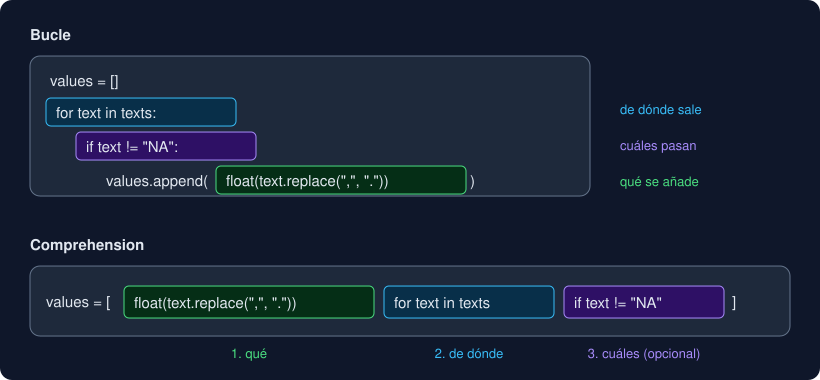

# 05 · Comprehensions

⏱️ 55 min

## 🎯 Objetivos

- Traducir un bucle que construye una lista a una list comprehension, y al revés.
- Distinguir el `if` que filtra del `if ... else` que elige.
- Escribir dict y set comprehensions.
- Usar expresiones generadoras con `sum`, `any`, `all`, `min`, `max` y `join`.
- Saber cuándo un bucle se lee mejor.

---

## 1. Del bucle a la comprehension

Este patrón lo has escrito muchas veces desde la semana 3: lista vacía, bucle, filtro, `append`.

```python
values = []
for text in texts:
    if text != "NA":
        values.append(float(text.replace(",", ".")))
```

Una **list comprehension** dice lo mismo en una línea:

```python
values = [float(text.replace(",", ".")) for text in texts if text != "NA"]
```



Se lee en tres partes: **qué** se añade, **de dónde** sale y **cuáles** pasan. El `if` es opcional:

```python
squares = [n * n for n in range(1, 6)]        # [1, 4, 9, 16, 25]
labels = [label for label, _ in records]       # desempaqueta como el for
```

La comprehension siempre crea una lista **nueva**; no cambia la original (teoría 01). Y las variables del `for` de dentro no salen de ella: después de la línea, `text` no existe.

## 2. Filtrar o elegir

Los dos `if` se parecen y hacen cosas distintas:

| Forma | Hace | Ejemplo con `[12.5, 55.1]` |
|---|---|---|
| `[x for x in xs if cond]` al final | **Filtra**: quita los que no cumplen | `[v for v in vs if v >= 50]` → `[55.1]` |
| `[a if cond else b for x in xs]` al principio | **Elige** el valor; no quita ninguno | `["alto" if v >= 50 else "normal" for v in vs]` → `['normal', 'alto']` |

El segundo es una **expresión condicional** (`a if cond else b`), que también existe fuera de las comprehensions: `text = "sin dato" if value is None else f"{value:.1f}"`. Se pueden combinar las dos formas, pero cuesta leerlas: en ese caso, escribe el bucle.

## 3. Diccionarios y conjuntos

Con llaves, la misma idea construye un diccionario o un conjunto:

| Escribes | Obtienes |
|---|---|
| `[expr for ...]` | Lista |
| `{clave: valor for ...}` | Diccionario |
| `{expr for ...}` | Conjunto |

```python
counts = {level: 0 for level in LEVELS}
means = {label: sum(values) / len(values) for label, values in groups.items()}
high = {label: v for label, v in readings.items() if v >= 50}
names = {label for label, _ in records}
```

Las cuatro son funciones del proyecto: `level_counts` empieza con la primera, `label_means` es la segunda y `distinct_labels`, la última.

## 4. Expresiones generadoras

Con paréntesis no sale una "tuple comprehension", sale un **generador**: un objeto que da los valores de uno en uno, cuando se le piden, sin guardar la lista entera.

```python
gen = (n * n for n in range(3))
list(gen)       # [0, 1, 4]
list(gen)       # []: se agotó, como sys.stdin en la semana 3
```

Su sitio natural es dentro de una función que recorre algo y devuelve un solo valor. Los paréntesis de la llamada bastan:

| Pregunta | Expresión |
|---|---|
| ¿Cuánto suman? | `sum(v for v in values if v is not None)` |
| ¿Cuántos cumplen? | `sum(1 for v in values if v >= 50)` |
| ¿Alguno cumple? | `any(v > 60 for v in values)` |
| ¿Todos cumplen? | `all(line.strip() for line in lines)` |
| ¿El mayor según algo? | `max(len(label) for label in labels)` |
| Unir textos | `" \| ".join(f"{k}: {v}" for k, v in counts.items())` |

`any` y `all` paran en cuanto saben la respuesta: `any` en el primer verdadero, `all` en el primer falso. Con un millón de líneas, `sum(v for ...)` no crea una lista de un millón; `sum([v for ...])` sí.

## 5. Anidadas

Varios `for` se leen en el mismo orden que los bucles anidados:

```python
grid = [[1, 2, 3], [4, 5, 6]]
flat = [n for row in grid for n in row]          # [1, 2, 3, 4, 5, 6]
```

Equivale a:

```python
flat = []
for row in grid:
    for n in row:
        flat.append(n)
```

Una comprehension dentro de otra crea listas de listas: `[[0] * 3 for _ in range(3)]` es la cuadrícula del ejercicio 04.

## 6. Cuándo no

| Situación | Por qué un bucle |
|---|---|
| Necesitas `print`, escribir un archivo o cualquier otro efecto | Una comprehension es para **construir** un valor; `[print(x) for x in xs]` crea una lista de `None` que nadie usa |
| Hay más de un `if`, o un `for` y un `if ... else` mezclados | Si hay que releerla para entenderla, el bucle se lee mejor |
| Necesitas `break`, `try` o varias líneas por elemento | No caben en una comprehension |
| Vas acumulando un estado entre vueltas (racha, máximo con su posición) | Es el `longest_streak` de la semana 3: un bucle |

Regla del proyecto: una comprehension por línea, y que se pueda leer en voz alta de izquierda a derecha.

---

## ⚠️ Errores frecuentes

| Error | Causa | Arreglo |
|---|---|---|
| `SyntaxError` con `if ... else` al final | El `else` solo va en la expresión del principio | `[a if c else b for x in xs]` |
| `<generator object <genexpr> at 0x...>` | Paréntesis en lugar de corchetes | `[...]`, o `list(...)` |
| La segunda vez que recorres un generador no da nada | Los generadores se agotan | Usa una lista si vas a recorrerlo dos veces |
| Te sale un diccionario en lugar de un set | Hay `:` dentro de las llaves | El set va sin `:` |
| `NameError` con una variable del `for` después de la comprehension | Esas variables solo existen dentro | Usa el resultado, no la variable |

## ✅ Qué debes saber al terminar

- [ ] Cómo convertir un bucle con `append` en una comprehension.
- [ ] Qué diferencia hay entre el `if` del final y el `if ... else` del principio.
- [ ] Cómo se escribe una dict comprehension y una set comprehension.
- [ ] Qué es una expresión generadora, qué significa que se agote y dónde se usa.
- [ ] Tres casos en que un bucle es mejor.

---

## 🔗 Navegación

| Anterior | Actual | Siguiente |
| -------- | ------ | --------- |
| [04 · Conjuntos](04-conjuntos.md) | **05 · Comprehensions** | [Ejercicio 01 · Listas y tuplas](../2-practicas/ejercicio-01-listas-y-tuplas/README.md) |
