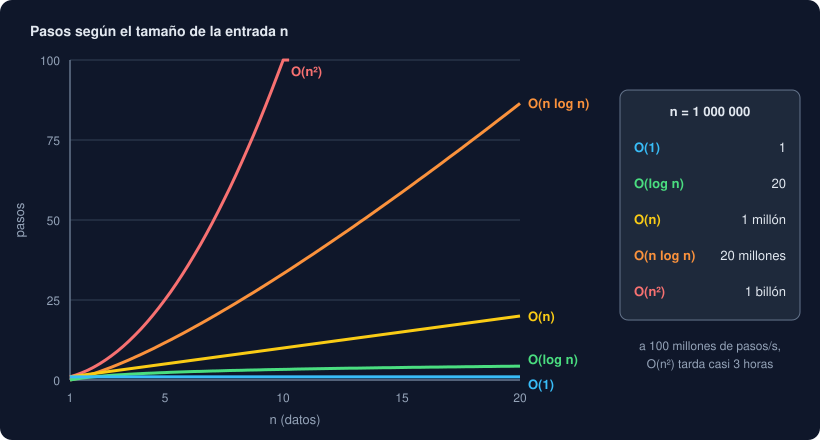

# 01 · Algoritmos y Big-O

⏱️ 1 h

## 🎯 Objetivos

- Explicar qué es un algoritmo y por qué dos soluciones correctas pueden tardar muy distinto.
- Estimar el orden de un trozo de código contando cuántas veces se repite su trabajo.
- Reconocer O(1), O(log n), O(n), O(n log n) y O(n²), y elegir el más barato.
- Medir tiempos con `time.perf_counter` y `timeit` sin engañarte.

---

## 1. Qué es un algoritmo

Un **algoritmo** es una receta: una lista finita de pasos que, a partir de una entrada, da una salida. "Recorre los registros y suma uno al contador de su nivel" es un algoritmo; `level_counts` de la semana 5 es su versión en Python.

Un mismo problema admite muchos algoritmos. Para saber si en una lista de medidas hay alguna repetida puedes:

1. Comparar cada medida con todas las demás.
2. Recorrerlas una vez y guardar en un set las que ya viste.

Las dos dan la misma respuesta. Con 4 000 medidas, la primera tarda cientos de milisegundos y la segunda una fracción de milisegundo (lo mides en el ejercicio 01). Con un millón, la primera tardaría horas. La diferencia no está en Python ni en tu máquina: está en **cuánto trabajo hace cada algoritmo cuando crece la entrada**.

## 2. Contar pasos en lugar de segundos

Los segundos dependen de tu máquina, de lo que esté haciendo y de la versión de Python. Los **pasos** no. Un paso es una operación sencilla que tarda siempre lo mismo: una comparación, una suma, leer `values[i]`, buscar en un set.

```python
def total(values: list[float]) -> float:
    result = 0.0              # 1 paso
    for value in values:      # se repite n veces...
        result += value       # ...1 paso cada vez
    return result             # 1 paso
```

Con `n` valores son `n + 2` pasos. Cuando `n` es grande, el `+ 2` no importa: lo que cuenta es que el trabajo crece **igual que** `n`. Se escribe **O(n)** y se lee "o de ene" u "orden ene".

```python
def has_duplicates_slow(values: list[int]) -> bool:
    for i in range(len(values)):              # n veces...
        for j in range(i + 1, len(values)):   # ...hasta n veces cada una
            if values[i] == values[j]:
                return True
    return False
```

El bucle de dentro se repite unas `n / 2` veces de media por cada vuelta del de fuera: unos `n² / 2` pasos. Se escribe **O(n²)**: se quitan las constantes (el `/ 2`) y los términos pequeños, porque solo interesa **cómo crece**.

Reglas para estimar a ojo:

| Si el código... | El orden es... |
|---|---|
| Hace un número fijo de pasos, sin bucles que dependan de `n` | O(1) |
| Recorre los datos una vez | O(n) |
| Recorre los datos una vez **por cada** dato (dos bucles anidados) | O(n²) |
| Descarta la mitad de lo que queda en cada vuelta | O(log n) |
| Ordena | O(n log n) |
| Hace dos recorridos seguidos, uno detrás del otro | O(n) + O(n) = O(n) |

Big-O describe normalmente el **peor caso**: `x in lista` puede encontrarlo a la primera, pero si no está, mira los `n`. Cuando digas "esto es O(n)", piensa "en el peor caso, el trabajo crece como `n`".

## 3. Los órdenes que vas a ver



| Orden | Nombre | Ejemplo en Python | Con n = 1 000 000 |
|---|---|---|---|
| O(1) | Constante | `d[clave]`, `x in conjunto`, `lista[i]`, `lista.append(x)` | 1 paso |
| O(log n) | Logarítmico | Búsqueda binaria, `bisect` (teoría 02) | 20 pasos |
| O(n) | Lineal | `x in lista`, `sum`, `max`, un `for` sobre los datos | 1 millón |
| O(n log n) | "Ene log ene" | `sorted`, `list.sort` (teoría 03) | 20 millones |
| O(n²) | Cuadrático | Dos bucles anidados sobre los mismos datos | 1 billón |

Una máquina corriente hace del orden de 100 millones de pasos sencillos de Python por segundo, o menos. Con un millón de datos, O(n) es instantáneo, O(n log n) tarda una fracción de segundo y O(n²) tarda horas.

El logaritmo en base 2 de `n` es cuántas veces puedes partir `n` por la mitad hasta llegar a 1: `log₂ 1 000 000 ≈ 20`. Por eso un algoritmo que descarta la mitad en cada paso es tan rápido.

## 4. El coste de las operaciones de Python

Elegir bien la colección es la forma más barata de cambiar de orden:

| Operación | `list` | `set` / `dict` | `deque` (teoría 04) |
|---|---|---|---|
| `x in ...` | O(n) | O(1) | O(n) |
| Leer o cambiar por posición `[i]` | O(1) | — | O(n) en el centro |
| Leer o cambiar por clave `[k]` | — | O(1) | — |
| Añadir al final | O(1) | O(1) (`add`) | O(1) |
| Añadir o quitar al principio | O(n) | — | O(1) |
| `len(...)` | O(1) | O(1) | O(1) |
| Ordenar | O(n log n) | — | — |

Un `in` sobre una lista dentro de un `for` es la forma más común de escribir O(n²) sin darte cuenta:

```python
# O(n · m): por cada etiqueta, recorre toda la lista de permitidas
valid = [label for label in labels if label in allowed_list]

# O(n + m): construye el set una vez y cada búsqueda es O(1)
allowed = set(allowed_list)
valid = [label for label in labels if label in allowed]
```

Los dos ejemplos tienen la misma forma. Solo cambia la colección donde se busca.

## 5. Medir sin engañarte

Big-O dice cómo **crece** el trabajo, no cuánto tarda. Para saberlo, mide. Python trae dos herramientas:

```python
import time

start = time.perf_counter()
result = sum(values)
elapsed = time.perf_counter() - start     # segundos, con muchos decimales
print(f"{elapsed * 1000:.2f} ms")
```

`perf_counter` es un reloj de alta precisión cuyo valor suelto no significa nada; solo tiene sentido **restar** dos lecturas. Una sola medida engaña: tu sistema operativo hace otras cosas a la vez. `timeit` repite la instrucción muchas veces:

```python
import timeit

seconds = timeit.timeit("target in data", globals=globals(), number=1_000)
```

`number` es cuántas veces se repite, y el resultado es el **total** en segundos. `globals=globals()` le deja ver los nombres de tu programa. Desde la terminal, sin escribir un archivo:

```bash
uv run python -m timeit -s "data = list(range(100_000))" "99_999 in data"
```

```
500 loops, best of 5: 634 usec per loop
```

Reglas para medir bien:

| Regla | Por qué |
|---|---|
| Mide varias veces y quédate con la mejor | Las peores tienen ruido de otros programas |
| Compara **tamaños**, no un solo número | Si al doblar `n` el tiempo se dobla, es O(n); si se multiplica por 4, O(n²) |
| Mide el peor caso | Buscar el primer elemento siempre es rápido |
| No midas antes de que funcione | Primero correcto, después rápido |
| No optimices lo que no es lento | Un O(n²) con 20 datos es instantáneo; cámbialo cuando los datos crezcan |

En la semana 22 medirás programas enteros con `cProfile` y `py-spy` para saber **qué** parte es la lenta.

## 6. Cómo se aplica en el proyecto

Cada función de `trends.py` recorre los datos una vez, O(n), salvo `median`, que ordena: O(n log n). La más interesante es `moving_average`: la versión obvia vuelve a sumar toda la ventana para cada media, O(n · k) con ventana `k`; la tuya guarda el total, suma el valor que entra y resta el que sale, O(n). `test_moving_average_is_linear` lo comprueba con 200 000 valores y una ventana de 1 000.

---

## ⚠️ Errores frecuentes

| Error | Causa | Arreglo |
|---|---|---|
| Un programa que iba bien se vuelve lentísimo con más datos | Un `in` sobre una lista, o un `.index`, dentro de un bucle: O(n²) | Busca en un set o un diccionario |
| "Mi O(n²) es más rápido que tu O(n)" | Con pocos datos, las constantes pesan más que el orden | Mide con tamaños grandes; el orden manda cuando `n` crece |
| Un tiempo distinto en cada ejecución | El sistema hace otras cosas | `timeit`, varias repeticiones, la mejor |
| `NameError` dentro de `timeit` | `timeit` no ve tus variables | `globals=globals()` o `setup="..."` |
| Optimizar antes de tener tests | Un cambio "más rápido" rompe algo | Primero los tests en verde; después, refactoriza y mide |

## ✅ Qué debes saber al terminar

- [ ] Por qué se cuentan pasos y no segundos.
- [ ] El orden de un bucle, de dos bucles anidados y de una búsqueda binaria.
- [ ] La tabla de los cinco órdenes y cuántos pasos da cada uno con un millón de datos.
- [ ] El coste de `in` en una lista, un set y un diccionario.
- [ ] Cómo medir con `perf_counter` y con `timeit`, y por qué una sola medida no basta.

---

## 🔗 Navegación

| Anterior | Actual | Siguiente |
| -------- | ------ | --------- |
| [Semana 06](../README.md) | **01 · Algoritmos y Big-O** | [02 · Buscar](02-buscar.md) |
