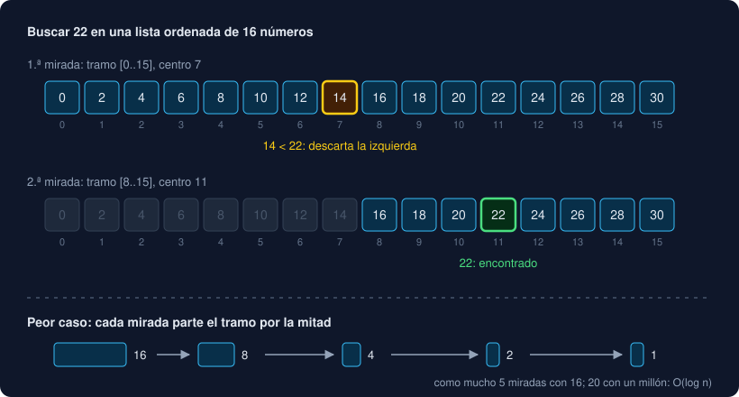

# 02 · Buscar

⏱️ 45 min

## 🎯 Objetivos

- Distinguir la búsqueda lineal de la binaria y saber cuándo sirve cada una.
- Seguir a mano una búsqueda binaria y explicar por qué es O(log n).
- Usar `bisect` para buscar, contar e insertar en una lista ordenada.
- Elegir entre buscar en una lista, ordenarla y usar `bisect`, o usar un set.

---

## 1. Búsqueda lineal

Mirar los elementos uno a uno hasta encontrar el que buscas:

```python
def linear_search(values: list[float], target: float) -> int:
    """La posición de target en values, o -1 si no está."""
    for position, value in enumerate(values):
        if value == target:
            return position
    return -1
```

Es lo que hacen `x in lista` y `lista.index(x)`. Funciona con **cualquier** lista, ordenada o no, y es O(n): si el elemento no está, mira los `n`. Para una búsqueda suelta en una lista pequeña, es lo correcto.

`lista.index(x)` lanza `ValueError: list.index(x): x not in list` si no lo encuentra. Pregunta antes con `in`, o usa la versión que devuelve `-1`.

## 2. Búsqueda binaria

Si la lista está **ordenada**, puedes hacerlo mucho mejor. Es como buscar una palabra en un diccionario de papel: abres por el centro, ves si la palabra va antes o después, y descartas la mitad.

```python
def binary_search(values: list[int], target: int) -> int:
    """La posición de target en values (ordenada), o -1 si no está."""
    low, high = 0, len(values) - 1
    while low <= high:
        middle = (low + high) // 2
        if values[middle] == target:
            return middle
        if values[middle] < target:
            low = middle + 1      # está a la derecha: descarta la izquierda
        else:
            high = middle - 1     # está a la izquierda: descarta la derecha
    return -1
```



`low` y `high` marcan el tramo donde todavía puede estar. Cada vuelta lo parte por la mitad: con 16 elementos, 16 → 8 → 4 → 2 → 1, como mucho 5 miradas. Con un millón, 20. Eso es **O(log n)**.

| Elementos | Búsqueda lineal (peor caso) | Búsqueda binaria (peor caso) |
|---|---|---|
| 16 | 16 | 5 |
| 1 000 | 1 000 | 10 |
| 1 000 000 | 1 000 000 | 20 |
| 1 000 000 000 | 1 000 000 000 | 30 |

La condición es dura: **la lista tiene que estar ordenada**. Con una lista desordenada, la búsqueda binaria no da error: da una respuesta equivocada sin avisar.

Escribir una búsqueda binaria a mano es famoso por sus errores (un `<` donde va `<=`, olvidar el `+ 1` y entrar en un bucle infinito). Escríbela una vez para entenderla, en el ejercicio 02; después usa `bisect`.

## 3. `bisect`

El módulo `bisect` de la biblioteca estándar hace búsquedas binarias en listas ordenadas:

```python
import bisect

ordered = [8.0, 9.5, 12.5, 22.4, 30.1, 48.9, 55.1, 61.0]

bisect.bisect_left(ordered, 30)      # 4: 30 iría en la posición 4
bisect.bisect_left(ordered, 48.9)    # 5: antes del 48.9 que ya está
bisect.bisect_right(ordered, 48.9)   # 6: después del 48.9 que ya está
bisect.insort(ordered, 40.0)         # inserta 40.0 en su sitio
```

| Función | Qué devuelve | Para qué |
|---|---|---|
| `bisect_left(a, x)` | La posición donde iría `x`, antes de los iguales | Cuántos elementos son **menores** que `x`; si `x` está |
| `bisect_right(a, x)` | La posición donde iría `x`, después de los iguales | Cuántos son **menores o iguales** que `x` |
| `insort(a, x)` | Nada: inserta `x` en su sitio | Mantener una lista siempre ordenada |

`bisect_left(a, x)` es a la vez una posición y una cuenta: si `x` iría en la posición 4, hay 4 elementos menores que él. Con eso respondes "¿qué porcentaje de las medidas está por debajo de 30?" sin recorrerlas.

Para saber si un valor está:

```python
position = bisect.bisect_left(ordered, target)
found = position < len(ordered) and ordered[position] == target
```

`insort` encuentra el sitio en O(log n), pero insertar en una lista obliga a correr los elementos de detrás: O(n). Para muchas inserciones hay estructuras mejores; para unas pocas, sirve.

### Clasificar por tramos

El ejemplo clásico de la documentación es poner notas por tramos. Con umbrales ordenados, `bisect_right` dice en qué tramo cae cada valor:

```python
thresholds = [10.0, 50.0]
names = ["bajo", "medio", "alto"]
names[bisect.bisect_right(thresholds, 8.0)]    # 'bajo'
names[bisect.bisect_right(thresholds, 10.0)]   # 'medio'
names[bisect.bisect_right(thresholds, 61.0)]   # 'alto'
```

Es tu `classify` de la semana 2, pero sirve igual con 2 umbrales que con 20.

## 4. ¿Cuál uso?

| Situación | Usa | Coste |
|---|---|---|
| Una búsqueda en una lista cualquiera | `x in lista` | O(n) |
| Muchas búsquedas de "¿está?" | Un `set`, construido una vez | O(n) al crearlo, O(1) cada búsqueda |
| Buscar por clave y obtener un valor | Un `dict` | O(1) |
| Preguntas de **orden**: cuántos menores que `x`, en qué tramo cae, el siguiente mayor | Ordenar una vez y `bisect` | O(n log n) al ordenar, O(log n) cada pregunta |
| Una sola pregunta de orden | Un recorrido: `sum(1 for v in values if v < x)` | O(n), más barato que ordenar |

Ordenar para hacer una sola búsqueda binaria no compensa: ordenar es O(n log n) y una búsqueda lineal es O(n). La búsqueda binaria brilla cuando ordenas **una vez** y preguntas **muchas**.

Un set responde "¿está?" más rápido que `bisect`, pero no sabe nada de orden: no puede decirte cuántos elementos son menores que 30.

---

## ⚠️ Errores frecuentes

| Error | Causa | Arreglo |
|---|---|---|
| La búsqueda binaria dice que no está y sí está | La lista no estaba ordenada | Ordénala antes; `bisect` no lo comprueba |
| Bucle infinito en la búsqueda binaria | `low = middle` en lugar de `low = middle + 1` | El tramo tiene que encogerse en cada vuelta |
| `ValueError: list.index(x): x not in list` | `.index` de un elemento que no está | Pregunta con `in` antes |
| Creer que `bisect_left` dice si el valor está | Devuelve dónde **iría** | Comprueba también `ordered[position] == target` |
| Ordenar para una sola búsqueda | O(n log n) para ahorrar un O(n) | Búsqueda lineal |

## ✅ Qué debes saber al terminar

- [ ] Cuándo sirve la búsqueda lineal y cuándo la binaria.
- [ ] Por qué la búsqueda binaria es O(log n) y qué pasa si la lista no está ordenada.
- [ ] Qué devuelven `bisect_left` y `bisect_right`, y cómo contar con ellos.
- [ ] Cómo clasificar un valor por tramos con `bisect_right`.
- [ ] Cuándo compensa ordenar y usar `bisect`, y cuándo un set.

---

## 🔗 Navegación

| Anterior | Actual | Siguiente |
| -------- | ------ | --------- |
| [01 · Algoritmos y Big-O](01-algoritmos-y-big-o.md) | **02 · Buscar** | [03 · Ordenar](03-ordenar.md) |
