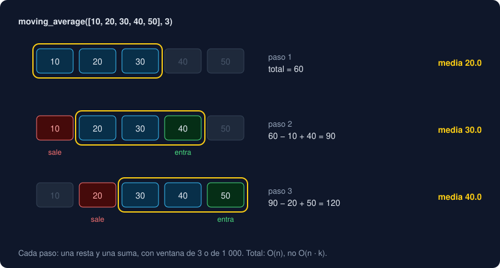

# 04 · collections

⏱️ 45 min

## 🎯 Objetivos

- Contar con `Counter` y sacar los más frecuentes con `most_common`.
- Agrupar con `defaultdict` y evitar la trampa de las claves que aparecen solas.
- Usar `deque` como cola y como ventana deslizante, y calcular una media móvil en O(n).
- Dar nombre a las partes de una tupla con `namedtuple`.

---

El módulo `collections` de la biblioteca estándar trae colecciones especializadas: cada una resuelve en una línea un patrón que en la semana 5 escribiste a mano.

| Patrón de la semana 5 | Herramienta |
|---|---|
| `counts[k] = counts.get(k, 0) + 1` | `Counter` |
| `groups.setdefault(k, []).append(v)` | `defaultdict(list)` |
| `values.pop(0)` en una lista | `deque.popleft()` |
| `record[1]` en una tupla | `namedtuple`: `record.value` |

## 1. `Counter`

Un `Counter` es un diccionario que cuenta. Recibe cualquier iterable:

```python
from collections import Counter

counts = Counter(["alto", "bajo", "alto", "medio", "alto", "bajo"])
counts                    # Counter({'alto': 3, 'bajo': 2, 'medio': 1})
counts["alto"]            # 3
counts["sin dato"]        # 0: una clave que no está vale 0, sin KeyError
counts.most_common(2)     # [('alto', 3), ('bajo', 2)]
counts.update(["bajo"])   # suma, no sustituye
counts.total()            # 7: la suma de todos los conteos
```

`most_common(n)` devuelve las `n` parejas `(elemento, conteo)` más frecuentes; sin `n`, todas. Con conteos iguales, primero el que apareció antes. `most_common_labels` del proyecto es una línea:

```python
Counter(label for label, _ in records).most_common(n)
```

La expresión generadora le pasa las etiquetas sin crear una lista intermedia. Contar es O(n): una pasada.

Los `Counter` se suman y se restan: `Counter(lunes) + Counter(martes)` junta los conteos de los dos días.

## 2. `defaultdict`

Un `defaultdict` es un diccionario que, cuando pides una clave que no está, **crea** su valor llamando a una función y lo guarda:

```python
from collections import defaultdict

groups: defaultdict[str, list[float]] = defaultdict(list)
for label, value in records:
    groups[label].append(value)
```

`defaultdict(list)` llama a `list()` y crea una lista vacía. Con `defaultdict(int)` crearía un `0` (un contador) y con `defaultdict(set)`, un conjunto vacío. Se le pasa la función **sin paréntesis**: `defaultdict(list)`, no `defaultdict([])`, que da `TypeError: first argument must be callable or None`.

La trampa: **leer** una clave que no está también la crea.

```python
"Oeste" in groups       # False
groups["Oeste"]         # [] ... y ahora la clave existe
"Oeste" in groups       # True
```

Por eso, cuando una función agrupa con `defaultdict`, devuelve un diccionario normal: `return dict(groups)`. Quien lo reciba y pregunte por una etiqueta que no existe verá un `KeyError`, como espera, en lugar de una lista vacía nueva. Es la refactorización de `values_by_label` del proyecto. Para preguntar sin crear, `in` y `.get` no crean nada.

¿`setdefault` o `defaultdict`? Hacen lo mismo. `defaultdict` se lee mejor cuando agrupas en un bucle; `setdefault` vale para un diccionario normal que ya tienes.

## 3. `deque`: colas y ventanas

Un `deque` (*double-ended queue*, "cola de dos extremos", se pronuncia "dec") añade y quita por los dos extremos en O(1):

```python
from collections import deque

queue = deque(["Norte", "Sur"])
queue.append("Este")        # por la derecha
queue.appendleft("Oeste")   # por la izquierda
queue.popleft()             # 'Oeste'
queue.pop()                 # 'Este'
```

Una lista es un bloque de posiciones seguidas: añadir o quitar al final es O(1), pero `lista.pop(0)` o `lista.insert(0, x)` obligan a correr todas las demás, O(n). Si necesitas una cola (el primero que entra es el primero que sale), usa un `deque`. En cambio, leer `d[i]` en el centro de un deque es O(n): para acceder por posición, la lista.

### Ventana deslizante con `maxlen`

Con `maxlen`, el deque guarda como mucho ese número de elementos. Cuando está lleno y añades uno, el del otro extremo sale solo:

```python
last_three: deque[float] = deque(maxlen=3)
for value in [10.0, 20.0, 30.0, 40.0]:
    last_three.append(value)
# deque([20.0, 30.0, 40.0], maxlen=3)
```

Eso es una **ventana deslizante**: siempre los últimos `k` valores. Sirve para la **media móvil**, la media de cada tramo de `k` valores seguidos. Suaviza el ruido de unas medidas y deja ver la tendencia; en pandas es `rolling(3).mean()` (semana 25).



La forma obvia vuelve a sumar la ventana entera en cada paso: `sum(window) / k`. Con `n` valores y ventana `k` son `n · k` sumas: **O(n · k)**. Con una ventana de 1 000 sobre 200 000 valores, 200 millones de sumas.

La forma buena guarda el total de la ventana. En cada paso, **resta** el valor que sale y **suma** el que entra: dos operaciones, sea cual sea `k`. En total, **O(n)**:

| Paso | Ventana | Sale | Entra | Total | Media |
|---|---|---|---|---|---|
| 3 | 10, 20, 30 | — | 30 | 60 | 20.0 |
| 4 | 20, 30, 40 | 10 | 40 | 60 − 10 + 40 = 90 | 30.0 |
| 5 | 30, 40, 50 | 20 | 50 | 90 − 20 + 50 = 120 | 40.0 |

El orden importa: el que sale es `recent[0]`, y hay que restarlo **antes** de añadir el nuevo, porque con `maxlen` el `append` lo expulsa y ya no está para leerlo.

## 4. `namedtuple`

Una `namedtuple` es una tupla con nombres para sus partes:

```python
from collections import namedtuple

Reading = namedtuple("Reading", ["label", "value"])
reading = Reading("Norte", 12.5)
reading.value               # 12.5, en lugar de reading[1]
label, value = reading      # sigue siendo una tupla: se desempaqueta
reading._replace(value=13)  # una tupla nueva con un campo cambiado
```

Como toda tupla, no cambia: `reading.value = 13.0` da `AttributeError: can't set attribute`. Es útil cuando una tupla tiene varias partes y `record[2]` ya no dice nada. Existe también `typing.NamedTuple`, que añade tipos a cada campo; en la semana 9 verás `dataclasses`, que suelen ser la mejor opción para registros con nombre. El proyecto sigue usando el alias `Record = tuple[str, float | None]`: con dos partes y el desempaquetado de la semana 5, se lee bien.

---

## ⚠️ Errores frecuentes

| Error | Causa | Arreglo |
|---|---|---|
| `TypeError: first argument must be callable or None` | `defaultdict([])` | `defaultdict(list)`: la función, sin paréntesis |
| Aparecen claves con listas vacías | Leíste `groups[clave]` de un `defaultdict` | `in` o `.get` para preguntar; devuelve `dict(groups)` |
| `IndexError: deque index out of range` | Una posición que el deque no tiene todavía | Mira `len(d)` antes |
| La media móvil no cuadra | Restas `recent[0]` después del `append` | Resta antes de añadir |
| `AttributeError: can't set attribute` | Asignar a un campo de una `namedtuple` | `_replace` crea una nueva |
| Un programa con `pop(0)` en un bucle es lento | `pop(0)` es O(n) en una lista | `deque.popleft()` |

## ✅ Qué debes saber al terminar

- [ ] Qué hace `Counter`, qué da una clave que no está y qué devuelve `most_common`.
- [ ] Cómo agrupar con `defaultdict` y por qué se devuelve `dict(groups)`.
- [ ] Por qué `deque.popleft()` es O(1) y `list.pop(0)` es O(n).
- [ ] Cómo funciona una ventana con `maxlen` y cómo calcular la media móvil en O(n).
- [ ] Para qué sirve una `namedtuple` y en qué se parece a una tupla.

---

## 🔗 Navegación

| Anterior | Actual | Siguiente |
| -------- | ------ | --------- |
| [03 · Ordenar](03-ordenar.md) | **04 · collections** | [05 · itertools](05-itertools.md) |
