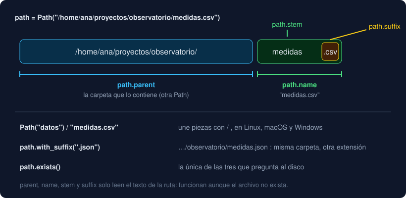

# 01 · `pathlib` y archivos de texto

⏱️ 50 min

## 🎯 Objetivos

- Construir y desmontar rutas con `pathlib.Path` en lugar de pegar strings.
- Distinguir una ruta relativa de una absoluta y saber desde dónde se resuelve.
- Abrir, leer y escribir archivos de texto con `with` y `encoding="utf-8"`.
- Elegir el modo de apertura correcto: `"r"`, `"w"`, `"a"` o `"x"`.

---

## 1. Una ruta es un objeto, no un string

Un programa que solo lee de la terminal pierde todo al cerrarse. Para guardar datos hay que escribir **archivos**, y para encontrar un archivo hay que dar su **ruta**: el camino de carpetas hasta él.

Durante años, en Python las rutas eran strings: `"datos/" + nombre + ".csv"`. Funciona hasta que alguien olvida una barra, o el programa corre en Windows, que separa con `\`. El módulo `pathlib` de la biblioteca estándar las convierte en objetos `Path` que saben partirse y unirse solos:

```python
from pathlib import Path

path = Path("/home/ana/proyectos/observatorio/medidas.csv")
path.parent      # Path('/home/ana/proyectos/observatorio')
path.name        # 'medidas.csv'
path.stem        # 'medidas'
path.suffix      # '.csv'
path.with_suffix(".json")   # Path('/home/ana/proyectos/observatorio/medidas.json')
```



El operador `/` une piezas, sea cual sea el sistema:

```python
Path("datos") / "2026" / "medidas.csv"    # Path('datos/2026/medidas.csv')
```

`parent`, `name`, `stem`, `suffix` y `/` solo trabajan con el **texto** de la ruta: funcionan aunque el archivo no exista. Las que preguntan al disco son otras:

| Pregunta | Método |
|---|---|
| ¿Existe? | `path.exists()` |
| ¿Es un archivo? ¿Una carpeta? | `path.is_file()`, `path.is_dir()` |
| ¿Qué hay en esta carpeta? | `path.iterdir()`, `path.glob("*.csv")` |
| Crea la carpeta (y las de arriba si faltan) | `path.mkdir(parents=True, exist_ok=True)` |
| Borra el archivo | `path.unlink()` |

`glob("*.csv")` da un iterador con los archivos que encajan con el patrón: `*` es "cualquier cosa". `rglob` busca también en las subcarpetas.

## 2. Relativa o absoluta

Una ruta **absoluta** empieza en la raíz (`/home/ana/...` en Linux y macOS, `C:\Users\ana\...` en Windows) y señala siempre al mismo sitio. Una **relativa** (`medidas.csv`, `datos/medidas.csv`) se resuelve desde la **carpeta de trabajo**, la carpeta donde estabas cuando lanzaste el programa, no la carpeta donde está el `.py`:

```python
Path.cwd()                       # la carpeta de trabajo
Path("medidas.csv").resolve()    # la ruta absoluta a la que apunta
```

Por eso `uv run observatorio -f medidas.csv` funciona en la raíz del proyecto y falla con `FileNotFoundError` si antes haces `cd src`. No es un error del programa: la ruta relativa apunta a otro sitio. `Path.home()` da tu carpeta personal, y `~` no se expande solo: `Path("~/datos").expanduser()`.

## 3. Abrir un archivo con `with`

Para leer o escribir, se **abre** el archivo, se trabaja y se **cierra**. Cerrar importa: un archivo escrito y sin cerrar puede quedarse a medias en el disco, y cada sistema limita cuántos archivos abiertos puede tener un programa. La forma correcta es `with`, que lo cierra solo al salir del bloque, también si salta un error (teoría 03):

```python
with path.open(encoding="utf-8") as file:
    text = file.read()
# aquí el archivo ya está cerrado
```

`path.open(...)` hace lo mismo que la función `open(path, ...)`. Formas de leer:

| Código | Da | Cuándo |
|---|---|---|
| `file.read()` | Todo el texto en un string | Archivos pequeños o medianos |
| `file.read().splitlines()` | Lista de líneas **sin** `\n` | Lo más cómodo para procesar líneas |
| `file.readlines()` o `list(file)` | Lista de líneas **con** `\n` | Rara vez lo que quieres |
| `for line in file:` | Una línea cada vez, con `\n` | Archivos enormes: no carga todo en memoria |

Para un archivo pequeño hay un atajo que abre, lee y cierra en una línea: `path.read_text(encoding="utf-8")`, y su pareja `path.write_text(texto, encoding="utf-8")`. Los tests del proyecto los usan para preparar archivos.

## 4. `encoding="utf-8"`, siempre

Un archivo de texto son **bytes**. Para convertirlos en letras hace falta saber la **codificación**: la tabla que dice qué bytes son qué letra. UTF-8 es el estándar de hoy, y escribe la `ñ` con dos bytes. Una codificación antigua como Latin-1 la escribe con uno. Si lees con una tabla un archivo escrito con otra:

```
UnicodeDecodeError: 'utf-8' codec can't decode byte 0xf1 in position 2: invalid continuation byte
```

Sin `encoding=`, Python usa la codificación del sistema: UTF-8 en Linux y macOS, y en Windows a menudo otra. El mismo programa funciona en tu máquina y rompe las tildes en la de tu compañero. Pon siempre `encoding="utf-8"` y el resultado no dependerá del sistema.

## 5. Escribir: los modos

El segundo argumento de `open` es el **modo**:

| Modo | Hace | Si el archivo existe | Si no existe |
|---|---|---|---|
| `"r"` (por defecto) | Leer | Lo lee | `FileNotFoundError` |
| `"w"` | Escribir | **Lo vacía** y escribe desde cero | Lo crea |
| `"a"` | Añadir al final | Escribe detrás de lo que había | Lo crea |
| `"x"` | Crear | `FileExistsError` | Lo crea |

```python
with path.open("w", encoding="utf-8") as file:
    file.write("etiqueta;valor\n")     # write no añade el salto de línea: lo pones tú
    file.write("Norte;12,5\n")
```

`"w"` es el que más se usa y el más peligroso: abre y vacía en el mismo instante, antes de que escribas nada. `"a"` sirve para un registro (*log*) que crece. `"x"` sirve cuando pisar un archivo existente sería un error. La carpeta tiene que existir: si no, `FileNotFoundError` también al escribir.

---

## ⚠️ Errores frecuentes

| Error | Causa | Arreglo |
|---|---|---|
| `FileNotFoundError: [Errno 2] No such file or directory: 'medidas.csv'` | La ruta relativa se resuelve desde otra carpeta | Lanza el programa desde la raíz, o mira `Path.cwd()` |
| `IsADirectoryError: [Errno 21] Is a directory: '.'` | Abriste una carpeta como archivo | Comprueba con `is_file()` o captura el error |
| `UnicodeDecodeError: 'utf-8' codec can't decode byte 0xf1 ...` | El archivo no está en UTF-8 | Guárdalo como UTF-8, o captura el error y avisa |
| Las líneas acaban en `\n` y las comparaciones fallan | `readlines()` o `for line in file` | `read().splitlines()` o `line.rstrip("\n")` |
| El archivo quedó vacío | Abriste en `"w"` para leer | `"r"` para leer, `"a"` para añadir |
| `ValueError: I/O operation on closed file.` | Usaste `file` fuera del `with` | Trabaja dentro del bloque |

## ✅ Qué debes saber al terminar

- [ ] Qué dan `parent`, `name`, `stem` y `suffix` de una ruta, y cómo se unen piezas con `/`.
- [ ] Desde dónde se resuelve una ruta relativa.
- [ ] Por qué se abre con `with` y qué diferencia hay entre `read().splitlines()` y `readlines()`.
- [ ] Por qué `encoding="utf-8"` siempre.
- [ ] Qué hace cada modo: `"r"`, `"w"`, `"a"` y `"x"`.

---

## 🔗 Navegación

| Anterior | Actual | Siguiente |
| -------- | ------ | --------- |
| [Semana 07](../README.md) | **01 · `pathlib` y archivos** | [02 · Excepciones](02-excepciones.md) |
