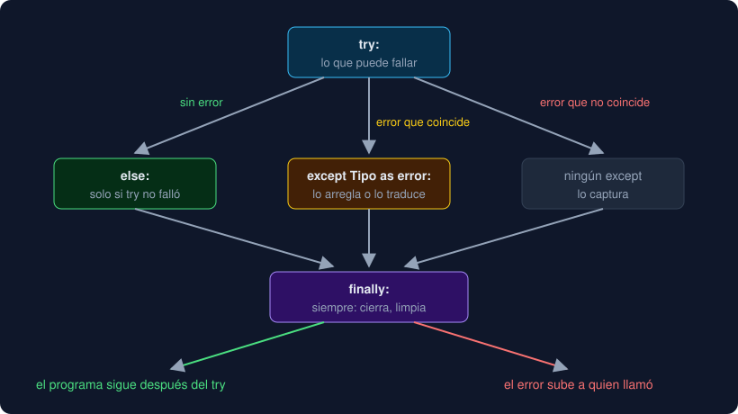

# 02 · Excepciones

⏱️ 55 min

## 🎯 Objetivos

- Leer un *traceback* y entender qué es una excepción y cómo sube por las llamadas.
- Capturar con `try` y `except`, y saber para qué sirven `else` y `finally`.
- Lanzar con `raise`, traducir con `raise ... from` y crear excepciones propias.
- Decidir qué capturar y dónde: capturar poco, cerca de donde se puede hacer algo.

---

## 1. Qué es una excepción

Desde la semana 1 has visto mensajes como este:

```
Traceback (most recent call last):
  File "main.py", line 3, in <module>
    total = int("12,5")
ValueError: invalid literal for int() with base 10: '12,5'
```

Es una **excepción**: un objeto que Python crea cuando algo no puede seguir como estaba previsto. Su **tipo** (`ValueError`) dice qué clase de problema es, y su **mensaje** cuenta el detalle. El *traceback* se lee **de abajo arriba**: la última línea es el error, y encima está el camino de llamadas que llevó hasta él.

Cuando salta una excepción, la función se corta en esa línea y la excepción **sube** a la función que la llamó, y de ahí a la siguiente, hasta que alguien la captura. Si nadie lo hace, el programa termina con el *traceback*. Las que más vas a ver:

| Tipo | Cuándo | Ejemplo |
|---|---|---|
| `ValueError` | El tipo es correcto, el valor no | `float("12,5")` |
| `TypeError` | El tipo no vale para esa operación | `"3" + 4` |
| `KeyError` | La clave no está en el diccionario | `{}["Norte"]` |
| `IndexError` | La posición no está en la lista | `[][0]` |
| `ZeroDivisionError` | División entre cero | `1 / 0` |
| `FileNotFoundError` | El archivo no existe | `open("no.txt")` |

## 2. `try` y `except`

Para **capturar** una excepción, el código que puede fallar va en un `try`, y lo que hacer si falla, en un `except` con el tipo que esperas:

```python
def parse_number(text: str) -> float | None:
    try:
        return float(text.replace(",", "."))
    except ValueError:
        return None
```

Si `float` falla con `ValueError`, Python salta al `except` y la función devuelve `None`. Si no falla, el `except` no se ejecuta. Si salta **otro** tipo, el `except` no lo captura y sigue subiendo.

Con `as`, el `except` recibe la excepción para leer su mensaje:

```python
try:
    file = path.open(encoding="utf-8")
except FileNotFoundError as error:
    print(f"error: {error}")    # error: [Errno 2] No such file or directory: 'no.txt'
```

Python borra la variable `error` al salir del `except`. Usarla después da `NameError`, y `mypy` avisa con `Trying to read deleted variable "error"`.

Varios tipos con el mismo arreglo se capturan juntos: `except (ValueError, TypeError):`. Desde Python 3.14, sin `as`, los paréntesis son opcionales: `except ValueError, TypeError:`. Varios `except` seguidos se prueban en orden, y entra solo el primero que coincide.

## 3. `else` y `finally`

```python
try:
    value = float(text)
except ValueError:
    print("no es un número")
else:
    print(f"leído: {value}")    # solo si el try no falló
finally:
    print("fin")                # siempre, falle o no
```



`else` mantiene el `try` corto: dentro del `try` va **solo** lo que puede fallar con ese tipo, y lo que viene después va en el `else`. Así el `except` no captura por accidente un error de otra línea. `finally` es para limpiar (cerrar, borrar un temporal) pase lo que pase, incluso si la excepción sigue subiendo. En la práctica, casi siempre lo hace un `with` por ti (teoría 03). Un `return` dentro de `finally` se come la excepción en vuelo, y Python 3.14 avisa con `SyntaxWarning: 'return' in a 'finally' block`.

## 4. Lanzar: `raise`

Tus funciones también pueden lanzar excepciones. Es lo que hace `median` de la semana 6 con una lista vacía:

```python
if not values:
    raise ValueError("no hay mediana de una lista vacía")
```

Lanzar es mejor que devolver un valor inventado (`0.0`, `-1`) que alguien puede confundir con un dato real. La excepción obliga a quien llama a decidir qué hacer, y si no decide, el programa para en lugar de seguir con un número falso.

## 5. Traducir: `raise ... from`

Una función de bajo nivel recibe errores de bajo nivel: `FileNotFoundError`, `UnicodeDecodeError`, `json.JSONDecodeError`. A quien la llama no le interesa cuál de los tres fue. Le interesa saber que **el archivo de datos no sirve**, y por qué, en su idioma. Para eso se captura el error original y se lanza otro con más sentido:

```python
try:
    with path.open(encoding="utf-8") as file:
        return file.read().splitlines()
except FileNotFoundError as error:
    raise DataFileError(f"no existe el archivo {path}") from error
```

`from error` guarda el original en el atributo `__cause__` de la nueva. Si la nueva llega sin capturar, el *traceback* muestra las dos, unidas por la frase `The above exception was the direct cause of the following exception`. Sin `from`, el original se pierde para quien depura, o aparece como si hubiera habido un segundo error mientras se trataba el primero.

## 6. Excepciones propias

Una excepción propia es una clase que hereda de `Exception`. Basta una línea y un docstring:

```python
class DataFileError(Exception):
    """Un archivo de datos que no se puede leer o escribir."""


error = DataFileError("no existe el archivo medidas.csv")
str(error)    # 'no existe el archivo medidas.csv'
```

En la semana 9 verás las clases a fondo; de momento, `class Nombre(Exception):` es todo lo que necesitas. Las excepciones forman una **jerarquía**: `except OSError` captura también `FileNotFoundError`, `IsADirectoryError` y `PermissionError`, porque son de la misma familia. Y `except DataFileError` captura solo la tuya, que es lo que quieres en `main`: un solo `except` para todos los problemas de archivos, sin capturar los demás.

## 7. Qué capturar y dónde

| Regla | Por qué |
|---|---|
| Captura un tipo concreto, nunca `except:` a secas | `except:` captura todo, también `KeyboardInterrupt` (Ctrl+C) y tus propios errores de programación, y los esconde |
| Captura donde puedes **hacer algo** | Si no sabes qué hacer con el error, deja que suba: alguien de más arriba sabrá |
| Pon en el `try` solo la línea que puede fallar | Cuantas más líneas, más errores ajenos capturas por accidente |
| No silencies: `except ...: pass` necesita una razón | Un error tragado reaparece semanas después, lejos de su causa |
| Traduce en la frontera | Los módulos de bajo nivel lanzan sus errores; `storage.py` los convierte en `DataFileError`; `main` decide qué ve el usuario |

En Python es normal **intentar y capturar** (*EAFP*, "es más fácil pedir perdón que permiso") en lugar de preguntar antes (*LBYL*, "mira antes de saltar"). Un `if path.exists():` antes de abrir no basta: entre la pregunta y la apertura, otro programa puede borrar el archivo. Abrir y capturar `FileNotFoundError` no tiene ese hueco.

---

## ⚠️ Errores frecuentes

| Error | Causa | Arreglo |
|---|---|---|
| El programa ignora Ctrl+C o esconde fallos | `except:` (captura hasta Ctrl+C) o `except Exception:` alrededor de todo | Captura el tipo concreto que esperas |
| `NameError: name 'error' is not defined` | Usaste la variable del `except` fuera de él | Guarda lo que necesites dentro del bloque |
| El *traceback* no dice el error original | `raise NuevoError(...)` sin `from` | `raise NuevoError(...) from error` |
| Un `except ValueError` captura un error de otra línea | El `try` tiene demasiadas líneas | Deja en el `try` solo lo que falla y mueve el resto a `else` |
| `except FileNotFoundError` nunca entra con una carpeta | Una carpeta da `IsADirectoryError` | Otro `except`, o `except OSError` para toda la familia |
| `SyntaxWarning: 'return' in a 'finally' block` | `return` dentro de `finally` | Sácalo del `finally` |

## ✅ Qué debes saber al terminar

- [ ] Cómo se lee un *traceback* y qué significa que una excepción "sube".
- [ ] Qué hacen `try`, `except`, `else` y `finally`, y cuándo se ejecuta cada uno.
- [ ] Para qué sirve `raise ... from` y qué guarda `__cause__`.
- [ ] Cómo se crea una excepción propia y por qué `except OSError` captura `FileNotFoundError`.
- [ ] Por qué no se usa `except:` a secas y dónde conviene capturar.

---

## 🔗 Navegación

| Anterior | Actual | Siguiente |
| -------- | ------ | --------- |
| [01 · `pathlib` y archivos](01-pathlib-y-archivos.md) | **02 · Excepciones** | [03 · Context managers](03-context-managers.md) |
