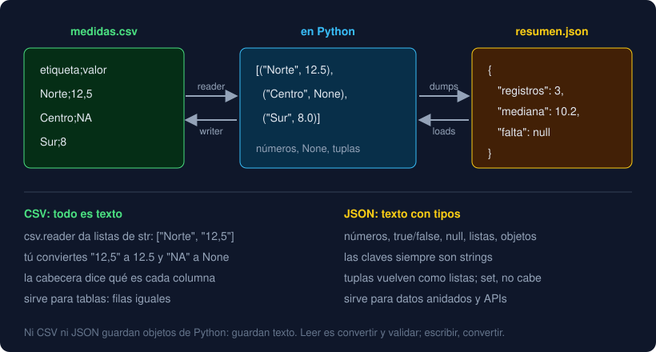

# 05 · JSON

⏱️ 50 min

## 🎯 Objetivos

- Explicar qué es JSON y cómo se corresponden sus tipos con los de Python.
- Convertir con `json.dumps` y `json.loads`, y escribir y leer archivos con `json.dump` y `json.load`.
- Usar `indent` y `ensure_ascii=False` para un JSON legible con tildes.
- Capturar `json.JSONDecodeError` y validar la forma de lo que llega.

---

## 1. Qué es JSON

**JSON** (*JavaScript Object Notation*) es un formato de texto para datos con estructura: objetos con claves, listas, números, textos. Nació en JavaScript y hoy lo habla todo el mundo: casi todas las API web responden en JSON, y muchos programas guardan su configuración así.

```json
{
  "registros": 7,
  "con_valor": 6,
  "mediana": 30.7,
  "etiquetas": ["Norte", "Sur"],
  "falta": null
}
```

A diferencia de un CSV, JSON **conserva los tipos**: `7` es un número, `"Norte"` es un texto y `null` es la ausencia de valor. Y admite datos **anidados**: listas dentro de objetos, objetos dentro de listas.



## 2. Tipos de JSON y de Python

| JSON | Python al leer | Python que se puede escribir |
|---|---|---|
| objeto `{...}` | `dict` | `dict` (con claves `str`, `int`, `float`, `bool` o `None`) |
| lista `[...]` | `list` | `list` o `tuple` |
| texto `"..."` | `str` | `str` |
| número `7`, `30.7` | `int`, `float` | `int`, `float` |
| `true`, `false` | `True`, `False` | `True`, `False` |
| `null` | `None` | `None` |

Tres consecuencias que sorprenden la primera vez:

- Una **tupla** se escribe como lista y vuelve como `list`: `(1, 2)` da `[1, 2]`.
- Las **claves** de un objeto JSON siempre son textos: `{3: None}` se escribe `{"3": null}` y vuelve con la clave `"3"`.
- Un `set`, una `Path` o un objeto tuyo **no caben**: `json.dumps({1, 2})` da `TypeError: Object of type set is not JSON serializable`. Conviértelos antes (`sorted(conjunto)`, `str(path)`).

JSON usa siempre comillas **dobles**, y no admite comentarios ni una coma después del último elemento. `{'a': 1}`, que es un diccionario de Python válido, no es JSON válido.

## 3. Texto ↔ Python: `dumps` y `loads`

```python
import json

data = {"registros": 7, "mediana": 30.7, "falta": None}
text = json.dumps(data)        # '{"registros": 7, "mediana": 30.7, "falta": null}'
json.loads(text) == data       # True: ida y vuelta
```

`dumps` (*dump string*) convierte un objeto de Python en texto JSON, y `loads` (*load string*) hace lo contrario. Comprobar que la ida y la vuelta dan lo mismo es la mejor prueba de que tus datos caben en el formato: es `test_json_round_trip` del proyecto.

## 4. Archivos: `dump` y `load`

Sin la `s`, trabajan directamente con un archivo abierto:

```python
with path.open("w", encoding="utf-8") as file:
    json.dump(data, file, ensure_ascii=False, indent=2)

with path.open(encoding="utf-8") as file:
    data = json.load(file)
```

| Argumento | Sin él | Con él |
|---|---|---|
| `indent=2` | Todo en una línea | Un elemento por línea, con sangría de 2 espacios: se lee y se revisa en un `git diff` |
| `ensure_ascii=False` | `"Peñalara"` | `"Peñalara"`, tal cual, porque el archivo es UTF-8 |
| `sort_keys=True` | Las claves en el orden del diccionario | Ordenadas alfabéticamente |

`json.dump` no añade un salto de línea al final. Muchas herramientas lo esperan, y `git` avisa con `No newline at end of file`: escríbelo tú con `file.write("\n")`.

## 5. Cuando el JSON llega roto

Un JSON escrito a mano o cortado a medias falla al leerlo con `json.JSONDecodeError`, que trae la posición exacta del problema:

```python
json.loads('{\n  "registros": 1,\n}\n')
# json.decoder.JSONDecodeError: Illegal trailing comma before end of object: line 2 column 17 (char 18)
```

El error tiene los atributos `msg`, `lineno` (la línea) y `colno` (la columna). `JSONDecodeError` es una subclase de `ValueError`, así que un `except ValueError` también lo captura. En el proyecto la traduces a `DataFileError` con la línea, para que el mensaje diga dónde mirar.

Que el texto sea JSON válido no significa que tenga la **forma** que esperas. `json.loads("[1, 2]")` es una lista, no un diccionario, y `data["mediana"]` daría `TypeError`. Comprueba lo básico antes de usarlo:

```python
data = json.loads(text)
if not isinstance(data, dict):
    raise DataFileError(f"{path} no contiene un objeto JSON")
```

`isinstance(valor, tipo)` pregunta si un valor es de un tipo. Además, `mypy` lo entiende: después del `if`, sabe que `data` es un `dict`. En la semana 13, Pydantic valida la forma completa (claves, tipos, rangos) en una línea.

## 6. ¿CSV o JSON?

| Si tus datos son... | Usa | Porque |
|---|---|---|
| Una tabla: muchas filas con las mismas columnas | CSV | Ocupa poco, lo abre cualquier hoja de cálculo |
| Un resumen, una configuración, datos anidados | JSON | Conserva tipos y estructura |
| La respuesta de una API web (semana 18) | JSON | Es lo que mandan |
| Millones de filas para analizar (fase 4) | Parquet | Columnas con tipos, comprimido; lo verás con pandas y DuckDB |

El Observatorio usa los dos: lee medidas en CSV, que es lo que exportan las hojas de cálculo, y guarda su resumen en JSON, que otro programa puede leer sin adivinar tipos.

---

## ⚠️ Errores frecuentes

| Error | Causa | Arreglo |
|---|---|---|
| `TypeError: Object of type set is not JSON serializable` | Un tipo que JSON no tiene | Conviértelo antes: `sorted(conjunto)`, `str(path)` |
| `JSONDecodeError: Expecting property name enclosed in double quotes` | Comillas simples o una coma de más | JSON solo admite comillas dobles y nada tras el último elemento |
| `JSONDecodeError: Expecting value: line 1 column 1 (char 0)` | El texto está vacío | Comprueba que el archivo tiene contenido |
| Tildes como `ñ` en el archivo | Falta `ensure_ascii=False` | Añádelo, y abre con `encoding="utf-8"` |
| Una tupla vuelve como lista | JSON no tiene tuplas | Compara con listas, o convierte al leer |
| `data[3]` da `KeyError` tras leer | Las claves vuelven como `str` | `data["3"]` |

## ✅ Qué debes saber al terminar

- [ ] Cómo se corresponden los tipos de JSON con los de Python, y qué no cabe.
- [ ] La diferencia entre `dumps`/`loads` y `dump`/`load`.
- [ ] Qué hacen `indent` y `ensure_ascii=False`.
- [ ] Cómo capturar `JSONDecodeError` y por qué hay que comprobar la forma con `isinstance`.
- [ ] Cuándo elegir CSV y cuándo JSON.

---

## 🔗 Navegación

| Anterior | Actual | Siguiente |
| -------- | ------ | --------- |
| [04 · CSV](04-csv.md) | **05 · JSON** | [Ejercicio 01 · Archivos y rutas](../2-practicas/ejercicio-01-archivos-y-rutas/README.md) |
