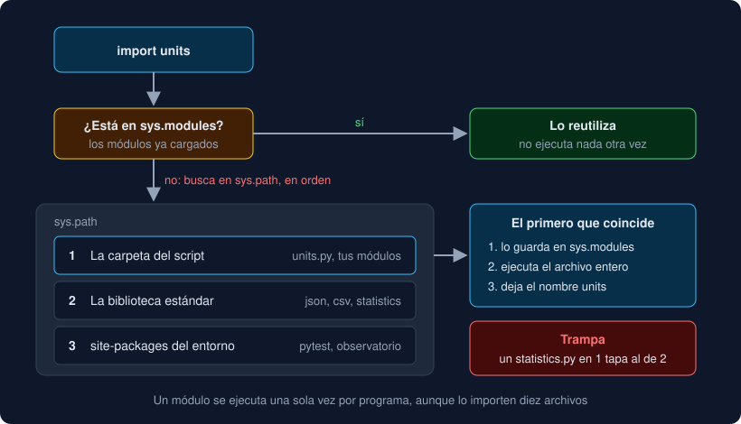

# 01 · Módulos e imports

⏱️ 50 min

## 🎯 Objetivos

- Explicar qué es un módulo y qué pasa, paso a paso, cuando Python ejecuta un `import`.
- Elegir entre `import módulo` y `from módulo import nombre`, y usar `as`.
- Usar `if __name__ == "__main__":` y saber por qué existe.
- Explicar dónde busca Python los módulos (`sys.path`) y evitar tapar uno de la biblioteca estándar.
- Reconocer un import circular y deshacerlo.

---

## 1. Un módulo es un archivo

Desde la semana 4 tu Observatorio está repartido en archivos: `record.py`, `rules.py`, `report.py`... Cada uno es un **módulo**: un archivo `.py` cuyo nombre, sin la extensión, es el nombre del módulo. Partir el código en módulos sirve para lo mismo que partirlo en funciones, pero a mayor escala:

| Sin módulos | Con módulos |
|---|---|
| Un archivo de 2000 líneas | Archivos de 50 a 200 líneas, cada uno con un tema |
| Para cambiar la lectura de CSV, buscas entre todo | Abres `storage.py` |
| Dos funciones con el mismo nombre chocan | Cada módulo tiene sus propios nombres: `trends.median` y `statistics.median` conviven |
| Un test importa el archivo entero | Un test importa solo lo que prueba |

## 2. Qué hace `import`

```python
import units

print(units.miles_to_km(10))
```

Cuando Python llega a `import units`, hace esto:

1. Mira en `sys.modules`, un diccionario con todos los módulos ya cargados. Si `units` está, usa ese y no hace nada más.
2. Si no está, busca un archivo `units.py` en las carpetas de `sys.path`, en orden (apartado 5).
3. Crea un módulo vacío, lo guarda en `sys.modules` y **ejecuta** `units.py` de arriba abajo. Cada `def`, cada constante y cada `import` de dentro va llenando el módulo.
4. En tu archivo, deja el nombre `units` apuntando a ese módulo.



Dos consecuencias que verás en el ejercicio 01:

- Lo que hay **fuera de las funciones** en un módulo se ejecuta al importarlo. Un `print` suelto sale por pantalla; un cálculo largo ralentiza el arranque. Por eso los módulos de tu Observatorio solo definen funciones y constantes.
- Un módulo se ejecuta **una vez por programa**. El segundo `import units`, en el mismo archivo o en otro, encuentra el módulo en `sys.modules` y lo reutiliza. Todos los que lo importan comparten el mismo objeto.

## 3. Formas de importar

```python
import units                              # el módulo entero: units.miles_to_km(10)
from units import miles_to_km             # un nombre suelto: miles_to_km(10)
from units import miles_to_km, KM_PER_MILE  # varios
import units as u                         # el módulo con otro nombre: u.miles_to_km(10)
from units import celsius_to_fahrenheit as c_to_f  # un nombre con otro nombre
```

| Forma | Ventaja | Cuándo |
|---|---|---|
| `import módulo` | Al leer `trends.median(...)` se ve de dónde viene | Módulos con nombres genéricos, o muchos nombres de un mismo módulo |
| `from módulo import nombre` | Código más corto | Pocos nombres, con nombre claro. Es lo que usa tu Observatorio |
| `as` | Evita choques o acorta nombres largos | Dos `median` de módulos distintos; alias de costumbre como `import numpy as np` (semana 23) |

`from módulo import nombre` también carga el módulo entero: solo cambia qué nombres quedan en tu archivo. Y no copia nada: `miles_to_km` y `units.miles_to_km` son **el mismo** objeto.

Existe `from módulo import *`, que trae todos los nombres públicos. No lo uses: al leer el archivo no se sabe de dónde sale cada nombre, y uno importado puede pisar otro sin avisar.

## 4. `__name__` y `if __name__ == "__main__":`

Cada módulo tiene una variable `__name__`. Python le da un valor distinto según cómo se use el archivo:

| Cómo se usa | `__name__` vale |
|---|---|
| Lo importa otro archivo (`import units`) | `"units"` |
| Lo ejecutas tú (`uv run python units.py`) | `"__main__"` |

Así un archivo puede ser módulo y programa a la vez:

```python
def miles_to_km(miles: float) -> float:
    return miles * 1.609344


if __name__ == "__main__":
    print(miles_to_km(1))     # solo al ejecutarlo, nunca al importarlo
```

Es lo que hace el final de tu `__main__.py` con `raise SystemExit(main())`: los tests importan `main` sin ejecutarlo, y la terminal lo ejecuta.

## 5. Dónde busca Python: `sys.path`

`sys.path` es una lista de carpetas. `import` las recorre en orden y se queda con el **primer** archivo que coincide:

1. La carpeta del script que ejecutas (o la carpeta de trabajo, con `python -m` o en el REPL).
2. La biblioteca estándar: `json`, `csv`, `statistics`...
3. `site-packages` del entorno: lo que instala `uv`, incluido tu propio paquete `observatorio`.

La primera carpeta es la del **script**, no la de trabajo. Por eso `import units` funciona aunque lances el programa desde otra carpeta, mientras que `open("medidas.csv")` de la semana 7 depende de la carpeta de trabajo. Son dos reglas distintas.

La primera carpeta va antes que la biblioteca estándar, y eso tiene una trampa. Un archivo tuyo llamado `statistics.py` **tapa** al módulo estándar:

```
AttributeError: module 'statistics' has no attribute 'median' (consider renaming '.../statistics.py' since it has the same name as the standard library module named 'statistics' and prevents importing that standard library module)
```

Python 3.14 detecta el caso y lo dice en el mensaje. Nunca llames a un módulo tuyo `csv.py`, `json.py`, `random.py`, `test.py` o como cualquier módulo estándar. La lista completa está en `sys.stdlib_module_names`.

## 6. Imports circulares

Un import circular aparece cuando `a.py` importa de `b.py` y `b.py` importa de `a.py`:

```python
# a.py
from b import helper

def parse() -> int:
    return helper()
```

```python
# b.py
from a import parse

def helper() -> int:
    return 1
```

```
ImportError: cannot import name 'parse' from 'a' (consider renaming '/w/a.py' if it has the same name as a library you intended to import)
```

Sigue los pasos del apartado 2. Python empieza a ejecutar `a.py`; en su primera línea va a por `b.py`; en la primera línea de `b.py` pide `parse` a `a`, que está en `sys.modules` pero **a medias**: todavía no llegó al `def parse`. La pista de renombrar despista: el problema es el círculo. Se arregla de una de estas formas:

- Lo que necesitan los dos va a un tercer módulo del que ambos importan. En tu Observatorio, `Record` vive en `groups.py` y lo importan `trends.py` y `storage.py`.
- Las dependencias van en una sola dirección: los módulos de abajo (`record.py`) no importan de los de arriba (`analysis.py`).

En tu proyecto, `analysis` importa de `groups`, `report` y `rules`; `rules` importa de `record`; ningún módulo del núcleo importa de `analysis`. Las flechas van siempre hacia abajo, sin círculos.

---

## ⚠️ Errores frecuentes

| Error | Causa | Arreglo |
|---|---|---|
| `ModuleNotFoundError: No module named 'units'` | El archivo no está en ninguna carpeta de `sys.path`, o el nombre está mal escrito | Ejecuta desde la carpeta correcta o revisa el nombre |
| `ImportError: cannot import name 'x' from 'units'` | El módulo existe, pero no define `x` | Revisa el nombre en el módulo |
| `AttributeError: module 'csv' has no attribute 'reader'` | Un `csv.py` tuyo tapa al estándar | Renómbralo |
| Un `print` sale al importar un módulo | Hay código suelto fuera de las funciones | Muévelo a una función o a `if __name__ == "__main__":` |
| `ImportError: cannot import name ...` entre dos módulos tuyos que se importan entre sí | Import circular | Mueve lo común a un tercer módulo |

---

## ✅ Qué debes saber al terminar

- [ ] Qué es un módulo y los cuatro pasos de un `import`.
- [ ] Por qué un módulo se ejecuta una sola vez aunque lo importen diez archivos.
- [ ] Cuándo usar `import módulo` y cuándo `from módulo import nombre`.
- [ ] Qué vale `__name__` en cada caso y para qué sirve `if __name__ == "__main__":`.
- [ ] En qué orden busca Python en `sys.path` y por qué un `statistics.py` tuyo rompe `import statistics`.
- [ ] Qué es un import circular y cómo se deshace.

---

## 🔗 Navegación

| Anterior | Actual | Siguiente |
| -------- | ------ | --------- |
| [Semana 08](../README.md) | **01 · Módulos e imports** | [02 · Paquetes](02-paquetes.md) |
