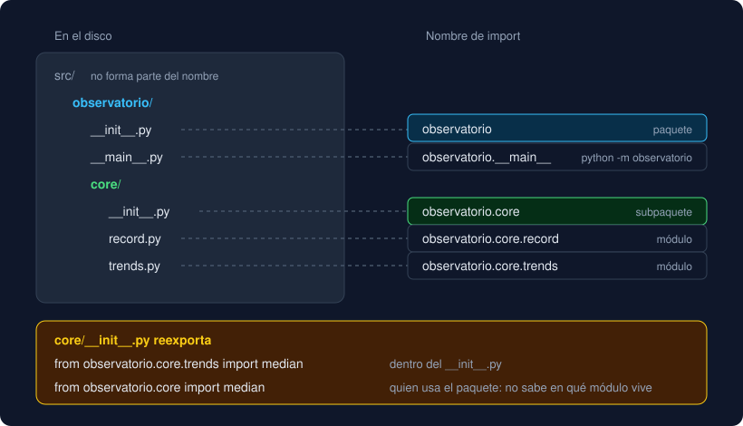

# 02 · Paquetes

⏱️ 45 min

## 🎯 Objetivos

- Explicar qué es un paquete y cómo se importan sus módulos.
- Decidir qué va en un `__init__.py` y escribir una API pública con `__all__`.
- Elegir entre imports absolutos y relativos.
- Ejecutar un paquete con `python -m` y explicar el papel de `__main__.py`.
- Explicar por qué tu proyecto usa la estructura `src/`.

---

## 1. Un paquete es una carpeta de módulos

Un **paquete** es una carpeta con módulos dentro y un archivo `__init__.py`. Igual que un módulo agrupa funciones, un paquete agrupa módulos, y puede contener otros paquetes (subpaquetes):

```
observatorio/            # paquete
├── __init__.py
├── __main__.py
└── core/                # subpaquete
    ├── __init__.py
    ├── record.py        # módulo observatorio.core.record
    └── trends.py        # módulo observatorio.core.trends
```

El nombre completo de un módulo es su camino desde el paquete de arriba, con puntos: `observatorio.core.trends`. Es lo que escribes en el `import`:

```python
import observatorio.core.trends               # usar: observatorio.core.trends.median(...)
from observatorio.core.trends import median   # usar: median(...)
from observatorio.core import trends          # usar: trends.median(...)
```

Para cargar `observatorio.core.trends`, Python carga antes `observatorio` y `observatorio.core`, en ese orden: ejecuta sus `__init__.py`. Cada uno, una sola vez por programa.



## 2. El `__init__.py`

`__init__.py` es el código del paquete en sí: lo que se ejecuta al importarlo y los nombres que tiene `observatorio.core`. Puede estar vacío, y aun así marca la carpeta como paquete. Su uso más útil es **reexportar**: importar los nombres importantes de sus módulos para que el paquete los ofrezca directamente.

```python
# src/observatorio/core/__init__.py
"""El núcleo del Observatorio: modelo de registros, análisis y archivos."""

from observatorio.core.record import parse_value
from observatorio.core.storage import DataFileError, read_data
from observatorio.core.trends import median

__all__ = ["DataFileError", "median", "parse_value", "read_data"]
```

Con eso, quien usa el paquete escribe:

```python
from observatorio.core import median, read_data
```

y no necesita saber que `median` vive en `trends.py` y `read_data` en `storage.py`. El día que muevas `median` a otro módulo, cambias una línea del `__init__.py` y nadie más se entera. Es la **API pública** del paquete: lo que prometes que funciona; los módulos de dentro son detalles que puedes reorganizar.

## 3. `__all__`

`__all__` es una lista de textos con los nombres públicos del módulo o paquete. Hace dos cosas:

- Decide qué trae `from observatorio.core import *`. Sin `__all__`, `*` trae todo lo que no empieza por `_`, incluidos los módulos que se cargaron por el camino (`record`, `trends`...).
- Documenta la API: quien abre el `__init__.py` ve la lista oficial de un vistazo, y las herramientas (ruff, mypy, el editor) la usan.

`__all__` no esconde nada: `observatorio.core.trends.jumps` sigue accesible aunque `jumps` no esté en la lista. En Python no hay nombres privados de verdad; hay convenciones. Un nombre que empieza por `_`, como `_round1`, dice "es interno, no lo uses desde fuera".

ruff ordena `__all__` con `--fix` (regla `RUF022`): primero las CONSTANTES, después las Clases y al final las funciones, cada grupo en orden alfabético.

## 4. Imports absolutos y relativos

Dentro de un paquete, un módulo puede importar a sus vecinos de dos formas:

```python
# en src/observatorio/core/trends.py
from observatorio.core.groups import Record   # absoluto: el camino completo
from .groups import Record                     # relativo: "." es el paquete donde estoy
from ..core.groups import Record               # relativo: ".." es el paquete de arriba
```

| | Absoluto | Relativo |
|---|---|---|
| Se lee | Siempre igual, desde cualquier archivo | Depende de dónde está el archivo |
| Si mueves el módulo | Hay que cambiar el camino | Sigue funcionando si sus vecinos se mueven con él |
| Ejecutar el módulo como archivo (`python trends.py`) | Funciona si el paquete está instalado | `ImportError: attempted relative import with no known parent package` |

PEP 8 recomienda los absolutos, y es lo que usa tu Observatorio: un `grep "from observatorio.core.groups"` encuentra a todos los que usan `groups.py`. Los relativos los verás en bibliotecas grandes.

## 5. `python -m` y `__main__.py`

`python -m nombre` ejecuta un módulo **por su nombre de import**, no por su ruta:

```bash
uv run python -m observatorio.core.trends   # ejecuta trends.py como "__main__", dentro de su paquete
uv run python -m observatorio               # ejecuta observatorio/__main__.py
uv run python -m json.tool resumen.json     # funciona con la biblioteca estándar
```

Con `-m`, Python carga primero los paquetes de arriba, así que los imports del módulo funcionan. Cuando el nombre es un paquete, ejecuta su `__main__.py`. Por eso tu Observatorio tiene `main` en `__main__.py`: `uv run python -m observatorio` y `uv run observatorio` hacen lo mismo. El segundo es un comando que `pyproject.toml` declara en `[project.scripts]` (teoría 03).

## 6. Por qué `src/`

Tu proyecto no tiene la carpeta `observatorio/` en la raíz, sino dentro de `src/`:

```
python-ana-garcia/
├── pyproject.toml
├── src/
│   └── observatorio/
└── tests/
```

Es la **estructura src** (*src layout*), la que crea `uv init --package`. Sin `src/`, al ejecutar `pytest` desde la raíz, Python encontraría la carpeta `observatorio/` directamente en la carpeta de trabajo y los tests usarían el código suelto, no el paquete instalado. Todo pasaría en tu máquina, y el paquete construido podría estar roto (un archivo que no se incluye, un import que solo funciona desde la raíz) sin que ningún test lo viera. Con `src/`, la única forma de importar `observatorio` es instalarlo, y `uv sync` lo instala en tu `.venv` en modo editable: los cambios en `src/` se ven al momento, sin reinstalar.

---

## ⚠️ Errores frecuentes

| Error | Causa | Arreglo |
|---|---|---|
| `ModuleNotFoundError: No module named 'observatorio.analysis'` | Moviste el módulo a `core/` y queda un import con el camino viejo | `grep -rnE "from observatorio\.(analysis\|groups\|record\|report\|rules\|storage\|trends) import" src tests` y cámbialo |
| `ImportError: cannot import name 'median' from 'observatorio.core'` | El `__init__.py` de `core` no importa `median` | Añádelo a los imports y a `__all__` |
| `ImportError: attempted relative import with no known parent package` | Ejecutaste como archivo un módulo con imports relativos | `python -m paquete.módulo` |
| `No module named observatorio.__main__; 'observatorio' is a package and cannot be directly executed` | Falta `__main__.py` en el paquete | Créalo, o ejecuta un módulo concreto |
| Un nombre de `__all__` no existe | Lo escribiste mal o no lo importaste | Un test como `test_every_name_in_core_all_exists` lo detecta |

---

## ✅ Qué debes saber al terminar

- [ ] Qué es un paquete, qué es un subpaquete y cómo se escribe el nombre completo de un módulo.
- [ ] Qué hace un `__init__.py` y para qué sirve reexportar.
- [ ] Qué hace `__all__` y qué no hace.
- [ ] La diferencia entre un import absoluto y uno relativo, y cuál usa tu proyecto.
- [ ] Qué hace `python -m` y cuándo se ejecuta `__main__.py`.
- [ ] Por qué la estructura `src/` evita tests que pasan con un paquete roto.

---

## 🔗 Navegación

| Anterior | Actual | Siguiente |
| -------- | ------ | --------- |
| [01 · Módulos e imports](01-modulos-e-imports.md) | **02 · Paquetes** | [03 · `pyproject.toml`](03-pyproject-toml.md) |
