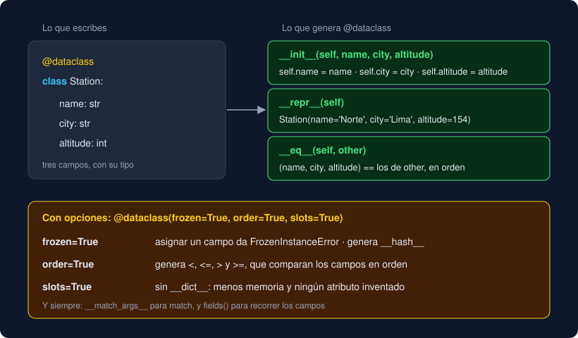

# 03 · `dataclasses`

⏱️ 50 min

## 🎯 Objetivos

- Declarar una clase de datos con `@dataclass` y explicar qué métodos genera.
- Dar valores por defecto a los campos y respetar su orden.
- Usar `field(default_factory=...)` para listas y diccionarios.
- Validar y calcular campos en `__post_init__`.
- Recorrer y convertir una *dataclass* con `fields()` y `asdict()`.

---

## 1. Lo que repites en cada clase

El termómetro de la teoría 02 tiene dos campos y ya necesita `__init__`, `__repr__` y `__eq__`: unas quince líneas que repiten tres veces `name` y `celsius`. Si mañana añades un campo, tienes que acordarte de tocar los tres métodos. Ese código es igual en todas las clases de datos: se puede generar.

## 2. `@dataclass`

```python
from dataclasses import dataclass


@dataclass
class Station:
    name: str
    city: str
    altitude: int


north = Station("Norte", "Lima", 154)
north                                     # Station(name='Norte', city='Lima', altitude=154)
north == Station("Norte", "Lima", 154)    # True
```

Declaras los **campos** con `nombre: tipo`, y el decorador `@dataclass` lee esa lista y escribe por ti `__init__`, `__repr__` y `__eq__`. El resultado es una clase normal: le puedes añadir métodos, propiedades y `@classmethod`.



Dos detalles:

- **Sin tipo no hay campo.** `altitude = 0` es un atributo de clase (teoría 01); `altitude: int = 0` es un campo.
- **Los tipos no se comprueban al ejecutar.** `Station("Norte", "Lima", "alta")` no falla. Los tipos son para ti, para el editor y para mypy, que sí se queja. En la semana 13, Pydantic los comprobará cuando los datos lleguen de fuera.

## 3. Valores por defecto

```python
@dataclass
class Sensor:
    name: str
    unit: str = "µg/m³"
    active: bool = True


Sensor("PM2.5")                          # Sensor(name='PM2.5', unit='µg/m³', active=True)
Sensor("Temperatura", "°C", active=False)
```

El `__init__` generado tiene un parámetro por campo, **en el orden en que los declaras**, así que vale la regla de las funciones: los parámetros sin valor por defecto van antes que los que lo tienen. Si no, la clase ni se crea:

```
TypeError: non-default argument 'name' follows default argument 'unit'
```

## 4. Listas y diccionarios: `default_factory`

```python
@dataclass
class Route:
    stops: list[str] = []      # ValueError al crear la clase
```

```
ValueError: mutable default <class 'list'> for field stops is not allowed: use default_factory
```

Es la lista compartida de la teoría 01: `= []` sería una sola lista para todos los objetos. `@dataclass` lo detecta y no te deja. La forma correcta:

```python
from dataclasses import dataclass, field


@dataclass
class Route:
    name: str
    stops: list[str] = field(default_factory=list)
```

`field(default_factory=list)` significa "si no me pasan `stops`, llama a `list()` y usa esa lista nueva". Cada ruta tiene la suya. Vale cualquier función sin argumentos: `dict`, `set`, `Counter` o una tuya. Es lo que hace `Series` en tu proyecto.

## 5. `__post_init__`

El `__init__` lo escribe `@dataclass`, así que no puedes poner tu código en él. Para eso está `__post_init__`, que el `__init__` generado llama al terminar:

```python
@dataclass
class Reading:
    label: str
    value: float
    level: str = field(init=False)

    def __post_init__(self) -> None:
        if self.value < 0:
            raise ValueError(f"lectura negativa en {self.label}: {self.value}")
        self.level = "alto" if self.value >= 50 else "normal"


Reading("Centro", 61.2)   # Reading(label='Centro', value=61.2, level='alto')
Reading("Sur", -3.0)      # ValueError: lectura negativa en Sur: -3.0
```

Sirve para dos cosas:

- **Validar**: si los datos no tienen sentido, el objeto no llega a existir. Es mejor fallar al crear la lectura que tres funciones más allá con un resultado absurdo.
- **Calcular** campos a partir de otros. `field(init=False)` saca `level` de los parámetros del `__init__`, pero sigue siendo un campo: sale en el `repr` y cuenta en `==`.

En tu proyecto, `Scale.__post_init__` comprueba que `low` sea menor que `high`. Como `SCALE = Scale(UNIT, LOW, HIGH)` se crea al importar `__main__.py`, unos umbrales imposibles hacen fallar el programa **al arrancar**. Fíjate en la traza: aparece `File "<string>", line 6, in __init__`, que es el `__init__` que escribió `@dataclass`, sin archivo propio.

## 6. `fields()` y `asdict()`

```python
from dataclasses import asdict, fields

[f.name for f in fields(Station)]    # ['name', 'city', 'altitude']
asdict(north)                        # {'name': 'Norte', 'city': 'Lima', 'altitude': 154}
```

`fields()` devuelve la descripción de cada campo, en orden. `asdict()` convierte el objeto en un diccionario (también las *dataclasses* que tenga dentro), listo para `json.dumps` o para tu `write_json`. La vuelta es `Station(**data)`, desempaquetando el diccionario como argumentos con nombre.

## 7. Qué más puede generar

`@dataclass` acepta opciones: `@dataclass(frozen=True, order=True, slots=True)`. Las tres son la teoría 04.

| Opción | Por defecto | Qué hace |
|---|---|---|
| `init`, `repr`, `eq` | `True` | Genera `__init__`, `__repr__` y `__eq__` |
| `order` | `False` | Genera `<`, `<=`, `>`, `>=` |
| `frozen` | `False` | Objetos inmutables, con `__hash__` |
| `slots` | `False` | Sin `__dict__`: menos memoria, sin atributos inventados |
| `kw_only` | `False` | Todos los campos se pasan por nombre |

---

## ⚠️ Errores frecuentes

| Error | Causa | Arreglo |
|---|---|---|
| `TypeError: non-default argument 'name' follows default argument 'unit'` | Un campo sin valor por defecto va detrás de uno con valor | Pon primero los campos sin valor por defecto |
| `ValueError: mutable default <class 'list'> for field stops is not allowed: use default_factory` | `= []` o `= {}` como valor por defecto | `field(default_factory=list)` |
| Un campo no aparece en el `repr` ni en el `__init__` | Le falta el tipo: es un atributo de clase | `nombre: tipo = valor` |
| `TypeError: Station.__init__() missing 1 required positional argument: 'altitude'` | Faltan argumentos | Revisa el orden de los campos con `fields()` |
| Faltan campos o el `repr` falla tras escribir tu `__init__` | Un `__init__` escrito por ti sustituye al que genera `@dataclass`, y no guarda los campos que no asignes | Quita tu `__init__` y pon tu código en `__post_init__` |
| `AttributeError: '...' object has no attribute 'level'` | Un campo con `init=False` que `__post_init__` no asigna | Asígnalo en `__post_init__`, o dale un valor por defecto |

---

## ✅ Qué debes saber al terminar

- [ ] Qué métodos genera `@dataclass` y a partir de qué.
- [ ] Por qué una línea sin tipo no es un campo y por qué los tipos no se comprueban al ejecutar.
- [ ] La regla del orden de los campos con valor por defecto.
- [ ] Por qué `= []` no se permite y qué hace `field(default_factory=list)`.
- [ ] Para qué sirve `__post_init__` y qué hace `field(init=False)`.
- [ ] Cómo convertir una *dataclass* en diccionario y de vuelta.

---

## 🔗 Navegación

| Anterior | Actual | Siguiente |
| -------- | ------ | --------- |
| [02 · Propiedades y métodos especiales](02-propiedades-y-metodos-especiales.md) | **03 · `dataclasses`** | [04 · *Dataclasses* inmutables y con `slots`](04-dataclasses-inmutables-y-con-slots.md) |
