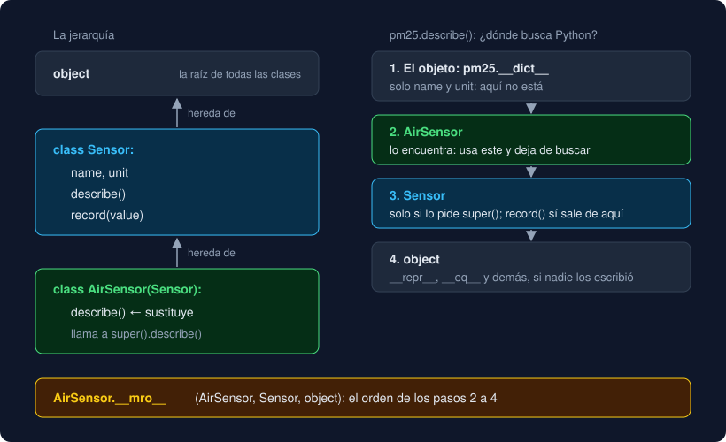

# 01 · Herencia

⏱️ 50 min

## 🎯 Objetivos

- Crear una subclase que hereda atributos y métodos de otra clase.
- Sustituir un método heredado (*override*) y extenderlo con `super()`.
- Explicar dónde busca Python un método y qué es la MRO.
- Usar `isinstance` e `issubclass` y entender por qué una subclase "es" también su base.
- Crear tus propias excepciones en una jerarquía.

---

## 1. Una clase a partir de otra

En la semana 9 escribiste un `Sensor`. Ahora necesitas un sensor de aire, que además del nombre y la unidad sabe qué contaminante mide. Podrías copiar `Sensor` entero y añadirle un campo, pero tendrías dos copias del mismo código. La **herencia** dice: "un `AirSensor` es un `Sensor`, con algo más".

```python
class Sensor:
    def __init__(self, name: str, unit: str) -> None:
        self.name = name
        self.unit = unit
        self.readings: list[float] = []

    def record(self, value: float) -> None:
        self.readings.append(value)

    def describe(self) -> str:
        return f"{self.name} ({self.unit})"


class AirSensor(Sensor):
    pass


pm25 = AirSensor("Centro", "µg/m³")
pm25.record(18.5)
pm25.describe()      # 'Centro (µg/m³)'
pm25.readings        # [18.5]
```

`class AirSensor(Sensor):` crea una **subclase** (o clase hija) de `Sensor`, que es su **clase base** (o clase padre). Sin escribir ni una línea, `AirSensor` tiene el `__init__`, `record` y `describe` de `Sensor`: los **hereda**.

## 2. Sustituir un método: *override*

Si la subclase define un método con el mismo nombre, el suyo **sustituye** al de la base:

```python
class AirSensor(Sensor):
    def describe(self) -> str:
        return f"aire · {self.name} ({self.unit})"


AirSensor("Centro", "µg/m³").describe()   # 'aire · Centro (µg/m³)'
Sensor("Norte", "°C").describe()          # 'Norte (°C)'
```

`Sensor` no cambia: solo los `AirSensor` usan el método nuevo. A esto se le llama *override* (sobrescribir). La firma debe ser compatible: mismos parámetros, mismo tipo de retorno. Si `describe` de la base devuelve `str` y el de la hija devuelve `int`, mypy avisa: quien trabaja con un `Sensor` espera un `str`, sea el sensor que sea.

## 3. Extender con `super()`

Muchas veces no quieres sustituir el método, sino **añadirle** algo. `super()` te da acceso al método de la clase base:

```python
class AirSensor(Sensor):
    def __init__(self, name: str, unit: str, pollutant: str) -> None:
        super().__init__(name, unit)        # el __init__ de Sensor: name, unit y readings
        self.pollutant = pollutant          # lo que añade AirSensor

    def describe(self) -> str:
        return f"{super().describe()} · {self.pollutant}"


pm25 = AirSensor("Centro", "µg/m³", "PM2.5")
pm25.describe()   # 'Centro (µg/m³) · PM2.5'
```

Si olvidas `super().__init__(...)`, el `__init__` de la hija sustituye por completo al de la base: `name`, `unit` y `readings` nunca se crean, y el primer `pm25.record(...)` falla con `AttributeError: 'AirSensor' object has no attribute 'readings'`. Regla: si la subclase escribe `__init__`, casi siempre empieza llamando a `super().__init__`.

## 4. Dónde busca Python: la MRO

En la semana 9 viste que `objeto.atributo` busca primero en el objeto y después en su clase. Con herencia, la búsqueda sigue subiendo:



```python
AirSensor.__mro__   # (<class 'AirSensor'>, <class 'Sensor'>, <class 'object'>)
```

`__mro__` (*method resolution order*) es la lista de clases en las que Python busca, en orden. La primera que tiene el nombre gana. Por eso el `describe` de `AirSensor` tapa al de `Sensor`, y `record`, que solo está en `Sensor`, se encuentra un paso más arriba. Al final siempre está `object`: toda clase hereda de él, aunque no lo escribas, y de él salen el `__repr__` y el `__eq__` por defecto.

`super()` no significa "la clase padre", sino "**la siguiente** en la MRO". Con una sola base es lo mismo; en la teoría 05 verás cuándo no.

## 5. Una subclase también es su base

```python
pm25 = AirSensor("Centro", "µg/m³", "PM2.5")

isinstance(pm25, AirSensor)       # True
isinstance(pm25, Sensor)          # True: un AirSensor es un Sensor
isinstance(Sensor("Norte", "°C"), AirSensor)   # False
issubclass(AirSensor, Sensor)     # True
issubclass(bool, int)             # True: True + True == 2
```

Esto tiene una consecuencia práctica: una función que pide un `Sensor` acepta un `AirSensor`.

```python
def report(sensors: list[Sensor]) -> None:
    for sensor in sensors:
        print(sensor.describe())


report([Sensor("Norte", "°C"), AirSensor("Centro", "µg/m³", "PM2.5")])
# Norte (°C)
# Centro (µg/m³) · PM2.5
```

`report` no sabe ni le importa qué clase concreta tiene cada sensor: llama a `describe()`, y cada objeto responde con **su** versión. A esto se le llama **polimorfismo**. Es lo que hará `main` en tu proyecto con las fuentes de datos.

Para comprobar el tipo exacto, sin subclases, está `type(pm25) is Sensor` (`False`). Úsalo poco: casi siempre quieres `isinstance`, que respeta la herencia.

## 6. Tus propias excepciones

Las excepciones son el ejemplo de herencia que ya usas sin saberlo:

```python
ZeroDivisionError.__mro__
# (<class 'ZeroDivisionError'>, <class 'ArithmeticError'>, <class 'Exception'>, <class 'BaseException'>, <class 'object'>)
```

`except ArithmeticError:` atrapa un `ZeroDivisionError` porque **es** un `ArithmeticError`. En la semana 7 creaste `DataFileError(Exception)`. Con una jerarquía, quien llama elige cuánto detalle quiere:

```python
class DataFileError(Exception):
    """Cualquier problema con un archivo de datos."""


class HeaderError(DataFileError):
    """La cabecera del CSV no es la esperada."""


try:
    raise HeaderError("cabecera inesperada: nombre;dato")
except DataFileError as problem:
    print(f"error: {problem}")        # error: cabecera inesperada: nombre;dato
```

`main` puede atrapar `DataFileError` y tratar igual todos los problemas de archivo; un test puede pedir exactamente `HeaderError`. Una excepción propia casi nunca necesita más que una línea de *docstring*: hereda de `Exception` todo lo que necesita.

Cuidado con el orden de los `except`: Python usa el **primero** que encaja. Si `except DataFileError` va antes que `except HeaderError`, el segundo nunca se ejecuta.

---

## ⚠️ Errores frecuentes

| Error | Causa | Arreglo |
|---|---|---|
| `AttributeError: 'AirSensor' object has no attribute 'readings'` | El `__init__` de la hija no llama a `super().__init__(...)` | Empieza el `__init__` de la hija con `super().__init__(...)` |
| `TypeError: Sensor.__init__() takes 3 positional arguments but 4 were given` | `super().__init__` recibe los argumentos de la hija, no los de la base | Pasa a `super().__init__` solo los que espera la base |
| La hija se comporta como la base | El método de la hija tiene otro nombre (`descibe`) y no sustituye a nada | Copia el nombre exacto del método de la base |
| `RecursionError` | Dentro de `describe` llamas a `self.describe()` en lugar de `super().describe()` | `super()` para el de la base; `self.` llama al propio |
| Un `except` nunca se ejecuta | Un `except` de una clase base va antes que el de su subclase | Del más concreto al más general |

---

## ✅ Qué debes saber al terminar

- [ ] Qué hereda una subclase y cómo se sustituye un método.
- [ ] Para qué sirve `super()` y por qué el `__init__` de la hija suele llamarlo.
- [ ] Qué es la MRO y en qué orden busca Python.
- [ ] Por qué `isinstance(pm25, Sensor)` es `True` y qué es el polimorfismo.
- [ ] Cómo crear una jerarquía de excepciones y en qué orden van los `except`.

---

## 🔗 Navegación

| Anterior | Actual | Siguiente |
| -------- | ------ | --------- |
| [Semana 10](../README.md) | **01 · Herencia** | [02 · Composición](02-composicion.md) |
