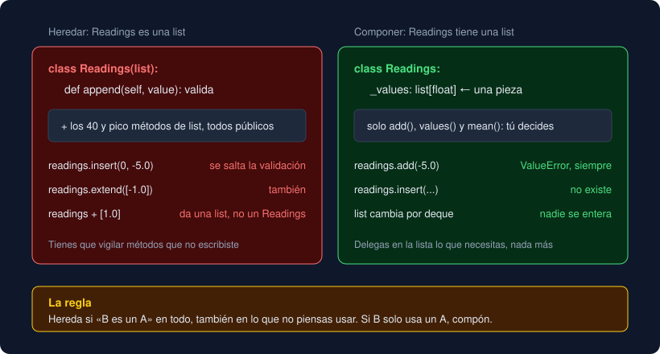

# 02 · Composición

⏱️ 45 min

## 🎯 Objetivos

- Distinguir "es un" (herencia) de "tiene un" (composición).
- Reconocer por qué heredar de `list` o `dict` suele traer problemas.
- Construir una clase a partir de otras y delegar en ellas.
- Cambiar una pieza de un objeto sin tocar a quien lo usa.

---

## 1. "Es un" o "tiene un"

La herencia de la teoría 01 funciona porque un sensor de aire **es un** sensor: todo lo que se puede hacer con un `Sensor` tiene sentido con un `AirSensor`. Pero muchas relaciones no son así. Una estación meteorológica **tiene** un termómetro y un pluviómetro; no **es** un termómetro. Para eso está la **composición**: un objeto guarda otros objetos en sus atributos y los usa.

```python
from dataclasses import dataclass, field


@dataclass
class Station:
    name: str
    sensors: list[Sensor] = field(default_factory=list)

    def install(self, sensor: Sensor) -> None:
        self.sensors.append(sensor)

    def summary(self) -> list[str]:
        return [sensor.describe() for sensor in self.sensors]
```

`Station` no hereda de nadie. **Tiene** una lista de sensores y les pide que se describan. Tu `Series` de la semana 9 es lo mismo: tiene una lista de `Measurement`.

## 2. La tentación: heredar de `list`

Quieres una lista de lecturas que no admita valores negativos. Parece natural heredar de `list` y validar en `append`:

```python
class Readings(list[float]):
    def append(self, value: float) -> None:
        if value < 0:
            raise ValueError(f"lectura negativa: {value}")
        super().append(value)


readings = Readings()
readings.append(12.5)
readings.append(-3.0)        # ValueError: lectura negativa: -3.0  ✔
readings.insert(0, -5.0)     # sin error ✘
readings.extend([-1.0])      # sin error ✘
readings                     # [-5.0, 12.5, -1.0]
type(readings + [1.0])       # <class 'list'> ✘
```

El problema: al heredar, `Readings` **es una** `list` en todo, también en los cuarenta y pico métodos que no pensabas usar. `insert`, `extend`, `__setitem__` (`readings[0] = -9`) y `+=` meten valores sin pasar por tu `append`. Y `readings + [1.0]` devuelve una `list` normal, que ya no valida nada. Para que `Readings` fuera segura tendrías que sustituir una docena de métodos que no escribiste.



## 3. La alternativa: tener una lista

```python
class Readings:
    def __init__(self) -> None:
        self._values: list[float] = []

    def add(self, value: float) -> None:
        if value < 0:
            raise ValueError(f"lectura negativa: {value}")
        self._values.append(value)

    def values(self) -> list[float]:
        return list(self._values)

    def mean(self) -> float:
        return sum(self._values) / len(self._values)
```

Ahora `Readings` **tiene** una lista, guardada en `_values` (el guion bajo dice "no la toques desde fuera", semana 9). Solo existen los métodos que tú decides, y todos pasan por la validación. `readings.insert(...)` da `AttributeError`: no existe. `values()` devuelve una copia, así que quien la reciba no puede colar un negativo con `append`.

A esto se le llama **delegar**: `add` hace su trabajo (validar) y le pasa el resto a la lista (`append`). Escribes un poco más que heredando, pero cada línea es tuya y la entiendes.

## 4. Cambiar una pieza

La composición tiene otra ventaja: la pieza interna se puede cambiar sin que nadie se entere. Si mañana solo quieres guardar las últimas 100 lecturas, cambias la lista por un `deque` (semana 6):

```python
from collections import deque


class Readings:
    def __init__(self, limit: int = 100) -> None:
        self._values: deque[float] = deque(maxlen=limit)
    # add, values y mean, sin cambios
```

Quien usa `Readings` sigue llamando a `add`, `values` y `mean`. Con la herencia esto sería imposible: si `Readings` es una `list`, quien la usa puede haber llamado a cualquier método de `list`, y un `deque` no los tiene todos.

Las piezas también pueden ser objetos distintos que se eligen al crear:

```python
@dataclass
class Monitor:
    sensor: Sensor
    scale: Scale          # la Scale de tu proyecto

    def check(self, value: float) -> str:
        self.sensor.record(value)
        return self.scale.level(value)
```

El mismo `Monitor` sirve con cualquier sensor y cualquier escala. Para probarlo, le pasas un sensor de prueba; para otro dominio, otra escala. Cambias el comportamiento **combinando** objetos, no creando subclases: `MonitorDeAireConEscalaOMS`, `MonitorDeAguaConEscalaLocal`...

## 5. "Composición antes que herencia"

Es un consejo clásico del diseño orientado a objetos. No dice "nunca heredes", sino: **hereda solo cuando "B es un A" sea verdad en todo**. Una prueba rápida: ¿tiene sentido usar un B en **cualquier** sitio donde se usa un A, sin sorpresas?

| Relación | ¿B es un A en todo? | Usa |
|---|---|---|
| `AirSensor` y `Sensor` | Sí: todo lo que hace un sensor lo hace uno de aire | Herencia |
| `HeaderError` y `DataFileError` | Sí: es un problema de archivo | Herencia |
| `Readings` y `list` | No: una `list` admite negativos, `insert` y `+` | Composición |
| `Station` y `Sensor` | No: una estación **tiene** sensores | Composición |
| `Series` y `Measurement` | No: una serie **tiene** medidas | Composición |

En la duda, compón. Pasar de composición a herencia más tarde es fácil; deshacer una jerarquía en la que otros ya confían, no.

---

## ⚠️ Errores frecuentes

| Error | Causa | Arreglo |
|---|---|---|
| Valores inválidos en una subclase de `list` | `insert`, `extend`, `[i] =` o `+=` no pasan por tu `append` | Guarda una lista dentro y expón solo tus métodos |
| `readings + [1.0]` pierde la validación | Los métodos heredados de `list` devuelven `list`, no tu clase | Composición |
| Quien usa tu clase cambia la lista interna | Devuelves `self._values` y no una copia | `return list(self._values)` |
| `AttributeError: 'Readings' object has no attribute 'insert'` | Es lo que querías: con composición, solo existen tus métodos | Añade el método si de verdad hace falta |
| Una subclase por cada combinación de opciones | Usas herencia para combinar comportamientos | Pasa las piezas al crear el objeto |

---

## ✅ Qué debes saber al terminar

- [ ] La diferencia entre "es un" y "tiene un", con un ejemplo de cada.
- [ ] Por qué heredar de `list` no protege los datos.
- [ ] Qué es delegar y por qué devolver una copia.
- [ ] Cómo cambiar una pieza interna sin tocar a quien usa la clase.
- [ ] La prueba de "B es un A en todo".

---

## 🔗 Navegación

| Anterior | Actual | Siguiente |
| -------- | ------ | --------- |
| [01 · Herencia](01-herencia.md) | **02 · Composición** | [03 · Clases abstractas](03-clases-abstractas.md) |
