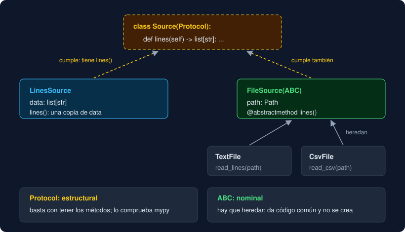

# 04 · `Protocol`

⏱️ 45 min

## 🎯 Objetivos

- Explicar el *duck typing* y por qué Python no exige heredar para funcionar.
- Declarar un `Protocol` y dejar que mypy compruebe quién lo cumple.
- Saber qué comprueba y qué no `@runtime_checkable`.
- Elegir entre una clase abstracta y un `Protocol`.

---

## 1. *Duck typing*

"Si camina como un pato y grazna como un pato, es un pato." Python no pregunta de qué clase es un objeto antes de llamar a un método: lo llama, y si existe, funciona.

```python
def total_lines(source) -> int:
    return len(source.lines())
```

`total_lines` acepta **cualquier** objeto con un método `lines()`: un `TextFile`, una clase de prueba de tres líneas, lo que sea. No hace falta que hereden de una base común. Es lo que llevas haciendo desde la semana 1: `len()` funciona con listas, cadenas, diccionarios y `range`, y ninguno hereda de los otros.

El problema es que sin tipo, ni el editor ni mypy saben qué necesita `source`. Si le pasas un `Path` en lugar de una fuente, el error llega al ejecutar: `AttributeError: 'PosixPath' object has no attribute 'lines'`.

## 2. Ponerle nombre al pato: `Protocol`

Un `Protocol` describe lo que tiene que tener un objeto, sin obligarle a heredar:

```python
from typing import Protocol


class Source(Protocol):
    def lines(self) -> list[str]: ...


def total_lines(source: Source) -> int:
    return len(source.lines())
```

`Source` dice: "una fuente es cualquier cosa con un método `lines()` que devuelve `list[str]`". El cuerpo es `...`: el `Protocol` no hace nada, solo describe.

```python
@dataclass
class Fixed:
    data: list[str]

    def lines(self) -> list[str]:
        return list(self.data)


total_lines(Fixed(["Norte;1", "Sur;2"]))    # 2: mypy está de acuerdo
total_lines(Path("medidas.txt"))            # mypy: error
```

```
error: Argument 1 to "total_lines" has incompatible type "Path"; expected "Source"  [arg-type]
```

`Fixed` no hereda de `Source` y no lo menciona en ningún sitio. mypy mira su **estructura**: tiene `lines()` con la firma correcta, así que cumple. A esto se le llama **tipado estructural**. La herencia de las teorías 01 y 03 es **nominal**: cuenta el nombre de la clase que pones entre paréntesis.

Y si el método existe pero con otra firma, tampoco cumple: un `lines(self) -> str` no es un `Source`, y mypy lo explica con una nota que compara las dos firmas.

## 3. `@runtime_checkable`: `isinstance` con un `Protocol`

Por defecto, un `Protocol` solo existe para mypy:

```python
isinstance(Fixed([]), Source)
# TypeError: Instance and class checks can only be used with @runtime_checkable protocols
```

Con el decorador `@runtime_checkable`, `isinstance` funciona:

```python
from typing import Protocol, runtime_checkable


@runtime_checkable
class Source(Protocol):
    def lines(self) -> list[str]: ...


isinstance(Fixed([]), Source)        # True
isinstance(Path("x"), Source)        # False
```

Pero ojo: `isinstance` solo comprueba que **existe** un atributo llamado `lines`. No mira los parámetros ni el tipo de retorno:

```python
class Liar:
    lines = 42


isinstance(Liar(), Source)    # True
```

La comprobación de verdad la hace mypy, antes de ejecutar. `@runtime_checkable` es útil en tests y en algún `match`, pero no sustituye a mypy.

## 4. Los protocolos que ya usas

Muchos tipos de `collections.abc` funcionan como protocolos: una clase cumple `Iterable` si tiene `__iter__`, `Sized` si tiene `__len__`, aunque no herede de ellos.

```python
from collections.abc import Sized


class Shelf:
    def __len__(self) -> int:
        return 3


isinstance(Shelf(), Sized)     # True, sin heredar de Sized
len(Shelf())                   # 3
```

En la semana 11 escribirás `__iter__` y `__len__` en tus clases, y entrarán solas en `for`, `len()` y todos estos tipos.

## 5. ¿Clase abstracta o `Protocol`?



Las dos herramientas describen "lo que tiene que tener" un objeto, pero no hacen lo mismo:

| | Clase abstracta (`ABC`) | `Protocol` |
|---|---|---|
| Cómo se cumple | Heredando de ella | Teniendo los métodos |
| Quién comprueba | Python, al crear el objeto | mypy, antes de ejecutar |
| Código común | Sí: campos y métodos concretos que se heredan | No: solo describe |
| Clases que no son tuyas | No: no puedes hacer que `Path` herede de tu base | Sí: si tienen los métodos, cumplen |
| Úsala para | Una familia de clases tuyas que comparten código | Decir qué necesita una función |

En tu proyecto conviven las dos, cada una para lo suyo:

- `Source` es un `Protocol`: es lo único que `main` necesita saber. `LinesSource` lo cumple sin heredar, y un test puede pasar cualquier objeto con `lines()`.
- `FileSource` es una clase abstracta: `TextFile` y `CsvFile` comparten el campo `path`, el `__init__`, la inmutabilidad y el `__eq__`, y nadie debe crear un `FileSource` a secas.

Una regla práctica: **el que usa** el objeto declara un `Protocol` con lo que necesita; **el que escribe** una familia de clases con código común usa una base abstracta.

---

## ⚠️ Errores frecuentes

| Error | Causa | Arreglo |
|---|---|---|
| `TypeError: Instance and class checks can only be used with @runtime_checkable protocols` | `isinstance` con un `Protocol` sin decorar | `@runtime_checkable` encima de la clase |
| `isinstance(..., Source)` es `True` y luego falla | `isinstance` solo mira que exista el nombre | Confía en mypy para las firmas |
| `mypy`: `Argument 1 ... has incompatible type "X"; expected "Source"` | A `X` le falta el método, o tiene otra firma | Si tiene el método con otra firma, la nota de mypy muestra la esperada (`Expected:`) y la tuya (`Got:`) |
| `TypeError: Protocols cannot be instantiated` | `Source()` | Crea un objeto de una clase que lo cumpla |

---

## ✅ Qué debes saber al terminar

- [ ] Qué es el *duck typing* y qué problema deja para mypy.
- [ ] Cómo se declara un `Protocol` y por qué `Fixed` lo cumple sin mencionarlo.
- [ ] La diferencia entre tipado estructural y nominal.
- [ ] Qué comprueba `isinstance` con `@runtime_checkable` y qué no.
- [ ] Cuándo usar una clase abstracta y cuándo un `Protocol`.

---

## 🔗 Navegación

| Anterior | Actual | Siguiente |
| -------- | ------ | --------- |
| [03 · Clases abstractas](03-clases-abstractas.md) | **04 · `Protocol`** | [05 · Diseñar jerarquías](05-disenar-jerarquias.md) |
