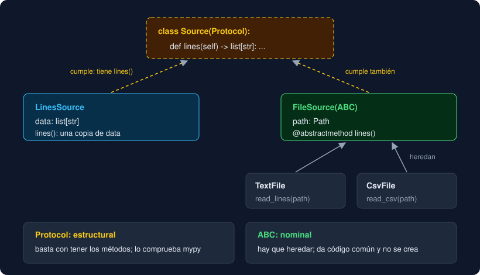

# Proyecto — Observatorio, capa 9: las fuentes de datos

⏱️ 6 h 30 min · Capa 9 del [proyecto hilo conductor](../../../docs/proyecto-hilo-conductor.md). **Único entregable de la semana.**

## Qué construyes

Hoy `main` decide de dónde salen las líneas con un `if`: si hay `-f`, llama a `read_data`, que a su vez mira la extensión; si no, usa `sys.stdin` o los argumentos. Cada fuente nueva (una API en la semana 16, PostgreSQL en la 18) añadiría otra rama a ese `if`. Esta semana cada origen pasa a ser un **objeto con un método `lines()`**, y `main` solo hace `source.lines()`.

| Nombre | Qué es | Herramienta de la semana |
|---|---|---|
| `Source` | Lo que tiene que cumplir una fuente: un método `lines() -> list[str]` | `Protocol` con `@runtime_checkable` |
| `LinesSource(data)` | Líneas que ya están en memoria: argumentos o `stdin` | *Dataclass* que cumple `Source` **sin heredar** de él |
| `FileSource(path)` | La base de las fuentes de archivo: guarda la ruta, no se puede crear | Clase abstracta (`ABC` + `@abstractmethod`) |
| `TextFile(path)`, `CsvFile(path)` | Un `.txt` y un `.csv` | **Herencia**: solo escriben `lines()`, con `read_lines` y `read_csv` |
| `open_file(path)` | La fuente adecuada según la extensión | Una función, no una clase |

Las funciones de las capas 0 a 8 **no cambian**: `TextFile` y `CsvFile` llaman a `read_lines` y `read_csv`, y `read_data` sigue existiendo con sus tests. La versión sube a `0.10.0` y el informe es **idéntico** al de la semana 9.

```
src/observatorio/core/
├── __init__.py      # + Source, LinesSource, FileSource, TextFile, CsvFile y open_file
├── sources.py       # nuevo: el Protocol, la base abstracta y las fuentes
└── ...              # los ocho módulos de siempre, sin cambios
```



## Dónde trabajas

En **tu repositorio** `python-<nombre>-<apellido>`, en una rama nueva `week-10`. El `starter/` trae la capa 8 resuelta; **tú escribes `sources.py`** y amplías tu `__main__.py`.

## Pasos

### 1. Rama de la semana

Comprueba que el *pull request* `week-09` está fusionado en `main`. Después:

```bash
cd ~/proyectos/python-<nombre>-<apellido>
git switch main
git pull
git switch -c week-10
```

### 2. Copia los archivos nuevos

```bash
STARTER=<ruta-al-bootcamp>/bootcamp/week-10-herencia_composicion_abc_y_protocol/3-proyecto/starter
cp $STARTER/tests/test_sources.py $STARTER/tests/test_my_sources.py tests/
cp $STARTER/tests/test_package.py $STARTER/tests/test_main.py tests/
sed -i 's/week-09/week-10/' compose.yaml
git status --short
```

Nuevos: `tests/test_sources.py` (25 tests) y `tests/test_my_sources.py` (un ejemplo). Modificados: `test_package.py`, que ahora espera el módulo `sources`, sus nombres en `__all__` y la versión `0.10.0`; `test_main.py`, que solo cambia la versión esperada; y `compose.yaml`.

### 3. Tests en rojo

```bash
uv run pytest
```

```
E   ImportError: cannot import name 'LinesSource' from 'observatorio.core' (.../src/observatorio/core/__init__.py)
E   ImportError: cannot import name 'sources' from 'observatorio.core' (.../src/observatorio/core/__init__.py)
E   ImportError: cannot import name 'CsvFile' from 'observatorio.core' (.../src/observatorio/core/__init__.py)
!!!!!!!!!!!!!!!!!!! Interrupted: 3 errors during collection !!!!!!!!!!!!!!!!!!!
```

Lee `tests/test_sources.py` entero antes de escribir nada: es la especificación. Fíjate en el último, `test_main_reads_files_through_open_file`: con `monkeypatch.setattr` cambia `open_file` dentro de `__main__` por una función que devuelve una fuente en memoria, y llama a `main` con un archivo que no existe. Solo pasa si `main` lee los archivos **a través de** `open_file`.

### 4. El esqueleto, sin herencia de verdad

Crea `src/observatorio/core/sources.py` con la versión más ingenua: una base que lanza `NotImplementedError` y dos subclases vacías.

```python
"""Las fuentes de líneas del Observatorio: argumentos, stdin, un .txt o un .csv."""

from dataclasses import dataclass
from pathlib import Path
from typing import Protocol


class Source(Protocol):
    def lines(self) -> list[str]: ...


@dataclass
class LinesSource:
    data: list[str]

    def lines(self) -> list[str]:
        return self.data


@dataclass
class FileSource:
    path: Path

    def lines(self) -> list[str]:
        raise NotImplementedError


class TextFile(FileSource):
    pass


class CsvFile(FileSource):
    pass


def open_file(path: Path) -> FileSource:
    return TextFile(path)
```

Y expón los seis nombres en la API pública: en `core/__init__.py`, añade `from observatorio.core.sources import CsvFile, FileSource, LinesSource, Source, TextFile, open_file` y los seis a `__all__`. `uv run ruff check --fix` los ordena y `uv run ruff format` parte la línea larga.

```bash
uv run pytest -q
```

```
21 failed, 225 passed
```

Ya se importa todo. Mira lo que **pasa** sin que hayas hecho nada: `test_file_sources_keep_their_path` y `test_file_sources_compare_class_and_path`. `TextFile` no tiene ni una línea propia y ya tiene `path`, `__init__`, `__repr__` y `__eq__`: los **hereda** de `FileSource`, que los recibió de `@dataclass`. Y `__eq__` compara también la clase: `TextFile(ruta) != CsvFile(ruta)`.

### 5. Un `Protocol` que se puede comprobar

```python
from typing import Protocol, runtime_checkable


@runtime_checkable
class Source(Protocol):
    """Cualquier objeto con un método lines() que devuelve las líneas a analizar."""

    def lines(self) -> list[str]: ...
```

```
18 failed, 228 passed
```

Pasan los tres tests de `isinstance(..., Source)`. Ni `LinesSource` ni `TextFile` heredan de `Source`, y aun así lo cumplen: tienen `lines()` (teoría 04). Lee `test_any_object_with_lines_is_a_source`: una clase de tres líneas definida dentro del test también es una fuente. Sin `@runtime_checkable`, `isinstance` con un `Protocol` lanza `TypeError`.

### 6. `LinesSource`, inmutable y con copia

```python
@dataclass(frozen=True, slots=True)
class LinesSource:
    data: list[str]

    def lines(self) -> list[str]:
        return list(self.data)
```

```
16 failed, 230 passed
```

`list(self.data)` devuelve una **copia**: si quien recibe las líneas les hace `append`, la fuente no cambia (`test_lines_source_gives_a_copy`). `frozen` impide reasignar `data`, pero no cambiar la lista que hay dentro (semana 9): por eso la copia.

### 7. `TextFile` y `CsvFile` escriben su `lines()`

Cada subclase **sustituye** (*override*) el `lines()` de la base por el suyo, que llama a una función de la capa 6:

```python
from observatorio.core.storage import read_csv, read_lines


class TextFile(FileSource):
    """Un archivo de texto con una medida "etiqueta;valor" por línea."""

    def lines(self) -> list[str]:
        return read_lines(self.path)


class CsvFile(FileSource):
    """Un CSV con cabecera "etiqueta;valor", leído con read_csv."""

    def lines(self) -> list[str]:
        return read_csv(self.path)
```

```
11 failed, 235 passed
```

Las `DataFileError` de `read_lines` y `read_csv` siguen saliendo igual: `main` ya sabe tratarlas. Fíjate en `test_creating_a_file_source_does_not_read_it`: crear `TextFile(ruta)` no abre nada; el archivo se lee al llamar a `lines()`.

### 8. `open_file` elige la clase

```python
def open_file(path: Path) -> FileSource:
    """CsvFile si la extensión es .csv (sin importar mayúsculas) y TextFile si es otra."""
    if path.suffix.lower() == ".csv":
        return CsvFile(path)
    return TextFile(path)
```

```
8 failed, 238 passed
```

Es la misma regla que `read_data`, pero en lugar de **leer** devuelve un **objeto que sabe leer**. El tipo de retorno es la base, `FileSource`: quien llama no necesita saber cuál de las dos le ha tocado. `test_open_file_reads_like_read_data` comprueba que las dos formas dan las mismas líneas.

### 9. `FileSource` pasa a ser abstracta

El `raise NotImplementedError` del paso 4 tiene dos problemas: se puede crear un `FileSource(ruta)`, que no sirve para nada, y una subclase que olvide `lines()` solo falla cuando alguien lo llama. Conviértela en **clase abstracta**:

```python
from abc import ABC, abstractmethod


@dataclass(frozen=True)
class FileSource(ABC):
    """La base de las fuentes que leen un archivo: guarda la ruta y no se puede crear."""

    path: Path

    @abstractmethod
    def lines(self) -> list[str]:
        """Las líneas del archivo, o DataFileError si no se puede leer."""
```

```
4 failed, 242 passed
```

Ahora `FileSource(Path("medidas.txt"))` falla **al crearse**:

```
TypeError: Can't instantiate abstract class FileSource without an implementation for abstract method 'lines'
```

Y lo mismo una subclase sin `lines()`, como `Forgetful` en `test_a_subclass_without_lines_cannot_be_created`. `frozen=True` en la base impide reasignar `path` también en `TextFile` y `CsvFile`, y les da `__hash__`. No pongas `slots=True` en la base: las subclases sin `@dataclass` volverían a tener `__dict__` y no ganarías nada (teoría 05).

### 10. La versión

```bash
uv version --bump minor
```

```
observatorio 0.9.0 => 0.10.0
```

```
1 failed, 245 passed
```

### 11. `main` usa las fuentes

Queda `test_main_reads_files_through_open_file`. En tu `__main__.py`:

1. Declara `source: Source` (en lugar de `source: Path | None = None`).
2. En los `case` de `-f`, `source = open_file(Path(name))`; en el de `stdin`, `source = LinesSource(list(sys.stdin))`; en el de los argumentos, `source = LinesSource(args)`.
3. Sustituye el `if source is not None:` con `read_data` por un solo bloque: `try: lines = source.lines()` con el mismo `except DataFileError`.
4. Importa `LinesSource`, `Source` y `open_file`; quita `read_data`. `uv run ruff check` te avisa si sobra algo (`F401`).
5. Actualiza el *docstring* de `main`: `-f` lee con `open_file`.

```bash
uv run pytest -q
uv run observatorio -f medidas.csv
```

```
246 passed
```

El informe es el mismo de la semana 9. La anotación `source: Source` no es decoración: mypy comprueba en cada asignación que el objeto cumple el `Protocol`. Pruébalo: renombra `LinesSource.lines` a `get_lines` y ejecuta `uv run mypy`:

```
src/observatorio/__main__.py:88: error: Incompatible types in assignment (expression has type "LinesSource", variable has type "Source")  [assignment]
```

Sale dos veces, una por cada `LinesSource` de `main`. mypy lo detecta **sin ejecutar** el programa: ni un test ha llegado a correr. Tus números de línea pueden ser otros. Vuelve a dejarlo como estaba.

### 12. Tus tests

En `tests/test_my_sources.py`, sustituye el ejemplo por **al menos 6 tests tuyos** con datos de tu dominio, importando solo de `observatorio.core`:

| Qué pruebas | Ejemplo (calidad del aire) |
|---|---|
| Un `.txt` de tu dominio | `TextFile` en `tmp_path` con tres medidas y una marca de dato faltante |
| Un `.csv` de tu dominio | `CsvFile` con la cabecera y dos estaciones |
| Una cabecera mal escrita | `CsvFile(...).lines()` lanza `DataFileError` |
| Tu propia fuente | Una clase tuya con `lines()` (por ejemplo, unas medidas fijas de prueba) cumple `Source` |
| De la fuente a la serie | `Series.from_lines(open_file(ruta).lines()).means()` con medias calculadas a mano |
| Una base que no se crea | `FileSource(ruta)` lanza `TypeError` |

Para crear `FileSource` en un test, mypy avisa (`Cannot instantiate abstract class`): es justo lo que quieres probar, así que añade `# type: ignore[abstract]` al final de esa línea, como en `test_sources.py`.

```bash
uv run pytest
uv run ruff check && uv run ruff format --check && uv run mypy
```

Esperado: todo en verde, al menos `298 passed`. Son los 239 del bootcamp (12 + 17 + 19 + 20 + 26 + 27 + 28 + 24 + 12 + 29 + 25) más los 59 tuyos como mínimo (5 + 6 + 6 + 6 + 6 + 6 + 6 + 6 + 6 + 6, de las semanas 1 a 10).

### 13. En el contenedor

```bash
docker compose run --build --rm app
docker compose run --rm app observatorio --version
```

Los tests en verde y `observatorio 0.10.0`.

### 14. README, commit y pull request

En el `README.md` de tu repositorio, añade `sources.py` al árbol del paquete y una frase sobre qué es una fuente.

Commits sugeridos, en este orden: `feat: add sources skeleton`, `feat: make source protocol runtime checkable`, `feat: freeze lines source`, `feat: read text and csv files`, `feat: choose file source by suffix`, `refactor: make file source abstract`, `chore: bump version to 0.10.0`, `refactor: read input through sources in main` y `test: add source tests`. Al final:

```bash
git push -u origin week-10
```

En GitHub, abre un *pull request* de `week-10` hacia `main` con:

1. La salida de `uv run pytest`, `uv run mypy` y `uv run ruff check`.
2. El error de mypy al renombrar `lines` (paso 11) y el `TypeError` al crear `FileSource`.
3. Por qué `LinesSource` no hereda de nada y `TextFile` sí.

## 🧯 Si algo sale mal

| Síntoma | Qué hacer |
|---|---|
| `ImportError: cannot import name 'LinesSource' from 'observatorio.core'` | Falta el import de `sources` en `core/__init__.py` (paso 4) |
| `test_every_module_lives_in_core` falla | `sources.py` no está en `src/observatorio/core/` |
| `TypeError: Instance and class checks can only be used with @runtime_checkable protocols` | Falta `@runtime_checkable` encima de `class Source(Protocol)` |
| `TypeError: Can't instantiate abstract class TextFile without an implementation for abstract method 'lines'` | El método de `TextFile` tiene otro nombre o mala sangría: debe llamarse `lines` y estar dentro de la clase |
| `TypeError: TextFile() takes no arguments` | Falta `@dataclass(frozen=True)` encima de `FileSource`: sin él no hay `__init__` que reciba `path` |
| `TypeError: cannot inherit frozen dataclass from a non-frozen one` | Pusiste `@dataclass(frozen=True)` en una subclase y no en `FileSource`: el `frozen` va en la base |
| `test_lines_source_gives_a_copy` falla | `lines()` devuelve `self.data` en lugar de `list(self.data)` |
| `test_main_reads_files_through_open_file` falla | `main` aún llama a `read_data`, o importa `open_file` con otro nombre (`from ... import open_file as ...`) |
| `mypy`: `Cannot instantiate abstract class "FileSource"` en tus tests | Es lo esperado al probarlo: `# type: ignore[abstract]` en esa línea |
| `mypy`: `Missing return statement  [empty-body]` en `FileSource.lines` | Falta `@abstractmethod` encima del método: solo a un método abstracto le permite mypy un cuerpo sin `return` |
| Los tests de `main` fallan tras el paso 11 | El informe cambió: compara tu salida con la de antes (`git stash`, ejecuta, `git stash pop`) |

## Entrega

- Rama `week-10` de `python-<nombre>-<apellido>` con `core/sources.py` (`Source`, `LinesSource`, `FileSource`, `TextFile`, `CsvFile` y `open_file`), los seis nombres en la API pública, `main` leyendo a través de las fuentes, la versión `0.10.0` y al menos 6 tests propios en `tests/test_my_sources.py`. Todo en verde (también en Docker), con `ruff check`, `ruff format --check` y `mypy` sin avisos.
- `README.md` del repositorio con `sources.py` en el árbol del paquete.
- *Pull request* `week-10` → `main` con la descripción del paso 14.

---

## 🔗 Navegación

| Anterior | Actual | Siguiente |
| -------- | ------ | --------- |
| [Ejercicio 04 · `Protocol`](../2-practicas/ejercicio-04-protocol/README.md) | **Proyecto · Observatorio, capa 9** | [Webgrafía](../4-recursos/webgrafia/README.md) |
