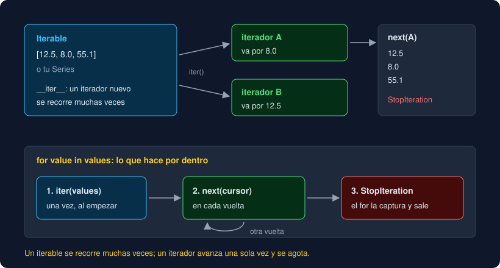

# 03 · Iteradores

⏱️ 45 min

## 🎯 Objetivos

- Distinguir un **iterable** de un **iterador**.
- Recorrer a mano con `iter()`, `next()` y `StopIteration`, y explicar qué hace un `for` por dentro.
- Escribir un iterador como clase con `__iter__` y `__next__`.
- Prever cuándo un iterador se agota y cómo evitar sorpresas.

---

## 1. Iterable e iterador

Llevas desde la semana 3 escribiendo `for valor in algo`. Ese `algo` puede ser una lista, una cadena, un diccionario, un archivo, un `range`... Lo que tienen en común es que son **iterables**. Pero el `for` no recorre el iterable directamente: le pide un **iterador**.

| | Iterable | Iterador |
|---|---|---|
| Qué es | Algo que se puede recorrer | El cursor que lo recorre |
| Dunder | `__iter__`, que devuelve un iterador **nuevo** | `__next__`, que da el siguiente valor, y `__iter__`, que devuelve `self` |
| Se recorre | Las veces que quieras | **Una sola vez** |
| Ejemplos | `list`, `str`, `dict`, `range`, tu `Series` | `iter(lista)`, `zip(...)`, `map(...)`, `enumerate(...)`, un archivo abierto, un generador |



Una lista es como un libro; su iterador, como un marcapáginas. Del mismo libro puedes sacar varios marcapáginas, cada uno por su página. Un marcapáginas solo sabe avanzar.

---

## 2. `iter()`, `next()` y `StopIteration`

```python
values = [12.5, 8.0, 55.1]
cursor = iter(values)      # values.__iter__(): un list_iterator
next(cursor)               # 12.5: cursor.__next__()
next(cursor)               # 8.0
next(cursor)               # 55.1
next(cursor)               # StopIteration
```

Cuando no quedan valores, `__next__` **lanza** `StopIteration`: es la forma de decir "se acabó". Con un segundo argumento, `next(cursor, None)` devuelve `None` en lugar de lanzar; útil para pedir "el primero, si hay":

```python
first_high = next((v for v in values if v > 50), None)    # 55.1, o None si no hay
```

### Lo que hace un `for` por dentro

Este `for`:

```python
for value in values:
    print(value)
```

es exactamente este `while`:

```python
cursor = iter(values)
while True:
    try:
        value = next(cursor)
    except StopIteration:
        break
    print(value)
```

El `for` llama a `iter()` una vez, a `next()` en cada vuelta, y captura `StopIteration` para terminar. Lo mismo hacen por dentro `list()`, `sum()`, `max()`, `sorted()`, `in`, `zip()`, el desempaquetado `a, b = algo` y las *comprehensions*: todo lo que acepta "un iterable" usa este protocolo.

---

## 3. Un iterador escrito como clase

Un iterador es cualquier objeto con `__next__` y un `__iter__` que devuelve `self`:

```python
class Countdown:
    def __init__(self, start: int) -> None:
        self.current = start

    def __iter__(self) -> Countdown:
        return self

    def __next__(self) -> int:
        if self.current <= 0:
            raise StopIteration
        self.current -= 1
        return self.current + 1


list(Countdown(3))     # [3, 2, 1]
```

- El **estado** (por dónde va) vive en `self.current`.
- `__iter__` devuelve `self` para que el iterador funcione en un `for`: el `for` siempre llama primero a `iter()`.
- Al terminar, **lanza** `StopIteration`, no la devuelve.

Si `__iter__` devuelve algo que no tiene `__next__`, el `for` falla al empezar: `TypeError: iter() returned non-iterator of type 'list'`.

---

## 4. Los iteradores se agotan

```python
countdown = Countdown(3)
list(countdown)     # [3, 2, 1]
list(countdown)     # []: current ya vale 0
```

Un iterador no vuelve a empezar. Es la fuente de un error muy común:

```python
pairs = zip(labels, values)
print(list(pairs))     # [('Norte', 12.5), ...]
print(list(pairs))     # []
```

Y de otro más sutil: dos bucles anidados sobre **el mismo** iterador se pisan, porque el de dentro consume los valores que el de fuera iba a usar (ejercicio 03, paso 4).

### Iterable de verdad: un iterador nuevo en cada `iter()`

La solución es separar los dos papeles: la clase que guarda los datos es un **iterable** cuyo `__iter__` crea un iterador **nuevo** cada vez.

```python
class Launch:
    def __init__(self, start: int) -> None:
        self.start = start

    def __iter__(self) -> Iterator[int]:
        return Countdown(self.start)


launch = Launch(3)
list(launch)     # [3, 2, 1]
list(launch)     # [3, 2, 1]
```

Es lo que hace `list`: `iter(lista)` devuelve un `list_iterator` nuevo cada vez. Y es lo que hará tu `Series`: su `__iter__` crea un generador nuevo en cada llamada (teoría 04), así que cada `for` sobre la serie empieza desde la primera medida.

**Regla**: una colección (algo que guarda datos) es un iterable y su `__iter__` **no** devuelve `self`. Solo un cursor devuelve `self`.

---

## 5. Tipos: `Iterable` e `Iterator`

En las anotaciones, `collections.abc` tiene los dos papeles:

```python
from collections.abc import Iterable, Iterator


def mean(values: Iterable[float]) -> float:      # acepta listas, tuplas, generadores...
    ...


def countdown(start: int) -> Iterator[int]:      # promete un cursor
    ...
```

- Para **parámetros**, pide lo mínimo: `Iterable[float]` acepta cualquier cosa que se pueda recorrer. Pide `list[float]` solo si necesitas `len` o índices.
- Para **retornos**, `Iterator[...]` dice a quien llama que lo recibido se recorre una vez.

Es la idea de la semana 10: `Iterable` es un `Protocol`. mypy acepta cualquier objeto con `__iter__`, sin que herede de nada.

---

## ⚠️ Errores frecuentes

| Error | Causa | Arreglo |
|---|---|---|
| La segunda vuelta sale vacía | Recorres dos veces un iterador (`zip`, `map`, un archivo, un generador) | Guárdalo en una lista si lo necesitas dos veces, o vuelve a crearlo |
| `TypeError: 'X' object is not iterable` | La clase no tiene `__iter__` | Escribe `__iter__` |
| `TypeError: iter() returned non-iterator of type 'list'` | `__iter__` devuelve una lista | Devuelve `iter(lista)` o usa `yield` (teoría 04) |
| `TypeError: 'list' object is not an iterator` | `next(lista)` | `next(iter(lista))` |
| El bucle no termina | `__next__` nunca lanza `StopIteration` | Lanza `StopIteration` al acabar |
| Dos bucles anidados dan menos de lo esperado | Los dos usan el mismo iterador | Haz que la clase sea un iterable con un iterador nuevo en cada `iter()` |

---

## ✅ Qué debes saber al terminar

- [ ] La diferencia entre un iterable y un iterador, y un ejemplo de cada uno.
- [ ] Qué hacen `iter()` y `next()`, y qué significa `StopIteration`.
- [ ] Escribir un `for` como un `while` con `try`/`except StopIteration`.
- [ ] Por qué el `__iter__` de una colección no debe devolver `self`.
- [ ] Cuándo anotar con `Iterable[...]` y cuándo con `Iterator[...]`.

---

## 🔗 Navegación

| Anterior | Actual | Siguiente |
| -------- | ------ | --------- |
| [02 · Operadores y contenedores](02-operadores-y-contenedores.md) | **03 · Iteradores** | [04 · Generadores](04-generadores.md) |
