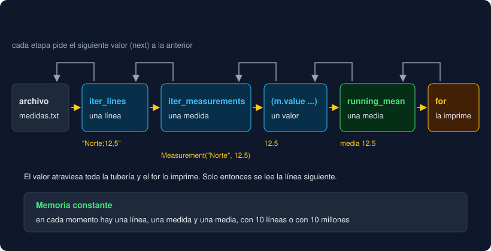

# Proyecto — Observatorio, capa 10: el data model y los generadores

⏱️ 6 h 30 min · Capa 10 del [proyecto hilo conductor](../../../docs/proyecto-hilo-conductor.md). **Único entregable de la semana.**

## Qué construyes

Tu `Series` guarda las medidas, pero no se comporta como una colección: `len(serie)` lanza `TypeError`, no entra en un `for` y para ver la primera medida hay que escribir `serie.measurements[0]`. Y todo el Observatorio trabaja con listas completas: para analizar un archivo, primero lo carga entero en memoria. Esta semana `Measurement` y `Series` hablan el idioma de Python (**dunders**), y un módulo nuevo procesa las medidas **de una en una** con generadores.

| Nombre | Qué hace | Herramienta de la semana |
|---|---|---|
| `str(medida)` | `"Norte;12,5"` o `"Sur;NA"`: la medida como línea, la inversa de `from_line` | `__str__` |
| `len(serie)`, `if serie:` | El número de medidas; una serie vacía es falsa | `__len__` |
| `for medida in serie`, `medida in serie` | Las medidas en orden; `in` funciona sin escribirlo | `__iter__` con `yield from` |
| `serie[0]`, `serie[-1]` | La medida en una posición | `__getitem__` |
| `serie_a + serie_b` | Una serie nueva con las medidas de las dos | `__add__` y `NotImplemented` |
| `iter_lines(path)` | Las líneas de un archivo una a una, con los errores de `read_lines` | Generador con `with` y `yield` |
| `iter_measurements(lines)` | Las medidas de las líneas válidas, una a una, aunque las líneas no terminen nunca | Generador |
| `running_mean(values)` | La media acumulada: `[10, 20, 30]` da `10, 15, 20` | Generador con estado |

Las funciones de las capas 0 a 9 **no cambian**, y `main` tampoco: el informe es **idéntico** al de la semana 10. La versión sube a `0.11.0`. Lo que ganas lo usan tus tests hoy y la CLI de la semana 15.

```
src/observatorio/core/
├── __init__.py      # + iter_lines, iter_measurements y running_mean
├── model.py         # + __str__ en Measurement; __len__, __iter__, __getitem__ y __add__ en Series
├── streams.py       # nuevo: los tres generadores
└── ...              # los demás módulos, sin cambios
```



## Dónde trabajas

En **tu repositorio** `python-<nombre>-<apellido>`, en una rama nueva `week-11`. El `starter/` trae la capa 9 resuelta; **tú amplías `model.py`**, escribes `streams.py` y no tocas tu `__main__.py`.

## Pasos

### 1. Rama de la semana

Comprueba que el *pull request* `week-10` está fusionado en `main`. Después:

```bash
cd ~/proyectos/python-<nombre>-<apellido>
git switch main
git pull
git switch -c week-11
```

### 2. Copia los archivos nuevos

```bash
STARTER=<ruta-al-bootcamp>/bootcamp/week-11-data_model_dunders_iteradores_y_generadores/3-proyecto/starter
cp $STARTER/tests/test_datamodel.py $STARTER/tests/test_my_datamodel.py tests/
cp $STARTER/tests/test_package.py $STARTER/tests/test_main.py tests/
sed -i 's/week-10/week-11/' compose.yaml
git status --short
```

Nuevos: `tests/test_datamodel.py` (25 tests) y `tests/test_my_datamodel.py` (un ejemplo). Modificados: `test_package.py`, que ahora espera el módulo `streams`, sus nombres en `__all__` y la versión `0.11.0`; `test_main.py`, que solo cambia la versión esperada; y `compose.yaml`.

### 3. Tests en rojo

```bash
uv run pytest
```

```
E   ImportError: cannot import name 'iter_lines' from 'observatorio.core' (.../src/observatorio/core/__init__.py)
E   ImportError: cannot import name 'running_mean' from 'observatorio.core' (.../src/observatorio/core/__init__.py)
E   ImportError: cannot import name 'streams' from 'observatorio.core' (.../src/observatorio/core/__init__.py)
!!!!!!!!!!!!!!!!!!! Interrupted: 3 errors during collection !!!!!!!!!!!!!!!!!!!
```

Lee `tests/test_datamodel.py` entero antes de escribir nada: es la especificación. Fíjate en los dos tests con `itertools.cycle` e `itertools.count`: les pasan a tus generadores una entrada **que no termina nunca** y solo piden unos pocos valores con `islice`. Una versión que construya una lista antes de devolver nada no terminaría.

### 4. El esqueleto de `streams.py`

Crea `src/observatorio/core/streams.py` con las tres funciones sin hacer nada todavía:

```python
"""Generadores del Observatorio: leer y procesar medidas de una en una."""

from collections.abc import Iterable, Iterator
from pathlib import Path

from observatorio.core.model import Measurement


def iter_lines(path: Path) -> Iterator[str]:
    raise NotImplementedError


def iter_measurements(lines: Iterable[str]) -> Iterator[Measurement]:
    raise NotImplementedError


def running_mean(values: Iterable[float]) -> Iterator[float]:
    raise NotImplementedError
```

Y expón los tres nombres en la API pública: en `core/__init__.py`, añade `from observatorio.core.streams import iter_lines, iter_measurements, running_mean` y los tres a `__all__`. `uv run ruff check --fix` los ordena.

```bash
uv run pytest -q
```

```
28 failed, 244 passed
```

Ya se importa todo. Mira uno que **pasa** sin hacer nada: `test_add_with_a_list_raises_type_error`. Sin `__add__`, `serie + [medida]` ya lanza `TypeError`; lo que falta es que `serie + serie` funcione sin perder ese error.

### 5. `Measurement.__str__`

En `model.py`, dentro de `Measurement`:

```python
    def __str__(self) -> str:
        """La medida como línea "etiqueta;valor", con coma decimal y "NA" si falta el valor.

        Es la inversa de from_line: Measurement.from_line(str(medida)) == medida.
        """
        text = "NA" if self.value is None else str(self.value).replace(".", ",")
        return f"{self.label};{text}"
```

```
25 failed, 247 passed
```

`print(medida)` y los *f-strings* usan `__str__`; `repr(medida)`, la consola y las listas siguen usando el `__repr__` que escribió `@dataclass`: `Measurement(label='Norte', value=12.5)`. Los dos conviven (teoría 01). `str(self.value)` y no `f"{self.value:.1f}"`: con un decimal, `12.25` volvería como `12.2` y la ida y vuelta de `test_measurement_str_round_trips_with_from_line` fallaría.

### 6. `Series.__len__`

Desde aquí, todo va dentro de `Series`, antes de `add`. Añade `Iterator` al import de `collections.abc`, que lo usarás en el paso 7.

```python
    def __len__(self) -> int:
        """El número de medidas: len(serie). Una serie vacía es falsa en un if."""
        return len(self.measurements)
```

```
22 failed, 250 passed
```

Pasan tres: los dos de `len` y `test_an_empty_series_is_falsy`. No escribiste `__bool__`: sin él, `if serie:` pregunta a `__len__`, y `0` es falso (ejercicio 01, paso 6).

### 7. `Series.__iter__`

```python
    def __iter__(self) -> Iterator[Measurement]:
        """Las medidas en orden: for medida in serie. También hace funcionar `in`."""
        yield from self.measurements
```

```
18 failed, 254 passed
```

Con un `yield`, `__iter__` es un **generador**: cada `iter(serie)` crea uno nuevo, así que cada `for` empieza desde el principio (`test_each_iter_starts_a_new_iterator`). La serie es un **iterable**, no un iterador (teoría 03). Y `in` funciona sin escribir `__contains__`: Python recorre con `__iter__` y compara con `==`, el `__eq__` de la *dataclass*.

La anotación `Iterator[Measurement]` le dice a mypy qué sale del `for`. Pruébalo: añade al final de `tests/test_my_datamodel.py` estas dos líneas y ejecuta `uv run mypy`:

```python
for measurement in Series():
    print(measurement.valor)
```

```
tests/test_my_datamodel.py:11: error: "Measurement" has no attribute "valor"  [attr-defined]
```

Tu número de línea puede ser otro. Bórralas.

### 8. `Series.__getitem__`

```python
    def __getitem__(self, index: int) -> Measurement:
        """La medida en la posición index: serie[0], serie[-1]."""
        return self.measurements[index]
```

```
16 failed, 256 passed
```

Delegar en la lista te da los índices negativos y el `IndexError` sin escribirlos. Solo acepta `int`: `serie[1:3]` funcionaría en ejecución (la lista acepta rebanadas), pero mypy lo rechaza, y no lo necesitas.

### 9. `Series.__add__`, primero ingenuo

```python
    def __add__(self, other: Series) -> Series:
        """Una serie nueva con las medidas de las dos: serie_a + serie_b."""
        return Series(self.measurements + other.measurements)
```

```
15 failed, 257 passed
```

Pasan los dos de sumar series, pero `test_add_with_a_list_raises_type_error`, que pasaba desde el paso 4, ahora **falla**:

```
E       AttributeError: 'list' object has no attribute 'measurements'
```

`serie + [medida]` entra en tu `__add__` y revienta dentro. Un operador que no sabe qué hacer con el otro operando debe **devolver** `NotImplemented` (no lanzarlo): Python prueba entonces `[medida].__radd__(serie)` y, si tampoco sabe, lanza el `TypeError` de siempre. Añade la comprobación:

```python
    def __add__(self, other: Series) -> Series:
        """Una serie nueva con las medidas de las dos: serie_a + serie_b."""
        if not isinstance(other, Series):
            return NotImplemented
        return Series(self.measurements + other.measurements)
```

```
14 failed, 258 passed
```

El `isinstance` protege en ejecución y la anotación `other: Series`, antes: mypy rechaza `serie + [medida]` sin ejecutar (`Unsupported operand types for + ("Series" and "list[Measurement]")`). Por eso el test lleva `# type: ignore[operator]`: prueba justo lo que mypy prohíbe.

### 10. `iter_lines`

En `streams.py`, importa `DataFileError` de `observatorio.core.storage` y escribe el primer generador:

```python
def iter_lines(path: Path) -> Iterator[str]:
    """Da las líneas del archivo de texto UTF-8 `path` una a una, sin el salto de línea.

    Mismos errores que read_lines, pero llegan en el primer next(), no al llamar:
    crear el generador no abre el archivo.
    """
    try:
        with path.open(encoding="utf-8") as file:
            for line in file:
                yield line.rstrip("\n")
    except FileNotFoundError as error:
        raise DataFileError(f"no existe el archivo {path}") from error
    except IsADirectoryError as error:
        raise DataFileError(f"{path} es una carpeta") from error
    except UnicodeDecodeError as error:
        raise DataFileError(f"{path} no es texto UTF-8") from error
```

```
10 failed, 262 passed
```

Compáralo con `read_lines` de la capa 6: los mismos `except`, pero `file.read().splitlines()` carga el archivo entero y `for line in file` lee línea a línea (un archivo abierto es un iterador, ejercicio 03). Lee `test_iter_lines_fails_on_the_first_next_not_on_the_call`: `iter_lines(ruta_que_no_existe)` **no falla**. El cuerpo de un generador no empieza hasta el primer `next()`, y ahí llega la `DataFileError`. El `with` sigue cerrando el archivo, también si quien recorre el generador se detiene a mitad.

### 11. `iter_measurements`

Importa `is_data_line` de `observatorio.core.report`:

```python
def iter_measurements(lines: Iterable[str]) -> Iterator[Measurement]:
    """Da la medida de cada línea de datos válida, con las reglas de Series.from_lines."""
    for line in lines:
        if is_data_line(line):
            measurement = Measurement.from_line(line.strip())
            if measurement is not None:
                yield measurement
```

```
8 failed, 264 passed
```

Son las reglas de `records_of` (semana 5), pero de una en una. `test_iter_measurements_works_with_an_endless_input` le pasa `itertools.cycle(...)`, que repite tres líneas sin fin, y pide tres medidas con `islice`: termina porque tu generador no intenta leerlas todas. `Series.from_lines` hace `records_of(lines)`, que construye una lista: con esa entrada no terminaría nunca.

### 12. `running_mean`

```python
def running_mean(values: Iterable[float]) -> Iterator[float]:
    """Da la media de los valores vistos hasta cada momento: [10, 20, 30] da 10, 15, 20."""
    total = 0.0
    for count, value in enumerate(values, start=1):
        total += value
        yield total / count
```

```
3 failed, 269 passed
```

`total` y `count` viven dentro del generador entre un `yield` y el siguiente: es su **estado**, el que en una clase iterador irían en `self` (ejercicio 03, paso 3). Fíjate en `test_a_generator_is_used_up_after_one_pass`: la segunda `list(medias)` da `[]`. Un generador se gasta; si necesitas los valores dos veces, guárdalos en una lista.

Prueba la tubería entera con tu `medidas.txt`:

```bash
uv run python -c "
from pathlib import Path
from observatorio.core import Series, iter_lines, running_mean
series = Series.from_lines(iter_lines(Path('medidas.txt')))
print(len(series), series[0], series[-1])
print(' · '.join(f'{mean:.1f}' for mean in running_mean(series.values())))
"
```

```
7 Norte;12,5 Sur;9,5
12.5 · 10.2 · 25.2 · 34.1 · 37.1 · 32.5
```

Con las medidas de ejemplo; con las tuyas, otros números. `series[0]` se imprime como línea gracias a `__str__`.

### 13. La versión

```bash
uv version --bump minor
```

```
observatorio 0.10.0 => 0.11.0
```

```
272 passed
```

`main` no ha cambiado y el informe tampoco: compruébalo con `uv run observatorio < medidas.txt`.

### 14. Tus tests

En `tests/test_my_datamodel.py`, sustituye el ejemplo por **al menos 6 tests tuyos** con datos de tu dominio, importando solo de `observatorio.core`:

| Qué pruebas | Ejemplo (calidad del aire) |
|---|---|
| `str` de una medida de tu dominio | `str(Measurement("Estación Centro", 18.5)) == "Estación Centro;18,5"` |
| Una serie de tu dominio en un `for` | Las etiquetas de tus estaciones, en orden, con `[m.label for m in serie]` |
| `len` y `serie[-1]` | Tras `serie.add(...)`, la longitud crece en uno y `serie[-1]` es la medida añadida |
| Sumar dos series | Las medidas de dos días (`lunes + martes`) dan la media de las dos juntas con `.means()` |
| `iter_lines` sobre un archivo tuyo | Un `.txt` en `tmp_path` con tus medidas, recorrido con `iter_measurements(iter_lines(ruta))` |
| `running_mean` con un generador infinito | `islice(running_mean(itertools.repeat(20.0)), 3)` da tres veces `20.0` |

```bash
uv run pytest
uv run ruff check && uv run ruff format --check && uv run mypy
```

Esperado: todo en verde, al menos `329 passed`. Son los 264 del bootcamp (12 + 17 + 19 + 20 + 26 + 27 + 28 + 24 + 12 + 29 + 25 + 25) más los 65 tuyos como mínimo (5 + 6 + 6 + 6 + 6 + 6 + 6 + 6 + 6 + 6 + 6, de las semanas 1 a 11).

### 15. En el contenedor

```bash
docker compose run --build --rm app
docker compose run --rm app observatorio --version
```

Los tests en verde y `observatorio 0.11.0`.

### 16. README, commit y pull request

En el `README.md` de tu repositorio, añade `streams.py` al árbol del paquete y una frase sobre qué hace un generador.

Commits sugeridos, en este orden: `feat: add streams skeleton`, `feat: add measurement str`, `feat: add series len`, `feat: make series iterable`, `feat: add series getitem`, `feat: add series addition`, `feat: read file lines lazily`, `feat: yield measurements from lines`, `feat: add running mean`, `chore: bump version to 0.11.0` y `test: add data model tests`. Al final:

```bash
git push -u origin week-11
```

En GitHub, abre un *pull request* de `week-11` hacia `main` con:

1. La salida de `uv run pytest`, `uv run mypy` y `uv run ruff check`.
2. El `AttributeError` del `__add__` ingenuo (paso 9) y por qué `NotImplemented` lo convierte en un `TypeError`.
3. Por qué `iter_lines(ruta_que_no_existe)` no falla hasta el primer `next()`, y qué haría `list(running_mean(itertools.count()))`.

## 🧯 Si algo sale mal

| Síntoma | Qué hacer |
|---|---|
| `ImportError: cannot import name 'iter_lines' from 'observatorio.core'` | Falta el import de `streams` en `core/__init__.py` (paso 4) |
| `ImportError: cannot import name 'Measurement' from partially initialized module` | `model.py` importa algo de `streams.py`, y `streams.py` importa `model`: es un ciclo. Solo `streams` importa a `model`, nunca al revés |
| `TypeError: object of type 'Series' has no len()` | Falta `__len__`, o está fuera de la clase `Series` (mira la sangría) |
| `TypeError: 'Series' object is not iterable` | Falta `__iter__`, o tiene otro nombre |
| `test_each_iter_starts_a_new_iterator` falla | `__iter__` devuelve `self`: así la serie sería un iterador y se gastaría. Usa `yield from self.measurements` |
| `test_add_with_a_list_raises_type_error` falla con `AttributeError` | Falta el `if not isinstance(other, Series): return NotImplemented` (paso 9) |
| `test_add_does_not_change_the_operands` falla | `__add__` cambia `self.measurements` (con `extend` o `+=`) en lugar de crear una `Series` nueva |
| `test_iter_lines_fails_on_the_first_next_not_on_the_call` falla | `iter_lines` no es un generador: si devuelve `iter(read_lines(path))`, falla al llamar. Usa `yield` |
| Un test con `cycle` o `count` no termina | La función construye una lista antes de dar el primer valor: corta con `Ctrl+C` y usa `yield` |
| `mypy`: `The return type of a generator function should be "Generator" or one of its supertypes` | Anotaste un generador con `-> list[...]`: es `-> Iterator[...]` |
| Los tests de `main` fallan | No toques `__main__.py` esta semana: compara con `git diff main -- src/observatorio/__main__.py` |

## Entrega

- Rama `week-11` de `python-<nombre>-<apellido>` con `Measurement.__str__`; `__len__`, `__iter__`, `__getitem__` y `__add__` en `Series`; `core/streams.py` (`iter_lines`, `iter_measurements` y `running_mean`), los tres nombres en la API pública, la versión `0.11.0` y al menos 6 tests propios en `tests/test_my_datamodel.py`. Todo en verde (también en Docker), con `ruff check`, `ruff format --check` y `mypy` sin avisos.
- `README.md` del repositorio con `streams.py` en el árbol del paquete.
- *Pull request* `week-11` → `main` con la descripción del paso 16.

---

## 🔗 Navegación

| Anterior | Actual | Siguiente |
| -------- | ------ | --------- |
| [Ejercicio 04 · Generadores](../2-practicas/ejercicio-04-generadores/README.md) | **Proyecto · Observatorio, capa 10** | [Webgrafía](../4-recursos/webgrafia/README.md) |
