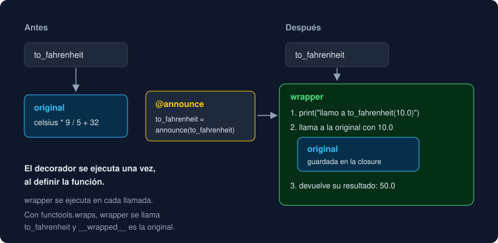

# 03 · Decoradores

⏱️ 50 min

## 🎯 Objetivos

- Escribir un decorador como una función que recibe una función y devuelve otra.
- Leer `@decorador` como lo que es: `f = decorador(f)`.
- Conservar el nombre, el *docstring* y la función original con `functools.wraps`.
- Escribir decoradores que valen para cualquier función con `*args`, `**kwargs` y `ParamSpec`, y prever el orden cuando se apilan.

---

## 1. Un decorador es una closure

Quieres que varias funciones de conversión avisen cada vez que se llaman. Repetir el `print` dentro de cada una mezcla dos cosas: lo que la función calcula y lo que haces **alrededor**. Un **decorador** separa las dos:

```python
def announce(func: Callable[[float], float]) -> Callable[[float], float]:
    def wrapper(value: float) -> float:
        print(f"llamo a {func.__name__}({value})")
        return func(value)

    return wrapper
```

`announce` recibe una función y devuelve **otra**, `wrapper`, que hace algo antes, llama a la original y devuelve su resultado. `wrapper` es una closure: recuerda `func` (teoría 02).

```python
def to_fahrenheit(celsius: float) -> float:
    return celsius * 9 / 5 + 32


to_fahrenheit = announce(to_fahrenheit)     # el nombre ahora apunta a wrapper
to_fahrenheit(10.0)
# llamo a to_fahrenheit(10.0)
# 50.0
```



---

## 2. La sintaxis `@`

Escribir `to_fahrenheit = announce(to_fahrenheit)` debajo de cada función es fácil de olvidar. Python tiene un atajo:

```python
@announce
def to_kelvin(celsius: float) -> float:
    return celsius + 273.15
```

Es **exactamente** lo mismo: define `to_kelvin` y en el acto la sustituye por `announce(to_kelvin)`. El decorador se ejecuta **una vez, al definir** la función (al importar el módulo); `wrapper` se ejecuta en cada llamada.

Ya los usabas: `@dataclass`, `@property`, `@classmethod`, `@abstractmethod`, `@runtime_checkable`, `@total_ordering`. Todos reciben lo que hay debajo (una función o una clase) y devuelven otra cosa en su lugar.

---

## 3. `functools.wraps`

El decorador de arriba tiene un efecto secundario:

```python
to_kelvin.__name__      # 'wrapper'
to_kelvin.__doc__       # None
```

El nombre `to_kelvin` apunta a `wrapper`, con su nombre y sin *docstring*. Los errores, `help()`, pytest y los registros mostrarán `wrapper`. `functools.wraps` copia los datos de la original a la nueva:

```python
import functools


def announce(func: Callable[[float], float]) -> Callable[[float], float]:
    @functools.wraps(func)
    def wrapper(value: float) -> float:
        print(f"llamo a {func.__name__}({value})")
        return func(value)

    return wrapper
```

Ahora `to_kelvin.__name__` es `'to_kelvin'`, el *docstring* vuelve y `to_kelvin.__wrapped__` es la función original, útil para probarla sin decorar. `wraps` es a su vez un decorador con argumento (teoría 04). **Regla**: todo `wrapper` lleva `@functools.wraps(func)`.

---

## 4. Decoradores para cualquier función

`announce` solo sirve para funciones de un `float`. Para decorar cualquier función, el `wrapper` recibe lo que venga y se lo pasa entero a la original:

```python
def counted(func):
    calls = 0

    @functools.wraps(func)
    def wrapper(*args, **kwargs):
        nonlocal calls
        calls += 1
        print(f"{func.__name__}: llamada {calls}")
        return func(*args, **kwargs)

    return wrapper
```

`*args` recoge los argumentos posicionales en una tupla y `**kwargs` los nombrados en un diccionario (semana 3); `func(*args, **kwargs)` los vuelve a repartir. `calls` vive en la closure: cada función decorada tiene su propio contador, y `nonlocal` lo deja cambiar.

### El tipo de un decorador genérico

Sin anotaciones, mypy no sabe qué devuelve `counted(mean)` y deja de comprobar sus llamadas. Con `Callable[..., Any]` pasa lo mismo: `...` acepta cualquier argumento. Para decir "devuelve una función **con la misma firma** que la que recibe" existe **`ParamSpec`**, que en Python 3.12+ se escribe `**P` entre corchetes:

```python
def counted[**P, R](func: Callable[P, R]) -> Callable[P, R]:
    calls = 0

    @functools.wraps(func)
    def wrapper(*args: P.args, **kwargs: P.kwargs) -> R:
        nonlocal calls
        calls += 1
        return func(*args, **kwargs)

    return wrapper
```

| Pieza | Qué es |
|---|---|
| `[**P, R]` | Dos variables de tipo: `P`, los parámetros de `func`; `R`, lo que devuelve |
| `Callable[P, R]` | Una función con los parámetros `P` que devuelve `R` |
| `*args: P.args, **kwargs: P.kwargs` | El `wrapper` acepta exactamente los parámetros de `func` |

Así mypy sigue comprobando las llamadas a la función decorada:

```python
@counted
def mean(values: list[float]) -> float:
    return sum(values) / len(values)


mean("10")
# error: Argument 1 to "mean" has incompatible type "str"; expected "list[float]"  [arg-type]
```

La sintaxis `[T]` de las funciones genéricas la verás a fondo en la semana 13. Por ahora, copia el molde: casi todos los decoradores tienen esa forma.

---

## 5. Apilar decoradores

```python
@bold
@italic
def title() -> str:
    return "Observatorio"


title()        # '<b><i>Observatorio</i></b>'
```

Se aplican **de abajo arriba**: `title = bold(italic(title))`. El de más cerca de `def` envuelve primero; el de arriba queda por fuera y es el primero que se ejecuta en cada llamada. Cambiar el orden cambia el resultado: `@italic` encima de `@bold` da `'<i><b>...</b></i>'`. En tu proyecto, `skip_missing(rounded(1)(f))` salta los `None` **antes** de redondear; al revés, `round(None, 1)` lanzaría `TypeError`.

---

## ⚠️ Errores frecuentes

| Error | Causa | Arreglo |
|---|---|---|
| `TypeError: 'NoneType' object is not callable` al llamar a la función decorada | El decorador no tiene `return wrapper` | Devuelve `wrapper` al final del decorador |
| La función decorada devuelve `None` | El `wrapper` llama a `func(...)` pero no devuelve el resultado | `return func(*args, **kwargs)` |
| `__name__` es `'wrapper'` en errores y tests | Falta `@functools.wraps(func)` | Añádelo encima del `def wrapper` |
| `TypeError: announce.<locals>.wrapper() got an unexpected keyword argument 'upper'` | El `wrapper` solo acepta argumentos posicionales | `def wrapper(*args, **kwargs)` |
| El resultado sale envuelto al revés | Orden de los decoradores apilados | El de abajo se aplica primero |
| `mypy` no detecta llamadas mal hechas a la función decorada | El decorador está anotado con `Callable[..., Any]` o sin anotar | `[**P, R]` y `Callable[P, R]` |

---

## ✅ Qué debes saber al terminar

- [ ] Escribir un decorador y su `wrapper`, y explicar por qué es una closure.
- [ ] Qué hace exactamente `@decorador` encima de un `def`, y cuándo se ejecuta cada parte.
- [ ] Qué se pierde sin `functools.wraps` y qué guarda `__wrapped__`.
- [ ] Anotar un decorador genérico con `[**P, R]`.
- [ ] En qué orden se aplican y se ejecutan dos decoradores apilados.

---

## 🔗 Navegación

| Anterior | Actual | Siguiente |
| -------- | ------ | --------- |
| [02 · Closures y alcance](02-closures-y-alcance.md) | **03 · Decoradores** | [04 · Decoradores con argumentos](04-decoradores-con-argumentos.md) |
