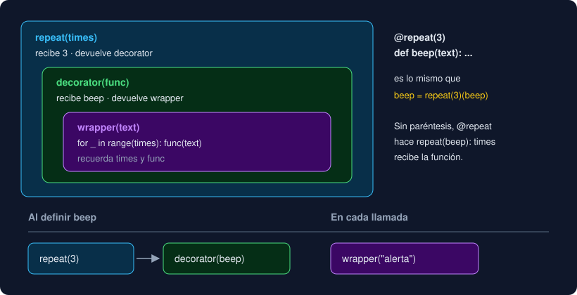

# Proyecto — Observatorio, capa 11: funciones que fabrican y envuelven funciones

⏱️ 6 h 30 min · Capa 11 del [proyecto hilo conductor](../../../docs/proyecto-hilo-conductor.md). **Único entregable de la semana.**

## Qué construyes

Tu `Series` se recorre, se mide y se suma, pero no se filtra: para quedarte con las medidas altas hay que escribir el `for` a mano cada vez. Y cada función de conversión que escribas tendrá que comprobar si el valor es `None` antes de calcular. Esta semana la serie recibe **funciones** como argumento, y un módulo nuevo fabrica filtros con **closures**, envuelve funciones con **decoradores** y describe cada objeto del modelo con `functools.singledispatch`.

| Nombre | Qué hace | Herramienta de la semana |
|---|---|---|
| `serie.where(keep)` | Una serie nueva con las medidas para las que `keep(medida)` es `True` | Función como argumento |
| `above(limit)` | Un filtro: `serie.where(above(50))` deja las medidas con valor mayor que 50 | Closure |
| `@skip_missing` | La función decorada acepta también `None`, y entonces devuelve `None` sin llamarla | Decorador con `functools.wraps` |
| `@rounded(digits)` | La función decorada devuelve su resultado redondeado a `digits` decimales | Decorador con argumento y `ParamSpec` |
| `describe(objeto)` | `"Norte: 12,5"`, `"medidas: 3 · etiquetas: 2"` o `"°C entre 10 y 50"`, según el tipo | `functools.singledispatch` |

Las funciones de las capas 0 a 10 **no cambian**, y `main` tampoco: el informe es **idéntico** al de la semana 11. La versión sube a `0.12.0`.

```
src/observatorio/core/
├── __init__.py      # + above, describe, rounded y skip_missing
├── functional.py    # nuevo: la closure, los dos decoradores y describe
├── model.py         # + where en Series
└── ...              # los demás módulos, sin cambios
```



## Dónde trabajas

En **tu repositorio** `python-<nombre>-<apellido>`, en una rama nueva `week-12`. El `starter/` trae la capa 10 resuelta; **tú amplías `model.py`**, escribes `functional.py` y no tocas tu `__main__.py`.

## Pasos

### 1. Rama de la semana

Comprueba que el *pull request* `week-11` está fusionado en `main`. Después:

```bash
cd ~/proyectos/python-<nombre>-<apellido>
git switch main
git pull
git switch -c week-12
```

### 2. Copia los archivos nuevos

```bash
STARTER=<ruta-al-bootcamp>/bootcamp/week-12-closures_decoradores_y_functools/3-proyecto/starter
cp $STARTER/tests/test_functional.py $STARTER/tests/test_my_functional.py tests/
cp $STARTER/tests/test_package.py $STARTER/tests/test_main.py tests/
sed -i 's/week-11/week-12/' compose.yaml
git status --short
```

Nuevos: `tests/test_functional.py` (29 tests) y `tests/test_my_functional.py` (un ejemplo). Modificados: `test_package.py`, que ahora espera el módulo `functional`, sus nombres en `__all__` y la versión `0.12.0`; `test_main.py`, que solo cambia la versión esperada; y `compose.yaml`.

### 3. Tests en rojo

```bash
uv run pytest
```

```
E   ImportError: cannot import name 'above' from 'observatorio.core' (.../src/observatorio/core/__init__.py)
E   ImportError: cannot import name 'above' from 'observatorio.core' (.../src/observatorio/core/__init__.py)
E   ImportError: cannot import name 'functional' from 'observatorio.core' (.../src/observatorio/core/__init__.py)
!!!!!!!!!!!!!!!!!!! Interrupted: 3 errors during collection !!!!!!!!!!!!!!!!!!!
```

Lee `tests/test_functional.py` entero antes de escribir nada: es la especificación. Fíjate en cómo se prueban los decoradores: cada test decora una función pequeña **dentro** del test y comprueba el resultado, si se llamó a la original (con una lista que apunta las llamadas) y si conserva su nombre.

### 4. El esqueleto de `functional.py`

Crea `src/observatorio/core/functional.py` con las cuatro funciones sin hacer nada todavía:

```python
"""Funciones que fabrican y envuelven funciones: closures, decoradores y functools."""

from collections.abc import Callable

from observatorio.core.model import Measurement


def above(limit: float) -> Callable[[Measurement], bool]:
    raise NotImplementedError


def skip_missing(func: Callable[[float], float]) -> Callable[[float | None], float | None]:
    raise NotImplementedError


def rounded[**P](digits: int) -> Callable[[Callable[P, float]], Callable[P, float]]:
    raise NotImplementedError


def describe(item: object) -> str:
    raise NotImplementedError
```

Y expón los cuatro nombres en la API pública: en `core/__init__.py`, añade `from observatorio.core.functional import above, describe, rounded, skip_missing` y los cuatro a `__all__`. `uv run ruff check --fix` los ordena.

```bash
uv run pytest -q
```

```
33 failed, 269 passed
```

Ya se importa todo. Tres de los fallos son de la versión (`test_package.py` y `test_main.py`) y seguirán hasta el paso 12.

### 5. `Series.where`

En `model.py`, añade `Callable` al import de `collections.abc` y, dentro de `Series`, antes de `add`:

```python
    def where(self, keep: Callable[[Measurement], bool]) -> Series:
        """Una serie nueva con las medidas para las que keep devuelve True, en orden.

        keep es una función: serie.where(lambda m: m.label == "Norte") o serie.where(above(50)).
        """
        return Series([measurement for measurement in self.measurements if keep(measurement)])
```

```
29 failed, 273 passed
```

`where` no sabe qué regla aplica: la recibe. `keep` es una función, y `keep(measurement)` la llama una vez por medida, como `key=` en `sorted`. Devuelve una `Series` **nueva** y deja la original como estaba (`test_where_returns_a_new_series_and_keeps_the_original`). Los tests le pasan una `lambda`, una función con nombre y, en el paso 6, una closure.

### 6. `above`, una closure

En `functional.py`:

```python
def above(limit: float) -> Callable[[Measurement], bool]:
    """Un filtro para Series.where: True si la medida tiene valor y es mayor que limit.

    La función devuelta es una closure: recuerda limit después de que above termine.
    """

    def is_above(measurement: Measurement) -> bool:
        return measurement.value is not None and measurement.value > limit

    return is_above
```

```
22 failed, 280 passed
```

`above(50.0)` termina enseguida, pero la función que devuelve sigue viendo `limit`: la guarda en su closure. `test_each_above_remembers_its_own_limit` crea dos con límites distintos y comprueba que no se estorban. Fíjate en `return is_above`, **sin paréntesis**: devuelves la función, no la llamas.

La anotación ayuda: añade al final de `tests/test_my_functional.py` la línea `above(10.0)("Norte;12,5")` y ejecuta `uv run mypy`:

```
tests/test_my_functional.py:10: error: Argument 1 has incompatible type "str"; expected "Measurement"  [arg-type]
```

Tu número de línea puede ser otro. Bórrala.

### 7. `skip_missing`, primero sin `wraps`

```python
def skip_missing(func: Callable[[float], float]) -> Callable[[float | None], float | None]:
    """Decorador: la función acepta también None y entonces devuelve None sin llamarla."""

    def wrapper(value: float | None) -> float | None:
        if value is None:
            return None
        return func(value)

    return wrapper
```

```
19 failed, 283 passed
```

Funciona: con un valor llama a la original, y con `None` ni la llama. Pero dos tests fallan:

```
E       AssertionError: assert 'wrapper' == 'to_fahrenheit'
E       AssertionError: assert None is <function test_skip_missing_keeps_the_original_function_in_wrapped.<locals>.half at 0x...>
```

Después de `@skip_missing`, el nombre `to_fahrenheit` apunta a tu `wrapper`, con su nombre y sin *docstring*. Las trazas de error y pytest dirían `wrapper`.

### 8. `functools.wraps`

Importa `wraps` de `functools` y ponlo encima del `wrapper`:

```python
    @wraps(func)
    def wrapper(value: float | None) -> float | None:
```

```
17 failed, 285 passed
```

`wraps` copia `__name__`, `__doc__` y los demás datos de la original y guarda la original en `__wrapped__`. Todo `wrapper` lo lleva.

### 9. `rounded`, un decorador con argumento

```python
def rounded[**P](digits: int) -> Callable[[Callable[P, float]], Callable[P, float]]:
    """Decorador con argumento: redondea a digits decimales lo que devuelve la función.

    Ejemplo: @rounded(1) encima de una función que devuelve 12.345 hace que devuelva 12.3.
    """

    def decorator(func: Callable[P, float]) -> Callable[P, float]:
        @wraps(func)
        def wrapper(*args: P.args, **kwargs: P.kwargs) -> float:
            return round(func(*args, **kwargs), digits)

        return wrapper

    return decorator
```

```
11 failed, 291 passed
```

Tres niveles: `rounded(1)` devuelve `decorator`, que recibe la función y devuelve `wrapper`. `*args` y `**kwargs` dejan decorar funciones con cualquier firma (`test_rounded_passes_positional_and_keyword_arguments`), y `[**P]` le dice a mypy que la firma no cambia. Pruébalo con estas líneas al final de `tests/test_my_functional.py` (añade `rounded` al import) y `uv run mypy`:

```python
@rounded(1)
def third(value: float) -> float:
    return value / 3


third("10")
```

```
tests/test_my_functional.py:16: error: Argument 1 to "third" has incompatible type "str"; expected "float"  [arg-type]
```

Con `Callable[..., float]` en lugar de `P`, mypy no lo vería. Bórralas.

Lee `test_skip_missing_and_rounded_stack_with_partial`: combina los dos decoradores con un `functools.partial`. `skip_missing` va por fuera, así que los `None` no llegan a `round`.

### 10. `describe` con `singledispatch`

Importa `singledispatch` de `functools` (junto a `wraps`) y sustituye el esqueleto de `describe` por:

```python
@singledispatch
def describe(item: object) -> str:
    """Una frase que describe una medida, una serie o una escala.

    Cada tipo registra su versión con @describe.register; con otro tipo, TypeError.
    """
    raise TypeError(f"describe no acepta {type(item).__name__}")


@describe.register
def _(item: Measurement) -> str:
    text = "sin dato" if item.value is None else str(item.value).replace(".", ",")
    return f"{item.label}: {text}"
```

```
8 failed, 294 passed
```

La función decorada con `@singledispatch` es la versión **por defecto**, la que se usa con un tipo no registrado. `@describe.register` mira la anotación del primer parámetro: esta versión es la de `Measurement`. Se llama `_` porque nadie la llama por su nombre; se llega a ella a través de `describe`.

### 11. Las versiones de `Series` y `Scale`

Añade `Scale` y `Series` al import de `observatorio.core.model` y, al final del archivo:

```python
@describe.register
def _(item: Series) -> str:
    return f"medidas: {len(item)} · etiquetas: {len(item.labels())}"


@describe.register
def _(item: Scale) -> str:
    return f"{item.unit} entre {item.low:g} y {item.high:g}"
```

```
3 failed, 299 passed
```

`len(item)` funciona gracias al `__len__` de la semana 11. `:g` escribe `10.0` como `10` y `12.5` como `12.5`. Añadir un tipo nuevo al Observatorio no obliga a tocar las versiones que ya existen: se registra otra.

### 12. La versión

```bash
uv version --bump minor
```

```
observatorio 0.11.0 => 0.12.0
```

```
302 passed
```

`main` no ha cambiado y el informe tampoco: compruébalo con `uv run observatorio < medidas.txt`.

### 13. Todo junto

```bash
uv run python -c "
from pathlib import Path
from observatorio.core import Scale, Series, above, describe, iter_lines
series = Series.from_lines(iter_lines(Path('medidas.txt')))
print(describe(series))
print(describe(Scale('unidad', 10.0, 50.0)))
for measurement in series.where(above(50.0)):
    print(describe(measurement))
"
```

```
medidas: 7 · etiquetas: 5
unidad entre 10 y 50
Oriente: 55,1
Occidente: 61,0
```

Con las medidas de ejemplo; con las tuyas, otras líneas. Cada capa usa la anterior: el generador de la semana 11 lee el archivo, `where` recibe la closure de `above` y `describe` elige la versión según el tipo.

### 14. Tus tests

En `tests/test_my_functional.py`, sustituye el ejemplo por **al menos 6 tests tuyos** con datos de tu dominio, importando solo de `observatorio.core` (y `functools` si lo necesitas):

| Qué pruebas | Ejemplo (calidad del aire) |
|---|---|
| `where` con una `lambda` de tu dominio | Las medidas de una estación concreta, por su etiqueta |
| `above` con tu umbral real | `serie.where(above(50.0))` deja solo los días por encima del límite de PM2.5 |
| Dos filtros encadenados | `serie.where(above(25.0)).where(lambda m: m.label != "Centro")` |
| `skip_missing` en una conversión tuya | µg/m³ a otra unidad, con un `None` en medio de la lista |
| `rounded` en un cálculo tuyo | La media de tus medidas redondeada a un decimal |
| `describe` de una escala y una serie tuyas | `describe(Scale("µg/m³", 25.0, 50.0)) == "µg/m³ entre 25 y 50"` |

```bash
uv run pytest
uv run ruff check && uv run ruff format --check && uv run mypy
```

Esperado: todo en verde, al menos `364 passed`. Son los 293 del bootcamp (12 + 17 + 19 + 20 + 26 + 27 + 28 + 24 + 12 + 29 + 25 + 25 + 29) más los 71 tuyos como mínimo (5 + 6 + 6 + 6 + 6 + 6 + 6 + 6 + 6 + 6 + 6 + 6, de las semanas 1 a 12).

### 15. En el contenedor

```bash
docker compose run --build --rm app
docker compose run --rm app observatorio --version
```

Los tests en verde y `observatorio 0.12.0`.

### 16. README, commit y pull request

En el `README.md` de tu repositorio, añade `functional.py` al árbol del paquete y una frase sobre qué hace un decorador.

Commits sugeridos, en este orden: `feat: add functional skeleton`, `feat: filter series with where`, `feat: add above closure`, `feat: add skip_missing decorator`, `fix: keep wrapped function metadata`, `feat: add rounded decorator`, `feat: describe measurements`, `feat: describe series and scales`, `chore: bump version to 0.12.0` y `test: add functional tests`. Al final:

```bash
git push -u origin week-12
```

En GitHub, abre un *pull request* de `week-12` hacia `main` con:

1. La salida de `uv run pytest`, `uv run mypy` y `uv run ruff check`.
2. Los dos fallos del paso 7 y por qué `functools.wraps` los arregla.
3. Qué pasaría con `@rounded` sin paréntesis, y en qué orden se aplican `skip_missing(rounded(1)(f))` y por qué al revés fallaría con un `None`.

## 🧯 Si algo sale mal

| Síntoma | Qué hacer |
|---|---|
| `ImportError: cannot import name 'above' from 'observatorio.core'` | Falta el import de `functional` en `core/__init__.py` (paso 4) |
| `ImportError: cannot import name 'Measurement' from partially initialized module` | `model.py` importa algo de `functional.py`: es un ciclo. Solo `functional` importa a `model`, nunca al revés |
| `AttributeError: 'Series' object has no attribute 'where'` | Falta `where`, o está fuera de la clase `Series` (mira la sangría) |
| `serie.where(above)` deja todas las medidas | Falta el límite: `above(medida)` devuelve una función, y una función es verdadera. Escribe `where(above(50.0))`; `mypy` lo detecta |
| `test_skip_missing_keeps_the_name_and_the_docstring` falla | Falta `@wraps(func)` encima del `wrapper` |
| `TypeError: 'NoneType' object is not callable` | Al decorador le falta `return wrapper` o `return decorator` |
| `TypeError: type NoneType doesn't define __round__ method` | Usaste `rounded(...)` por fuera de `skip_missing`: el `None` llega a `round` |
| `TypeError: describe no acepta Measurement` | Falta `@describe.register` encima de la versión de `Measurement` |
| ``TypeError: Invalid first argument to `register()` `` | La versión registrada no tiene anotación en `item` |
| Los tests de `main` fallan | No toques `__main__.py` esta semana: compara con `git diff main -- src/observatorio/__main__.py` |

## Entrega

- Rama `week-12` de `python-<nombre>-<apellido>` con `Series.where`; `core/functional.py` (`above`, `skip_missing`, `rounded` y `describe`), los cuatro nombres en la API pública, la versión `0.12.0` y al menos 6 tests propios en `tests/test_my_functional.py`. Todo en verde (también en Docker), con `ruff check`, `ruff format --check` y `mypy` sin avisos.
- `README.md` del repositorio con `functional.py` en el árbol del paquete.
- *Pull request* `week-12` → `main` con la descripción del paso 16.

---

## 🔗 Navegación

| Anterior | Actual | Siguiente |
| -------- | ------ | --------- |
| [Ejercicio 04 · functools](../2-practicas/ejercicio-04-functools/README.md) | **Proyecto · Observatorio, capa 11** | [Webgrafía](../4-recursos/webgrafia/README.md) |
