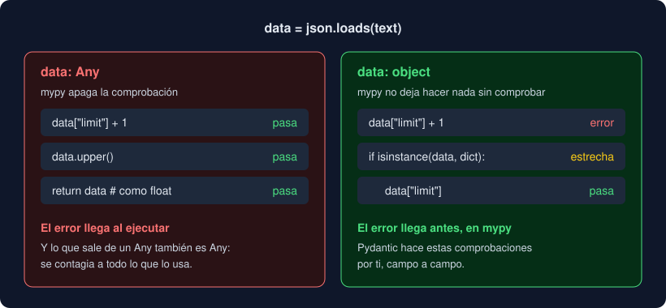

# 01 · mypy estricto

⏱️ 45 min

## 🎯 Objetivos

- Saber qué revisa mypy en su modo normal y qué deja pasar.
- Activar `strict` y entender qué comprobaciones añade.
- Reconocer cómo se cuela `Any` y por qué `object` es más seguro.
- Estrechar tipos con `is None`, `isinstance` y `TypeIs`.
- Usar `cast` y `# type: ignore[código]` solo cuando toca.

---

## 1. Lo que mypy deja pasar

Desde la semana 3 ejecutas mypy en tu proyecto, y desde la 8 con `uv run mypy`. En su modo normal, mypy es **permisivo**: no revisa lo que no está anotado.

```python
def mean_untyped(values):
    return sum(values) / len(values)


mean_untyped(["12,5", "8"])
```

```
Success: no issues found in 1 source file
```

Sin anotaciones, mypy no sabe qué es `values`, así que no revisa la función ni sus llamadas. El error llega al ejecutar: `TypeError: unsupported operand type(s) for +: 'int' and 'str'`. Este modo existe para poder añadir mypy poco a poco a un proyecto que no tiene anotaciones. Tu Observatorio está anotado desde el primer día, así que puede pedir más.

---

## 2. `strict = true`

```toml
[tool.mypy]
files = ["src", "tests"]
strict = true
```

`strict` activa de una vez todas las comprobaciones opcionales. `mypy --help` las enumera:

```
--strict                  Strict mode; enables the following flags:
                          --disallow-any-generics, --disallow-subclassing-
                          any, --disallow-untyped-calls, --disallow-untyped-
                          defs, --disallow-incomplete-defs, --check-untyped-
                          defs, --disallow-untyped-decorators, --warn-
                          redundant-casts, --warn-unused-ignores, --warn-
                          return-any, --no-implicit-reexport, --strict-
                          equality, --extra-checks
```

No hace falta memorizarlas. Estas son las que más vas a ver, con su error real:

| Comprobación | Código que la dispara | Error |
|---|---|---|
| Funciones sin anotar | `def first(record: Record):` | `Function is missing a return type annotation  [no-untyped-def]` |
| Parámetros sin anotar | `def label(record: Record, unit) -> str:` | `Function is missing a type annotation for one or more parameters  [no-untyped-def]` |
| Llamar a una función sin anotar | `mean_untyped([12.5])` dentro de código anotado | `Call to untyped function "mean_untyped" in typed context  [no-untyped-call]` |
| Genéricos sin parámetro | `def count(items: list) -> int:` | `Missing type arguments for generic type "list"  [type-arg]` |
| Devolver `Any` | `return data["limit"]` con `data = json.loads(...)` | `Returning Any from function declared to return "float"  [no-any-return]` |
| Reexportar sin querer | `from observatorio.core.storage import Record` | `Module "observatorio.core.storage" does not explicitly export attribute "Record"  [attr-defined]` |
| Comparar lo que nunca es igual | `TextFile(path) != CsvFile(path)` | `Non-overlapping equality check (left operand type: "TextFile", right operand type: "CsvFile")  [comparison-overlap]` |
| Comentarios que sobran | Un `# type: ignore` que ya no tapa nada | `Unused "type: ignore" comment  [unused-ignore]` |

La de la reexportación explica algo de la semana 8. `storage.py` importa `Record` de `groups.py` para usarlo, no para ofrecerlo. Con `strict`, un módulo solo exporta lo que define, lo que pone en `__all__` o lo que importa como `import X as X`. Por eso `core/__init__.py` tiene su `__all__`.

> Con `strict` desde el principio, cada función que escribes queda revisada. Activarlo en un proyecto grande y viejo da cientos de errores, y se hace por módulos con `[[tool.mypy.overrides]]`. En el tuyo, el paso 7 del proyecto da dos.

---

## 3. `Any` frente a `object`

`Any` y `object` aceptan cualquier valor, pero mypy los trata al revés:



- **`Any`** apaga la comprobación: todo lo que hagas con él vale, y lo que sale de él también es `Any`. Es contagioso: `data = json.loads(text)` es `Any`, `data["limit"]` es `Any`, y una función que lo devuelve como `float` miente sin que mypy lo vea.
- **`object`** es el tipo más general, pero no deja hacer nada que no tenga todo objeto: ni sumar, ni indexar, ni llamar. Para usarlo, **compruebas** antes su tipo.

```python
def read_limit_checked(text: str) -> float:
    data: object = json.loads(text)
    if not isinstance(data, dict):
        raise TypeError("se esperaba un objeto JSON")
    value = data.get("limit")
    if not isinstance(value, int | float):
        raise TypeError(f"limit debe ser un número, no {value!r}")
    return float(value)
```

Al anotar `data: object` conviertes el `Any` en algo que te obliga a mirar. Es lo correcto, y con tres campos ya es largo: para eso existe Pydantic (teoría 03). La regla práctica:

- `Any`, casi nunca en tu código;
- `object`, para un dato del que aún no sabes nada;
- y una validación que lo convierta en un tipo concreto lo antes posible.

---

## 4. Estrechar tipos

mypy sigue el flujo del código. Después de una comprobación, sabe más del valor: lo **estrecha** (*narrowing*).

```python
def level(value: float | None) -> str:
    if value is None:
        return "sin dato"
    return "alto" if value > 50 else "bajo"   # aquí value es float
```

Sin el `if`, `value > 50` con un `None` fallaría al ejecutar, y mypy lo dice antes:

```
error: Unsupported operand types for < ("int" and "None")  [operator]
note: Left operand is of type "float | None"
```

Estrechan `is None` e `is not None`, `isinstance`, un `return` o `raise` dentro del `if`, y los `case` de un `match`. Para tus propias comprobaciones, una función que devuelve `TypeIs[T]` estrecha igual que `isinstance`:

```python
from typing import TypeIs


def is_number(value: object) -> TypeIs[float]:
    return isinstance(value, float)
```

Cuando `is_number(x)` da `True`, mypy trata `x` como `float`; cuando da `False`, como "cualquier cosa menos `float`".

---

## 5. `cast` y `# type: ignore`

Las dos le dicen a mypy "confía en mí", y las dos son una deuda.

```python
from typing import cast

raw = json.loads('{"value": "12,5"}')["value"]
value = cast(float, raw)
print(repr(value), type(value).__name__)   # '12,5' str
```

`cast` no convierte nada: devuelve el mismo objeto y cambia lo que mypy cree. Úsalo solo cuando sabes algo que mypy no puede deducir, nunca con datos de fuera.

`# type: ignore` apaga mypy en una línea. Ponle siempre el código del error, `# type: ignore[arg-type]`: así solo tapa ese error, y con `strict` mypy avisa si el comentario deja de hacer falta (`unused-ignore`). En los tests sí tiene sentido: el test `test_measurement_in_is_frozen` de tu proyecto cambia a propósito un campo de un modelo `frozen`, y lo marca con `# type: ignore[misc]`.

---

## 🧯 Errores típicos

| Error | Causa | Solución |
|---|---|---|
| `Function is missing a return type annotation` | Una función, a menudo un test, sin `-> ...` | Anota la vuelta; en un test, `-> None` |
| `Returning Any from function declared to return "..."` | El valor sale de `json.loads`, de un `dict[str, Any]` o de una biblioteca sin tipos | Anota como `object` y comprueba, o valida con Pydantic |
| `Missing type arguments for generic type "list"` | `list`, `dict` o `Callable` sin lo que contienen | `list[float]`, `dict[str, int]`, `Callable[[float], bool]` |
| `does not explicitly export attribute` | Importas un nombre de un módulo que solo lo usa | Impórtalo del módulo que lo define o de `observatorio.core` |
| `Unused "type: ignore" comment` | El error que tapaba ya no existe | Borra el comentario |

---

## ✅ Qué debes saber al terminar

- [ ] Qué deja pasar mypy sin `strict` y por qué existe ese modo.
- [ ] Tres comprobaciones que añade `strict`, con su código de error.
- [ ] La diferencia entre `Any` y `object`, y cuál usar con un dato sin comprobar.
- [ ] Tres formas de estrechar un `float | None`.
- [ ] Por qué `cast` no es una validación y cómo escribir un `# type: ignore` bien acotado.

---

## 🔗 Navegación

| Anterior | Actual | Siguiente |
| -------- | ------ | --------- |
| [Semana 13](../README.md) | **01 · mypy estricto** | [02 · Tipos avanzados](02-tipos-avanzados.md) |
