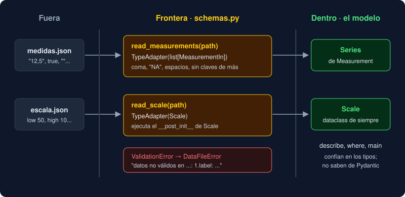

# 05 · Fronteras y diseño

⏱️ 45 min

## 🎯 Objetivos

- Validar en la frontera y confiar en los tipos dentro.
- Decidir qué modelar con una dataclass, un `TypedDict` o un modelo de Pydantic.
- Entender el diseño de la capa 12 del Observatorio.
- Convertir un `ValidationError` en un error de tu dominio sin perder la causa.
- Probar modelos y lectores validados.

---

## 1. La frontera

Un programa tiene un **dentro** y un **fuera**. Fuera están los archivos, la terminal, las APIs y las bases de datos: lo que llega puede ser cualquier cosa. Dentro están tus funciones y tus clases, que esperan los tipos que dicen sus anotaciones.



La idea, conocida en inglés como *parse, don't validate*, es convertir los datos **una vez**, al cruzar la frontera, en un tipo que ya no pueda estar mal. No se trata de comprobarlos en cada función que los usa.

| Comprobar en cada función | Convertir en la frontera |
|---|---|
| `if value is not None and isinstance(value, float)` repartido por el código | Una `Series` de `Measurement` ya validadas |
| Cada función decide qué hacer con un dato raro | Un solo sitio decide, y lanza un solo tipo de error |
| mypy no ayuda: todo es `object` o `Any` | mypy confía en los tipos, porque son ciertos |

Tu proyecto ya tenía fronteras sin llamarlas así. `parse_record` (semana 4) convierte una línea en una tupla o en `None`. `read_csv` (semana 7) comprueba la cabecera. `Scale.__post_init__` (semana 9) rechaza unos umbrales imposibles. Pydantic hace lo mismo para los JSON, con menos código y mejores mensajes.

---

## 2. Dataclass, `TypedDict` o Pydantic

Las tres describen datos con anotaciones. Cada una sirve para algo distinto:

| | `@dataclass` | `TypedDict` | `BaseModel` de Pydantic |
|---|---|---|---|
| En ejecución es | Un objeto de tu clase | Un `dict` | Un objeto de tu clase |
| Valida los tipos al crearlo | No | No | Sí, y convierte |
| Coste | Mínimo | Ninguno | Validar cuesta algo |
| Dependencia | Biblioteca estándar | Biblioteca estándar | `pydantic` |
| Úsalo para | El modelo de tu dominio, dentro | Un diccionario con claves fijas que solo pasa de un sitio a otro | Datos que llegan de fuera o que salen como JSON |
| En tu Observatorio | `Scale`, `Measurement`, `Series` | `Summary` | `MeasurementIn` |

¿Por qué no pasar `Measurement` y `Series` a Pydantic? Porque dentro del programa nadie les pasa datos sin comprobar: los crea tu código, con tipos que mypy ya revisa. Validarlos otra vez solo costaría tiempo. Además, el modelo quedaría atado a una biblioteca: si mañana los datos llegan de PostgreSQL (semana 19), el modelo no debería cambiar.

---

## 3. El diseño de la capa 12

| Pieza | Dónde | Decisión |
|---|---|---|
| `strict = true` y el plugin | `pyproject.toml` | Todo el proyecto, tests incluidos; solo dio dos errores |
| `Summary` | `storage.py` | Junto a `summary_data`, que lo devuelve; un `TypedDict` porque `json.dump` necesita un `dict` |
| `write_json(data: Mapping[str, object], ...)` | `storage.py` | Pide lo mínimo; acepta `Summary` y cualquier `dict` |
| `MeasurementIn` | `schemas.py` | Las reglas del formato JSON, no del dominio: coma decimal, `"NA"`, espacios, claves de más, `true` |
| `parse_text` reutiliza `parse_value` | `schemas.py` | El texto `"12,5"` sigue las reglas de la semana 2, sin repetirlas |
| `TypeAdapter(Scale)` | `schemas.py` | Ningún `ScaleIn`: la regla de los umbrales vive en `Scale` |
| `_MEASUREMENTS` y `_SCALE` a nivel de módulo | `schemas.py` | Se construyen una vez; el `_` dice que no son API pública |
| `_invalid` | `schemas.py` | Convierte el primer error de Pydantic en un `DataFileError` en español |
| Las dependencias van hacia dentro | `schemas` importa `model` y `storage` | El modelo no sabe que Pydantic existe |
| `main` sin cambios | `__main__.py` | La opción para leer JSON llega con la CLI de la semana 15 |

---

## 4. Errores de la frontera

Para quien llama a `read_measurements`, da igual que el fallo sea un archivo que no existe, un JSON roto o una etiqueta vacía: el archivo no sirve. Por eso todo sale como `DataFileError`, como en la semana 7, y `main` lo podrá atrapar en un solo `except`.

```python
def read_measurements(path: Path) -> Series:
    text = "\n".join(read_lines(path))
    try:
        items = _MEASUREMENTS.validate_json(text)
    except ValidationError as error:
        raise _invalid(path, error) from error
    return Series([item.to_measurement() for item in items])
```

- `read_lines` ya lanza `DataFileError` si el archivo no existe o no es UTF-8.
- `raise ... from error` guarda el `ValidationError` original en `__cause__`: la traza muestra los dos, y un test puede comprobarlo.
- El mensaje dice **dónde** (`1.label`) y **qué** (`String should have at least 1 character`). El `msg` de Pydantic está en inglés. Traducir todos los mensajes no compensa: el código de error (`type`) es estable y el texto se entiende.

---

## 5. Probar la frontera

Los tests de `test_schemas.py` siguen tres patrones:

```python
def test_measurement_in_rejects_extra_keys() -> None:
    with pytest.raises(ValidationError, match="Extra inputs are not permitted"):
        MeasurementIn.model_validate({"label": "Norte", "value": 1, "unit": "ppm"})
```

1. **Un `dict` como el que llegaría**, con `model_validate`, y un `match` con el mensaje del error: así compruebas que falla, y que falla **por lo que esperas**.
2. **Un archivo de verdad en `tmp_path`** para los lectores, como en la semana 7. Pruebas el camino entero: archivo, JSON, validación y conversión al modelo.
3. **`pytest.mark.parametrize`** para varios datos con la misma regla (`"12,5"`, `"8.0"`, `"NA"`). En la semana 14 lo verás a fondo.

| Prueba siempre | Ejemplo |
|---|---|
| Un caso válido con datos de tu dominio | `{"label": "Norte", "value": "35,2"}` da `35.2` |
| Cada regla que añadiste, con un caso que la rompe | Etiqueta vacía, `true`, clave de más |
| Que el error dice dónde | `1.label` en el mensaje |
| Que lo que sale es tu modelo, no el de Pydantic | `list(serie) == [Measurement("Norte", 12.5), ...]` |

No pruebes que Pydantic sabe validar un `float`: eso ya lo prueban sus autores. Prueba **tus** reglas.

---

## 🧯 Errores típicos

| Error | Causa | Solución |
|---|---|---|
| `ImportError: ... partially initialized module` | `model.py` importa de `schemas.py` | Las dependencias van hacia dentro: solo `schemas` importa `model` |
| Un `ValidationError` llega hasta `main` | El lector no lo convierte en `DataFileError` | `except ValidationError as error: raise ... from error` |
| Validas lo mismo en dos sitios | Una regla del dominio copiada en un modelo de Pydantic | Déjala en la dataclass y valida con `TypeAdapter` |
| Los tests pasan con cualquier error | `pytest.raises(ValidationError)` sin `match` | Añade `match` con el mensaje o comprueba `errors()[0]["type"]` |

---

## ✅ Qué debes saber al terminar

- [ ] Qué es la frontera de un programa y por qué se valida allí.
- [ ] Cuándo usar una dataclass, un `TypedDict` o un modelo de Pydantic, con un ejemplo de tu proyecto para cada uno.
- [ ] Por qué `MeasurementIn` existe y `ScaleIn` no.
- [ ] Qué hace `raise ... from error` y por qué los lectores lanzan `DataFileError`.
- [ ] Qué prueba un buen test de un modelo validado.

---

## 🔗 Navegación

| Anterior | Actual | Siguiente |
| -------- | ------ | --------- |
| [04 · Validadores y serialización](04-validadores-y-serializacion.md) | **05 · Fronteras y diseño** | [Ejercicio 01 · mypy estricto](../2-practicas/ejercicio-01-mypy-estricto/README.md) |
