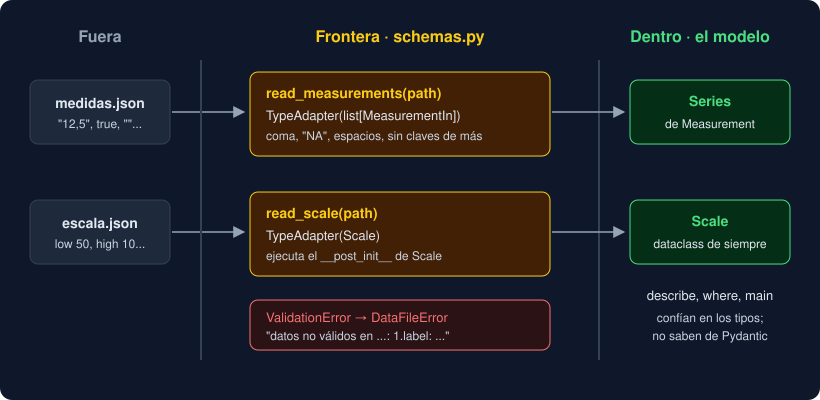

# Proyecto — Observatorio, capa 12: tipos estrictos y una frontera con Pydantic

⏱️ 6 h 30 min · Capa 12 del [proyecto hilo conductor](../../../docs/proyecto-hilo-conductor.md). **Único entregable de la semana.**

## Qué construyes

Tu Observatorio lee texto, CSV y JSON, pero solo comprueba a mano lo que lee. Además, mypy aún deja pasar funciones sin anotar y los `Any` de `json.loads`. Esta semana haces dos cosas:

- Activas `mypy --strict` en todo el proyecto, con el plugin de Pydantic, y das un tipo exacto al resumen JSON con un `TypedDict`.
- Abres una **frontera**: un módulo nuevo valida con Pydantic las medidas y la escala que llegan en un archivo JSON, y las convierte en tus `Series` y `Scale` de siempre.

| Nombre | Qué hace | Herramienta de la semana |
|---|---|---|
| `strict = true` | mypy exige anotar todo y no deja que un `Any` se cuele | mypy estricto |
| `Summary` | Las cuatro claves del resumen y su tipo; `summary_data` lo devuelve | `TypedDict` |
| `write_json(data: Mapping[str, object], ...)` | Acepta un `Summary` o cualquier `dict` | `Mapping`, de solo lectura |
| `MeasurementIn` | El esquema de una medida en JSON: etiqueta no vacía, valor numérico, `null`, `"12,5"` o `"NA"` y ninguna clave de más | `BaseModel`, `Field`, `field_validator` |
| `read_measurements(path)` | Una `Series` con las medidas validadas de un JSON | `TypeAdapter(list[...])` |
| `read_scale(path)` | Una `Scale` validada de un JSON, con la regla de los umbrales de `Scale` | `TypeAdapter` sobre una dataclass |

El modelo **no** cambia ni sabe que Pydantic existe, y `main` tampoco: el informe es **idéntico** al de la semana 12. La versión sube a `0.13.0` y el proyecto gana su primera dependencia, `pydantic==2.14.2`.

```
src/observatorio/core/
├── __init__.py      # + MeasurementIn, Summary, read_measurements y read_scale
├── schemas.py       # nuevo: MeasurementIn y los dos lectores de JSON
├── storage.py       # + Summary; write_json recibe un Mapping
└── ...              # los demás módulos, sin cambios
```



## Dónde trabajas

En **tu repositorio** `python-<nombre>-<apellido>`, en una rama nueva `week-13`. El `starter/` trae la capa 11 resuelta. **Tú** añades la dependencia, cambias `storage.py` y `pyproject.toml` y escribes `schemas.py`. Tu `__main__.py` no se toca.

## Pasos

### 1. Rama de la semana

Comprueba que el *pull request* `week-12` está fusionado en `main`. Después:

```bash
cd ~/proyectos/python-<nombre>-<apellido>
git switch main
git pull
git switch -c week-13
```

### 2. Copia los archivos nuevos

```bash
STARTER=<ruta-al-bootcamp>/bootcamp/week-13-typing_estricto_mypy_y_pydantic/3-proyecto/starter
cp $STARTER/tests/test_schemas.py $STARTER/tests/test_my_schemas.py tests/
cp $STARTER/tests/test_package.py $STARTER/tests/test_main.py tests/
cp $STARTER/medidas.json $STARTER/escala.json .
sed -i 's/week-12/week-13/' compose.yaml
git status --short
```

Copias estos archivos:

- **Nuevos:**
  - `tests/test_schemas.py`, con 29 tests;
  - `tests/test_my_schemas.py`, con un ejemplo;
  - `medidas.json` y `escala.json`, datos de ejemplo para el paso 13.
- **Modificados:**
  - `test_package.py`, que ahora espera el módulo `schemas`, sus nombres en `__all__`, la versión `0.13.0`, la dependencia de Pydantic y `strict`;
  - `test_main.py`, que solo cambia la versión esperada;
  - `compose.yaml`.

### 3. Tests en rojo

```bash
uv run pytest
```

```
E   ImportError: cannot import name 'MeasurementIn' from 'observatorio.core' (.../src/observatorio/core/__init__.py)
E   ImportError: cannot import name 'schemas' from 'observatorio.core' (.../src/observatorio/core/__init__.py)
E   ModuleNotFoundError: No module named 'pydantic'
!!!!!!!!!!!!!!!!!!! Interrupted: 3 errors during collection !!!!!!!!!!!!!!!!!!!
```

Lee `tests/test_schemas.py` entero antes de escribir nada: es la especificación. Fíjate en que casi todos los tests de `MeasurementIn` usan `model_validate` con un `dict`, como llegaría de un JSON, y en que los de `read_measurements` comprueban el **texto** del error: dónde está el fallo y qué falla.

### 4. La dependencia

```bash
uv add pydantic==2.14.2
```

`uv add` escribe la dependencia en `[project] dependencies` del `pyproject.toml`, resuelve las versiones de `pydantic-core`, `annotated-types`, `typing-extensions` y `typing-inspection` en `uv.lock` y las instala. Míralo:

```bash
uv tree --depth 1
git diff pyproject.toml
```

A diferencia de mypy, pytest y ruff, que van en el grupo `dev`, Pydantic es una dependencia **del programa**: quien instale tu Observatorio la necesita. Ya no sale el `ModuleNotFoundError`, pero los tres errores siguen: falta el código.

### 5. El esqueleto: `Summary` y `schemas.py`

En `src/observatorio/core/storage.py`, importa `TypedDict` (`from typing import TypedDict`) y añade la clase encima de `summary_data`, que de momento **no** cambia:

```python
class Summary(TypedDict):
    """Las claves del resumen JSON y el tipo de cada una."""

    registros: int
    con_valor: int
    mediana: float | None
    mayor_salto: float | None
```

Crea `src/observatorio/core/schemas.py` con el modelo sin reglas y los dos lectores sin hacer nada todavía:

```python
"""La frontera del Observatorio: validar con Pydantic los datos que llegan en JSON."""

from pathlib import Path

from pydantic import BaseModel

from observatorio.core.model import Measurement, Scale, Series


class MeasurementIn(BaseModel):
    """Una medida tal como llega en JSON: {"label": "Norte", "value": "12,5"}."""

    label: str
    value: float | None

    def to_measurement(self) -> Measurement:
        raise NotImplementedError


def read_measurements(path: Path) -> Series:
    raise NotImplementedError


def read_scale(path: Path) -> Scale:
    raise NotImplementedError
```

En `core/__init__.py`, importa `Summary` de `storage` y los tres nombres de `schemas`, y añade los cuatro a `__all__`, en orden (ruff te avisa si no). `schemas` importa `model` y `storage`, y ninguno de los dos importa `schemas`: así no hay ciclos.

```
26 failed, 308 passed
```

Los tres tests de `Summary` ya pasan: en ejecución, un `TypedDict` es un `dict` normal.

### 6. `summary_data` devuelve un `Summary`

Ejecuta mypy:

```bash
uv run mypy
```

```
tests/test_schemas.py:24: error: Incompatible types in assignment (expression has type "dict[str, object]", variable has type "Summary")  [assignment]
```

`summary_data` promete un `dict[str, object]`, que puede tener cualquier clave. Cambia su anotación de vuelta a `-> Summary` y vuelve a ejecutar mypy:

```
src/observatorio/__main__.py:119: error: Argument 1 to "write_json" has incompatible type "Summary"; expected "dict[str, object]"  [arg-type]
tests/test_storage.py:179: error: Argument 1 to "write_json" has incompatible type "Summary"; expected "dict[str, object]"  [arg-type]
```

El número de línea de tu `__main__.py` puede ser otro. `write_json` pide un `dict[str, object]`, en el que podría escribir cualquier clave, y eso rompería un `Summary`. Pero `write_json` solo lee. Cámbiale el tipo del parámetro a `data: Mapping[str, object]`, con `from collections.abc import Mapping`, y mypy da `Success`. Los tests no cambian: `26 failed`.

### 7. `strict = true`

En `pyproject.toml`, debajo de `files` en `[tool.mypy]`, añade:

```toml
# strict activa todas las comprobaciones opcionales: funciones sin anotar, Any que se
# cuelan, imports implícitos... (semana 13).
strict = true
```

```bash
uv run mypy
```

```
tests/test_sources.py:109: error: Non-overlapping equality check (left operand type: "TextFile", right operand type: "CsvFile")  [comparison-overlap]
tests/test_schemas.py:90: error: Unused "type: ignore" comment  [unused-ignore]
```

Si en tus tests de semanas anteriores falta alguna anotación, aparecerán más errores. Arréglalos uno a uno: suele bastar con un `-> None`.

El primero es un test de la semana 10 que comprueba justo lo que mypy dice que es imposible: que un `TextFile` y un `CsvFile` nunca son iguales. Anota el segundo como `FileSource` y mypy deja de saber que son de clases distintas:

```python
def test_file_sources_compare_class_and_path() -> None:
    path = Path("medidas")
    # Anotado como FileSource: con un CsvFile, mypy --strict avisaría de que TextFile y
    # CsvFile nunca pueden ser iguales (comparison-overlap), que es justo lo que se prueba.
    other: FileSource = CsvFile(path)
    assert TextFile(path) == TextFile(path)
    assert TextFile(path) != other
    assert TextFile(path) != TextFile(Path("otras"))
```

El segundo error lo arreglas en el paso 10. Los tests siguen en `26 failed`, porque uno de ellos espera también el plugin.

### 8. Las reglas de los campos

Importa `Annotated` de `typing`, y `ConfigDict` y `Field` de `pydantic`. Con ellos, la etiqueta no puede estar vacía:

```python
    model_config = ConfigDict(extra="forbid", str_strip_whitespace=True)

    label: Annotated[str, Field(min_length=1)]
```

`extra="forbid"` rechaza las claves que no son `label` ni `value`; `str_strip_whitespace` quita los espacios de los lados antes de comprobar la longitud, así que `"   "` también es una etiqueta vacía.

```
22 failed, 312 passed
```

### 9. Valores con coma: `field_validator`

Un valor en JSON puede llegar como número, como `null` o como texto con las reglas de siempre (`"12,5"`, `"NA"`). Importa `parse_value` de `observatorio.core.record` y `field_validator` de `pydantic`, y añade a `MeasurementIn`:

```python
    @field_validator("value", mode="before")
    @classmethod
    def parse_text(cls, value: object) -> object:
        """Convierte un texto con parse_value antes de validar el tipo; lo demás, tal cual."""
        if isinstance(value, str):
            return parse_value(value)
        return value
```

`mode="before"`: recibe el dato tal como llega, antes de que Pydantic intente leerlo como número. Si `parse_value` lanza `ValueError` (`"doce"`), Pydantic lo convierte en un error de validación.

```
18 failed, 316 passed
```

### 10. `frozen` y el plugin de mypy

Añade `frozen=True` al `ConfigDict`: un `MeasurementIn` no se cambia después de validarlo, igual que tu `Measurement`. En `pyproject.toml`, debajo de `strict`:

```toml
# El plugin de Pydantic enseña a mypy cómo son los modelos: por ejemplo, que un modelo
# frozen no deja cambiar sus campos.
plugins = ["pydantic.mypy"]
```

```
16 failed, 318 passed
```

Y `uv run mypy` da `Success`. El `# type: ignore[misc]` de la línea 90 de `test_schemas.py` ya sirve: sin el plugin, mypy no sabía que el modelo es `frozen`, y el comentario sobraba.

### 11. La trampa de `true`

Queda un test de `MeasurementIn` en rojo:

```bash
uv run pytest -k boolean
```

```
FAILED tests/test_schemas.py::test_measurement_in_rejects_a_boolean_value - Failed: DID NOT RAISE ...
1 failed, 333 deselected
```

En su modo normal, Pydantic convierte `true` en `1.0`. Un sensor que manda `true` por error acabaría como una medida de `1.0`. Haz estricto **solo** ese campo:

```python
    # strict: sin él, Pydantic convierte true en 1.0. Los textos ya llegan convertidos
    # por parse_text, que se ejecuta antes (mode="before").
    value: Annotated[float | None, Field(strict=True)]
```

```
15 failed, 319 passed
```

¿Por qué no `strict=True` en todo el modelo? Porque los textos `"12,5"` llegan a la validación del tipo ya convertidos por `parse_text`, y un entero sigue valiendo como `float` también en estricto.

### 12. `read_measurements` y `read_scale`

`to_measurement` devuelve `Measurement(self.label, self.value)`. Después, los dos lectores y un ayudante para el mensaje de error:

```python
# Se crean una vez, al importar: construir el validador es lo caro, usarlo es rápido.
_MEASUREMENTS = TypeAdapter(list[MeasurementIn])
# Scale es una dataclass del modelo: Pydantic valida sus campos y ejecuta su __post_init__,
# así que la regla de los umbrales no se repite aquí.
_SCALE = TypeAdapter(Scale)


def _invalid(path: Path, error: ValidationError) -> DataFileError:
    """DataFileError con el primer error: "datos no válidos en <path>: <dónde>: <qué>"."""
    first = error.errors()[0]
    where = ".".join(str(part) for part in first["loc"])
    prefix = f"{where}: " if where else ""
    return DataFileError(f"datos no válidos en {path}: {prefix}{first['msg']}")


def read_measurements(path: Path) -> Series:
    text = "\n".join(read_lines(path))
    try:
        items = _MEASUREMENTS.validate_json(text)
    except ValidationError as error:
        raise _invalid(path, error) from error
    return Series([item.to_measurement() for item in items])
```

Escribe tú `read_scale` con el mismo patrón y `_SCALE.validate_json`. Importa `TypeAdapter` y `ValidationError` de `pydantic`, y `DataFileError` y `read_lines` de `observatorio.core.storage`. Escribe también los *docstrings* de los lectores: qué devuelven y qué errores lanzan.

```
3 failed, 331 passed
```

Fíjate en lo que **no** has escrito:

- No abres el archivo a mano: `read_lines` ya da los errores de archivo de la semana 7.
- No hay un `except` para el JSON roto: `validate_json` lo convierte en un `ValidationError` más.
- No hay un modelo `ScaleIn`: `TypeAdapter(Scale)` usa los campos y el `__post_init__` de tu dataclass.

### 13. La versión

```bash
uv version --bump minor
```

```
observatorio 0.12.0 => 0.13.0
```

```
334 passed
```

`main` no ha cambiado y el informe tampoco: compruébalo con `uv run observatorio < medidas.txt`.

### 14. Todo junto

```bash
uv run python -c "
from pathlib import Path
from observatorio.core import DataFileError, describe, read_measurements, read_scale
series = read_measurements(Path('medidas.json'))
scale = read_scale(Path('escala.json'))
print(describe(series))
print(describe(scale))
for measurement in series.where(lambda m: scale.level(m.value) == 'alto'):
    print(scale.row(measurement))
try:
    read_measurements(Path('escala.json'))
except DataFileError as error:
    print('error:', error)
"
```

```
medidas: 7 · etiquetas: 5
unidad entre 10 y 50
Oriente            55.1 unidad | alto
Occidente          61.0 unidad | alto
error: datos no válidos en escala.json: Input should be a valid array
```

Lo que sale de la frontera es tu modelo de siempre: `describe`, `where` y `Scale.row`, de las semanas 9 a 12, lo usan sin saber que vino de un JSON. Cambia `medidas.json` y `escala.json` a los datos y umbrales de tu dominio, y prueba a romperlos: un `"value": true`, una clave `"valor"`, un `"low"` mayor que `"high"`.

### 15. Tus tests

En `tests/test_my_schemas.py`, sustituye el ejemplo por **al menos 6 tests tuyos** con datos de tu dominio, importando solo de `observatorio.core` (y `pydantic` o `pytest` si lo necesitas):

| Qué pruebas | Ejemplo (calidad del aire) |
|---|---|
| Una medida de tu dominio con coma decimal | `{"label": "Estación Norte", "value": "35,2"}` da `35.2` |
| Un valor imposible que el esquema rechaza | Un texto como `"sin calibrar"` lanza `ValidationError` |
| Una clave mal escrita | `{"label": "Norte", "valor": 12}` lanza `ValidationError` |
| `read_measurements` con un archivo tuyo | Un JSON en `tmp_path` con tres medidas da una `Series` de longitud 3 |
| `read_scale` con tus umbrales reales | `{"unit": "µg/m³", "low": 25, "high": 50}` da `Scale("µg/m³", 25.0, 50.0)` |
| El mensaje de error dice dónde está el fallo | La segunda medida sin etiqueta: el mensaje contiene `1.label` |

```bash
uv run pytest
uv run ruff check && uv run ruff format --check && uv run mypy
```

Esperado: todo en verde, al menos `401 passed`. Son los 324 del bootcamp (12 + 17 + 19 + 20 + 26 + 27 + 28 + 24 + 14 + 29 + 25 + 25 + 29 + 29) más los 77 tuyos como mínimo (5 + 6 × 12, de las semanas 1 a 13).

### 16. Contenedor, README y pull request

```bash
docker compose run --build --rm app
docker compose run --rm app observatorio --version
```

Los tests en verde y `observatorio 0.13.0`. El `Dockerfile` no cambia: `uv sync --locked` instala Pydantic desde `uv.lock`.

En el `README.md` de tu repositorio, añade `schemas.py` al árbol del paquete y una frase sobre qué valida.

Commits sugeridos, en este orden:

1. `build: add pydantic 2.14.2`
2. `feat: add schemas skeleton and Summary`
3. `refactor: type summary_data with Summary`
4. `build: enable mypy strict`
5. `feat: validate measurement fields`
6. `feat: parse text values`
7. `build: add pydantic mypy plugin`
8. `fix: reject boolean values`
9. `feat: read measurements and scale from JSON`
10. `chore: bump version to 0.13.0`
11. `test: add schemas tests`

Al final:

```bash
git push -u origin week-13
```

En GitHub, abre un *pull request* de `week-13` hacia `main` con:

1. La salida de `uv run pytest`, `uv run mypy` y `uv run ruff check`.
2. Los errores que te dio `strict` en el paso 7 y cómo los arreglaste.
3. Por qué `write_json` pide un `Mapping` y no un `dict`, y qué pasaba con `"value": true` antes del paso 11.

## 🧯 Si algo sale mal

| Síntoma | Qué hacer |
|---|---|
| `ModuleNotFoundError: No module named 'pydantic'` | Falta el paso 4, o lo instalaste con otra herramienta: `uv add pydantic==2.14.2` |
| `ImportError: cannot import name 'MeasurementIn' from 'observatorio.core'` | Falta el import de `schemas` en `core/__init__.py` (paso 5) |
| `ImportError: ... from partially initialized module` | `model.py` o `storage.py` importan algo de `schemas.py`: es un ciclo. Solo `schemas` importa a los otros |
| `error: Error importing plugin "pydantic.mypy"` | Ejecutaste mypy con `uvx`, que no ve tu entorno. Usa `uv run mypy` |
| mypy: `Function is missing a return type annotation` en tus tests | `strict` exige `-> None` en cada test |
| `'12,5'` da `unable to parse string as a number` | Falta `mode="before"` en `parse_text` |
| `test_measurement_in_rejects_a_boolean_value` falla | Falta `Field(strict=True)` en `value` (paso 11) |
| `datos no válidos en ...: Input should be a valid array` | Tu JSON de medidas es un objeto `{...}`: debe ser una lista `[...]` de objetos |
| Los tests de `main` fallan | No toques `__main__.py` esta semana: compara con `git diff main -- src/observatorio/__main__.py` |

## Entrega

- Rama `week-13` de `python-<nombre>-<apellido>` con:
  - `pydantic==2.14.2` en las dependencias, y `strict` y el plugin en `[tool.mypy]`;
  - `Summary` en `storage.py` y `write_json` con `Mapping`;
  - `core/schemas.py` con `MeasurementIn`, `read_measurements` y `read_scale`, y los cuatro nombres en la API pública;
  - la versión `0.13.0` y al menos 6 tests propios en `tests/test_my_schemas.py`.

  Todo en verde, también en Docker, con `ruff check`, `ruff format --check` y `mypy` sin avisos.
- `README.md` del repositorio con `schemas.py` en el árbol del paquete.
- *Pull request* `week-13` → `main` con la descripción del paso 16.

---

## 🔗 Navegación

| Anterior | Actual | Siguiente |
| -------- | ------ | --------- |
| [Ejercicio 04 · Validadores y JSON](../2-practicas/ejercicio-04-validadores-y-json/README.md) | **Proyecto · Observatorio, capa 12** | [Webgrafía](../4-recursos/webgrafia/README.md) |
