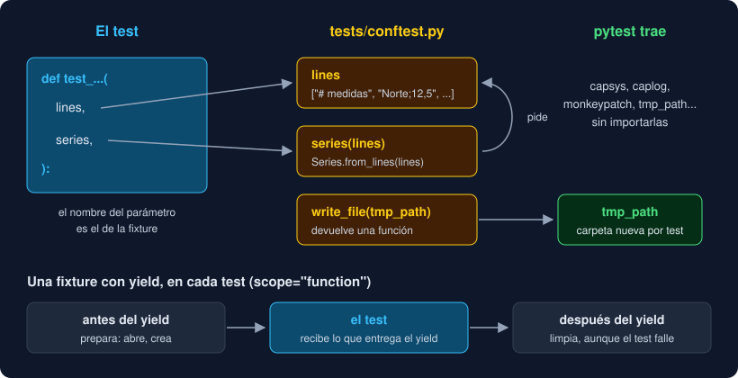

# 01 · Fixtures y `conftest.py`

⏱️ 50 min

## 🎯 Objetivos

- Preparar los datos de un test con una fixture y pedirla por su nombre.
- Encadenar fixtures y saber cuándo se crea cada una.
- Limpiar después de un test con `yield`.
- Compartir fixtures entre archivos con `conftest.py`.
- Elegir el alcance (`scope`) y usar las fixtures que trae pytest.

---

## 1. El problema: datos repetidos

Desde la semana 4 escribes tests que empiezan igual:

```python
def test_median_of_the_series() -> None:
    series = Series.from_lines(["Norte;12,5", "Sur;NA", "Este;55,1"])
    assert median(series.values()) == 33.8


def test_labels_of_the_series() -> None:
    series = Series.from_lines(["Norte;12,5", "Sur;NA", "Este;55,1"])
    assert series.labels() == {"Norte", "Sur", "Este"}
```

La preparación se repite, y si un día cambia el formato de las líneas, cambia en veinte tests. Además, ocupa el sitio de lo que importa: qué se prueba.

## 2. Una fixture

Una **fixture** es una función que prepara algo para los tests. Se marca con `@pytest.fixture`, y un test la pide poniendo su nombre como parámetro:

```python
import pytest

from observatorio.core import Series


@pytest.fixture
def series() -> Series:
    return Series.from_lines(["Norte;12,5", "Sur;NA", "Este;55,1"])


def test_labels_of_the_series(series: Series) -> None:
    assert series.labels() == {"Norte", "Sur", "Este"}
```

Nadie llama a `series()`. Antes de ejecutar el test, pytest mira sus parámetros, busca una fixture con cada nombre, la ejecuta y le pasa el resultado. Si llamas tú a la fixture, pytest se queja: `Fixture "series" called directly`.

## 3. Fixtures que piden fixtures

Una fixture puede pedir otras, igual que un test:

```python
@pytest.fixture
def lines() -> list[str]:
    return ["# medidas", "Norte;12,5", "Sur;NA", "malo", "Este;55,1"]


@pytest.fixture
def series(lines: list[str]) -> Series:
    return Series.from_lines(lines)
```

Un test que pide `series` recibe la serie hecha con `lines`. Un test que pide las dos recibe **la misma** lista en `lines` que la que usó `series`: dentro de un test, cada fixture se crea una sola vez.



Por defecto, la fixture se crea **de nuevo en cada test**. Si un test añade una medida a `series`, el siguiente recibe una serie limpia. Así los tests no dependen del orden. `uv run pytest --setup-show` enseña cuándo se crea (`SETUP`) y se destruye (`TEARDOWN`) cada fixture.

## 4. Limpiar con `yield`

Algunas cosas hay que deshacerlas al terminar: cerrar un archivo, borrar una tabla, devolver una variable a su valor. Una fixture con `yield` en lugar de `return` lo hace:

```python
@pytest.fixture
def opened(tmp_path: Path) -> Iterator[TextIO]:
    path = tmp_path / "sur.txt"
    path.write_text("Sur\n9,5\n", encoding="utf-8")
    file = path.open(encoding="utf-8")
    yield file      # el test se ejecuta aquí
    file.close()    # y esto, al terminar, aunque el test falle
```

Lo de antes del `yield` prepara y lo de después limpia. El tipo de vuelta es `Iterator[...]`, porque una función con `yield` es un generador (semana 11). Si la preparación falla antes del `yield`, el test ni empieza y no hay nada que limpiar.

## 5. `conftest.py`

Una fixture definida en un archivo de tests solo vale en ese archivo. Para compartirla, va en `conftest.py`, en la carpeta de los tests:

```
tests/
├── conftest.py          # scale, lines, series, write_file
├── test_quality.py      # las usa sin importarlas
└── test_my_quality.py   # también
```

pytest carga `conftest.py` antes que los tests de su carpeta y de las subcarpetas. **No se importa**: pytest ya conoce sus fixtures, y un `from conftest import series` solo añade un import que ruff marca como error (el parámetro del test lo tapa). `uv run pytest --fixtures` lista todas las fixtures disponibles y dónde está cada una.

`conftest.py` es el sitio de los datos compartidos, no de la lógica: si una fixture crece y hace cálculos, probablemente eso sea código del programa.

## 6. Alcance: `scope`

| `scope` | Se crea | Para qué |
|---|---|---|
| `"function"` (por defecto) | Una vez por test | Casi todo: cada test con lo suyo |
| `"module"` | Una vez por archivo | Algo caro de crear que nadie cambia |
| `"session"` | Una vez en toda la ejecución | Algo muy caro: un contenedor de PostgreSQL (semana 19) |

```python
@pytest.fixture(scope="module")
def big_series() -> Series:
    return Series.from_lines(Path("tests/datos/grande.txt").read_text().splitlines())
```

El peligro es compartir algo que se puede **cambiar**: si un test hace `big_series.add(...)`, los siguientes del archivo ven la medida de más, y el resultado depende del orden. Con objetos mutables, `scope="function"`. Una fixture solo puede pedir fixtures de su mismo alcance o más amplio: una de `module` no puede pedir `tmp_path`, que es de función.

## 7. Las fixtures que trae pytest

Ya usas algunas. Todas se piden por el nombre, sin importar nada:

| Fixture | Qué da |
|---|---|
| `tmp_path` | Una carpeta nueva y vacía para el test (un `Path`) |
| `capsys` | Lo que el test escribió en stdout y stderr: `capsys.readouterr()` |
| `monkeypatch` | Cambiar atributos, variables de entorno o el directorio actual y deshacerlo al terminar |
| `caplog` | Los mensajes de registro del test (teoría 05) |
| `tmp_path_factory` | Como `tmp_path`, pero de sesión: para fixtures de `scope="session"` |

## 8. Fábricas

A veces el test necesita **varios** archivos, o uno con un contenido que decide él. La fixture devuelve entonces una función:

```python
@pytest.fixture
def write_file(tmp_path: Path) -> Callable[[str, str], Path]:
    def write(name: str, text: str) -> Path:
        path = tmp_path / name
        path.write_text(text, encoding="utf-8")
        return path

    return write


def test_two_files(write_file: Callable[[str, str], Path]) -> None:
    good = write_file("bien.txt", "Norte;12,5\n")
    bad = write_file("mal.txt", "malo\n")
    ...
```

Es el patrón **fábrica**: la fixture guarda lo común (la carpeta, la codificación) y el test decide lo particular (nombre y contenido). Tu proyecto tiene `write_file`.

---

## ⚠️ Errores comunes

| Error | Causa | Solución |
|---|---|---|
| `fixture 'series' not found` | El nombre del parámetro no coincide, o la fixture está en otro archivo | Muévela a `conftest.py` o corrige el nombre |
| `Fixture "series" called directly` | Llamas a la fixture dentro del test | Pídela como parámetro |
| Un test pasa solo y falla con los demás | Una fixture de `module` o `session` con un objeto que algún test cambia | `scope="function"`, o una copia para cada test |
| `ScopeMismatch` | Una fixture de `module` pide `tmp_path` | Usa `tmp_path_factory`, o baja el alcance |
| mypy: `Function is missing a return type annotation` en `conftest.py` | `strict` también revisa las fixtures | Anota el tipo: `-> Series`, `-> Iterator[TextIO]` |

---

## ✅ Qué debes saber al terminar

- [ ] Cómo encuentra pytest la fixture que pide un test.
- [ ] Por qué una fixture de función hace que los tests no dependan del orden.
- [ ] Qué hace lo que va después del `yield`.
- [ ] Para qué sirve `conftest.py` y por qué no se importa.
- [ ] Cuándo usar `scope="module"` y cuándo no.
- [ ] Qué es una fixture fábrica.

---

## 🔗 Navegación

| Anterior | Actual | Siguiente |
| -------- | ------ | --------- |
| [README de la semana](../README.md) | **01 · Fixtures y `conftest.py`** | [02 · Parametrize y marcas](02-parametrize-y-marcas.md) |
