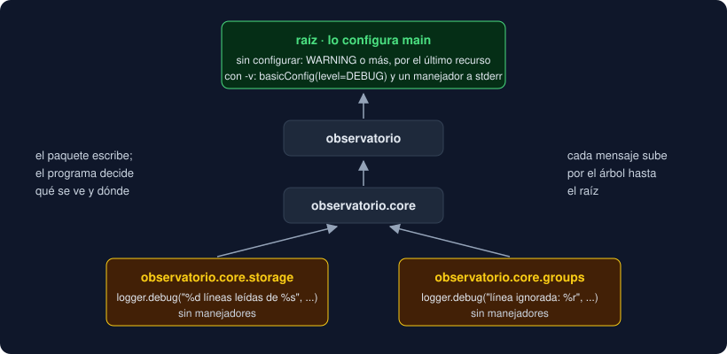

# 05 · Cobertura y logging

⏱️ 50 min

## 🎯 Objetivos

- Medir la cobertura de líneas y de ramas con coverage, y leer su informe.
- Poner un mínimo con `fail_under` y saber qué **no** dice el 100 %.
- Registrar con `logging`: niveles, un logger por módulo y el árbol de loggers.
- Separar quién escribe en el registro (el paquete) de quién lo configura (el programa).
- Probar lo que se registra con `caplog`.

---

## 1. Cobertura

La **cobertura** responde a una pregunta: ¿qué partes del código ha ejecutado al menos un test? Lo que ningún test ejecuta puede estar roto sin que nadie se entere. coverage la mide:

```bash
uv run coverage run -m pytest -q   # ejecuta pytest y apunta cada línea ejecutada
uv run coverage report             # resume lo apuntado
```

```
Name                                  Stmts   Miss Branch BrPart  Cover   Missing
---------------------------------------------------------------------------------
src/observatorio/core/storage.py         57      0      8      0   100%
src/observatorio/core/streams.py         29      2     10      0    95%   35-36
...
TOTAL                                   484      2    114      0    99%
```

| Columna | Qué cuenta |
|---|---|
| `Stmts` / `Miss` | Sentencias del archivo / las que no se ejecutaron |
| `Branch` / `BrPart` | Caminos posibles de los `if`, `for` y `while` / decisiones que solo tomaron uno de sus caminos |
| `Missing` | Qué líneas faltan (`35-36`) y qué caminos (`34->36`: de la 34 a la 36 sin pasar por la de en medio) |

`coverage html` hace lo mismo como página web, en `htmlcov/index.html`, con las líneas sin ejecutar en rojo.

## 2. Líneas y ramas

Con la cobertura de líneas, un `if` sin `else` cuenta como cubierto aunque ningún test haya probado el caso en que **no** entra:

```python
def describe(counts: dict[str, int]) -> str:
    text = ", ".join(...)
    if "alto" in counts:
        text += " (¡atención!)"
    return text
```

Un test con `{"alto": 1}` ejecuta las cuatro líneas: 100 %. Pero nadie probó el caso sin `alto`. Con `branch = true`, coverage mira los dos caminos de cada decisión y avisa: `34->36`. Por eso tu proyecto activa las ramas.

## 3. La configuración

```toml
[tool.coverage.run]
source_pkgs = ["observatorio"]   # mide tu paquete, no los tests ni las bibliotecas
branch = true

[tool.coverage.report]
fail_under = 95                  # por debajo, coverage report termina con código 2
show_missing = true
exclude_also = ['if __name__ == "__main__":']
```

- `fail_under` convierte la cobertura en un requisito: `coverage report` da `Coverage failure: total of 93 is less than fail-under=95` y termina con código `2`. En el CI de la semana 21, eso pone el *pull request* en rojo.
- `exclude_also` quita del cálculo líneas que no tiene sentido probar con pytest, como el arranque desde la terminal.
- Si una línea de verdad no se puede probar, `# pragma: no cover` la excluye. Úsalo muy poco: casi siempre es una excusa.

## 4. Lo que el 100 % no dice

La cobertura dice qué se **ejecutó**, no qué se **comprobó**. Este test cubre `median` entera y no prueba nada:

```python
def test_median_runs() -> None:
    median([1.0, 2.0, 3.0])   # sin assert
```

Y tu proyecto tenía cobertura de casi el 100 % con tres bugs dentro: `parse_value` se ejecutaba en cientos de tests, pero ninguno con `"nan"`. La cobertura encuentra código **sin probar**. Para encontrar código **mal hecho** están los `assert`, las propiedades de Hypothesis y los casos raros. Por eso el mínimo de tu proyecto es 95 % y no 100 %: perseguir la última línea suele producir tests como el de arriba.

## 5. Por qué no `print`

Para ver qué hace un programa por dentro, `print` es lo primero que se te ocurre. Tiene tres problemas: mezcla los mensajes con la salida de verdad, no se puede apagar sin borrarlo y no dice de dónde viene. `logging` resuelve los tres:

```python
import logging

logger = logging.getLogger(__name__)


def read_lines(path: Path) -> list[str]:
    ...
    logger.debug("%d líneas leídas de %s", len(lines), path)
    return lines
```

Cada mensaje tiene un **nivel**:

| Nivel | Para qué | En tu proyecto |
|---|---|---|
| `DEBUG` | Detalle para quien depura | `9 líneas leídas de medidas.csv`, `línea ignorada: 'Sur 9,5'` |
| `INFO` | Hitos normales del programa | "servidor arrancado" (semana 20) |
| `WARNING` | Algo raro, pero el programa sigue | Un umbral fuera de lo habitual |
| `ERROR` | Algo falló | `logger.exception(...)` dentro de un `except`, con la traza |
| `CRITICAL` | El programa no puede seguir | Muy raro |

Configuras un nivel mínimo y se ve ese nivel y los superiores. Sin configurar nada, solo WARNING y superiores.

## 6. El árbol de loggers

`logging.getLogger(__name__)` crea un logger con el nombre del módulo: `observatorio.core.storage`. Los nombres con puntos forman un **árbol**: `observatorio.core.storage` cuelga de `observatorio.core`, que cuelga de `observatorio`, que cuelga del logger **raíz**.



Un mensaje sube por el árbol hasta encontrar **manejadores** (*handlers*), que deciden dónde se escribe: stderr, un archivo, un servicio. Esa es la regla de oro:

- **El paquete** (`core/`) crea sus loggers y escribe en ellos. Nunca configura nada: ni nivel, ni manejadores, ni formato.
- **El programa** (`main`) configura el registro **una vez**, al arrancar, en el logger raíz.

```python
if args[:1] in (["-v"], ["--verbose"]):
    logging.basicConfig(level=logging.DEBUG, format="%(levelname)s %(name)s: %(message)s")
```

`basicConfig` pone en el raíz un manejador que escribe en stderr, con ese formato y ese nivel. Así quien usa tu paquete decide qué ver. Un test, por ejemplo, no quiere que nada se escriba en la terminal. Y si mañana tu paquete corre dentro de una API (semana 20), los mensajes irán a donde diga la API.

Si nadie configura nada, Python usa un manejador de **último recurso**: escribe en stderr los WARNING y superiores, solo con el texto. Por eso los DEBUG de tu paquete no se ven sin `-v`.

## 7. Detalles que importan

- **Formato perezoso**: `logger.debug("%d líneas leídas de %s", n, path)`, no `logger.debug(f"{n} líneas leídas de {path}")`. Con `%`, `logging` solo compone el texto si el mensaje se va a ver. Con una f-string, se compone siempre.
- **stderr**: el registro va a stderr y el resultado del programa a stdout. Así `observatorio -v -f medidas.csv > informe.txt` guarda el informe limpio y te enseña el registro en la terminal.
- **No registres y lances**: si una función lanza una excepción, no la registres también. Quien la capture decidirá. Registrar y lanzar llena el registro del mismo error repetido.
- **Datos personales**: lo que registras puede acabar en un archivo o en un servicio. No registres contraseñas, tokens ni datos personales (semana 41).

## 8. `caplog`

La fixture `caplog` captura los mensajes de registro de un test:

```python
def test_records_of_logs_each_ignored_line(caplog: pytest.LogCaptureFixture) -> None:
    caplog.set_level(logging.DEBUG, logger="observatorio")
    records_of(["Norte;12,5", "malo", "Sur;abc"])
    assert caplog.messages == ["línea ignorada: 'malo'", "línea ignorada: 'Sur;abc'"]
    assert {record.name for record in caplog.records} == {"observatorio.core.groups"}
```

`caplog.messages` tiene los textos ya compuestos, y `caplog.records` los registros completos: nivel (`levelname`), logger (`name`), mensaje. `caplog.set_level` baja el nivel solo para ese test y para ese logger, y pytest lo restaura al terminar. Sin él, los DEBUG no se registran: el test `test_debug_messages_are_hidden_by_default` lo comprueba.

---

## ⚠️ Errores comunes

| Error | Causa | Solución |
|---|---|---|
| `No data to report.` | `coverage report` sin un `coverage run` antes | `uv run coverage run -m pytest` primero |
| La cobertura incluye los tests | Falta `source_pkgs` | `source_pkgs = ["observatorio"]` |
| 100 % de líneas y un `if` sin probar | Cobertura de líneas, sin ramas | `branch = true` |
| Los DEBUG no salen nunca | Nadie bajó el nivel: por defecto, WARNING | `basicConfig(level=logging.DEBUG)` en `main`, o `caplog.set_level` en el test |
| Los mensajes salen dos veces | Un manejador en el logger del paquete y otro en el raíz | El paquete no añade manejadores; solo `main` configura |
| `basicConfig` no hace nada | Ya había un manejador en el raíz (pytest pone el suyo, por ejemplo) | Es lo esperado: `basicConfig` solo configura un raíz vacío |

---

## ✅ Qué debes saber al terminar

- [ ] Qué miden `Miss`, `BrPart` y `Missing` en el informe de coverage.
- [ ] Por qué la cobertura de ramas encuentra casos que la de líneas no ve.
- [ ] Qué no dice un 100 % de cobertura.
- [ ] Qué nivel usar para cada mensaje, y por qué el paquete usa `DEBUG`.
- [ ] Por qué el paquete crea loggers y solo `main` configura el registro.
- [ ] Cómo probar con `caplog` que algo se registró.

---

## 🔗 Navegación

| Anterior | Actual | Siguiente |
| -------- | ------ | --------- |
| [04 · Mocks y dobles](04-mocks-y-dobles.md) | **05 · Cobertura y logging** | [Ejercicio 01 · Fixtures y parametrize](../2-practicas/ejercicio-01-fixtures-y-parametrize/README.md) |
