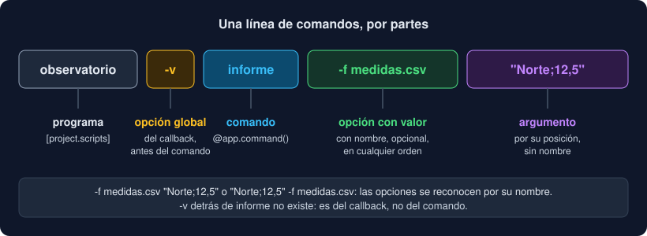
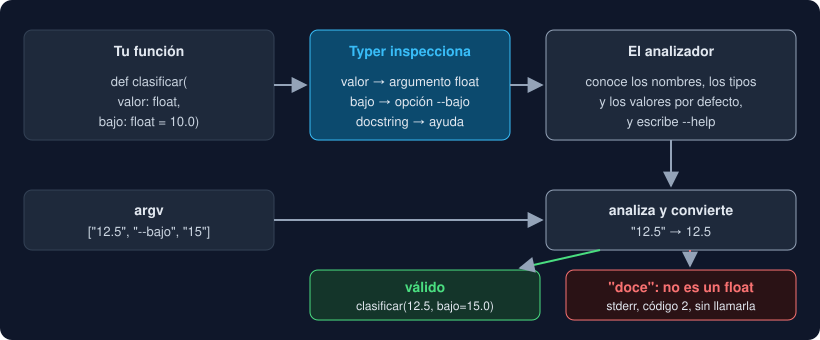

# 01 · De `argv` a Typer

⏱️ 45 min

## 🎯 Objetivos

- Reconocer las partes de una línea de comandos: programa, comando, opciones y argumentos.
- Conocer las convenciones que esperan quienes usan una CLI.
- Entender qué problema resuelve una biblioteca de CLI frente al `match` sobre `argv`.
- Ver cómo Typer convierte la firma de una función en un analizador de argumentos.
- Saber cómo llega `observatorio` a ser un comando de la terminal.

---

## 1. Tu `main` de hoy

Desde la semana 3, tu `main` lee `sys.argv` con un `match`:

```python
match args:
    case ["-h" | "--ayuda"]:
        print(USAGE)
        return 0
    case ["-V" | "--version"]:
        ...
    case ["-f" | "--archivo", name]:
        source = open_file(Path(name))
    case ["-f" | "--archivo", name, "-j" | "--json", summary]:
        ...
```

Funciona y lo entiendes entero. Pero mira lo que **no** hace:

- `-j resumen.json -f medidas.csv`, al revés, da "uso incorrecto": el orden importa, y en una CLI normal no;
- `--archivo=medidas.csv`, con `=`, tampoco funciona;
- cada opción nueva multiplica los `case`: con `-v` delante tuviste que quitarla a mano (`args = args[1:]`);
- `USAGE` es un texto que escribes y mantienes tú, y se queda viejo en cuanto añades una opción;
- los números llegan como texto, y la conversión y su error son cosa tuya.

Con dos opciones es manejable. Con diez, el `match` es más largo que el programa. Esta semana lo sustituyes por **Typer**.

## 2. Las partes de una línea de comandos



| Parte | Ejemplo | Qué es |
|---|---|---|
| Programa | `observatorio` | El ejecutable |
| Comando | `informe`, `validar` | Qué quieres hacer, cuando el programa hace varias cosas: `git commit`, `docker run` |
| Opción | `-f medidas.csv`, `--json resumen.json` | Un dato con nombre: opcional y en cualquier orden. Corta (`-f`) o larga (`--archivo`) |
| Opción booleana (*flag*) | `-v`, `--verbose` | Una opción sin valor: está o no está |
| Argumento | `"Norte;12,5"` | Un dato por su **posición**, sin nombre |

Y unas **convenciones** que la gente espera sin leer tu documentación:

- `--help` (y a menudo `-h`) enseña la ayuda y termina con código 0;
- `--version` escribe la versión;
- las opciones cortas se pueden escribir `-f medidas.csv`, y las largas, `--archivo medidas.csv` o `--archivo=medidas.csv`;
- `--` termina las opciones: lo que sigue son argumentos, aunque empiecen por `-`;
- los resultados van a stdout y los mensajes de error a stderr (semana 3);
- código `0` si todo fue bien, `2` si te llamaron mal y otro distinto de cero si algo falló.

## 3. Qué hace una biblioteca de CLI

Una biblioteca de CLI cumple esas convenciones por ti. Tú declaras qué argumentos y opciones hay, de qué tipo y con qué ayuda. Ella hace el resto: analizar `argv` en cualquier orden, convertir tipos, escribir la ayuda y explicar los errores.

| Biblioteca | Cómo se declara | Dónde está |
|---|---|---|
| `argparse` | Llamadas: `parser.add_argument("-f", "--archivo", type=Path)` | En la biblioteca estándar |
| Click | Decoradores: `@click.option("-f", "--archivo", type=click.Path())` | Dependencia |
| Typer | La firma de la función, con anotaciones de tipo | Dependencia (trae Rich) |

`argparse` no necesita instalar nada, y para un *script* suelto es suficiente. Typer gana en un proyecto con tipado estricto como el tuyo: lo que declaras ya lo tienes escrito. Los tipos que mypy comprueba desde la semana 13 son los mismos que Typer usa para convertir.

## 4. Typer: la firma es la especificación

```python
import typer


def clasificar(valor: float, bajo: float = 10.0, alto: float = 50.0) -> None:
    """Dice el nivel de un valor."""
    nivel = "bajo" if valor < bajo else "alto" if valor > alto else "medio"
    print(f"{valor} → {nivel}")


if __name__ == "__main__":
    typer.run(clasificar)
```



Typer **inspecciona** la función, como Pydantic inspecciona un modelo:

| En la firma | En la línea de comandos |
|---|---|
| `valor: float`, sin valor por defecto | Argumento obligatorio, convertido a `float` |
| `bajo: float = 10.0` | Opción `--bajo`, que vale `10.0` si no se escribe |
| El *docstring* | La descripción en `--help` |
| `-> None` y lo que haga la función | El comando en sí |

```
$ python main.py 12.5 --alto 12
12.5 → alto
$ python main.py doce
╭─ Error ──────────────────────────────────────────────────────────────────────╮
│ Invalid value for 'valor': 'doce' is not a valid float.                      │
╰──────────────────────────────────────────────────────────────────────────────╯
```

Tu función nunca ve `"doce"`. O recibe un `float` o no se ejecuta. Es la idea de la semana 13 (validar en la frontera y confiar dentro), aplicada a la línea de comandos.

Por dentro, Typer construye su analizador sobre **Click**. En la versión que usas (0.27), Click viene incluido dentro de Typer: no aparece como una dependencia aparte en tu `uv.lock`. Los mensajes en inglés (`Usage`, `Invalid value`, `Missing argument`) son de Click.

## 5. `typer.run` y `typer.Typer()`

`typer.run(función)` sirve para un programa de un solo comando. Para varios, creas una **aplicación** y registras cada comando con un decorador:

```python
app = typer.Typer(no_args_is_help=True, add_completion=False)


@app.command()
def informe(...) -> None: ...


@app.command()
def validar(...) -> None: ...


if __name__ == "__main__":
    app()
```

`app` es un objeto que se puede llamar: `app()` lee `sys.argv`, elige el comando y lo ejecuta. Dos opciones de `Typer(...)` que usarás:

- `no_args_is_help=True`: sin argumentos, enseña la ayuda en lugar de quejarse;
- `add_completion=False`: Typer añade por defecto `--install-completion` y `--show-completion`, para completar con el tabulador en tu shell. Es útil en una herramienta que instalas, pero llena la ayuda de opciones que no son del Observatorio.

## 6. De función a comando de la terminal

`uv run observatorio` funciona desde la semana 8 gracias a esta tabla de `pyproject.toml`:

```toml
[project.scripts]
observatorio = "observatorio.cli:app"
```

Al instalar tu paquete, uv crea en `.venv/bin/` un pequeño ejecutable `observatorio` que importa `observatorio.cli` y llama a `app()`. Hasta ahora apuntaba a `observatorio.__main__:main`, una función que devolvía un código. Ahora apunta a la aplicación Typer, que termina ella misma con el código correcto.

`python -m observatorio` ejecuta otro camino, `src/observatorio/__main__.py`. Para que los dos hagan lo mismo, `__main__.py` queda en tres líneas:

```python
from observatorio.cli import app

if __name__ == "__main__":
    app(prog_name="observatorio")
```

`prog_name` es el nombre que sale en `Usage:`. Sin él, la ayuda diría `python -m observatorio`.

Y si quieres el comando fuera del proyecto, en cualquier carpeta: `uv tool install .` lo instala como herramienta, igual que `uvx ruff`. No lo necesitas para el bootcamp.

---

## ⚠️ Errores comunes

| Error | Causa | Solución |
|---|---|---|
| `Got unexpected extra argument(s)` | Con un solo comando, Typer no espera su nombre | Escribe un `@app.callback()` (teoría 03), o no escribas el nombre del comando |
| `RuntimeError: Could not get a command for this Typer instance` | `app()` sin ningún `@app.command()` | Registra al menos un comando |
| `observatorio: command not found` tras cambiar `[project.scripts]` | El ejecutable se generó con la tabla vieja | `uv sync` lo vuelve a generar |
| La ayuda dice `python -m observatorio` | `app()` sin `prog_name` en `__main__.py` | `app(prog_name="observatorio")` |
| Mezclar `typer.run` y `app` | Son dos formas de arrancar | `typer.run` para un comando suelto; `app` para todo lo demás |

---

## ✅ Qué debes saber al terminar

- [ ] Las partes de una línea de comandos y las convenciones que se esperan de una CLI.
- [ ] Qué no hacía bien el `match` sobre `argv`.
- [ ] Cómo convierte Typer un parámetro en argumento u opción.
- [ ] Por qué tu función nunca recibe un valor sin convertir.
- [ ] Qué hace `[project.scripts]` y por qué `__main__.py` también llama a `app`.

---

## 🔗 Navegación

| Anterior | Actual | Siguiente |
| -------- | ------ | --------- |
| [Semana 15](../README.md) | **01 · De `argv` a Typer** | [02 · Argumentos y opciones](02-argumentos-y-opciones.md) |
