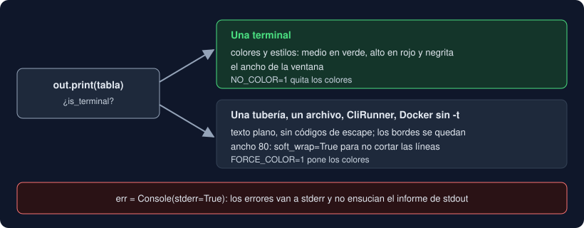

# 04 · Rich

⏱️ 50 min

## 🎯 Objetivos

- Escribir con una `Console` de Rich: estilos, marcas y resaltado.
- Construir tablas, y conocer paneles y reglas.
- Separar el resultado (stdout) de los errores (stderr) con dos consolas.
- Saber qué hace Rich cuando la salida no va a una terminal.
- Evitar que los datos del usuario se interpreten como marcas.

---

## 1. `Console`

Rich escribe en la terminal con estilos, tablas y colores. Typer lo trae como dependencia, y lo usa para su ayuda y sus errores: los recuadros que ya has visto. Tú lo usas con una **consola**:

```python
from rich.console import Console

out = Console()
out.print("[bold]Norte[/bold]: 12.5 µg/m³ → [green]medio[/green]")
```

`out.print` funciona como `print`, con tres cosas más:

| Qué | Ejemplo | Para qué |
|---|---|---|
| **Marcas** (*markup*) | `"[bold red]alto[/]"` | Estilos dentro del texto: `[estilo]...[/estilo]`, y `[/]` cierra el último |
| `style=` | `out.print("aviso", style="yellow")` | Un estilo para todo el texto |
| **Resaltado** (*highlight*) | `12.5`, `True`, `/ruta/a.csv` | Colorea por su cuenta números, rutas y valores de Python |

Los estilos se combinan con espacios: `"bold"`, `"italic"`, `"red"`, `"bold red"`, `"white on red"` (texto blanco sobre fondo rojo).

## 2. Tablas

```python
from rich.table import Table
from rich.text import Text

table = Table(title="Medidas")
table.add_column("Etiqueta")
table.add_column("Valor", justify="right")
table.add_column("Nivel")
table.add_row("Norte", "12.5 unidad", Text("medio", style="green"))
out.print(table)
```

```
             Medidas
┏━━━━━━━━━━┳━━━━━━━━━━━━━┳━━━━━━━┓
┃ Etiqueta ┃       Valor ┃ Nivel ┃
┡━━━━━━━━━━╇━━━━━━━━━━━━━╇━━━━━━━┩
│ Norte    │ 12.5 unidad │ medio │
└──────────┴─────────────┴───────┘
```

`Table` mide cada columna con su celda más larga, así que no tienes que calcular anchos como hacía `format_row` con `:<16` y `:>14`. Los números van a la derecha (`justify="right"`) para que las cifras queden alineadas. Cada celda es texto (con marcas) o un `Text`, que lleva su propio estilo. Tu proyecto colorea el nivel así:

```python
STYLES = {"bajo": "cyan", "medio": "green", "alto": "bold red"}
...
table.add_row(measurement.label, value, Text(level, style=STYLES.get(level, "")))
```

`STYLES.get(level, "")`: el nivel `sin dato` no tiene color.

Otros objetos que `print` sabe dibujar: `Panel(texto, title=...)` enmarca un texto, `out.rule("Resumen")` dibuja una línea con título y `rich.progress.track(iterable)` enseña una barra de progreso mientras recorres algo largo. Tu proyecto solo usa la tabla. El resumen sigue siendo texto plano, una línea por dato, fácil de leer para una persona y para `grep`.

## 3. Dos consolas: stdout y stderr

```python
out = Console()               # el resultado: la tabla y el resumen
err = Console(stderr=True)    # los errores y los avisos
```

Es la regla de la semana 3 con otra herramienta: `observatorio informe -f medidas.csv > informe.txt` guarda el informe y te enseña los errores en la terminal. Si los errores fueran por `out`, acabarían mezclados en el archivo.

## 4. Terminal o no terminal

Rich pregunta al arrancar si su salida va a una **terminal** (`console.is_terminal`) y se adapta:



| La salida va a | Colores y estilos | Ancho |
|---|---|---|
| Una terminal | Sí | El de la ventana |
| Una tubería (`\| grep`), un archivo (`> informe.txt`) | No: texto plano | 80 |
| `CliRunner` en los tests, Docker sin `-t`, el CI | No | 80 |

Sin colores, otro programa o un archivo reciben texto limpio, sin códigos de escape como `\x1b[1;31m`. Las tablas siguen saliendo con sus bordes: son caracteres Unicode, no estilos.

Dos variables de entorno, estándar en muchas herramientas, cambian la decisión:

- `NO_COLOR=1`: nunca colores, aunque haya terminal;
- `FORCE_COLOR=1`: colores siempre, aunque no la haya.

## 5. Tres opciones que tu proyecto cambia

```python
out = Console(markup=False, highlight=False, soft_wrap=True)
err = Console(stderr=True, markup=False, highlight=False, soft_wrap=True)
```

**`markup=False`: los corchetes de tus datos.** Con marcas activadas, Rich interpreta **cualquier** texto que imprimes, también el que viene del usuario. Una estación llamada `Sala [b]` sale como `Sala `, porque `[b]` significa "negrita". No hay ningún error: el dato desaparece sin avisar. Es el mismo problema que una inyección SQL (semana 19) o una inyección de *prompt* (semana 41): **datos** que se interpretan como **instrucciones**.

| Solución | Cuándo |
|---|---|
| `from rich.markup import escape` y `escape(dato)` | Mezclas marcas tuyas con datos en el mismo texto |
| `markup=False` en el `print` | Una línea concreta lleva datos |
| `Console(markup=False)` | Casi todo lo que imprimes son datos: tu caso |

El color del nivel no necesita marcas: va en el `Text(level, style=...)`.

**`highlight=False`.** El resaltado colorea los números y las rutas a su manera. En un informe con colores propios, distrae: el `12.5` sale en cian aunque no signifique nada especial.

**`soft_wrap=True`.** Sin terminal, el ancho es 80, y Rich **corta** las líneas más largas para que quepan. Una ruta larga en un mensaje de error acaba partida en dos líneas, y un test que busca el mensaje entero falla. `soft_wrap=True` deja las líneas de texto enteras. Las tablas siguen ajustándose al ancho.

## 6. Rich y `logging`

Rich trae un manejador de registro, `rich.logging.RichHandler`, que escribe los mensajes con colores, la hora y el archivo de origen:

```python
logging.basicConfig(level=logging.DEBUG, handlers=[RichHandler(console=err)])
```

Tu proyecto **no** lo usa. Con `-v` sigue escribiendo `DEBUG observatorio.core.storage: 9 líneas leídas de medidas.csv`, una línea de texto fácil de filtrar con `grep`, y un test de la semana 14 la comprueba. Es una decisión de presentación, y vive en el callback: el paquete no se entera.

---

## ⚠️ Errores comunes

| Error | Causa | Solución |
|---|---|---|
| Una etiqueta pierde lo que va entre corchetes | Rich lo tomó por una marca | `Console(markup=False)` o `escape(dato)` |
| `MarkupError: closing tag '[/bold]' at position 5 doesn't match any open tag` | Un texto con `[/algo]` sin abrir: a veces, un dato del usuario | Lo mismo: los datos no deben pasar por las marcas |
| Un test falla porque el mensaje sale partido en dos líneas | Ancho 80 sin terminal | `soft_wrap=True` |
| Los errores acaban en el archivo del informe | Escribes los errores con la consola de stdout | `Console(stderr=True)` para los errores |
| Los tests no ven ningún color | `CliRunner` no es una terminal | Es lo esperado. Para probar el color, una consola con `force_terminal=True` (teoría 05) |
| Una celda sale como `[green]medio[/]`, con los corchetes | Con `Console(markup=False)`, las celdas tampoco interpretan marcas | El estilo va en un `Text(texto, style=...)`, no en marcas |

---

## ✅ Qué debes saber al terminar

- [ ] Qué añade `Console.print` a `print`: marcas, estilos y resaltado.
- [ ] Cómo se construye una tabla y cómo se colorea una celda con `Text`.
- [ ] Por qué hay dos consolas.
- [ ] Qué cambia cuando la salida no va a una terminal, y qué hacen `NO_COLOR` y `FORCE_COLOR`.
- [ ] Por qué `markup=False` evita un bug con los datos del usuario.
- [ ] Para qué sirve `soft_wrap=True`.

---

## 🔗 Navegación

| Anterior | Actual | Siguiente |
| -------- | ------ | --------- |
| [03 · Comandos, callback y salida](03-comandos-callback-y-salida.md) | **04 · Rich** | [05 · Probar la CLI y cerrar la fase](05-probar-la-cli-y-cerrar-la-fase.md) |
