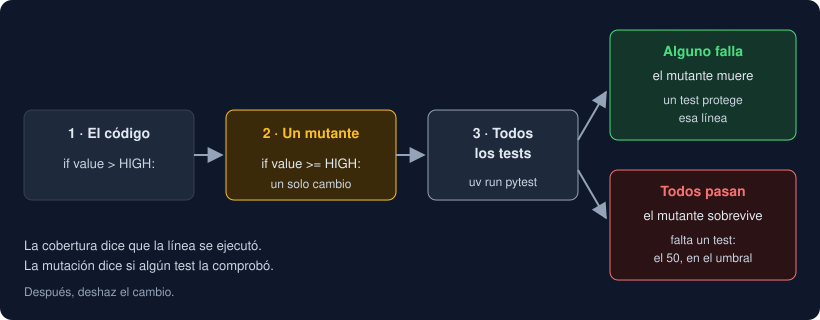

# 05 · Probar la CLI y cerrar la fase

⏱️ 50 min

## 🎯 Objetivos

- Probar una aplicación Typer con `CliRunner`: código, stdout, stderr y stdin.
- Saber qué no ve `CliRunner` (colores, otro proceso) y cómo probarlo.
- Comprobar que tus tests detectan bugs con una prueba de mutación a mano.
- Repasar qué construiste en la fase 2 y cómo queda el Observatorio.

---

## 1. `CliRunner`

```python
from typer.testing import CliRunner

from observatorio import cli

runner = CliRunner()


def test_informe_errors_go_to_stderr_with_code_1() -> None:
    result = runner.invoke(cli.app, ["informe", "Norte;12,5", "malo", "Sur;abc"])
    assert result.exit_code == 1
    assert result.stderr == "error: línea 2: 'malo'\nerror: línea 3: 'Sur;abc'\n"
    assert "Norte" in result.stdout
```

`invoke` ejecuta la aplicación **dentro del test**, como si escribieras `observatorio informe ...` en la terminal. Cambia `sys.stdin`, `sys.stdout` y `sys.stderr` mientras dura y devuelve un `Result`:

| Atributo | Qué tiene |
|---|---|
| `exit_code` | El código de salida: 0, 1, 2... |
| `stdout` / `stderr` | Lo que se escribió en cada uno, por separado |
| `output` | Los dos juntos, en el orden en que se escribieron |
| `exception` | La excepción que terminó el comando, si hubo una. `CliRunner` la captura y no la enseña |

Y `invoke` acepta más cosas:

- `input="Norte;12,5\nSur;8\n"`: lo que el comando lee de stdin. Sin `input`, stdin está vacío y el test no se queda esperando;
- `env={"NO_COLOR": "1"}`: variables de entorno solo para esa llamada.

Es lo que hacían tus tests de `main(argv)` con `capsys`, pero sin llamar a la función a mano. Pasa por el analizador de Typer, así que también prueba los nombres de las opciones, los tipos y la ayuda.

**Si un test falla sin explicación**, imprime `result.stderr` o `result.exception`. Un `exit_code == 1` sin nada en stderr suele ser una excepción de Python capturada por `CliRunner`.

## 2. Lo que `CliRunner` no ve

**Colores.** `CliRunner` no es una terminal, y Rich no pone colores (teoría 04). Si el color importa, y en tu tabla importa porque es lo que distingue un `alto`, se prueba con una consola que **finge** ser una terminal:

```python
def test_table_colors_each_level() -> None:
    console = Console(record=True, force_terminal=True, color_system="standard", width=80)
    console.print(cli.table_of(Series.from_lines(["Norte;12,5", "Sur;8", "Este;60"]), cli.SCALE))
    text = console.export_text(styles=True)
    assert "\x1b[1;31malto" in text
```

`record=True` guarda lo que escribe, y `export_text(styles=True)` lo devuelve con sus códigos de escape: `\x1b[1;31m` es "negrita y rojo".

**Otro proceso.** `python -m observatorio` y `basicConfig` con `-v` se prueban de verdad, con `subprocess.run`, como en la semana 14. pytest ya configura el registro antes de tus tests, y `basicConfig` no hace nada si el registro ya está configurado. Ojo: coverage no mide lo que pasa dentro de otro proceso. Por eso `__main__.py` y la línea de `basicConfig` salen sin cubrir aunque haya tests que los ejecutan.

## 3. ¿Tus tests detectan bugs?

Tu proyecto tiene un 99 % de cobertura. La semana pasada viste que eso dice qué se **ejecutó**, no qué se **comprobó**. Hay una forma directa de medir lo segundo: meter un bug a propósito y ver si algún test falla. Se llama **prueba de mutación**, y cada bug es un **mutante**.



Al preparar esta semana, se le hizo esa prueba a mano a la CLI del Observatorio: 14 mutantes, uno cada vez, ejecutando toda la batería de tests. Con el 99 % de cobertura, **sobrevivieron 4**:

| Mutante | Por qué sobrevivió | Test que lo mata |
|---|---|---|
| La tabla usa `SCALE` en lugar de la escala de `--escala` | El test buscaba `"alto: 1"` en la salida, y esa línea es del **resumen**, que sí usaba la escala buena. Pasaba por la razón equivocada | Comparar las filas de la tabla, celda a celda (`table_rows`) |
| Sin el color del nivel | `CliRunner` no ve colores | La consola con `force_terminal=True` |
| `alto` en verde en lugar de rojo | Lo mismo | Lo mismo |
| Sin `is_eager` en `--version` | Hoy no cambia nada observable | Ninguno: el test que lo "probaba" pasaba igual con y sin `is_eager`, así que se borró |

La lección no es "escribe más tests", sino "escribe tests que miren lo que importa". Busca:

- `assert "x" in result.stdout` con una `x` que puede salir de **otro** sitio: compara la línea entera o la celda concreta;
- casos que no tocan los **bordes**: `10` y `50` en tus umbrales (ejercicio 04);
- tests que pasan **con y sin** la línea que dicen probar: si no puede fallar, no prueba nada.

Mutantes que vale la pena probar a mano: `<` por `<=`, un código de salida por otro, `stderr` por `stdout`, un valor por defecto cambiado (`TOP = 3` por `TOP = 2`), una rama quitada. Si no tienes tiempo de probar todas las líneas, prueba las que más te preocupan. Hay herramientas que lo automatizan, como **mutmut**: generan cientos de mutantes y ejecutan los tests con cada uno. Son lentas, pero no dependen de tu imaginación, como Hypothesis.

## 4. La fase 2, completa

En siete semanas, tu Observatorio pasó de funciones sueltas con tuplas a esto:

| Semana | Qué añadiste |
|---|---|
| 9 | `Scale`, `Measurement` y `Series` como `dataclasses` |
| 10 | `Source`: un `Protocol`, dos fuentes de archivo con un ABC, `open_file` |
| 11 | `Series` que se recorre, se indexa y se suma; generadores en `streams.py` |
| 12 | Closures y decoradores en `functional.py`; `Series.where` |
| 13 | mypy estricto, `TypedDict` y Pydantic en la frontera: `schemas.py` |
| 14 | Fixtures, Hypothesis, mocks, coverage y `logging`: tres bugs encontrados y arreglados |
| 15 | La CLI con Typer y Rich: `cli.py` |

Y la arquitectura que lo sostiene:

```
src/observatorio/
├── __init__.py      # __version__
├── __main__.py      # python -m observatorio → cli.app
├── cli.py           # Typer + Rich: argumentos, tablas, códigos de salida
└── core/            # todo lo demás: sin terminal, sin Typer, sin Rich
```

`core/` no sabe que existe una CLI. Lo has comprobado cada semana: el informe no cambió cuando el modelo pasó a `dataclasses`, ni cuando las fuentes pasaron a un `Protocol`. Esta semana cambia toda la forma de llamar al programa, y `core/` no se toca. En la fase 3, la API de FastAPI (semana 20) será otro `cli.py`, que llamará a las mismas funciones. Y en la fase 4, un *notebook* hará lo mismo con pandas.

---

## ⚠️ Errores comunes

| Error | Causa | Solución |
|---|---|---|
| `result.stdout` vacío y `exit_code == 1` | Una excepción dentro del comando | Mira `result.exception` |
| Un test de `-v` con `CliRunner` no ve los DEBUG | pytest ya configuró el registro, y `basicConfig` no hace nada | `subprocess.run`, o `caplog` si pruebas el paquete |
| `result.stdout` vacío aunque el comando escribe | La consola se creó con `Console(file=sys.stdout)` y guardó el `sys.stdout` de antes del `invoke` | No pases `file=`: sin él, Rich busca el `sys.stdout` actual cada vez que escribe |
| El test pasa con y sin la línea que prueba | Comprueba algo que sale de otro sitio | Compara la línea o la celda exacta, y rompe el código a propósito para verlo fallar |
| Un test que comprueba la ayuda se rompe al cambiar una palabra | Comparas la ayuda entera, con sus recuadros | Comprueba que aparecen las opciones (`"--archivo" in result.stdout`), no el dibujo |

---

## ✅ Qué debes saber al terminar

- [ ] Qué hace `CliRunner.invoke` y qué guarda el `Result`.
- [ ] Cómo se pasa stdin a un comando en un test.
- [ ] Cómo se prueba el color y qué hay que probar con `subprocess`.
- [ ] Qué es una prueba de mutación y qué te dice que la cobertura no.
- [ ] Tres formas en que un test puede pasar sin probar lo que dice.
- [ ] Por qué `core/` no ha cambiado al cambiar la CLI.

---

## 🔗 Navegación

| Anterior | Actual | Siguiente |
| -------- | ------ | --------- |
| [04 · Rich](04-rich.md) | **05 · Probar la CLI y cerrar la fase** | [Ejercicio 01 · Argumentos y opciones](../2-practicas/ejercicio-01-argumentos-y-opciones/README.md) |
