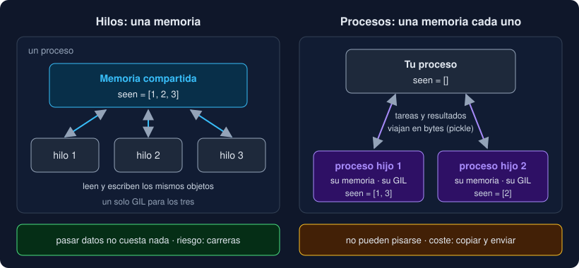

# 01 · Concurrencia y paralelismo

⏱️ 45 min

## 🎯 Objetivos

- Distinguir concurrencia de paralelismo.
- Saber si tu programa está limitado por E/S o por CPU, midiéndolo.
- Explicar qué comparten los hilos de un proceso y qué no comparten dos procesos.
- Elegir entre las herramientas de Python para hacer varias cosas a la vez.
- Calcular cuánto puedes ganar como mucho antes de paralelizar.

---

## 1. Hacer varias cosas a la vez

Hasta ahora, tus programas hacen una cosa detrás de otra. Leer un archivo, procesarlo, leer el siguiente. Mientras el disco o la red responden, el programa está parado, esperando.

Hay dos ideas distintas detrás de "hacer varias cosas a la vez":

| Idea | Qué significa | Ejemplo |
|---|---|---|
| **Concurrencia** | Tener varias tareas **en marcha** a la vez, aunque se avance en una sola cada instante | Un cocinero pone el agua a hervir y, mientras espera, corta verduras |
| **Paralelismo** | Ejecutar varias tareas **en el mismo instante**, en varios núcleos | Cuatro cocineros, cada uno con su plato |

La concurrencia aprovecha las **esperas**: mientras una tarea espera, otra avanza. No necesita más de un núcleo. El paralelismo necesita varios núcleos, y solo ayuda si hay **cálculo** que repartir.

Un programa puede ser concurrente sin ser paralelo (un cocinero que no se queda mirando la olla), y es lo más habitual con hilos en Python, por el GIL (teoría 03).

## 2. ¿Qué frena tu programa?

Antes de elegir una herramienta, averigua qué frena tu programa:

- **Limitado por E/S** (*I/O-bound*): la mayor parte del tiempo espera. A la red, al disco, a una base de datos, a otro programa. La CPU está casi parada.
- **Limitado por CPU** (*CPU-bound*): la mayor parte del tiempo calcula. Recorrer millones de filas, comprimir, entrenar un modelo.

No lo adivines: compara dos relojes. `time.perf_counter()` mide el tiempo **real** que pasa, y `time.process_time()` mide el tiempo de **CPU** que usó tu proceso:

```python
import time

start_wall = time.perf_counter()
start_cpu = time.process_time()
work()
wall = time.perf_counter() - start_wall
cpu = time.process_time() - start_cpu
print(f"real: {wall:.2f} s · CPU: {cpu:.2f} s")
```

```
real: 2.01 s · CPU: 0.00 s     # E/S: casi todo es espera
real: 2.38 s · CPU: 2.37 s     # CPU: casi todo es cálculo
```

Si el tiempo de CPU es mucho menor que el real, el programa espera: tiene sentido solapar esperas. Si son casi iguales, calcula: solo ganarás repartiendo el cálculo entre núcleos.

Desde la terminal, `time` da los mismos dos números: `real` es el tiempo real, y `user` + `sys` es el de CPU.

## 3. Procesos e hilos

Tu sistema operativo ejecuta **procesos**. Cada programa que lanzas (`uv run observatorio ...`) es un proceso, con su propia **memoria**: sus variables, sus listas, sus objetos. Un proceso no puede leer la memoria de otro.

Dentro de un proceso puede haber varios **hilos** (*threads*). Cada hilo ejecuta su propio código, por su cuenta, pero todos los hilos de un proceso **comparten la misma memoria**: ven las mismas variables globales y los mismos objetos.



| | Hilos | Procesos |
|---|---|---|
| Memoria | Compartida | Separada: cada uno la suya |
| Comunicación | Leer y escribir los mismos objetos | Enviar copias en bytes (`pickle`) |
| Riesgo | Dos hilos que modifican lo mismo se pisan (teoría 02) | Ninguno de esos: no comparten nada |
| Coste de crearlos | Bajo | Alto: un intérprete de Python entero |
| En Python, con GIL | Solo uno ejecuta código Python a la vez | Cada uno tiene su GIL: calculan a la vez |

Compartir memoria es a la vez la ventaja de los hilos (pasar datos no cuesta nada) y su peligro. No compartir es la ventaja de los procesos (no pueden pisarse) y su coste (todo lo que se envía se copia).

## 4. Las herramientas de Python

| Herramienta | Qué da | Cuándo |
|---|---|---|
| `threading` | Hilos, `Lock`, `Event`, `Barrier`... a bajo nivel | Para entender cómo funciona, y para casos especiales |
| `multiprocessing` | Procesos a bajo nivel, colas y memoria compartida entre procesos | Casos especiales con procesos |
| **`concurrent.futures`** | Un *pool* de hilos o de procesos con la **misma** interfaz | **Casi siempre**: es lo que usa tu proyecto |
| `concurrent.interpreters` | Subintérpretes, nuevos en Python 3.14 | Paralelismo dentro de un proceso (teoría 03) |
| `asyncio` | Miles de tareas concurrentes en un solo hilo | Mucha E/S de red: la semana 17 |

`concurrent.futures` es la herramienta del día a día. Le das una función y una lista de entradas, y él reparte el trabajo entre sus trabajadores y te devuelve los resultados:

```python
from concurrent.futures import ThreadPoolExecutor

with ThreadPoolExecutor(max_workers=4) as pool:
    reports = list(pool.map(report_file, paths))
```

Cambiar `ThreadPoolExecutor` por `ProcessPoolExecutor` cambia hilos por procesos, sin tocar nada más. Por eso tu proyecto ofrece las dos cosas con una sola opción, `--procesos`.

## 5. Cuánto puedes ganar

Ninguna herramienta acelera la parte de tu programa que no se puede repartir. Si de un programa de 10 s, 2 s son secuenciales (arrancar, leer la configuración, escribir el informe final), con infinitos núcleos tardaría 2 s: como mucho **5 veces** más rápido. Es la **ley de Amdahl**:

```
aceleración máxima = 1 / (parte secuencial)       1 / 0.2 = 5
```

Y repartir tiene su propio coste: crear hilos o procesos, enviarles el trabajo, recoger los resultados. Con tareas pequeñas, ese coste puede ser mayor que lo que ganas. Lo verás en el ejercicio 02 y en el paso 11 del proyecto.

La regla de esta semana: **mide antes y mide después**. Una versión concurrente es más difícil de leer y de probar que una secuencial. Solo compensa si lo que ganas lo justifica.

---

## ⚠️ Errores comunes

| Error | Causa | Solución |
|---|---|---|
| Añadir hilos a un cálculo y que no vaya más rápido | El cálculo es CPU, y con GIL los hilos se turnan | Procesos, o el Python sin GIL (teoría 03) |
| Añadir procesos y que vaya más lento | Las tareas son tan pequeñas que enviarlas cuesta más que hacerlas | Tareas más grandes, `chunksize`, o no paralelizar |
| Paralelizar sin medir | Se supone que "más trabajadores, más rápido" | Mide con `perf_counter` y `process_time` antes y después |
| Medir una sola vez | El primer arranque carga módulos y llena cachés | Repite la medida y quédate con la mediana (teoría 05) |
| Esperar 4 veces menos con 4 trabajadores | Siempre queda una parte secuencial y un coste de repartir | Calcula el máximo con la ley de Amdahl |

---

## ✅ Qué debes saber al terminar

- [ ] La diferencia entre concurrencia y paralelismo.
- [ ] Cómo medir si un programa está limitado por E/S o por CPU.
- [ ] Qué comparten los hilos de un proceso y qué no comparten dos procesos.
- [ ] Qué herramienta de Python usar en cada caso.
- [ ] Por qué hay un límite a lo que puedes ganar paralelizando.

---

## 🔗 Navegación

| Anterior | Actual | Siguiente |
| -------- | ------ | --------- |
| [Semana 16](../README.md) | **01 · Concurrencia y paralelismo** | [02 · Hilos, carreras y locks](02-hilos-carreras-y-locks.md) |
