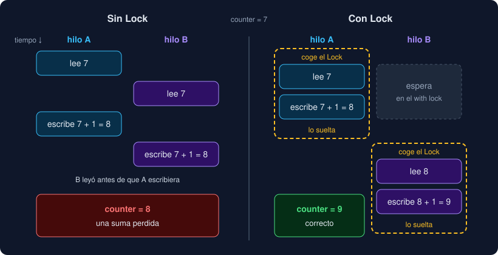

# 02 · Hilos, carreras y locks

⏱️ 50 min

## 🎯 Objetivos

- Crear, arrancar y esperar hilos con `threading`.
- Explicar qué es una condición de carrera y por qué es tan difícil de ver.
- Proteger datos compartidos con un `Lock`, y conocer su precio.
- Conocer las otras herramientas de sincronización: `Queue`, `Event`, `Barrier`, `Semaphore`.
- Diseñar tareas que no comparten nada, para no necesitar ningún `Lock`.

---

## 1. `threading.Thread`

```python
import threading

def download(station: str) -> None:
    ...

thread = threading.Thread(target=download, args=("Norte",), name="norte")
thread.start()   # arranca el hilo y vuelve enseguida
...              # el hilo principal sigue con lo suyo
thread.join()    # espera a que el hilo termine
```

| Qué | Para qué |
|---|---|
| `target`, `args`, `kwargs` | La función que ejecuta el hilo y sus argumentos. `args` es una tupla: `("Norte",)`, con coma |
| `start()` | Arranca el hilo. Solo una vez por hilo |
| `join(timeout=None)` | Espera a que termine. Sin `join`, nadie garantiza que el trabajo esté hecho |
| `name` | Un nombre para los registros y los depuradores; por defecto, `Thread-1`... |
| `daemon=True` | El programa termina sin esperar a este hilo, aunque no haya acabado |
| `threading.current_thread()` | El hilo que está ejecutando esta línea |

Todo programa empieza con un hilo, `MainThread`. Cuando termina tu código, Python espera a los hilos que no son *daemon* antes de salir.

Un hilo **no devuelve** nada: `Thread` ignora el valor de retorno de `target`. Para recoger resultados, o cada hilo escribe en su propio sitio (ejercicio 01, paso 4), o usas un *pool* de `concurrent.futures`, que devuelve los resultados por ti (teoría 04).

## 2. Una condición de carrera

Dos hilos suman uno a un contador:

```python
counter = 0

def add() -> None:
    global counter
    counter += 1
```

`counter += 1` no es una operación, sino tres: **leer** `counter`, **sumar** uno y **escribir** el resultado. Entre cualquiera de ellas, el sistema puede pausar un hilo y dar paso a otro:



Los dos hilos han leído 7, los dos escriben 8, y una suma se ha perdido. Es una **condición de carrera** (*race condition*): el resultado depende del orden en que se intercalan los hilos, y ese orden cambia en cada ejecución.

Lo peor de una carrera no es que exista, sino que **casi nunca se ve**. En el ejercicio 01 la provocas con un `time.sleep(0)` entre leer y escribir. Sin él, con el Python normal, el mismo código da el resultado correcto casi siempre. Pasa los tests, llega a producción, y un día, con otra carga o en otra máquina, pierde datos. Con el Python sin GIL (ejercicio 03), el mismo `+= 1` pierde tres de cada cuatro sumas.

Una carrera necesita tres cosas a la vez:

1. datos **compartidos** entre hilos;
2. que al menos un hilo los **modifique**;
3. una operación que **no es atómica**: leer, decidir y escribir.

Quita cualquiera de las tres y la carrera desaparece.

## 3. `Lock`

Un `Lock` (cerrojo) deja pasar a **un solo hilo** a la vez por un bloque de código:

```python
lock = threading.Lock()

def add() -> None:
    global counter
    with lock:          # espera hasta que el cerrojo esté libre, y lo coge
        counter += 1    # nadie más puede estar aquí dentro
                        # al salir del with, lo suelta (también si hay una excepción)
```

Leer, sumar y escribir quedan juntos. El segundo hilo espera en la puerta, y cuando entra lee el 8 que dejó el primero.

Tres reglas:

- **Usa siempre `with`**. Con `lock.acquire()` y `lock.release()` a mano, una excepción entre medias deja el cerrojo cogido para siempre.
- **Protege lo mínimo**. Mientras un hilo tiene el cerrojo, los demás esperan. Si dentro del `with` va todo el trabajo, has vuelto a un programa secuencial, con más complicaciones.
- **El mismo `Lock` para los mismos datos**. Un `Lock` no protege una variable: protege el código que la usa. Todo el código que toca `counter` tiene que pasar por **el mismo** `lock`.

### Interbloqueos

Con dos cerrojos aparece otro problema. El hilo A coge `lock_1` y espera a `lock_2`; el hilo B coge `lock_2` y espera a `lock_1`. Ninguno suelta el suyo, y los dos esperan para siempre: un **interbloqueo** (*deadlock*). El programa no falla: se queda colgado.

La regla para evitarlo: si un hilo necesita varios cerrojos, todos los hilos los cogen **en el mismo orden**. Mejor aún: no necesites varios.

## 4. Las otras herramientas

| Herramienta | Qué hace | Ejemplo |
|---|---|---|
| `queue.Queue` | Una cola segura entre hilos: `put` añade, `get` espera hasta que haya algo | Productor y consumidores (ejercicio 01, paso 7) |
| `threading.Event` | Una señal: un hilo hace `set()` y los que hacen `wait()` despiertan | "Ya puedes empezar", "para todo" |
| `threading.Barrier(n)` | Los hilos esperan en `wait()` hasta que llegan `n` | Comprobar en un test que varias tareas corren a la vez |
| `threading.Semaphore(n)` | Como un `Lock`, pero deja pasar a `n` a la vez | Como mucho 3 conexiones simultáneas a un servidor |
| `threading.RLock` | Un `Lock` que el mismo hilo puede coger varias veces | Una función protegida que se llama a sí misma |

`Queue` es la más útil: en lugar de compartir una lista y protegerla, los hilos se **pasan** los datos por la cola. Cada dato tiene un solo dueño a la vez.

`logging` también es seguro entre hilos: varios hilos pueden registrar a la vez sin mezclar las líneas. `print` no lo garantiza.

## 5. La mejor estrategia: no compartir

Cada `Lock` es una pregunta que tienes que responder bien (¿qué protege?, ¿lo usa todo el código que toca esos datos?, ¿en qué orden se cogen?) y un sitio donde los hilos esperan. La forma más segura de evitar carreras es no tener datos compartidos que se modifican:

```python
@dataclass(frozen=True, slots=True)
class FileReport:
    path: Path
    measurements: int = 0
    ...

def report_file(path: Path) -> FileReport:
    ...                      # solo usa sus argumentos y variables locales
    return FileReport(...)   # y devuelve un valor nuevo, inmutable
```

Es el diseño de tu proyecto:

- cada tarea recibe lo que necesita como **argumento**;
- trabaja con variables **locales**, que son de su hilo;
- **devuelve** su resultado, inmutable (`frozen=True`), en lugar de escribirlo en una lista común;
- quien junta los resultados es el hilo principal, con `pool.map`.

Ninguna de las tres condiciones de la sección 2 se cumple, así que no hace falta ningún `Lock`. Y el mismo código funciona igual con procesos, que no podrían compartir nada aunque quisieran. Son las funciones puras de la semana 3, que ahora además se pueden ejecutar a la vez sin miedo.

---

## ⚠️ Errores comunes

| Error | Causa | Solución |
|---|---|---|
| `TypeError: download() takes 1 positional argument but 5 were given` | `args=("Norte")` sin coma: es un texto, y se reparte letra a letra | `args=("Norte",)` |
| `RuntimeError: threads can only be started once` | `start()` dos veces sobre el mismo hilo | Un hilo nuevo para cada ejecución |
| Un resultado se lee antes de que exista | Falta el `join()` | `join()` antes de usar lo que calcula el hilo |
| Un contador pierde sumas de vez en cuando | Una carrera: leer y escribir desde varios hilos sin protección | Un `Lock` alrededor de las dos cosas, o mejor, que cada hilo devuelva su parte |
| El programa se queda colgado sin error | Un interbloqueo, o un `get()` de una cola que nunca recibe nada | Coge los cerrojos siempre en el mismo orden; envía una señal de parar por consumidor |
| Con `Lock`, el programa no es más rápido que sin hilos | Todo el trabajo está dentro del `with` | Protege solo la lectura y la escritura de los datos compartidos |

---

## ✅ Qué debes saber al terminar

- [ ] Cómo se crea, se arranca y se espera un hilo, y por qué no devuelve nada.
- [ ] Qué es una condición de carrera y por qué puede pasar los tests.
- [ ] Las tres condiciones que necesita una carrera.
- [ ] Cómo se usa un `Lock`, y qué es un interbloqueo.
- [ ] Para qué sirven `Queue`, `Event`, `Barrier` y `Semaphore`.
- [ ] Por qué tu proyecto no necesita ningún `Lock`.

---

## 🔗 Navegación

| Anterior | Actual | Siguiente |
| -------- | ------ | --------- |
| [01 · Concurrencia y paralelismo](01-concurrencia-y-paralelismo.md) | **02 · Hilos, carreras y locks** | [03 · El GIL, procesos y free-threading](03-el-gil-procesos-y-free-threading.md) |
