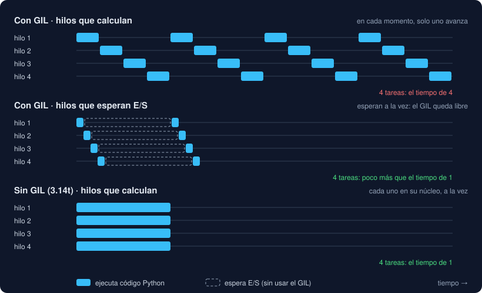

# 03 · El GIL, procesos y free-threading

⏱️ 50 min

## 🎯 Objetivos

- Explicar qué es el GIL, por qué existe y cuándo lo suelta un hilo.
- Usar procesos para el trabajo de CPU, y conocer sus reglas: `pickle`, el guardián `__main__` y los métodos de arranque.
- Instalar y usar el Python 3.14 *free-threaded* con uv.
- Saber qué cambia sin GIL, y qué no cambia.
- Conocer los subintérpretes de Python 3.14.

---

## 1. El GIL

CPython, el Python que usas, tiene un **cerrojo global del intérprete**: el GIL (*Global Interpreter Lock*). Un hilo solo puede ejecutar código Python si tiene el GIL, y solo hay uno. Por mucho que tu proceso tenga cuatro hilos y tu máquina ocho núcleos, en cada instante **solo un hilo** ejecuta código Python.

¿Para qué? Cada objeto de Python lleva la cuenta de cuántas variables lo usan (su **contador de referencias**), y lo borra cuando llega a cero. Si dos hilos cambiaran a la vez el contador del mismo objeto, se pisarían como el `counter += 1` de la teoría 02, y Python borraría objetos en uso. El GIL lo evita de la forma más sencilla: un hilo cada vez. También hace más fácil escribir extensiones en C, y más rápido el código de un solo hilo.

Pero un hilo **suelta** el GIL en tres situaciones:

| Cuándo | Ejemplo | Qué pasa |
|---|---|---|
| Cada pocos milisegundos | Un bucle que calcula | Python le obliga a ceder el turno: `sys.getswitchinterval()` vale `0.005`, 5 ms |
| Al esperar E/S | Leer un archivo, la red, `time.sleep` | Lo suelta mientras espera, y otro hilo avanza |
| Dentro de muchas extensiones en C | `hashlib`, `zlib`, NumPy, Polars | El cálculo en C no toca objetos de Python y lo suelta |



De ahí sale la regla de toda la vida en Python:

- **E/S**: hilos. Mientras uno espera, suelta el GIL, y los demás avanzan. Ejercicio 01: cuatro esperas de 0,5 s tardan 0,5 s.
- **CPU en Python puro**: procesos. Cuatro hilos que calculan se turnan con un solo GIL y tardan lo que uno. Ejercicio 02: los procesos sí reparten el trabajo.

## 2. Procesos

Cada proceso es un intérprete de Python completo, con su memoria y **su propio GIL**. `ProcessPoolExecutor` los crea y les reparte las tareas:

```python
from concurrent.futures import ProcessPoolExecutor

if __name__ == "__main__":
    with ProcessPoolExecutor(max_workers=4) as pool:
        counts = list(pool.map(count_primes, limits))
```

Tienen tres reglas que los hilos no tienen.

### Todo viaja con `pickle`

Los procesos no comparten memoria. Para enviar una tarea, Python convierte en bytes la función y sus argumentos con `pickle`; el hijo los reconstruye, ejecuta la función y devuelve el resultado, también en bytes.

- Las **funciones** viajan por su nombre: `modulo.funcion`. Tienen que estar definidas a nivel de módulo. Una `lambda` o una función anidada da `PicklingError`.
- Los **argumentos y los resultados** tienen que poder convertirse en bytes. Números, textos, listas, diccionarios, `Path` y *dataclasses* como `FileReport`, sí. Un archivo abierto, un `Lock` o una conexión a una base de datos, no.
- Enviar cuesta tiempo. Con tareas pequeñas, cuesta más que hacerlas (ejercicio 02, paso 7).

### El guardián `if __name__ == "__main__":`

El proceso hijo necesita tus funciones, así que **importa tu archivo**, con el nombre `__mp_main__`. Todo lo que esté a nivel de módulo se vuelve a ejecutar en él. Si ahí está el código que crea procesos, cada hijo intentaría crear los suyos: Python lo detecta y para con un `RuntimeError`.

Por eso el código que lanza procesos va dentro de `if __name__ == "__main__":`, y las funciones de las tareas, fuera. En tu proyecto no hace falta escribirlo: el comando arranca en `cli.py`, y las tareas viven en `core/batch.py`, que solo define cosas.

### Cómo nace un proceso

| Método | Cómo | Dónde es el habitual |
|---|---|---|
| `spawn` | Arranca un Python nuevo, que importa tu archivo desde cero | Windows y macOS |
| `fork` | Copia el proceso actual tal como está, con su memoria | Linux hasta Python 3.13 |
| `forkserver` | Arranca un proceso limpio, sin hilos, y cada hijo es una copia de él | **Linux desde Python 3.14** |

`fork` es rápido, pero peligroso si tu programa ya tiene hilos: copia también los cerrojos que otro hilo tenía cogidos en ese momento, y el hijo puede quedarse esperándolos para siempre. Python 3.14 cambió el método por defecto en Linux a `forkserver` por esa razón. Si tu código respeta las dos reglas anteriores, funciona igual con los tres.

## 3. Free-threading: Python sin GIL

Desde hace años, el GIL es la gran limitación de Python en máquinas con muchos núcleos. La [PEP 703](https://peps.python.org/pep-0703/) propuso una compilación de CPython **sin GIL**: Python 3.13 la publicó como experimento, y Python 3.14 la declaró **compatible oficialmente** ([PEP 779](https://peps.python.org/pep-0779/)). Se llama *free-threaded*, y sus versiones llevan una `t` al final: `3.14.10t`.

```bash
uv python install 3.14.10t                 # opcional: uv lo descarga solo al pedirlo
uv run --python 3.14.10t python main.py
```

```python
import sys
import sysconfig

sysconfig.get_config_var("Py_GIL_DISABLED")   # 1: compilado sin GIL
sys._is_gil_enabled()                         # False: el GIL está apagado ahora
```

Sin GIL, los hilos ejecutan código Python **de verdad a la vez**. En el ejercicio 03, cuatro hilos que calculan pasan de tardar lo que uno a tardar tres o cuatro veces menos.

Lo que **no** cambia, y lo que cambia a peor:

- **Las carreras se ven más**. El `+= 1` que con GIL casi nunca fallaba pierde tres de cada cuatro sumas. El código correcto (con `Lock` o sin datos compartidos) sigue siendo correcto. El incorrecto deja de parecer correcto.
- **Un hilo va algo más lento**. Python tiene que proteger cada objeto de otros hilos que podrían usarlo. La documentación de Python 3.14 habla de entre un 1 % y un 8 % de media, según la máquina.
- **Las extensiones en C tienen que declararse compatibles**. Si importas una que no lo hace, Python **vuelve a encender el GIL** y avisa con `RuntimeWarning: The global interpreter lock (GIL) has been enabled to load module ...`. Tu programa funciona, pero sin paralelismo.
- **Los objetos de la biblioteca estándar no se rompen**: una `list` o un `dict` usados desde varios hilos no corrompen la memoria. Pero una operación de varios pasos (`if key not in d: d[key] = ...`) sigue sin ser atómica.

Dos formas de encender el GIL en un Python *free-threaded*: `PYTHON_GIL=1` como variable de entorno o `python -X gil=1`. Sirven para comprobar si un fallo nuevo se debe a la falta del GIL.

¿Y tu proyecto? Pydantic publica versiones compiladas para el Python sin GIL, y Rich y Typer son Python puro. En el paso 12 ejecutas la suite entera sin GIL, y pasa.

## 4. Subintérpretes

Python 3.14 trae una tercera vía, entre hilos y procesos: los **subintérpretes** ([PEP 734](https://peps.python.org/pep-0734/), módulo `concurrent.interpreters`). Son varios intérpretes de Python dentro de un **mismo proceso**, cada uno con su memoria y **su propio GIL**:

```python
from concurrent.futures import InterpreterPoolExecutor

with InterpreterPoolExecutor(max_workers=4) as pool:
    results = list(pool.map(crunch, sizes))
```

| | Hilos | Subintérpretes | Procesos |
|---|---|---|---|
| Memoria | Compartida | Separada | Separada |
| Datos entre ellos | Los mismos objetos | Copias con `pickle` | Copias con `pickle` |
| Calculan a la vez con GIL | No | Sí: un GIL cada uno | Sí: un GIL cada uno |
| Coste de arrancar | Bajo | Medio | Alto |
| Extensiones en C | Todas | Solo las que lo soportan | Todas |

Son nuevos, y muchas bibliotecas con extensiones en C aún no funcionan en ellos. Para esta semana basta con saber que existen; tu proyecto usa hilos o procesos.

## 5. Qué elegir

| Tu programa | Con Python 3.14 normal | Con Python 3.14t |
|---|---|---|
| Espera E/S: archivos, red, base de datos | Hilos (`ThreadPoolExecutor`) | Hilos |
| Miles de esperas de red a la vez | `asyncio` (semana 17) | `asyncio` |
| Calcula en Python puro | Procesos (`ProcessPoolExecutor`) | Hilos, si no comparten datos sin protección |
| Calcula en NumPy, Polars, PyTorch | Hilos, o nada: la biblioteca ya reparte el trabajo y suelta el GIL | Lo mismo |
| Tareas muy pequeñas | Nada: repartir cuesta más que hacerlas | Nada |

Y siempre: mide. La tabla te dice por dónde empezar, no cuánto vas a ganar.

---

## ⚠️ Errores comunes

| Error | Causa | Solución |
|---|---|---|
| Cuatro hilos que calculan tardan lo mismo que uno | El GIL: solo uno ejecuta Python a la vez | Procesos, o el Python sin GIL |
| `PicklingError: Can't pickle local object` | Envías a un proceso una `lambda` o una función anidada | Una función a nivel de módulo |
| `RuntimeError: An attempt has been made to start a new process before...` | Lanzas procesos desde código a nivel de módulo | `if __name__ == "__main__":` |
| Un programa que funcionaba con `fork` se cuelga o falla en macOS o con Python 3.14 | Dependía de que el hijo heredara la memoria del padre | Pasa los datos como argumentos y respeta las reglas de `spawn` |
| `RuntimeWarning: The global interpreter lock (GIL) has been enabled...` | Una extensión en C no se declara compatible con el Python sin GIL | Actualiza la biblioteca, o usa procesos |
| Con 3.14t aparecen fallos que antes no salían | Carreras que el GIL escondía | No son nuevos: arréglalos con `Lock` o sin datos compartidos |

---

## ✅ Qué debes saber al terminar

- [ ] Qué es el GIL, para qué existe y cuándo lo suelta un hilo.
- [ ] Por qué los hilos sirven para E/S y los procesos para CPU, con el Python normal.
- [ ] Las tres reglas de los procesos: `pickle`, el guardián `__main__` y el método de arranque.
- [ ] Cómo ejecutar tu código con el Python sin GIL, y cómo saber si el GIL está activo.
- [ ] Qué cambia sin GIL: las carreras, la velocidad de un hilo y las extensiones en C.
- [ ] Qué son los subintérpretes y en qué se parecen a hilos y procesos.

---

## 🔗 Navegación

| Anterior | Actual | Siguiente |
| -------- | ------ | --------- |
| [02 · Hilos, carreras y locks](02-hilos-carreras-y-locks.md) | **03 · El GIL, procesos y free-threading** | [04 · concurrent.futures](04-concurrent-futures.md) |
