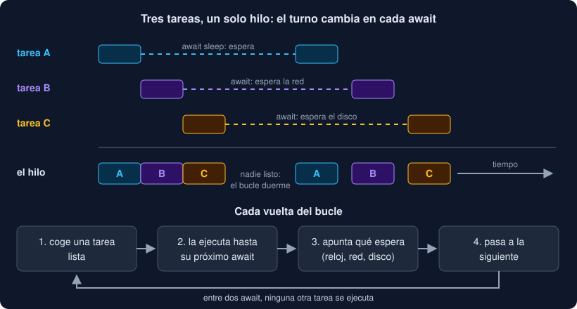

# 01 · Corrutinas y el bucle de eventos

⏱️ 45 min

## 🎯 Objetivos

- Explicar qué problema resuelve `asyncio` que los hilos resuelven peor.
- Escribir una corrutina con `async def` y esperarla con `await`.
- Explicar qué hace el bucle de eventos y cuándo cambia de tarea.
- Arrancar un programa asíncrono con `asyncio.run`.
- Reconocer cuándo `asyncio` no ayuda.

---

## 1. Mil cosas que esperan

En la semana 16, cuatro hilos esperaban a la vez cuatro descargas. Funciona, pero cada hilo cuesta: el sistema operativo le reserva memoria para su pila (del orden de megabytes de espacio reservado), lo crea, lo planifica y lo interrumpe cuando quiere. Con cuatro hilos no importa. Con diez mil conexiones abiertas a la vez (un servidor web, un recolector que consulta mil sensores), sí.

Y casi todo ese tiempo, los hilos **no hacen nada**: esperan. ¿Hace falta un hilo entero para esperar?

`asyncio` responde que no. Un solo hilo puede llevar miles de tareas, siempre que cada tarea **avise** cuando va a esperar. Mientras una espera, el hilo atiende a otra. Es concurrencia sin hilos: **concurrencia cooperativa**.

| | Hilos | `asyncio` |
|---|---|---|
| Quién decide cuándo cambiar de tarea | El sistema operativo, en cualquier instrucción | La propia tarea, en cada `await` |
| Coste de cada tarea | Un hilo del sistema operativo | Un objeto de Python, unos pocos kilobytes |
| Cuántas a la vez, en la práctica | Cientos | Decenas de miles |
| Funciona con cualquier biblioteca | Sí | Solo con bibliotecas que sepan esperar con `await` |
| Paralelismo de cálculo | Solo sin GIL (semana 16) | No: es un solo hilo |

## 2. `async def` y `await`

Una función definida con `async def` es una **función corrutina**. Llamarla **no** ejecuta su cuerpo: devuelve un objeto **corrutina**, un trabajo pendiente.

```python
import asyncio


async def download(station: str) -> str:
    await asyncio.sleep(0.5)
    return f"{station};17.5"


pending = download("Norte")   # no ha pasado nada: pending es una corrutina
```

Para ejecutarla, alguien tiene que **esperarla** con `await`, dentro de otra corrutina:

```python
async def main() -> None:
    line = await download("Norte")   # ejecuta download y espera su resultado
    print(line)
```

`await` significa: "ejecuta esto, y si tiene que esperar, **cede el turno** hasta que esté listo". Solo se puede escribir dentro de `async def`. Lo que va detrás de `await` tiene que ser **esperable** (*awaitable*): una corrutina, una tarea o un `Future`.

`asyncio.sleep(0.5)` es la espera más sencilla: "despiértame dentro de medio segundo". A diferencia de `time.sleep`, no para el hilo: devuelve el control al bucle.

## 3. El bucle de eventos

¿Quién ejecuta las corrutinas? El **bucle de eventos** (*event loop*): un bucle que, una y otra vez,

1. coge una tarea que esté **lista** para avanzar;
2. la ejecuta hasta su siguiente `await` que tenga que esperar;
3. apunta qué está esperando (un temporizador, datos de la red...);
4. pasa a la siguiente tarea lista.

Cuando ninguna está lista, el bucle pregunta al sistema operativo "avísame cuando pase algo de esto", y duerme hasta entonces. Cuando llega el aviso (venció un temporizador, llegaron datos), la tarea correspondiente vuelve a la lista de listas.



La consecuencia más importante: **una tarea solo pierde el turno en un `await`**. Entre dos `await`, nadie más se ejecuta. Con hilos, el sistema operativo puede interrumpir en cualquier instrucción; aquí, no. Eso hace que muchas carreras de la semana 16 desaparezcan, pero no todas (teoría 04).

## 4. `asyncio.run`: la puerta de entrada

Tu programa empieza siendo normal, sin bucle. `asyncio.run(corrutina)` es el puente:

```python
asyncio.run(main())
```

1. crea un bucle de eventos nuevo;
2. ejecuta `main()` hasta que termine, con todas las tareas que lance;
3. cancela las tareas que queden, cierra los generadores asíncronos y cierra el bucle;
4. devuelve lo que devolvió `main()`, o relanza su excepción.

Un programa asíncrono tiene normalmente **un solo** `asyncio.run`, en el punto de entrada, y todo lo demás son corrutinas que se esperan unas a otras. No se puede llamar a `asyncio.run` desde dentro de una corrutina: ya hay un bucle en marcha, y Python lo impide con `RuntimeError: asyncio.run() cannot be called from a running event loop`.

En tu proyecto, `core/live.py` solo tiene corrutinas, y el `asyncio.run` está en `cli.py`, en el comando `vigilar`. El paquete `core` no decide cuándo empieza ni cuánto dura el bucle: lo decide quien lo usa. La API de la semana 20, con FastAPI, ya tendrá su propio bucle, y llamará a `watch_files` con `await`.

## 5. Colorear funciones

`async` es "contagioso": para esperar una corrutina, tienes que estar en otra. Si `watch_file` es `async`, `watch_files`, que la espera, también lo es. Y así hasta el `asyncio.run`. A esto se le llama a veces el problema del **color de las funciones**: hay funciones "rojas" (`async`) y "azules" (normales), y una azul no puede esperar a una roja.

En la práctica:

- desde una función **normal**, arrancas el mundo asíncrono con `asyncio.run`;
- desde una **corrutina**, llamas a funciones normales sin problema, siempre que **no bloqueen** (teoría 04);
- desde una corrutina, para una función normal que sí bloquea, usas `await asyncio.to_thread(función)`.

## 6. Cuándo `asyncio` no ayuda

`asyncio` no hace nada más rápido por sí solo. Solo **solapa esperas**, y solo si las esperas son asíncronas:

- **Cálculo puro**: un solo hilo calcula a la velocidad de un solo hilo. Para repartir cálculo, procesos (semana 16).
- **Bibliotecas que bloquean**: `requests`, `time.sleep`, `open().read()` de un archivo enorme, un driver de base de datos síncrono. Dentro de una corrutina, paran el bucle entero. Hacen falta versiones asíncronas (`httpx` en la semana 18, un driver de base de datos asíncrono) o `to_thread`.
- **Pocas esperas**: con tres descargas, cuatro hilos son igual de buenos y más sencillos.

`asyncio` brilla cuando hay **muchas** cosas que esperan: miles de peticiones HTTP, conexiones de un servidor, mensajes de una cola, sensores que mandan datos cada pocos segundos.

---

## ⚠️ Errores comunes

| Error | Causa | Solución |
|---|---|---|
| `RuntimeWarning: coroutine 'download' was never awaited` | Llamaste a la función `async` sin `await`: creaste la corrutina y nunca se ejecutó | `await download(...)`, o `asyncio.run(...)` desde código normal |
| `SyntaxError: 'await' outside function` | `await` en el nivel del módulo | Mételo en una `async def` y arráncala con `asyncio.run` |
| `RuntimeError: asyncio.run() cannot be called from a running event loop` | `asyncio.run` dentro de una corrutina | Dentro de una corrutina, `await` |
| Un programa con `async def` tarda lo mismo que uno normal | Todas las esperas son `time.sleep` u otras llamadas que bloquean, o esperas con `await` una detrás de otra | Esperas asíncronas, y varias tareas a la vez (teoría 02) |

---

## ✅ Qué debes saber al terminar

- [ ] Por qué un solo hilo puede llevar miles de tareas que esperan.
- [ ] Qué devuelve una función `async def` cuando la llamas, y qué hace `await`.
- [ ] Qué hace el bucle de eventos en cada vuelta, y en qué momento cambia de tarea.
- [ ] Qué hace `asyncio.run`, y por qué está en `cli.py` y no en `core`.
- [ ] Cuándo `asyncio` no te va a ayudar.

---

## 🔗 Navegación

| Anterior | Actual | Siguiente |
| -------- | ------ | --------- |
| [Semana 17](../README.md) | **01 · Corrutinas y el bucle de eventos** | [02 · Tareas, gather y TaskGroup](02-tareas-gather-y-taskgroup.md) |
