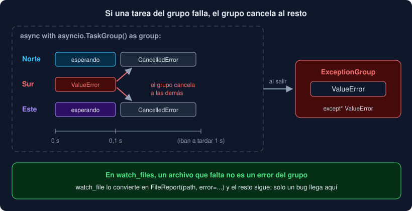

# 02 · Tareas, gather y TaskGroup

⏱️ 50 min

## 🎯 Objetivos

- Lanzar varias corrutinas a la vez con `create_task`.
- Esperar a un grupo con `gather` y con `TaskGroup`, y elegir entre los dos.
- Explicar qué pasa con las demás tareas cuando una falla.
- Capturar errores de un `ExceptionGroup` con `except*`.
- Evitar las tareas perdidas.

---

## 1. `await` no hace nada a la vez

`await` espera. Si escribes tres `await` seguidos, esperas tres veces, una detrás de otra:

```python
async def one_by_one() -> list[str]:
    return [await download(station) for station in STATIONS]   # 4 × 0,5 s = 2 s
```

Para que las esperas se solapen, cada corrutina tiene que ser una **tarea** independiente en el bucle.

## 2. `create_task`

`asyncio.create_task(corrutina)` envuelve la corrutina en una **tarea** (`Task`), la programa en el bucle y vuelve **enseguida**. La tarea empieza a correr en cuanto la corrutina actual ceda el turno.

```python
async def with_tasks() -> list[str]:
    tasks = [asyncio.create_task(download(station)) for station in STATIONS]
    # Las cuatro ya están en el bucle; mientras esperamos a la primera, las otras avanzan.
    return [await task for task in tasks]   # 0,5 s
```

Una `Task` es el `Future` de la semana 16 para `asyncio`: `done()`, `result()`, `exception()`, `cancel()`, `cancelled()`. Y se puede esperar con `await`, que da su resultado o relanza su excepción.

Fíjate en el orden: primero se crean **todas**, después se espera. Si creas una y la esperas en la misma vuelta, vuelves a ir de una en una.

## 3. `gather`

`asyncio.gather(*esperables)` convierte cada corrutina en una tarea, espera a todas y devuelve sus resultados en una lista, **en el orden en que se las diste**:

```python
results = await asyncio.gather(download("Norte"), download("Sur"))
# ["Norte;17.5", "Sur;10.5"], aunque Sur termine antes
```

Es cómodo, pero tiene un comportamiento con errores que sorprende:

- **Por defecto**, si una falla, `gather` lanza ese error enseguida, pero **no cancela** a las demás. Siguen corriendo, nadie espera sus resultados, y sus errores se pierden.
- **Con `return_exceptions=True`**, no lanza nada: espera a todas y pone cada excepción en la lista, en su posición, como un resultado más. Tienes que revisar cada elemento con `isinstance`.

## 4. `TaskGroup`

Desde Python 3.11, `asyncio.TaskGroup` es la forma recomendada de lanzar un grupo de tareas que van juntas:

```python
async with asyncio.TaskGroup() as group:
    north = group.create_task(download("Norte"))
    south = group.create_task(download("Sur"))
# Aquí, las dos han terminado.
print(north.result(), south.result())
```

Las reglas:

1. `group.create_task(...)` añade una tarea al grupo. Puedes añadir más en cualquier momento dentro del bloque, también desde las propias tareas.
2. Al **salir** del bloque `async with`, el grupo espera a que terminen **todas**.
3. Si una tarea falla con una excepción, el grupo **cancela** a todas las demás, espera a que terminen de cancelarse y lanza un **`ExceptionGroup`** con los errores.



Es la **concurrencia estructurada**: las tareas tienen un ámbito, como una variable local. No pueden "escaparse" del bloque y seguir corriendo cuando ya nadie las espera, y sus errores no se pierden. El bloque `with pool:` de la semana 16 hacía algo parecido con hilos.

## 5. `ExceptionGroup` y `except*`

En un grupo pueden fallar **varias** tareas a la vez. Por eso `TaskGroup` no lanza un error suelto, sino un `ExceptionGroup`, que los lleva todos en `.exceptions`.

Para capturarlos, `except*` (con asterisco) busca **dentro** del grupo:

```python
try:
    async with asyncio.TaskGroup() as group:
        group.create_task(read("Norte"))
        group.create_task(broken("Sur"))
except* ValueError as errors:
    for error in errors.exceptions:
        print(f"falló: {error}")
except* OSError as errors:
    print(f"{len(errors.exceptions)} errores de disco")
```

- Cada `except*` recibe un `ExceptionGroup` con **solo** las excepciones de ese tipo. Pueden ejecutarse varios `except*` del mismo `try`.
- Un `except ValueError` normal **no** captura un `ExceptionGroup`: el `ValueError` está dentro, no es lo que se lanzó.
- En un test, `pytest.raises(ExceptionGroup)` y `excinfo.group_contains(ValueError)` comprueban el contenido.

## 6. Elegir

| Necesitas | Usa |
|---|---|
| Varias tareas que van juntas: si una falla, el resto no tiene sentido | `TaskGroup` |
| Fallos independientes, y quieres todos los resultados que se puedan | `gather(..., return_exceptions=True)` |
| Lanzar una tarea y seguir haciendo otra cosa mientras corre | `create_task`, guardando la tarea en una variable |
| Los resultados según van llegando | `as_completed` (teoría 03) |

En tu proyecto, `watch_files` usa `TaskGroup`. Un archivo que falta no rompe el grupo, porque `watch_file` lo convierte en un `FileReport` con `error`: es un resultado esperado, no una excepción. Lo que llega al grupo es un **bug**, y entonces sí, conviene parar todo y verlo.

## 7. Tareas perdidas

Dos trampas con `create_task` suelto, sin grupo:

- **El error que nadie ve.** Si una tarea falla y nadie la espera, la excepción se queda guardada en la tarea. Python solo avisa cuando la tarea se borra, con `Task exception was never retrieved` en stderr. En un servidor que nunca termina, puede que no avise nunca.
- **La tarea que desaparece.** El bucle solo guarda una referencia **débil** a cada tarea. Si tú no guardas otra, el recolector de basura puede borrarla a medio camino.

```python
asyncio.create_task(send_alert())   # ⚠️ sin guardar: se puede perder
```

La solución para las dos: crea las tareas dentro de un `TaskGroup`, que las guarda y las espera. Si necesitas una tarea que viva más que una función, guárdala en una variable o en un conjunto, y espérala en algún momento.

---

## ⚠️ Errores comunes

| Error | Causa | Solución |
|---|---|---|
| Lanzas tareas y el programa tarda lo mismo que en secuencia | Creas cada tarea y la esperas antes de crear la siguiente | Crea todas primero; espera después |
| `except ValueError` no captura el error de un `TaskGroup` | Lo que llega es un `ExceptionGroup` | `except* ValueError` |
| `SyntaxError: cannot have both 'except' and 'except*' on the same 'try'` | Mezclaste los dos en un mismo `try` | Usa solo `except*` en ese `try` |
| `Task exception was never retrieved` en stderr | Una tarea falló y nadie la esperó | Crea las tareas en un `TaskGroup`, o espéralas |
| Con `gather`, una tarea sigue escribiendo después del error | `gather` sin `return_exceptions` no cancela a las demás | `TaskGroup` |

---

## ✅ Qué debes saber al terminar

- [ ] Por qué `await` seguidos van uno detrás de otro, y cómo lo cambia `create_task`.
- [ ] Qué devuelve `gather` y cómo se comporta con un error, con y sin `return_exceptions`.
- [ ] Las tres reglas de `TaskGroup`, y qué es la concurrencia estructurada.
- [ ] Qué es un `ExceptionGroup` y cómo se captura con `except*`.
- [ ] Por qué un archivo que falta no cancela el grupo de `watch_files`, y un bug sí.

---

## 🔗 Navegación

| Anterior | Actual | Siguiente |
| -------- | ------ | --------- |
| [01 · Corrutinas y el bucle de eventos](01-corrutinas-y-el-bucle-de-eventos.md) | **02 · Tareas, gather y TaskGroup** | [03 · Tiempo límite y cancelación](03-tiempo-limite-y-cancelacion.md) |
