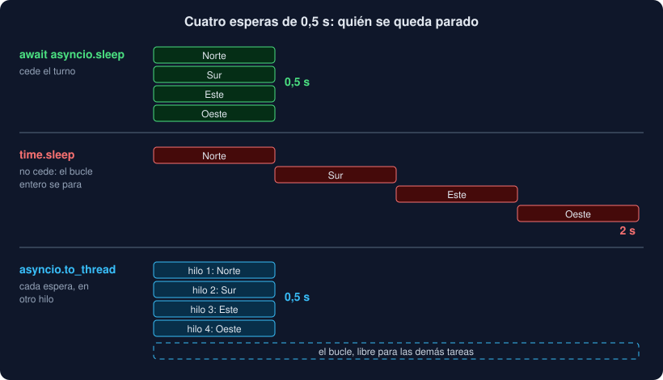

# 04 · Coordinar tareas y no bloquear el bucle

⏱️ 50 min

## 🎯 Objetivos

- Limitar cuántas tareas trabajan a la vez con un `Semaphore`.
- Reconocer una carrera entre tareas y evitarla con `asyncio.Lock`.
- Repartir trabajo con `asyncio.Queue`, con contrapresión y con `shutdown`.
- Reconocer lo que bloquea el bucle y sacarlo con `to_thread` o con procesos.
- Encontrar lo que bloquea con el modo debug y con ruff.

---

## 1. Las herramientas de `asyncio`

`asyncio` tiene sus propias versiones de las herramientas de `threading` de la semana 16. Se usan igual, pero sus esperas son `await`, así que no bloquean el bucle:

| `threading` / `queue` | `asyncio` | Para qué |
|---|---|---|
| `Lock` | `asyncio.Lock` | Una sola tarea a la vez en un bloque |
| `Semaphore` | `asyncio.Semaphore` | Como mucho N tareas a la vez |
| `Event` | `asyncio.Event` | Una señal para todas las que esperan |
| `Barrier` | `asyncio.Barrier` | Esperar a que lleguen N tareas |
| `queue.Queue` | `asyncio.Queue` | Pasar trabajo de unas tareas a otras |

**No las mezcles.** Un `threading.Lock` dentro de una corrutina bloquea el hilo, y con él todas las tareas. Y las de `asyncio` no son seguras entre hilos: solo sirven para tareas del mismo bucle.

## 2. `Semaphore`: no saturar al otro lado

Con `asyncio` es muy fácil lanzar diez mil tareas a la vez. Al otro lado puede haber un servidor que acepta veinte conexiones, o un sistema con un máximo de archivos abiertos. Un `Semaphore(n)` tiene `n` permisos:

```python
semaphore = asyncio.Semaphore(4)


async def guarded(path: Path) -> FileReport:
    async with semaphore:          # coge un permiso, o espera a que quede uno
        return await watch_file(path)
```

Se crean todas las tareas, pero solo cuatro pasan del `async with` a la vez. Las demás esperan sin gastar nada. Es lo que hace `watch_files` con `limit`, y el `--limite` de `vigilar`.

## 3. Carreras sin hilos

En la teoría 01 viste que una tarea solo pierde el turno en un `await`. Así que este código es seguro, sin ningún cerrojo:

```python
active += 1
peak = max(peak, active)   # entre estas dos líneas no hay await: nadie se cuela
```

Pero este no:

```python
current = self.value
await asyncio.sleep(0)     # ← aquí puede entrar otra tarea
self.value = current + 1
```

Las tres condiciones de una carrera de la semana 16 se cumplen: datos **compartidos**, alguien que los **modifica**, y una operación **no atómica**. La diferencia es que aquí "no atómica" significa "con un `await` en medio". Con cien tareas, las cien leen 0 antes de que ninguna escriba, y el resultado es 1 (ejercicio 03, paso 2).

La solución es la misma idea: un `asyncio.Lock` que mantenga juntas la lectura, la espera y la escritura. Y la mejor estrategia también es la misma: **no compartir**. `watch_file` crea su propia `Series`, devuelve un `FileReport` inmutable y no toca nada de nadie.

## 4. `Queue`: productores y consumidores

`asyncio.Queue` pasa elementos de unas tareas a otras. `await queue.get()` espera hasta que haya algo; `await queue.put(x)` mete un elemento.

```python
async def consumer(queue: asyncio.Queue[Path]) -> None:
    while True:
        path = await queue.get()
        try:
            await process(path)
        finally:
            queue.task_done()
```

Tres ideas:

- **`task_done` y `join`**: cada `get` debe tener su `task_done()` cuando el elemento está procesado. `await queue.join()` espera a que todos los elementos que entraron estén procesados.
- **Contrapresión** (*backpressure*): con `Queue(maxsize=10)`, `put` espera cuando la cola está llena. Si el productor va más rápido que los consumidores, se frena en lugar de llenar la memoria.
- **`shutdown`** (Python 3.13): `queue.shutdown()` cierra la cola. Los `get` siguientes vacían lo que queda y después lanzan `asyncio.QueueShutDown`; los consumidores lo capturan y terminan solos. `shutdown(immediate=True)` además descarta lo que quedaba.

Un `TaskGroup` con varios consumidores, un productor y `shutdown` al final es el patrón de un recolector: el productor descubre trabajo (archivos, URL) y los consumidores lo hacen, como mucho N a la vez.

## 5. Lo que bloquea el bucle

Todo el modelo depende de una promesa: **cada tarea cede el turno pronto**. Una sola tarea que no cede para el bucle entero. Las demás no avanzan, los plazos de `timeout` no vencen a tiempo y las cancelaciones no llegan.



Lo que bloquea:

| Bloquea | En su lugar |
|---|---|
| `time.sleep(s)` | `await asyncio.sleep(s)` |
| `requests.get(url)` | Un cliente asíncrono: `httpx.AsyncClient` (semana 18) |
| Leer o escribir archivos con `open` | `await asyncio.to_thread(función)`; para archivos pequeños y locales, a veces se acepta |
| Un driver de base de datos síncrono | Su versión asíncrona |
| Un cálculo largo en Python | Un proceso: `loop.run_in_executor(ProcessPoolExecutor(), función)` |
| `input()` | Leerlo en otro hilo con `to_thread` |

## 6. `to_thread` y los procesos

`asyncio.to_thread(función, *args)` ejecuta una función **normal** en un hilo del *pool* por defecto del bucle, y te devuelve una corrutina que puedes esperar:

```python
lines = await asyncio.to_thread(open_file(path).lines)
```

Mientras el hilo espera al disco, el bucle atiende a las demás tareas. Fíjate en que se pasa la **función**, sin llamarla. `to_thread(open_file(path).lines())` leería el archivo **antes**, en el bucle, y después intentaría llamar a la lista.

Con el GIL, `to_thread` solo sirve para **esperas** (E/S): un cálculo en otro hilo sigue compitiendo por el GIL (semana 16). Para cálculo, el *pool* de procesos de la semana 16 también se puede esperar desde `asyncio`:

```python
loop = asyncio.get_running_loop()
with ProcessPoolExecutor() as pool:
    reports = await asyncio.gather(
        *(loop.run_in_executor(pool, report_file, path) for path in paths)
    )
```

`run_in_executor` convierte el `Future` de `concurrent.futures` en uno que se puede esperar con `await`.

## 7. Encontrar lo que bloquea

Dos herramientas:

- **ruff** tiene reglas `ASYNC` que se activan solas: `ASYNC251` avisa de `time.sleep` dentro de una `async def`, y otras de `open()` o de llamadas de red que bloquean. Solo ve lo que está **escrito** dentro de la corrutina, no lo que pasa en las funciones a las que llama.
- **El modo debug**: `asyncio.run(main(), debug=True)` o la variable `PYTHONASYNCIODEBUG=1`. El bucle mide cuánto tarda cada paso de cada tarea y avisa por stderr si alguno pasa de 0,1 s: `Executing <Task ...> took 0.201 seconds`. Este sí ve lo que se esconde en otras funciones.

---

## ⚠️ Errores comunes

| Error | Causa | Solución |
|---|---|---|
| Con `Semaphore(2)`, corren todas a la vez | La espera está fuera del bloque `async with semaphore:` | El trabajo que se limita va dentro |
| Un contador entre tareas pierde sumas | Lee, hace `await` y escribe | `asyncio.Lock`, o no compartir: cada tarea devuelve su resultado |
| El programa se cuelga con un `threading.Lock` | Lo tiene una tarea parada en un `await`, y otra lo pide bloqueando el hilo | `asyncio.Lock` |
| `await queue.join()` no vuelve nunca | Falta un `task_done()` por cada `get()` | `task_done()` en un `finally` |
| Todo va lento, aunque cada tarea "espera" | Alguna llamada bloquea el bucle | Modo debug para encontrarla; `to_thread` o una biblioteca asíncrona |
| `TypeError: 'list' object is not callable` en `to_thread` | Pasaste el resultado de la función, no la función | `to_thread(objeto.lines)`, sin paréntesis |

---

## ✅ Qué debes saber al terminar

- [ ] Qué herramienta de `asyncio` corresponde a cada una de `threading`, y por qué no se mezclan.
- [ ] Para qué sirve el `Semaphore` de `watch_files`.
- [ ] Por qué hay carreras sin hilos, y cuándo un bloque es seguro sin cerrojo.
- [ ] Cómo funcionan `task_done`, `join`, `maxsize` y `shutdown` en una cola.
- [ ] Qué bloquea el bucle, y qué usar en su lugar.
- [ ] Cómo encontrar lo que bloquea con ruff y con el modo debug.

---

## 🔗 Navegación

| Anterior | Actual | Siguiente |
| -------- | ------ | --------- |
| [03 · Tiempo límite y cancelación](03-tiempo-limite-y-cancelacion.md) | **04 · Coordinar tareas y no bloquear el bucle** | [05 · Iteradores, gestores y probar código asíncrono](05-iteradores-gestores-y-probar-codigo-asincrono.md) |
